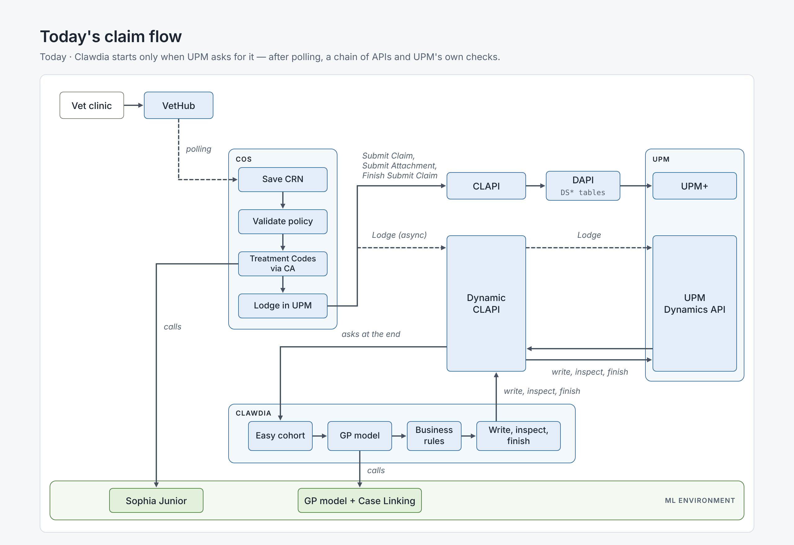
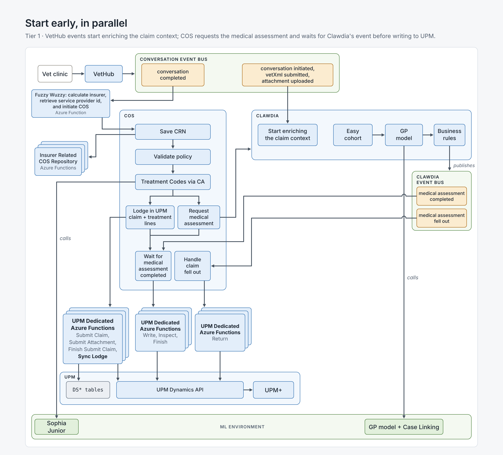
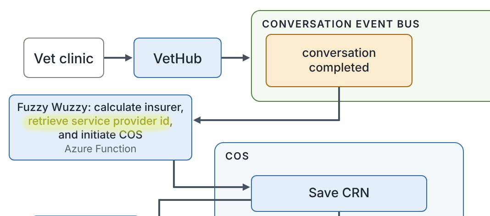
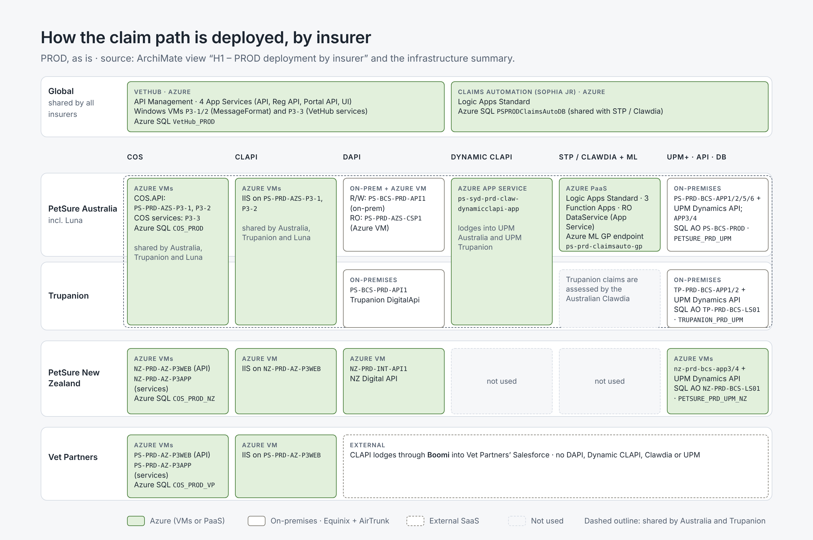
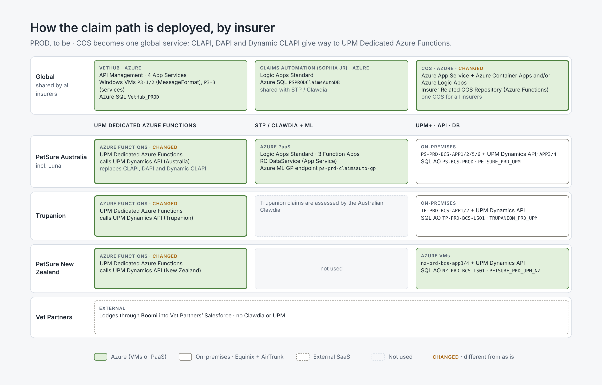
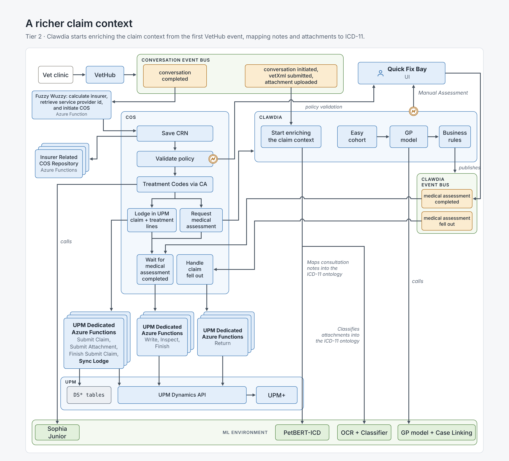
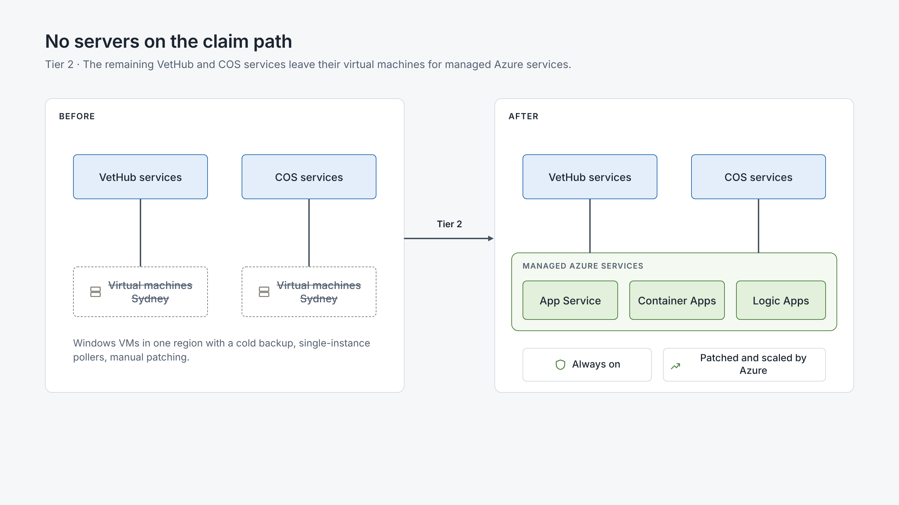
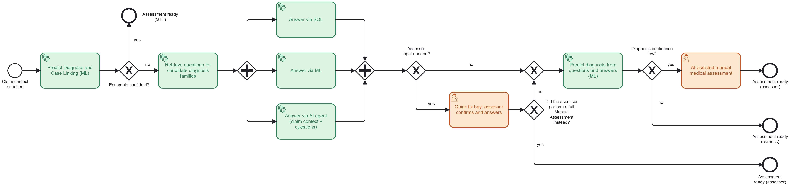
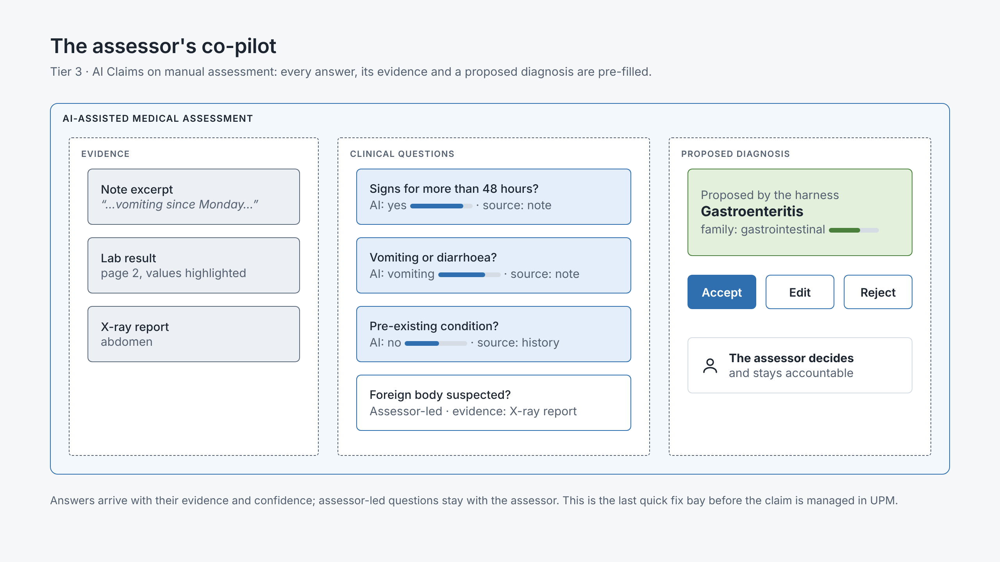
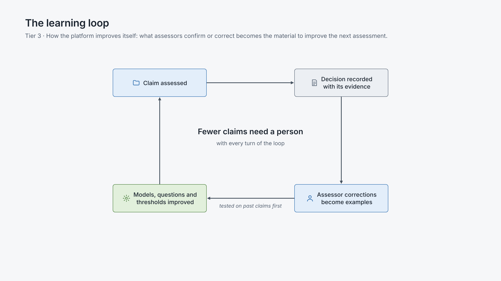

# AI CAsH — Architecture Vision

| | |
|---|---|
| **Initiative** | Horizon 1 – Claims Automation – Continuous STP Uplift |
| **Author** | Danilo (Domain Architect, STP 90) |
| **Status** | Draft for stakeholder review · v0.3 · 13 Nov 2026 |
| **Audience** | Management and semi-technical stakeholders |
| **Detail** | [AI CAsH high-level solution](cash-high-level-solution.md) · [solutions](solutions/) · [changes](changes/) |

**How to read this document.** Section 1 is the vision on one page. Sections 2–4 open each tier one level deeper: one picture per idea, a few lines to explain it, and a link to the detail. Section 5 lists the questions we expect and where the answers are. Pictures follow the PetSure Architecture Diagrams style; their source is described in [Appendix A](#appendix-a--picture-sources).

> **Disclaimer**
>
> - **An aspirational design, built from incremental changes.** The target is reached through small, independent changes. It is easier to work out the impact of removing a change on the fly than to add one at the last moment.
> - **Not every decision has been taken yet.** As the solution is shared with stakeholders, missing aspects and potential flaws will emerge. They will be addressed before the solution is finalised.
> - **Some solutions are not complete yet.** Wherever possible, the missing aspects are documented in this document. As per the point above, any gap that emerges while sharing the solution with stakeholders will be recorded and addressed.
> - **Business continuity is always taken into consideration,** but it needs a deeper analysis once there is enough consensus on the solution.

---

## 1. Vision on a page

> **A simpler, more resilient Go Tech platform where every claim starts its medical assessment as soon as the vet sends it, AI completes what the models can't, and people step in only for the one thing that needs them.**

**Where we are today**

- The automated medical assessment (**Clawdia**) starts only when UPM asks for it, at the end of a long chain of polling and API hops.
- STP25 (Dec 2026) raises the ceiling with improvements on the GP model and the Case Linking models. Going further needs a platform where AI can work safely and learn.

### Business drivers — applying these changes will:

| # | Driver | What changes | Why it matters |
|---|---|---|---|
| **D1** | **Make the Go Tech platform more resilient and faster to change** | • Remove the polling between VetHub and COS • Keep **one** copy of each attachment (today VetHub and COS each store it in blob storage) • Move from virtual machines to managed Azure services (App Service, Container Apps, Logic Apps) • Write the claim in UPM once and simplify the chain of APIs (CLAPI → DAPI) | Fewer moving parts and fewer failure points; lower run and storage cost; less key-person risk; ready for higher claim volumes |
| **D2** | **Enhance Medical Assessment Flow** | • Clawdia starts when Conversation in VetHub is received • Enable Clawdia to use more flexible use of model and data from attachments. Clawdia no longer writes directly into UPM. • COS gets the diagnosis from Clawdia,  it duplicate the invoice line items and hands the claim to UPM | The assessment starts as soon as the VPMS conversation is initiated, not at the end of the chain; we can evolve the assessment without waiting on the UPM claim lifecycle |
| **D3** | **Master Service Provider Data** | • Solve multiple service provider IDs (one VetHub clinic can be several UPM service providers) | Trupanion claims stop pointing at the wrong clinic and can be automated; Correct Service Provider Registration in Catch; prepare the foundations for Service Provider Master Data |
| **D4** | **Flexible Human and AI Workflow** | • **How AI gets its data:** a *claim context* — everything about one claim in one safe, auditable place • **How it improves itself:** Introduce an automatic audit process analysis and improvement proposal • **A possible approach:** Once the diagnosis family is identified, the system will load relevant questions to identify the exact diagnosis for that family, AI will answer to those questions, then the system will present relevant questions and answers to an ML model which will predict the diagnosis  • **The role of today's data and ML:** the GP and case linking models stay the first line and tell AI where to look; In Claims AI, ML will be used to enrich the claim context transforming the clinical notes into structured clinical information and performin OCR and classification on the attachments. | More claims settled without manual work; lower cost per claim; consistent, explainable decisions, a process that can evolve via configuration |

### The journey in three tiers

| Tier | In one line | Business outcome |
|---|---|---|
| **1 · Quick wins** | Start the assessment earlier, driven by events | Build the foundations of the new event-driven architecture; less plumbing; first steps to managed services |
| **2 · Round 2 - dependencies** | Give the assessment richer data and give people one place to fix exceptions | Better-informed models; Quick Fix Bay foundations (UI for AI Assisted Manual Medical Assessment and Policy Number Correction. Note: Analysis TBC); no virtual machines left on the claim path |
| **3 · AI Claims** | AI completes the medical assessment; people fix only what's needed | From "STP or manual" to "targeted help, then automation resumes" |

Each tier is useful on its own and prepares the next. 

**Guardrails:** Automated-first approach and reduce human effort on the manual interventions · benefit calculation and payment stay in UPM · small, reversible steps, no big-bang re-architecture.

**What we ask today:** agreement on the vision, the drivers and the order of the tiers. Dates, costs and STP targets come with the roadmap that follows this agreement.

---

## 2. Tier 1 — Quick wins: start earlier, on events

Small-to-medium changes with no regrets. They deliver the first set of dependencies for AI Claims: business events, and a medical assessment that no longer depends on UPM to start. **No ML change in this tier.**

### 2.1 COS starts the medical assessment early

**Today**

*COS polls VetHub, validates the policy, gets the treatment codes and lodges the claim in UPM through CLAPI, DAPI and Dynamic CLAPI. Clawdia starts only when UPM asks for it, at the end of the chain, and writes the diagnosis back into UPM itself.*

**Tier 1**

*VetHub publishes its events on the conversation event bus. Clawdia starts enriching the claim context from the first event; COS starts the claim on "conversation completed". After the treatment codes, COS requests the medical assessment and, in parallel, lodges the claim and treatment lines in UPM. When Clawdia publishes "medical assessment completed", COS writes, inspects and finishes the claim in UPM. Dedicated Azure Functions per UPM replace CLAPI, DAPI and Dynamic CLAPI.*

Changes behind it: [ABC-04 Remove polling from VetHub to COS](changes/abc-04-remove-polling-vethub-cos.md) (introduces the events) · [ABC-03 Decouple UPM / Clawdia](changes/abc-03-decouple-upm-clawdia.md) · [ABC-06 Remove dependencies on CLAPI and DAPI](changes/abc-06-remove-clapi-dapi-dependencies.md)

### 2.2 VetHub Service Provider 1:N UPM Service Provider Id

*The VPMS sends the service provider id as the VetHub GUID from the VetHub Service Providers table. That table has a 1:1 relationship with the UPM service provider id, because at the start there was only one UPM: Australia.*

*With the move to an event-driven architecture, the GUID travels in the VetXml. We can therefore ignore the UPM id saved in VetHub. The Azure Function that handles the Conversation Completed event runs the fuzzy-matching (FuzzyWuzzy) function, performs an automated correction of the policy id and works out which UPM should process the claim. Australia is the default, with the chance to reflow the claim if the policy has to be validated manually.*

*This solution moves COS closer to becoming a global platform instead of an insurer-specific one. It is also an opportunity to refactor COS into Logic Apps and make it a global service.*

Changes behind it: [ABC-02 Service Provider Master Data](changes/abc-02-service-provider-master-data.md) (solution owner **[TBC]**)

### 2.3 Current infrastructure topology (as is), by insurer

Each insurer has its own way through the claim path. VetHub and Claims Automation are shared by everyone; COS, CLAPI, DAPI and UPM+ are deployed per insurer (with PetSure Australia, Trupanion and Luna sharing the Australian stack); STP / Clawdia only serves the Australian stack. Everything in Azure runs in one region, Australia East (Sydney). Source: ArchiMate view *H1 – PROD deployment by insurer* in [`archi/h1.archimate`](../../archi/h1.archimate) and the [infrastructure summary — as is](../infrastructure/infrastructure-summary-as-is.md).

| Insurer | COS and CLAPI | DAPI | Dynamic CLAPI | STP / Clawdia + ML | UPM+ (incl. UPM Dynamics API and database) |
|---|---|---|---|---|---|
| **PetSure Australia** (incl. Luna) | Azure VMs `PS-PRD-AZS-P3-1/2` (COS.API, CLAPI) and `P3-3` (COS services); Azure SQL `COS_PROD`. **Shared with Trupanion and Luna** | R/W on-premises `PS-BCS-PRD-API1`; RO on Azure VM `PS-PRD-AZS-CSP1` | App Service `ps-syd-prd-claw-dynamicclapi-app`, **shared with Trupanion** | Azure PaaS: Logic Apps Standard, 3 Function Apps, ReadOnly DataService (App Service), Azure ML GP endpoint | On-premises (Equinix + AirTrunk): BC servers `PS-PRD-BCS-APP1/2/5/6` (with UPM Dynamics API) and `APP3/4`; SQL Always On `PS-BCS-PROD`, database `PETSURE_PRD_UPM` |
| **Trupanion** | Uses the Australian COS and CLAPI | On-premises `PS-BCS-PRD-API1` (Trupanion DigitalApi) | Uses the Australian Dynamic CLAPI | Claims assessed by the Australian Clawdia | On-premises: BC servers `TP-PRD-BCS-APP1/2` (with UPM Dynamics API); SQL Always On `TP-PRD-BCS-LS01`, database `TRUPANION_PRD_UPM` |
| **PetSure New Zealand** | Azure VMs `NZ-PRD-AZ-P3WEB` (COS.API, CLAPI) and `NZ-PRD-AZ-P3APP` (COS services); Azure SQL `COS_PROD_NZ` | Azure VM `NZ-PRD-INT-API1` | Not used | Not used | Azure VMs (landing zone): BC servers `nz-prd-bcs-app3/4` (with UPM Dynamics API); SQL Always On `NZ-PRD-BCS-LS01`, database `PETSURE_PRD_UPM_NZ` |
| **Vet Partners** | Azure VMs `PS-PRD-AZ-P3WEB` (COS.API, CLAPI) and `PS-PRD-AZ-P3APP` (COS services); Azure SQL `COS_PROD_VP` | Not used — CLAPI lodges through **Boomi** into Vet Partners' Salesforce | Not used | Not used | No UPM |

**Shared by all insurers**

- **VetHub:** API Management `ps-prod-apim-vethub` and four App Services (API, Reg API, Portal API, UI) in the landing zone; MessageFormat.API on Windows VMs `PS-PRD-AZS-P3-1/2` and the VetHub Windows services on `P3-3`; Azure SQL `VetHub_PROD`.
- **Claims Automation (Sophia Jr):** Logic Apps Standard; Azure SQL `PSPRODClaimsAutoDB`, also used by STP / Clawdia.
- **Platform:** one Azure SQL logical server (`petsure-production`) hosts the VetHub, COS and Claims Automation databases; Service Bus (NServiceBus) and Event Grid; the landing-zone hub (Azure Firewall, ExpressRoute to AirTrunk, DNS Private Resolver) connects Azure to the on-premises UPM+ Australia and UPM+ Trupanion.

**What this means for the vision**

- **Every insurer adds a stack.** COS, CLAPI and DAPI are duplicated per insurer on Windows VMs, and each insurer has a different back end (on-premises UPM, Azure UPM, or Salesforce through Boomi). This is the opposite of a global platform, and the reason to move COS to a global, insurer-aware service (see 2.2).
- **The claim path depends on Windows VMs in one region with a cold backup** (COS, CLAPI, VetHub services, DAPI RO and NZ), on .NET Framework, with single-instance pollers. This is what the move to managed services in Tiers 1–2 removes.
- **STP / Clawdia only serves the Australian stack** (PetSure Australia, Trupanion, Luna). New Zealand and Vet Partners get no automated medical assessment today.
- **UPM+ Australia and UPM+ Trupanion are on-premises**, so every call from Azure to them crosses ExpressRoute. The dedicated Azure Functions per UPM keep that hop in one place.

### 2.4 Infrastructure topology (to be), by insurer

COS moves into the global layer: one insurer-aware COS for every insurer, on Azure App Service plus Azure Container Apps and/or Azure Logic Apps, with insurer-specific data behind the Insurer Related COS Repository. CLAPI, DAPI and Dynamic CLAPI are removed. Each UPM instance (Australia, Trupanion, New Zealand) is reached only through its own UPM Dedicated Azure Functions, which call that instance's UPM Dynamics API. STP / Clawdia, UPM+ and the Vet Partners path through Boomi stay as they are.

> [!IMPORTANT]
> **❓ Open question for the business**
>
> ***Is there any business appetite to increase automation in New Zealand?***
>
> Today PetSure New Zealand has no STP / Clawdia. With a global COS and dedicated UPM functions in place, the platform no longer stands in the way; the answer decides whether New Zealand joins the automated medical assessment.

**Tier 1 outcome:** assessment off the critical path · no VetHub → COS polling · fewer integration hops · first business events in place · COS.API on a managed service.

---

## 3. Tier 2 — Round 2: richer data, a place for people, a managed platform

Medium-size changes that build on Tier 1's events and early start.

### 3.1 A richer claim context (AI Claims readiness)

**Before — Tier 1**

**After — Tier 2**

*Today models don't see what an assessor reads: the clinical notes and the attachments. In Tier 2, "Start enriching the claim context" calls two new models in the ML environment: PetBERT-ICD maps the consultation notes into the ICD-11 ontology, and OCR + Classifier classifies the attachments into the ICD-11 ontology. The GP model then uses this richer context. This is also the data AI will need in Tier 3.*

*When Clawdia can't complete the assessment, an error is caught and the claim goes to the Quick Fix Bay for a manual assessment; the bay then publishes "medical assessment completed", so COS carries on as usual. A failed policy validation in COS goes to the Quick Fix Bay too.*

Changes behind it: [ABC-01A OCR and attachment classification](changes/abc-01-ml-improvement.md#abc-01a--ml-improvement--ocr-and-attachment-classification) · [ABC-01B Clinical information extraction](changes/abc-01-ml-improvement.md#abc-01b--ml-improvement--clinical-information-extraction) · [ABC-07 Enrich the claim context](changes/abc-07-enrich-claims-clinical-information-attachment-classification.md) · [ABC-01C GP model on the enriched context](changes/abc-01-ml-improvement.md#abc-01c--ml-improvement--gp-model-on-the-enriched-claim-context)

### 3.2 Quick Fix Bay foundations

> **Analysis to be completed.** The Quick Fix Bay is described here as a direction, not as a finished design.

*A quick fix bay is where a person resolves the one issue that stopped the automation, then hands the claim back. Tier 2 introduces two bays:*

- **Manual assessment.** The UI should put the relevant information at the assessor's fingertips. It should be AI-assisted, so we can explore features such as generative UI and other uses of AI to support the assessor. To keep business continuity, the AI-assisted manual assessment does not need any integration with the tool that notifies users about a policy validation or a fall-out (today the CATCH notification flow: Event Grid → Catch Notification Function App → SignalR **[tool to confirm]**).
- **Policy validation.** The UI can be very simple, but this feature has a hard dependency on the task-allocation features implemented today in CATCH. **More analysis is required for this feature.**

Changes behind it: [ABC-10 Claim Visualiser](changes/abc-10-claim-visualiser.md) · [ABC-08 Introduce quick fix bays](changes/abc-08-introduce-quick-fix-bays.md) · [ABC-09 Decommission CATCH](changes/abc-09-decommission-catch.md)

### 3.3 Complete the move to managed services

> [!Note]
> **This change could be part of Tier 1 as well**

*The remaining VetHub and COS services leave their virtual machines for managed Azure services. Azure takes care of patching, scaling and availability, and we remove single points of failure from the claim path.*

*COS.API moves to App Service. Some COS services need an upgrade and a strong refactor, so instead of re-hosting them we could decommission them directly and move COS to Logic Apps (**further analysis is required**).*

Changes behind it: [ABC-15 Re-host remaining VetHub VMs](changes/abc-15-rehost-vethub-remaining-vms.md) · [ABC-16 Re-host COS services](changes/abc-16-rehost-cos-services.md)

**Tier 2 outcome:** every claim carries typed attachments and traceable clinical facts · the GP model uses them · exceptions are worked in one place · CATCH is retired · no virtual machines left on the claim path.

---

## 4. Tier 3 — AI Claims

Clawdia becomes the **AI Claim Assessment Harness**: the layer that puts models, AI agents and rules to work under control, brings people in at defined points and records why each decision was made.

### 4.1 AI Claims on STP — the AI-driven medical assessment

*When the models aren't confident, the claim no longer drops to manual. The harness asks the clinical questions that matter for the likely diagnosis families and answers them in parallel — from data, ML or an AI agent. A person only confirms AI answers or answers the questions that need clinical judgement. The diagnosis is then predicted from all the answers.*

Changes behind it: [ABC-11 Questions and answers per diagnosis family](changes/abc-11-questions-answers-diagnosis-family.md) · [ABC-01D Question answering](changes/abc-01-ml-improvement.md#abc-01d--ml-improvement--question-answering) · [ABC-01E Diagnosis from questions and answers](changes/abc-01-ml-improvement.md#abc-01e--ml-improvement--diagnosis-from-questions-and-answers) · [ABC-12 Quick fix bays for answers](changes/abc-12-quick-fix-bays-for-answers.md) · [ABC-14 Specialist models](changes/abc-14-specialist-models.md)

### 4.2 AI Claims on manual assessment — the AI-assisted assessor

*For the claims that still need a person, the assessor no longer starts from a blank page. Every answer, its evidence and a proposed diagnosis are pre-filled; the assessor accepts, edits or rejects. It is the last quick fix bay before the claim is managed in UPM.*

Changes behind it: [ABC-13 AI-assisted manual medical assessment](changes/abc-13-ai-assisted-manual-medical-assessment.md)

### 4.3 How the platform improves itself

*Every decision is recorded with its evidence. What assessors confirm or correct in the bays becomes examples to improve the models, the questions and the confidence thresholds, which are tested on past claims before release. Over time, fewer claims need a person.*

Detail: [SOL-4 — AI operating model hooks](solutions/ai-claim-assessment-harness.md#6-ai-operating-model-hooks) · [Claim Context tool](solutions/tools/claim-context-high-level-solution.md)

**Tier 3 outcome:** from "STP or manual" to "targeted help, then automation resumes" · new models plug into the existing ML router · every AI-assisted decision is explainable.

---

## 5. Questions we expect

Short answers, so the conversation can stay on the vision. Detail is one click away.

| Question | Short answer | Detail |
|---|---|---|
| How much STP uplift, and when? | Not estimated yet. Baselines and estimates come from H1 discovery and the ML team, then the roadmap. | [OQ-01, OQ-10](cash-high-level-solution.md#61-open-questions) |
| Will AI decline claims? | No. AI proposes or approves; declines stay with people. | [Principles](cash-high-level-solution.md#5-architecture-principles-applied) |
| Does this replace UPM? | No. Benefit calculation and payment stay in UPM; the assessment just stops depending on it. | [SOL-4 out of scope](solutions/ai-claim-assessment-harness.md#7-out-of-scope) |
| Why not go straight to Tier 3? | AI needs the events, the early start and the richer data that Tiers 1–2 deliver; each tier also pays back on its own. | [Dependencies](cash-high-level-solution.md#34-dependencies-between-changes) |
| Which LLM, and where does it run? | Open; doesn't change the vision. | [OQ-06](cash-high-level-solution.md#61-open-questions) |
| Service Bus or Event Grid? | Open; a technical choice inside Tier 1. | [OQ-02](cash-high-level-solution.md#61-open-questions) |
| Do clinical notes and attachments really improve the models? | It's an assumption we will test before relying on it. | [OQ-09](cash-high-level-solution.md#61-open-questions) |

**Differences from the high-level solution v0.3** (to align in its next version): the re-host of the remaining VetHub and COS services (ABC-15, ABC-16) moves from Tier 3 to Tier 2; the single attachment store is a new change not yet in [`changes/`](changes/).

---

## Appendix A — Picture sources

The pictures are PNG exports (at 2× scale) of the artboards on the **AI CAsH Vision Pictures** Design canvas on claude.ai, drawn in the **PetSure Architecture Diagrams** style:

- **Colour is layer:** blue = application, green = platform / technology, amber = outcome or event, grey = data, white = external.
- **Retired** parts are dashed and struck through (colour is never used for status).
- Files live in [`diagrams/`](diagrams/) as `vision-*.png`. To change a picture, edit its artboard on the canvas and re-export it under the same name.
