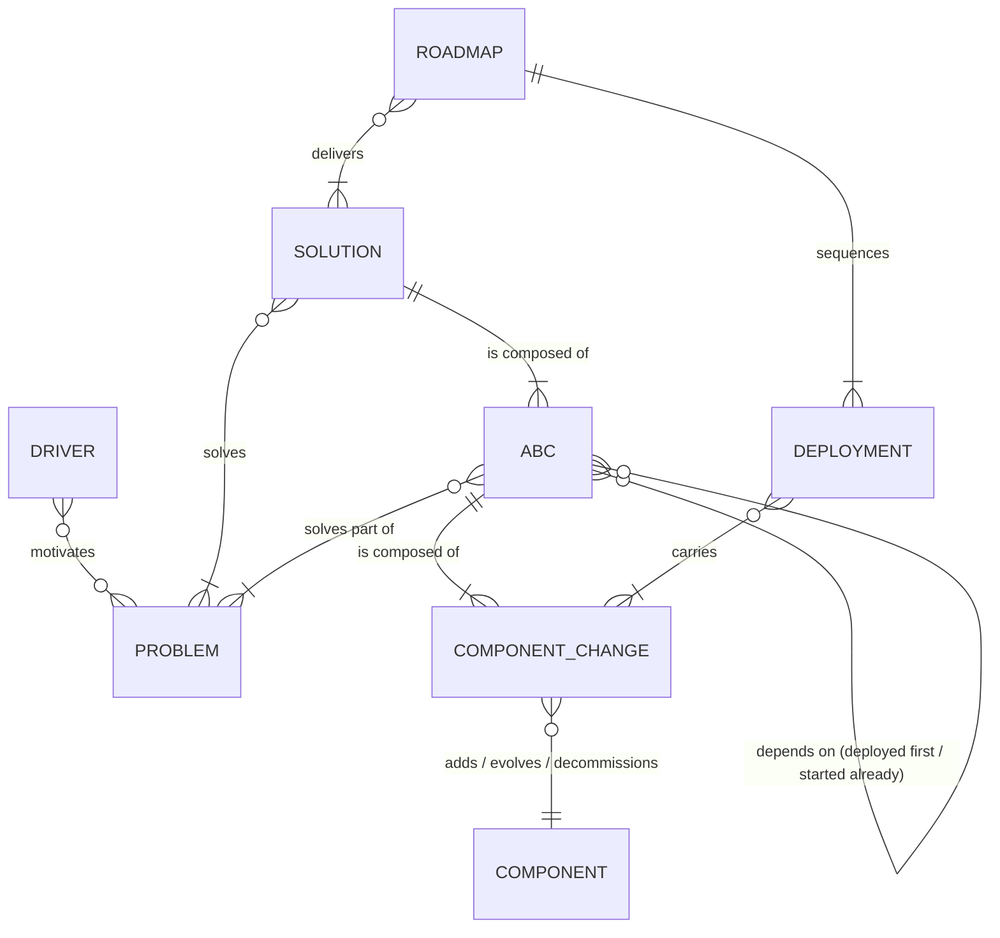
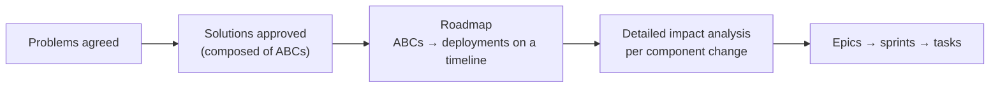
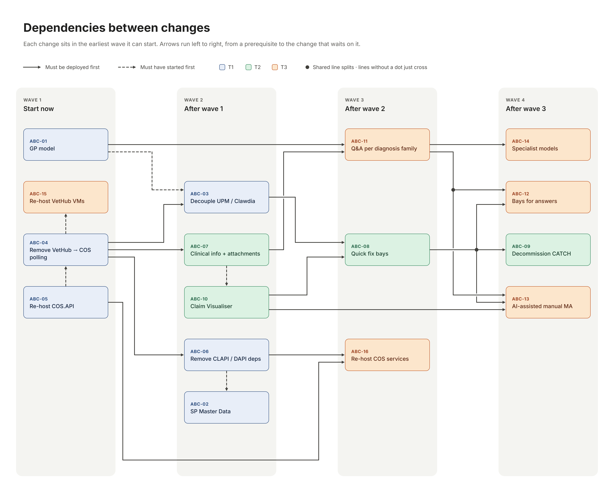
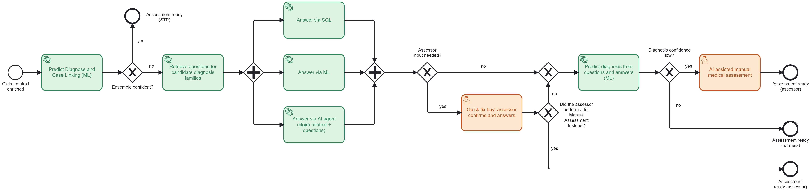
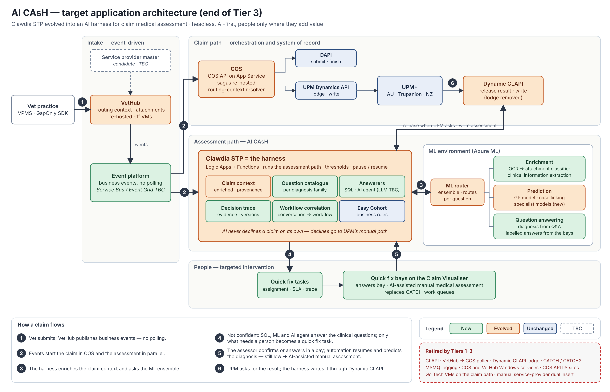

# AI Claim Assessment Harness (AI CAsH) — High-level solution

| | |
|---|---|
| **Initiative** | Horizon 1 – Claims Automation – Continuous STP Uplift |
| **Proposal** | AI Claim Assessment Harness (AI CAsH): vision and three tiers of change |
| **Author** | Danilo (Domain Architect, STP 90) |
| **Status** | Draft for team review |
| **Version** | 0.3 · 3 Nov 2026 |
| **Builds on** | [Earlier Birds — high-level solution](<../../solutions/earlier birds/Earlier birds - high-level solution.md>), [Go Tech component architecture and App Service readiness](../infrastructure/go-tech-components/README.md), [90% STP Architecture Vision — Business Motivation Model (BMM)](<../90_ STP Architecture Vision — Business Motivation Model.md>), [Horizon 1 Form](<../../Business point of view/Horizon 1 Form - Claims Automation - Continuous STP Uplift.md>) |

**Conventions:** **[TBC]** = to be confirmed. **TODO** = content still to be written. BMM references (D = driver, O = objective, S/T = strategy/tactic, AP = principle, PO = policy) point to the [90% STP BMM](<../90_ STP Architecture Vision — Business Motivation Model.md>). Terms are defined in [1.2 Terminology](#12-terminology). Architectural and behavioural change pages live in [`changes/`](changes/), solution pages in [`solutions/`](solutions/), diagrams in [`diagrams/`](diagrams/).

**Version history:** 0.1 — first draft. 0.2 — sub-items reframed as architectural and behavioural changes; concepts added; landscape problems revised; phases aligned with the tiers. 0.3 — AI CAsH definition clarified; terminology added; ML changes moved out of Tier 1 and regrouped as *ML Improvement* sub-changes (ABC-01A…E) in Tiers 2 and 3; claim context enrichment runs in the ML environment behind the ML router; Tier 3 assessment path as a BPMN process; drivers and solutions written out in full; dependency map image; open questions reviewed.

---

## 1. Introduction

### 1.1 Purpose

Today a claim is either processed straight through (STP) or it falls out to a **full manual assessment** in UPM. Nothing sits in between, and Clawdia STP — the automated medical assessment — only starts once UPM asks for it, at the end of a long, serial, polling-based pipeline.

**AI CAsH (AI Claim Assessment Harness)** is the solution that turns **Clawdia STP into an AI harness for claim medical assessment**. Its purpose is to close the gap between the claims the ML environment can assess with confidence and the claims that today go to manual assessment in UPM. When the model ensemble is not confident, AI CAsH does not hand the whole claim to a person. Instead it:

1. retrieves the clinical questions that matter for the candidate diagnosis families proposed by the GP model;
2. answers those questions in parallel from the claim context, using SQL queries, ML models and AI agents;
3. asks an assessor, through a **quick fix bay**, only for what needs a person: confirming AI-agent answers and answering assessor-led questions;
4. predicts the diagnosis from the questions and answers;
5. sends the claim to an **AI-assisted manual medical assessment** only when the confidence is still low.

A **harness** here is the orchestration layer that puts models, agents and rules to work under control: it decides what runs and in which order, collects every answer with its evidence and confidence, applies the thresholds, brings people in at defined points, and records a trace of each decision. AI CAsH is **headless** (it has no UI of its own; people work in the quick fix bays) and **AI-first**, in line with the vision of the 90% STP Business Motivation Model: *"A headless, AI-first claims platform that automates the customer journey across multiple insurers, with humans in the loop."*

The proposal is split into **three tiers of change**, each useful on its own and each preparing the platform for the next. This follows the H1 Form's guidance — capture near-term value within the existing architecture, prioritise reusable capabilities, and defer material re-architecture until the residual automation opportunity is understood (H1 Form, *Purpose* and *Risks*) — and BMM principle **AP2 Pragmatism over perfection**: *"favour small, reversible changes over big-bang re-architecture"*. At this stage the tiers are also the phases (section 2). A proper roadmap will be built once stakeholders agree on the vision.

### 1.2 Terminology

| Term | Meaning in this document |
|---|---|
| **ABC** | Architectural and behavioural change — see 1.3. IDs `ABC-nn` (or `ABC-01A…E` for the ML Improvement sub-changes). |
| **AI agent** | An LLM-based component that receives the claim context and one question and returns an answer with its evidence. A *System 2* approach (see below). |
| **AI CAsH** | AI Claim Assessment Harness — Clawdia STP evolved into an AI harness for claim medical assessment (1.1). Also the name of SOL-4 and of Tier 3. |
| **AI-assisted manual medical assessment** | The last quick fix bay: an assessor completes the medical assessment with the harness's answers and proposals pre-filled, before the claim is managed in UPM. |
| **Assessor-led question** | A question whose answer stays with an assessor by design (clinical judgement, policy sensitivity, audit). The automation prepares the evidence; the assessor decides. |
| **Attachment classification** | Assigning a type (clinical history, lab result, imaging report, referral, invoice, estimate, other) to each claim attachment, after OCR. |
| **BMM** | Business Motivation Model — an Object Management Group (OMG) standard that structures *why* an organisation changes: drivers, ends (vision, goals, objectives), means (mission, strategies, tactics) and directives (principles, policies). Here it refers to the [90% STP Architecture Vision — BMM](<../90_ STP Architecture Vision — Business Motivation Model.md>) (draft for review, 3 Aug 2026). |
| **BPMN** | Business Process Model and Notation — the standard notation used for the assessment path in 3.5. |
| **C3 / MRC** | Condition code claim / medical record claim. AI CAsH targets medical record claims (clinical notes plus attachments). |
| **Candidate diagnosis family** | A group of related diagnoses (for example gastrointestinal) that the GP model proposes for a condition when it can't settle on one diagnosis code. |
| **CATCH** | The Go Tech claims-team work-queue and notification tool (UI, API, functions, tables in the COS database). Retired in Tier 2. |
| **Claim context** | Everything the assessment knows about a claim: claim and invoice lines, policy, animal case history (including pre-existing conditions), classified attachments and clinical information extracted from the consultation notes. |
| **Claim context enrichment** | Adding attachment classification and clinical information to the claim context (Tier 2, SOL-2). |
| **Claim Visualiser** | Read-only UI that shows the claim from a medical assessment point of view; the base UI of the quick fix bays. |
| **Clawdia STP** | The automated medical assessment (Logic Apps and Functions) that loads the claim, calls the ML environment, applies business rules and writes the result to UPM. |
| **Clinical information extraction** | Turning free-text consultation notes into structured clinical facts (presenting signs, diagnosis candidates, body system, onset, procedures, medications, results), each with its source. |
| **COS / VetHub / UPM** | Claim Orchestration Service / vet-channel gateway / PetSure's insurance ERP (AU and Trupanion instances). |
| **CLAPI / Dynamic CLAPI / DAPI** | Claims API / dynamic routing API to UPM / CSP Digital API that stages claims in UPM's DS tables. |
| **Component change** | One Add, Evolve or Decommission on one component — see 1.3. IDs `ABC-nn.m`. |
| **Easy Cohort** | Deterministic rules in Clawdia STP that assess simple claims without ML. |
| **GP model** | The general-practice diagnosis model: predicts diagnosis codes from the claim context. One of the models behind the ML router. |
| **Case linking model** | The model that links a claim to existing cases / conditions (Condition Linking, STP25). Behind the ML router. |
| **H1 / H2** | Horizon 1 (optimise and scale, FY27–FY28) / Horizon 2 (transform, FY28+) of the claims automation roadmap. |
| **LLM** | Large language model. |
| **ML environment** | The Azure ML environment that hosts the ML router and the models. |
| **ML router (model ensemble)** | An application in a Docker container in the ML environment that runs an ensemble method: it sequences the calls to the models (today the GP model and the case linking model) and combines their results. In Tier 2 it also sequences OCR → attachment classifier. |
| **OCR** | Optical character recognition — turns scanned or image attachments into text before classification. |
| **Quick fix bay** | A place where a person resolves one specific issue that stopped the automation, then hands the claim back to it. |
| **SOL / LP** | Solution / landscape problem — see 1.3 and 2.2. |
| **STP** | Straight-through processing — a claim assessed and settled with no manual intervention. |
| **System 1 / System 2 model** | Terms borrowed from Daniel Kahneman's *Thinking, Fast and Slow*. A System 1 model is fast and returns only structured outputs (choice, yes/no, score) with calibrated probabilities; a System 2 model (a typical LLM) reasons and writes free text, slower and costlier. See [ABC-01D](changes/abc-01-ml-improvement.md#abc-01d--ml-improvement--question-answering). |
| **Tier** | One of the three groups of changes (Quick wins, Round 2, AI CAsH); currently also the phases. |

### 1.3 How the proposal is structured

The proposal uses six concepts. They keep the "why" (problems), the "what" (solutions and architectural changes) and the "how and when" (component changes, deployments, roadmap) separate, so each can be reviewed and approved at the right level.

| Concept | Definition | Where in this proposal |
|---|---|---|
| **Problem** | A condition in today's landscape with an observable effect, motivated by one or more drivers. Problems are stable: they don't depend on the solution chosen. | Landscape problems LP-1…LP-8 (section 2.2) |
| **Solution** | A coherent answer to one or more problems that stakeholders approve as a unit. **A solution is composed of 1..N architectural and behavioural changes.** | [`solutions/`](solutions/) (SOL-1…SOL-4) |
| **Architectural and behavioural change (ABC)** | A change to how the platform is structured or how it behaves (for example "Clawdia starts on a VetHub event" or "COS no longer polls VetHub"). It solves part of one or more problems. **An ABC is composed of 1..N component changes.** An ABC can carry a **category** (for example *ML Improvement*) to group related changes. | [`changes/`](changes/) |
| **Component change** | One **Add**, **Evolve** or **Decommission** on one component (application, service, model, data store, infrastructure). It is the unit of impact analysis. | Section "Component changes" of each ABC, IDs `ABC-nn.m` |
| **Dependency** | An ABC can depend on **0..N** other ABCs, of two kinds: **deployed first** (the other ABC must be live before this one is deployed) or **started already** (work on the other ABC must have begun, for example a contract or a platform decision, but it need not be live). | "Depends on" in each ABC; map in section 3.4 |
| **Roadmap** | How ABCs are combined on a timeline in **multiple deployments**, with the objective of delivering one or more solutions. A deployment can carry component changes from several ABCs. | Tiers for now; the roadmap follows stakeholder consensus |

**Rules**

1. Every ABC solves part of at least one problem and belongs to exactly one solution. An ABC needed by another solution is a **dependency**, not a shared member. An ABC with no solution yet is a **candidate** and must be assigned before approval.
2. A solution is delivered when all its ABCs are deployed. Value can be released earlier: each deployment must leave the platform working (transition state), using strangler-style switch-over for decommissions.
3. Dependencies form no cycles. "Deployed first" constrains the deployment order; "started already" constrains only the start of work.
4. A component change touches one component only. When an ABC changes three components, it has at least three component changes, and they may land in different deployments.
5. Decommissions are planned explicitly, as component changes, with the evidence that no consumer remains.

**From proposal to delivery**

Once the solutions are approved, a detailed impact analysis is applied to each component change (interface, data, performance, security, resilience, observability, infrastructure, dependents — as in the [Earlier Birds impact analysis](<../../solutions/earlier birds/Earlier birds - high-level solution.md>)), and the changes are divided into epics, sprints and tasks. A natural cut is one epic per ABC, with component changes as features or stories.

**ArchiMate mapping** (for the architecture repository)

| Concept | ArchiMate element |
|---|---|
| Driver, problem | Driver, Assessment |
| Solution | Work package (grouping the ABCs), realising Goals / Outcomes |
| ABC | Work package realising a Gap between plateaus |
| Component change | Gap on an application or technology element (add / evolve / decommission) |
| Deployment | Deliverable / Implementation event leading to a transition Plateau |
| Roadmap | Implementation and Migration view (plateaus, work packages, events) |

### 1.4 The three tiers

| Tier | Name | Intent | Solutions |
|---|---|---|---|
| **1** | **Quick wins** | No-regrets platform preparation for AI CAsH | [SOL-1 Early Starter](solutions/early-starter.md) |
| **2** | **Round 2** | Medium-size platform preparation for AI CAsH | [SOL-2 Medical Information Claim Enrichment](solutions/medical-information-claim-enrichment.md) (claim context enrichment and the first GP model improvements) · [SOL-3 Quick Fix Bay](solutions/quick-fix-bay.md) (foundation) |
| **3** | **AI Claim Assessment Harness** | Automated backend medical assessment with targeted human intervention | [SOL-4 AI Claim Assessment Harness](solutions/ai-claim-assessment-harness.md) · [SOL-3 Quick Fix Bay](solutions/quick-fix-bay.md) (expanded) · platform modernisation (**[solution TBC]**) |

---

## 2. The STP landscape: phases

### 2.1 Phases

At this stage **the phases correspond to the tiers**. The first two rows are known; the tier rows are the proposal. Dates and STP targets for the tiers are outputs of H1 discovery and of the roadmap that follows stakeholder consensus.

| Phase | Status | STP | Automation paradigm | What characterises it |
|---|---|---|---|---|
| **Today** | Live | ~17.5 % (H2 Form, Sep-26 PSC) | **STP or manual** | Automation limited to annual or $0 condition-based excess policies. Clawdia STP (Easy Cohort, then the ML router) starts only when UPM requests the assessment. Any doubt → full manual assessment in UPM. |
| **STP25** | In delivery, Dec 2026 (H2 Form, $321k) | 25 % target; ~22–23 % forecast post-Bingo | STP or manual | The case linking model (Condition Linking) joins the GP model behind the ML router and makes non-$0 condition-based excess policies STP-compatible. |
| **Phase 1 = Tier 1 · Quick wins** | Proposed | **[TBC]** | STP or manual, assessment off the critical path | Event-driven start of Clawdia STP; no VetHub→COS polling; fewer API layers; COS.API on PaaS. No ML change. |
| **Phase 2 = Tier 2 · Round 2** | Proposed | **[TBC]** | STP, **first quick fix bays**, or manual | Claim context enriched by the ML environment (OCR → attachment classification; clinical information from consultation notes); GP model uses the new features; Claim Visualiser; first quick fix bay; CATCH retired. |
| **Phase 3 = Tier 3 · AI CAsH** | Proposed | **[TBC]** | **Targeted intervention, then resume automation** | Clawdia STP becomes the AI harness: questions per candidate diagnosis family answered by SQL, ML and AI agents; diagnosis predicted from questions and answers; quick fix bays for answers; AI-assisted manual assessment; specialist models; Go Tech VMs on the claim path retired. |

### 2.2 Problems to solve and associated drivers

| # | Problem | Effect today | Drivers and ends | Solved by |
|---|---|---|---|---|
| **LP-1** | **All-or-nothing assessment.** A claim that can't be fully automated is fully manual. | Manual volume, AHT and cost per claim grow with claim volume | D16 Automation imperative D17 Resource constraints O4.1 Reduce cost per claim O4.3 Humans handle exceptions only (< 10 %) AP4 Automate first, human by exception H2: Quick-Fix & Claims Advisor experience | SOL-3 Quick Fix Bay SOL-4 AI Claim Assessment Harness |
| **LP-2** | **Late, serial assessment.** Clawdia STP waits for VetHub → COS polling → CLAPI/DAPI → UPM ingestion and checks. | Long cycle time; assessment on the critical path | D1 Point-of-care claim expectation D3 Customer clarity O3.1 Gap Only STP real-time claiming AP1 Simplicity first | SOL-1 Early Starter |
| **LP-3** | **Coupling to UPM.** Clawdia STP starts on UPM's request and reads claim data from the UPM replica. | Any change to the medical assessment is driven by the **UPM claim lifecycle** instead of by the **Claim Orchestration Service** | D10 Growing claims processing without UPM O1.1 Current claim process without UPM T1.1 COS and Clawdia run without UPM T6.5 Clawdia independent of policy record PO2 Adjudicate independent of policy ownership | SOL-1 Early Starter |
| **LP-4** | **Unstructured clinical evidence.** Clinical notes are free text; attachments are merged into one PDF with no classification. | ML models don't use the inputs a human uses in a manual assessment (clinical information and attachments). In theory, both diagnosis prediction and case linking get stronger with these inputs — **an assumption to verify** | S6 Automate lifecycle with data + AI & ML T6.3 Invest in Clawdia's STP rate H1: Structured inputs & OCR H2: Medical facts & clinical intelligence | SOL-2 Medical Information Claim Enrichment |
| **LP-5** | **Fragile, ageing platform.** COS and VetHub services on Windows VMs (Sydney, cold backup), MSMQ logging, single-instance pollers, .NET 8 end of support. | Availability, scale and key-person risk | D11 Technical debt and key-person risk D12 Scalability demand T3.2 Identify bottlenecks to 2.5M+ claims T3.6 Always-on availability AP3 Design for failure and resilience H1: Platform resilience & architecture | SOL-1 Early Starter (COS.API) Platform modernisation **[TBC]** |
| **LP-6** | **Service Provider Master Data.** Service provider data is duplicated in several systems and is sometimes inconsistent (for example the UPM service provider id). | Vet clinic information is inconsistent; VetHub DB is designed to map only one UPM Vet clinic Id but the relatiionship is  VetHub Service Provider **1:N** UPM Service Provider  **Trupanion claims refer to the wrong vet clinic and can't be processed automatically** | D14 Data inconsistency across systems T1.2 Unique GO Service Provider IDs PO4 Master for shared Vet IDs H1: Global eligibility, provider configuration & MDM | **[Solution TBC]** — SOL-1 Early Starter touches it |
| **LP-7** | **Fragmented exception handling.** Claims-team work queues in CATCH, assessment in UPM, no medical view of the claim. | Context switching; no targeted fix | H1: Existing UX/UI & exception handling H2: Quick-Fix & Claims Advisor experience | SOL-3 Quick Fix Bay |
| **LP-8** | **Diagnosis predictions are not traceable.** A predicted diagnosis can't be traced deterministically back to the evidence (note excerpt, attachment, fact) it came from. | Assessors and auditors can't check why a code was predicted; fall-outs are re-assessed from scratch **[to verify with Claims and ML]** | AP8 Make it understandable AP10 Human accountability for AI decisions H1: Monitoring & model assurance STP25 risk: Model / Audit (decision trace) | SOL-2 Medical Information Claim Enrichment (facts with provenance) used by SOL-3 Quick Fix Bay and SOL-4 AI Claim Assessment Harness |

---

## 3. Tiers of change

Each row below is an **architectural and behavioural change** (ABC). Its page lists the problem it solves, its component changes (add / evolve / decommission) and its dependencies. ML changes carry the category **ML Improvement** and are described together in [ABC-01 ML Improvement](changes/abc-01-ml-improvement.md) and [ABC-14](changes/abc-14-specialist-models.md).

### 3.1 Tier 1 — Quick wins: no-regrets platform preparation

**Early Starter.** Event-driven architecture starts Clawdia STP as soon as possible and replaces the plumbing between VetHub, COS and UPM, making the infrastructure more resilient and reducing the friction between components. There is **no ML change** in this tier: Clawdia STP maps the conversation data to the ML environment's existing input.

| ABC | Change | Problems | Solution | Depends on |
|---|---|---|---|---|
| [ABC-02](changes/abc-02-service-provider-master-data.md) | Service Provider Master Data | LP-6 | **Candidate** — SOL-1 touches it | ABC-06 (started) |
| [ABC-03](changes/abc-03-decouple-upm-clawdia.md) | Decouple UPM / Clawdia | LP-3, LP-2 | SOL-1 | ABC-04 (deployed) |
| [ABC-04](changes/abc-04-remove-polling-vethub-cos.md) | Remove polling from VetHub to COS | LP-2, LP-5 | SOL-1 | ABC-05 (started) |
| [ABC-05](changes/abc-05-rehost-cos-api-app-service.md) | Re-host COS.API to App Service | LP-5 | SOL-1 | — |
| [ABC-06](changes/abc-06-remove-clapi-dapi-dependencies.md) | Remove dependencies on CLAPI and DAPI | LP-2, LP-5, LP-3 | SOL-1 | ABC-04 (deployed) |

**Outcome:** assessment off the critical path, no VetHub→COS polling, fewer integration hops, first business events in place, COS.API on PaaS.

### 3.2 Tier 2 — Round 2: medium-size platform preparation

**Increase STP % by enriching the claim context.** Clawdia STP calls the ML environment to classify the attachments (OCR first, then the classifier, sequenced by the ML router) and to extract clinical information from the consultation notes. The enriched claim context is passed to an improved GP model that uses the new information as features. Assessors get a **UI that shows the claim from a medical assessment point of view**, the foundation of an **AI-assisted quick fix bay**.

| ABC | Change | Problems | Solution | Depends on |
|---|---|---|---|---|
| [ABC-01A](changes/abc-01-ml-improvement.md#abc-01a--ml-improvement--ocr-and-attachment-classification) | ML Improvement · OCR and attachment classification | LP-4 | SOL-2 | — |
| [ABC-01B](changes/abc-01-ml-improvement.md#abc-01b--ml-improvement--clinical-information-extraction) | ML Improvement · Clinical information extraction | LP-4, LP-8 | SOL-2 | — |
| [ABC-07](changes/abc-07-enrich-claims-clinical-information-attachment-classification.md) | Enrich the claim context with clinical information and attachment classification | LP-4, LP-8 | SOL-2 | ABC-01A, ABC-01B (deployed); ABC-03 (started) |
| [ABC-01C](changes/abc-01-ml-improvement.md#abc-01c--ml-improvement--gp-model-on-the-enriched-claim-context) | ML Improvement · GP model on the enriched claim context | LP-4, LP-1 | SOL-2 | ABC-07 (deployed) |
| [ABC-08](changes/abc-08-introduce-quick-fix-bays.md) | Introduce quick fix bays | LP-1, LP-7 | SOL-3 | ABC-10 (deployed), ABC-03 (deployed) |
| [ABC-09](changes/abc-09-decommission-catch.md) | ↳ Decommission CATCH / CATCH2 | LP-7, LP-5 | SOL-3 | ABC-08 (deployed) |
| [ABC-10](changes/abc-10-claim-visualiser.md) | ↳ Claim Visualiser | LP-7, LP-8 | SOL-3 | ABC-07 (started) |

**Outcome:** every claim context carries typed attachments and traceable clinical facts; the GP model uses them; the claims team works exceptions in one place with a medical view of the claim; CATCH is retired.

### 3.3 Tier 3 — AI Claim Assessment Harness

**Turn Clawdia STP into the AI Claim Assessment Harness** for automated backend medical assessment; **expand the quick fix bay** to the fall-outs caused by low confidence in the GP model and in the harness; **introduce an AI-assisted manual medical assessment UI** as the last bay before the claim is managed in UPM. The ML environment is asked two new kinds of inference: the answer to a specific question, and the best diagnosis given all the questions and answers.

| ABC | Change | Problems | Solution | Depends on |
|---|---|---|---|---|
| [ABC-01D](changes/abc-01-ml-improvement.md#abc-01d--ml-improvement--question-answering) | ML Improvement · Question answering (System 1, per-question models or LLM) | LP-1, LP-8 | SOL-4 | ABC-07 (deployed) |
| [ABC-01E](changes/abc-01-ml-improvement.md#abc-01e--ml-improvement--diagnosis-from-questions-and-answers) | ML Improvement · Diagnosis from questions and answers | LP-1, LP-8 | SOL-4 | ABC-01C (deployed) |
| [ABC-11](changes/abc-11-questions-answers-diagnosis-family.md) | Questions and answers per candidate diagnosis family, then predict the diagnosis | LP-1, LP-8 | SOL-4 | ABC-07, ABC-01C, ABC-01E (deployed); ABC-01D (started) |
| [ABC-12](changes/abc-12-quick-fix-bays-for-answers.md) | Quick fix bays for answers | LP-1 | SOL-3 | ABC-08, ABC-11 (deployed) |
| [ABC-13](changes/abc-13-ai-assisted-manual-medical-assessment.md) | AI-assisted manual medical assessment as the ultimate quick fix bay | LP-1, LP-7, LP-8 | SOL-3 | ABC-08, ABC-10, ABC-11 (deployed) |
| [ABC-14](changes/abc-14-specialist-models.md) | ML Improvement · Specialist models (multiple diagnoses, pre-existing conditions) | LP-1 | SOL-4 | ABC-11, ABC-01C (deployed) |
| [ABC-15](changes/abc-15-rehost-vethub-remaining-vms.md) | Re-host the remaining VetHub VMs to App Service, or refactor for containers | LP-5 | Platform modernisation **[TBC]** | ABC-04 (started) |
| [ABC-16](changes/abc-16-rehost-cos-services.md) | Re-host COS services to App Service, or refactor COS into Logic Apps | LP-5, LP-3 | Platform modernisation **[TBC]** | ABC-05, ABC-06 (deployed) |

**Outcome:** the paradigm moves from "STP or manual" to "targeted intervention, then resume automation"; new models plug into the existing ML router; the Go Tech VMs on the claim path are retired.

### 3.4 Dependencies between changes

> **Map to refresh for v0.3.** The image predates the ML restructuring. The tier tables above are the source of truth. Differences:
>
> - The **ABC-01 GP model** box becomes **ABC-01A…E ML Improvement**: ABC-01A and ABC-01B start in wave 1 (Tier 2); ABC-01C follows ABC-07; ABC-01D and ABC-01E sit before ABC-11 (Tier 3). Nothing ML-related remains in Tier 1.
> - The dashed arrow **ABC-01 ⇢ ABC-03** is removed: Clawdia STP maps the conversation to the existing ML input.
> - **ABC-04 → ABC-07** is replaced by **ABC-01A, ABC-01B → ABC-07** (deployed first) and **ABC-03 ⇢ ABC-07** (started).
> - **ABC-01 → ABC-11** becomes **ABC-01C, ABC-01E → ABC-11** (deployed first) and **ABC-01D ⇢ ABC-11** (started).
> - **ABC-01C → ABC-14** is added.

### 3.5 Assessment path at the end of Tier 3

Source: [`diagrams/ai-cash-assessment-path.bpmn`](diagrams/ai-cash-assessment-path.bpmn) (BPMN 2.0, opens in Camunda Modeler or bpmn.io).

| Element | Type | Behaviour |
|---|---|---|
| Claim context enriched | Start event | The claim context holds the claim, policy, animal case history (including pre-existing conditions), attachment classification and clinical information (Tier 2). |
| Predict diagnosis and case linking (ML) | Service task | Clawdia STP calls the ML router, which runs the ensemble: GP model diagnosis prediction and case linking model. Easy Cohort rules run before this, in Clawdia STP (not shown). |
| Ensemble confident? | Exclusive gateway | **Yes** → *Assessment ready (STP)*. **No** → the harness takes over: *Retrieve questions for candidate diagnosis families*. |
| Assessment ready (STP) | End event | Straight-through assessment; released to UPM when requested. |
| Retrieve questions for candidate diagnosis families | Service task | The GP model returns the candidate diagnosis families; AI CAsH retrieves the questions, with their relevant information, for those families. |
| *(unnamed)* | Parallel gateway (split) | Starts the three answer strategies at the same time. |
| Answer via SQL | Service task | Deterministic SQL query on structured data, for the questions configured for SQL. |
| Answer via ML | Service task | ML inference — System 1 or per-question model ([ABC-01D](changes/abc-01-ml-improvement.md#abc-01d--ml-improvement--question-answering)) — for the questions configured for ML. |
| Answer via AI agent (claim context + questions) | Service task | The AI agent receives the claim context and the questions configured for it, and returns each answer with its evidence. |
| *(unnamed)* | Parallel gateway (join) | Waits for all three strategies before the answers are evaluated. |
| Assessor input needed? | Exclusive gateway | **Yes** when at least one answer comes from the AI agent and needs confirmation, or at least one question is **assessor-led** → *Quick fix bay*. **No** → *Predict diagnosis from questions and answers*. |
| Quick fix bay: assessor confirms and answers | User task | The assessor confirms or corrects the AI-agent answers and answers the assessor-led questions, with the evidence in the Claim Visualiser. The assessor can instead choose to complete a full manual assessment. |
| Did the assessor perform a full manual assessment instead? | Exclusive gateway | **Yes** → *Assessment ready (assessor)*: the assessor's own assessment is the outcome and the harness stops. **No** → *Predict diagnosis from questions and answers*, with the confirmed answers. |
| *(unnamed)* | Exclusive gateway (merge) | Joins the path without assessor input and the path back from the quick fix bay. |
| Predict diagnosis from questions and answers (ML) | Service task | The ML environment evaluates all questions and answers and returns the best diagnosis with a confidence ([ABC-01E](changes/abc-01-ml-improvement.md#abc-01e--ml-improvement--diagnosis-from-questions-and-answers)). |
| Diagnosis confidence low? | Exclusive gateway | **Yes** → *AI-assisted manual medical assessment*. **No** → *Assessment ready (harness)*. |
| Assessment ready (harness) | End event | Diagnosis decided by the harness; released to UPM when requested. |
| AI-assisted manual medical assessment | User task | The last quick fix bay: the assessor completes the medical assessment with every answer and proposal pre-filled. |
| Assessment ready (assessor) | End event (×2) | Diagnosis decided by an assessor — either in the quick fix bay (full manual assessment instead) or in the AI-assisted manual medical assessment. |

AI never declines a claim on its own (AP10): declines, and claims the assessor can't complete, go to UPM's manual path.

### 3.6 Target application architecture at the end of Tier 3

Sources: [`diagrams/ai-cash-target-application.svg`](diagrams/ai-cash-target-application.svg) (presentation view) · [`diagrams/ai-cash-target-application.mmd`](diagrams/ai-cash-target-application.mmd) (Mermaid). Every component change of ABC-01…16 applied; colours show new, evolved and unchanged components; the panel lists what Tiers 1–3 retire. Not shown: where the harness reads policy and animal case history once claim data comes from VetHub / COS (ABC-03.4) **[TBC]**; Claims Automation (Sophia Jr) and Vet Partners / Boomi, which no ABC changes.

---

## 4. Solutions

| Solution | Tier | Composed of | Page |
|---|---|---|---|
| **SOL-1 · Early Starter** | 1 | ABC-03, ABC-04, ABC-05, ABC-06 | [early-starter.md](solutions/early-starter.md) |
| **SOL-2 · Medical Information Claim Enrichment** | 2 | ABC-01A, ABC-01B, ABC-07, ABC-01C | [medical-information-claim-enrichment.md](solutions/medical-information-claim-enrichment.md) |
| **SOL-3 · Quick Fix Bay** | 2 (foundation), 3 (expanded) | ABC-08, ABC-09, ABC-10 · ABC-12, ABC-13 | [quick-fix-bay.md](solutions/quick-fix-bay.md) |
| **SOL-4 · AI Claim Assessment Harness** | 3 | ABC-11, ABC-01D, ABC-01E, ABC-14 | [ai-claim-assessment-harness.md](solutions/ai-claim-assessment-harness.md) |
| Platform modernisation **[solution TBC]** | 3 | ABC-15, ABC-16 | — |
| **Candidate** (no solution yet) | 1 | ABC-02 | — |

### 4.1 Traceability: problems × solutions

● = solves · ◐ = contributes through a dependency

| Problem | SOL-1 Early Starter | SOL-2 Medical Information Claim Enrichment | SOL-3 Quick Fix Bay | SOL-4 AI Claim Assessment Harness | Other |
|---|---|---|---|---|---|
| LP-1 All-or-nothing assessment | | ◐ (better GP model) | ● | ● | |
| LP-2 Late, serial assessment | ● | | | | |
| LP-3 Coupling to UPM | ● | | | ◐ | Platform modernisation ◐ |
| LP-4 Unstructured clinical evidence | | ● | | ◐ | |
| LP-5 Fragile, ageing platform | ◐ (COS.API) | | ◐ (CATCH) | | Platform modernisation ● |
| LP-6 Service Provider Master Data | ◐ | | | | Candidate ABC-02 |
| LP-7 Fragmented exception handling | | | ● | | |
| LP-8 Diagnosis predictions not traceable | | ● | ◐ | ◐ | |

---

## 5. Architecture principles applied

| Principle | How the proposal applies it |
|---|---|
| **AP1 Simplicity first** | Remove steps before optimising them: polling, CLAPI, CATCH and repeated routing go away. |
| **AP2 Pragmatism over perfection** | Small ABCs, each deployable and reversible; Tier 3 only after Tiers 1–2 show their value. |
| **AP3 Design for failure** | Event-driven hand-offs with idempotency and dead-lettering; fall-out goes to a bay, never to a lost claim. |
| **AP4 Automate first, human by exception** | The assessor answers the open or assessor-led question, not the whole claim. |
| **AP5 Clear coupling** | Business events and explicit contracts between VetHub, COS, Clawdia STP and the ML environment; explicit ABC dependencies. |
| **AP8 Make it understandable** | Problems, solutions, ABCs and component changes kept separate; the Claim Visualiser makes automated decisions readable. |
| **AP10 Human accountability for AI decisions** | AI never declines a claim on its own; every diagnosis traces back to its evidence. |

## 6. Open questions and next steps

### 6.1 Open questions

| # | Open question | Affects |
|---|---|---|
| OQ-01 | Effort and expected STP uplift for each ML Improvement sub-change (ML team). | ABC-01A…E, ABC-14 |
| OQ-02 | Event channel for VetHub business events: Azure Service Bus or Event Grid. | ABC-03, ABC-04 |
| OQ-03 | What CATCH2 is, who uses CATCH today and for what. | ABC-09 |
| OQ-04 | Question catalogue per diagnosis family: who owns it, and which questions are assessor-led? | ABC-11, ABC-12 |
| OQ-05 | Confidence thresholds and the routing policy for each bay; who approves them? | ABC-08, ABC-12, ABC-13 |
| OQ-06 | Where does the AI agent run (ML environment, a separate AI service), and which LLM? | ABC-11 |
| OQ-07 | Refactor COS into Logic Apps, or re-host it on App Service WebJobs? | ABC-16 |
| OQ-08 | Which solution owns Service Provider Master Data (GapOnly MDM work?) | ABC-02 |
| OQ-09 | Verify the LP-4 assumption: do clinical information and attachments improve diagnosis prediction and case linking? | LP-4, ABC-01C, ABC-07 |
| OQ-10 | Baselines for STP %, manual volume, AHT and cycle time (H1 discovery output). | All tiers |
| OQ-11 | System 1 model for question answering: evaluate the vendor claims (latency, cost, calibration) against per-question models and LLMs. | ABC-01D |
| OQ-12 | Are multiple-diagnosis and pre-existing condition models needed in Tier 2 rather than Tier 3? | ABC-14 |

### 6.2 Answered in this version

| Was | Question | Answer (v0.3) |
|---|---|---|
| OQ-01 (part) | Exact list of GP model changes | No ML change in Tier 1. Tier 2: OCR and attachment classification, clinical information extraction, GP model with the new features. Further: multiple-diagnosis and pre-existing condition models. Tier 3: question answering and diagnosis-from-Q&A inferences. Effort and uplift remain open (new OQ-01). |
| OQ-06 | Hosting of the harness | AI CAsH is Clawdia STP evolved into the harness; the inferences run in the ML environment behind the ML router. Only the AI agent's hosting remains open (new OQ-06). |
| OQ-04 (part) | Diagnosis family taxonomy | Candidate diagnosis families come from the GP model. Ownership of the question catalogue remains open. |
| ABC-01 | Is "ML model improvements" a solution of its own? | No: the ML Improvement sub-changes belong to SOL-2 (Tier 2) and SOL-4 (Tier 3). |
| ABC-07 | Is enrichment its own service; where is it hosted? | Clawdia STP calls the ML environment; the ML router sequences OCR → classifier. |
| ABC-11 | How are answers produced? | In parallel: SQL, ML (System 1 / per-question models) and AI agent. |
| SOL-4 | Does Clawdia evolve into the harness, or does the harness sit behind Clawdia? | Clawdia STP evolves into the harness. |

**Next steps**

1. Team review of the terminology, concepts, problems, solutions and ABCs; agree the vision with stakeholders.
2. ML team: estimate the [ML Improvement](changes/abc-01-ml-improvement.md) sub-changes and plan the LP-4 verification.
3. Refresh the dependency map (3.4) for v0.3.
4. Turn [Early Starter](solutions/early-starter.md) into a component architecture (it reuses the Earlier Birds analysis).
5. After consensus: build the roadmap (ABCs → deployments on a timeline), then the detailed impact analysis per component change and the epics.
