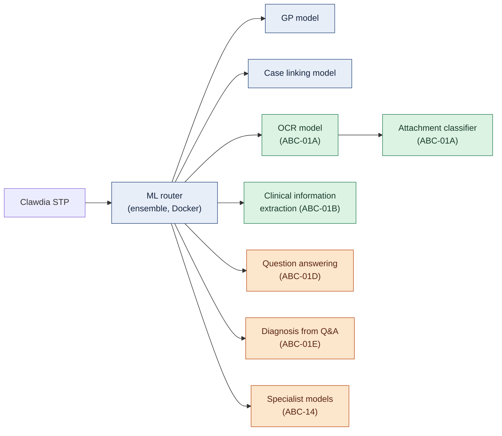

# ABC-01 — ML Improvement (ML environment changes)

| | |
|---|---|
| **Category** | ML Improvement |
| **Sub-changes** | [ABC-01A OCR and attachment classification](#abc-01a--ml-improvement--ocr-and-attachment-classification) · [ABC-01B Clinical information extraction](#abc-01b--ml-improvement--clinical-information-extraction) · [ABC-01C GP model on the enriched claim context](#abc-01c--ml-improvement--gp-model-on-the-enriched-claim-context) · [ABC-01D Question answering](#abc-01d--ml-improvement--question-answering) · [ABC-01E Diagnosis from questions and answers](#abc-01e--ml-improvement--diagnosis-from-questions-and-answers) |
| **Related** | [ABC-14 ML Improvement · Specialist models](abc-14-specialist-models.md) |
| **Tiers** | 2 (ABC-01A, B, C) and 3 (ABC-01D, E). **No ML change in Tier 1.** |
| **Status** | Draft — effort and uplift per sub-change **TODO** (ML team) |
| **Back to** | [AI CAsH high-level solution](../cash-high-level-solution.md) |

This page groups the changes to the **ML environment**. Each sub-change is an ABC of its own, with its own tier, solution, dependencies and component changes.

## Context: the ML environment today

- **Clawdia STP** loads the claim and policy data, runs **Easy Cohort** rules, then calls the ML environment.
- The ML environment runs the **ML router**: an application in a **Docker container** that performs an **ensemble method**. It sequences the calls to the models and combines their results. Today there are two models: the **GP model** (diagnosis codes) and the **case linking model** (Condition Linking, introduced by STP25).
- Neither model uses the inputs a human uses in a manual assessment: attachments are not classified, and clinical notes are not turned into structured clinical information (LP-4).
- The endpoint runs on an Ubuntu 18.04 base image, out of support. See [ML Environment](../../infrastructure/go-tech-components/08-ml-environment.md).

Blue = today · green = Tier 2 · amber = Tier 3.

---

## ABC-01A · ML Improvement · OCR and attachment classification

| | |
|---|---|
| **Tier** | 2 · Round 2 |
| **Solution** | [SOL-2 Medical Information Claim Enrichment](../solutions/medical-information-claim-enrichment.md) |
| **Problems solved (part)** | [LP-4 Unstructured clinical evidence](../cash-high-level-solution.md#22-problems-to-solve-and-associated-drivers) |
| **Depends on** | — |
| **Needed by** | ABC-07 (deployed) |

**Change.** When Clawdia STP sends a claim's attachments, the ML router calls an **OCR model first, then an attachment classifier**. Each attachment (and the relevant pages) gets a type — clinical history, lab result, imaging report, referral, invoice, estimate, other — with a confidence.

| ID | Component | Type | Change |
|---|---|---|---|
| ABC-01A.1 | ML environment — OCR model | Add | Text from scanned and image attachments |
| ABC-01A.2 | ML environment — attachment classifier | Add | Type per attachment and page, with confidence |
| ABC-01A.3 | ML router | Evolve | New pipeline: OCR → classifier; returns types and extracted text to Clawdia STP |
| ABC-01A.4 | ML environment — monitoring | Add | Classification accuracy and confidence drift |

**Acceptance criteria.** Every attachment has a type from the agreed taxonomy with a confidence; OCR text is kept with the attachment for later extraction.

---

## ABC-01B · ML Improvement · Clinical information extraction

| | |
|---|---|
| **Tier** | 2 · Round 2 |
| **Solution** | [SOL-2 Medical Information Claim Enrichment](../solutions/medical-information-claim-enrichment.md) |
| **Problems solved (part)** | [LP-4 Unstructured clinical evidence, LP-8 Diagnosis predictions not traceable](../cash-high-level-solution.md#22-problems-to-solve-and-associated-drivers) |
| **Depends on** | — |
| **Needed by** | ABC-07 (deployed) |

**Change.** The ML environment extracts **structured clinical information** from the consultation notes (and from the OCR text of clinical attachments): presenting signs, diagnosis candidates, body system, onset and duration, procedures, medications, test results. Each item keeps its **source span** (document, page, excerpt) and a confidence, so later predictions can be traced back to evidence.

| ID | Component | Type | Change |
|---|---|---|---|
| ABC-01B.1 | ML environment — clinical information extraction model | Add | For example a fine-tuned PetBERT, or an LLM extractor under AI governance **[TBC]** |
| ABC-01B.2 | ML router | Evolve | Expose the extraction pipeline to Clawdia STP |
| ABC-01B.3 | ML environment — monitoring | Add | Extraction precision / recall on a labelled sample |

**Acceptance criteria.** Every claim with notes gets a set of clinical facts, each with source and confidence.

---

## ABC-01C · ML Improvement · GP model on the enriched claim context

| | |
|---|---|
| **Tier** | 2 · Round 2 |
| **Solution** | [SOL-2 Medical Information Claim Enrichment](../solutions/medical-information-claim-enrichment.md) |
| **Problems solved (part)** | [LP-4 Unstructured clinical evidence, LP-1 All-or-nothing assessment](../cash-high-level-solution.md#22-problems-to-solve-and-associated-drivers) |
| **Depends on** | [ABC-07](abc-07-enrich-claims-clinical-information-attachment-classification.md) (deployed — enriched claim context available) |
| **Needed by** | ABC-01E, ABC-11, ABC-14 (deployed) |

**Change.** The ML router passes the **enriched claim context** to an improved GP model that uses attachment classification and clinical information as new features. The model returns a calibrated confidence per diagnosis code and, when it isn't confident, the **candidate diagnosis families** that Tier 3 uses to retrieve questions.

| ID | Component | Type | Change |
|---|---|---|---|
| ABC-01C.1 | ML router | Evolve | Pass the enriched claim context to the models |
| ABC-01C.2 | GP model | Evolve | Retrain with the new features (attachment types, clinical facts) |
| ABC-01C.3 | GP model | Evolve | Calibrated confidence per predicted diagnosis code (per invoice line) |
| ABC-01C.4 | GP model | Evolve | Return candidate diagnosis families with confidence when not confident |
| ABC-01C.5 | Case linking model | Evolve | Use the enriched context features, if the LP-4 verification confirms the gain |
| ABC-01C.6 | ML environment — endpoint | Evolve | Refresh the base image and runtime |

**Acceptance criteria.** The LP-4 assumption is tested: diagnosis prediction and case linking are measured with and without the new features on the same evaluation set; the GP model returns calibrated confidences and candidate families.

---

## ABC-01D · ML Improvement · Question answering

| | |
|---|---|
| **Tier** | 3 · AI Claim Assessment Harness |
| **Solution** | [SOL-4 AI Claim Assessment Harness](../solutions/ai-claim-assessment-harness.md) |
| **Problems solved (part)** | [LP-1 All-or-nothing assessment, LP-8 Diagnosis predictions not traceable](../cash-high-level-solution.md#22-problems-to-solve-and-associated-drivers) |
| **Depends on** | [ABC-07](abc-07-enrich-claims-clinical-information-attachment-classification.md) (deployed) |
| **Needed by** | ABC-11 (started) |

**Change.** A new kind of inference: **evaluate the answer to a specific question** from the claim context (the "Answer via ML" task in the [assessment path](../cash-high-level-solution.md#35-assessment-path-at-the-end-of-tier-3)). Input: the question and the claim context. Output: a structured answer (choice, yes/no or score), a calibrated probability and a reference to the evidence used.

**Strategy options**

| Option | Fit | Watch-outs |
|---|---|---|
| **System 1 model** (best candidate) | Questions with a predefined answer space (choice, yes/no, ordinal score). Fast, cheap, returns calibrated probabilities, no free-text hallucination | Vendor maturity and claims to verify (OQ-11); needs labelled examples per question type |
| **One model per question** | High-volume questions with plenty of historical labels | Many models to train, release and monitor |
| **LLM over the claim context** | Rare or new questions; questions that need reading long text | Slower, costlier, can hallucinate; answer must cite its evidence; usually confirmed by an assessor (quick fix bay) |

**System 1 vs System 2 models**

The terms come from cognitive psychology — Daniel Kahneman, *Thinking, Fast and Slow* — and are now used to describe two styles of AI model.

| Feature | System 1 model | System 2 model (typical LLM / reasoning model) |
|---|---|---|
| Cognitive analogy | Fast, instinctive, automatic (instantly sorting mail) | Slow, deliberate, logical (solving a maths problem, writing an essay) |
| Output | Strictly structured: choice, true/false or ordinal score, with calibrated probabilities | Free-form text (natural language, code, chains of thought) |
| Mechanism | All output probabilities in one forward pass, no token-by-token decoding | Auto-regressive decoding, one token at a time |
| Speed and cost | Vendor-reported 70–500 ms latency, up to 200× faster and 400× cheaper (about $0.042 per million input tokens, outputs free) — **to verify** | Multi-second latency; cost grows with every output token |
| Errors | No structural errors, because the answer space is predefined | Prone to hallucinations, formatting errors, drifting off-topic |

Figures are vendor-reported for the Jev System 1 models (see [DataCamp: System one models — Jev](https://www.datacamp.com/blog/system-one-models-jev), [regolo.ai: Jev and system one models — benchmarks](https://regolo.ai/jev-and-system-one-models-benchmarks-open-source-alternatives-and-when-to-use-them/)). They need independent verification before any decision (OQ-11).

| ID | Component | Type | Change |
|---|---|---|---|
| ABC-01D.1 | ML environment — question-answering inference | Add | (question, claim context) → structured answer, calibrated probability, evidence reference |
| ABC-01D.2 | ML router | Evolve | Route each question to its configured strategy (System 1, per-question model, LLM) |
| ABC-01D.3 | ML environment — evaluation set | Add | Labelled questions and answers from historical manual assessments and quick fix bay answers |

**Acceptance criteria.** Each answer is structured, carries a calibrated probability and cites its evidence; accuracy per question type is measured before release.

---

## ABC-01E · ML Improvement · Diagnosis from questions and answers

| | |
|---|---|
| **Tier** | 3 · AI Claim Assessment Harness |
| **Solution** | [SOL-4 AI Claim Assessment Harness](../solutions/ai-claim-assessment-harness.md) |
| **Problems solved (part)** | [LP-1 All-or-nothing assessment, LP-8 Diagnosis predictions not traceable](../cash-high-level-solution.md#22-problems-to-solve-and-associated-drivers) |
| **Depends on** | [ABC-01C](#abc-01c--ml-improvement--gp-model-on-the-enriched-claim-context) (deployed) |
| **Needed by** | ABC-11 (deployed) |

**Change.** A second new kind of inference: **evaluate all the questions and answers and decide the best diagnosis** (the "Predict diagnosis from questions and answers" task in the assessment path). Input: the claim context, the candidate diagnosis families and every question with its answer, source (SQL, ML, AI agent, assessor) and confidence. Output: the best diagnosis code per invoice line, a confidence, and the answers that contributed.

| ID | Component | Type | Change |
|---|---|---|---|
| ABC-01E.1 | ML environment — diagnosis-from-Q&A inference | Add | Best diagnosis per invoice line with confidence and contributing answers |
| ABC-01E.2 | ML router | Evolve | Reconcile with the ensemble's earlier prediction; record which inference decided |

**Acceptance criteria.** Every predicted diagnosis lists the answers it relied on; on the evaluation set, STP rises over the ensemble-only baseline **[target TBC]**.

---

## Open questions

- Effort and expected STP uplift per sub-change (ML team).
- Attachment taxonomy for ABC-01A: who defines it, and how many types?
- Build or buy for OCR, classification and extraction; AI governance for each.
- Does Easy Cohort move behind the ML router (owned by the ML team), or stay in Clawdia STP?
- System 1 vendor evaluation (OQ-11).
