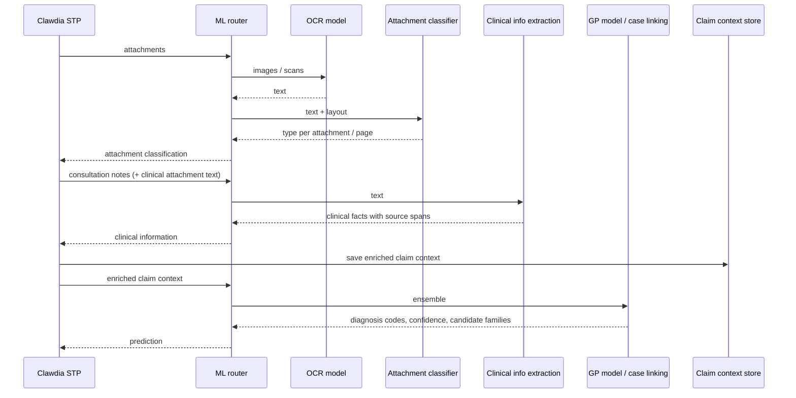

# ABC-07 — Enrich the claim context with clinical information and attachment classification

| | |
|---|---|
| **Tier** | 2 · Round 2 |
| **Solution** | [SOL-2 Medical Information Claim Enrichment](../solutions/medical-information-claim-enrichment.md) |
| **Problems solved (part)** | [LP-4 Unstructured clinical evidence, LP-8 Diagnosis predictions not traceable](../cash-high-level-solution.md#22-problems-to-solve-and-associated-drivers) |
| **Depends on** | [ABC-01A](abc-01-ml-improvement.md#abc-01a--ml-improvement--ocr-and-attachment-classification), [ABC-01B](abc-01-ml-improvement.md#abc-01b--ml-improvement--clinical-information-extraction) (deployed — ML inferences available); [ABC-03](abc-03-decouple-upm-clawdia.md) (started — claim data loaded from the conversation) |
| **Needed by** | ABC-01C, ABC-01D, ABC-11 (deployed); ABC-10 (started) |
| **Status** | Draft |
| **Back to** | [AI CAsH high-level solution](../cash-high-level-solution.md) |

## Change

Clawdia STP enriches the **claim context** before it asks for a diagnosis. After loading the claim, it calls the ML environment:

1. **Attachment classification** — the ML router runs OCR, then the attachment classifier ([ABC-01A](abc-01-ml-improvement.md#abc-01a--ml-improvement--ocr-and-attachment-classification)).
2. **Clinical information extraction** — from the consultation notes and the OCR text of clinical attachments ([ABC-01B](abc-01-ml-improvement.md#abc-01b--ml-improvement--clinical-information-extraction)).

The claim context then holds the claim and invoice lines, the policy, the **animal case history (including pre-existing conditions)**, the **attachment classification** and the **clinical information**, each item with its provenance (source document, page, excerpt), confidence and model version. Clawdia STP passes the enriched claim context to the improved GP model ([ABC-01C](abc-01-ml-improvement.md#abc-01c--ml-improvement--gp-model-on-the-enriched-claim-context)), and the Claim Visualiser and AI CAsH read the same context.

## Problem it solves

- **LP-4 effect:** ML models don't use the inputs a human uses in a manual assessment. In theory, diagnosis prediction and case linking both get stronger with clinical information and attachments — **this assumption must be verified** (ABC-01C measures it).
- **LP-8 effect:** a predicted diagnosis can't be traced deterministically to the evidence behind it.
- Today COS converts and merges attachments into one PDF for UPM; nothing is classified or extracted for automation. Clawdia STP's working data sits in `PSPRODClaimsAutoDB`.

## Component changes

| ID | Component | Type | Change |
|---|---|---|---|
| ABC-07.1 | STP – Clawdia | Evolve | Call the ML environment for attachment classification and clinical information extraction after loading the claim |
| ABC-07.2 | STP – Clawdia | Evolve | Claim context model: policy, animal case history (incl. pre-existing conditions), attachment classification, clinical information, with provenance |
| ABC-07.3 | Claim context store | Evolve | Persist the enriched claim context (`PSPRODClaimsAutoDB` or a dedicated store **[TBC]**) |
| ABC-07.4 | VetHub / Storage API | Evolve | Attachments available to Clawdia STP by reference, before lodgement |
| ABC-07.5 | STP – Clawdia | Evolve | Pass the enriched claim context to the ML router for the ensemble |
| ABC-07.6 | Claim context store | Add | Read API for the Claim Visualiser and AI CAsH |

## Dependencies

- [ABC-01A](abc-01-ml-improvement.md#abc-01a--ml-improvement--ocr-and-attachment-classification), [ABC-01B](abc-01-ml-improvement.md#abc-01b--ml-improvement--clinical-information-extraction) — **deployed first**.
- [ABC-03](abc-03-decouple-upm-clawdia.md) — **started already**: claim data loaded from the conversation, so enrichment can run before UPM asks for the assessment.

## Acceptance criteria

- **AC-1** Every attachment has a type with a confidence; every claim with notes has clinical information with sources.
- **AC-2** The enriched claim context is persisted and readable by the Claim Visualiser and AI CAsH.
- **AC-3** If an enrichment call fails, the assessment proceeds with the unenriched context (graceful degradation).

## Open questions

- Where does the case history (including pre-existing conditions) come from before lodgement: UPM data warehouse, Clawdia's own history, case linking output?
- Claim context store: extend `PSPRODClaimsAutoDB` or a dedicated store?
