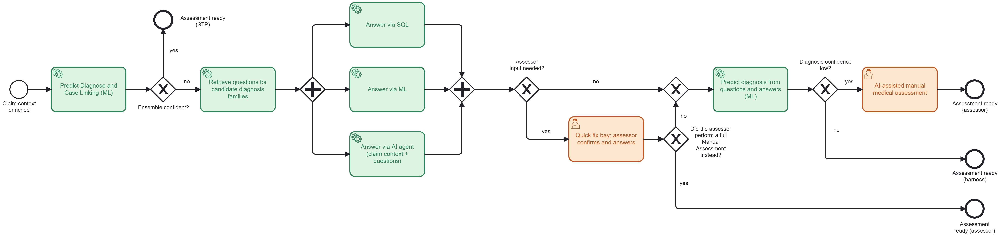

# SOL-4 — AI Claim Assessment Harness (AI CAsH)

| | |
|---|---|
| **Tier** | 3 · AI Claim Assessment Harness |
| **Composed of** | [ABC-01D](../changes/abc-01-ml-improvement.md#abc-01d--ml-improvement--question-answering), [ABC-01E](../changes/abc-01-ml-improvement.md#abc-01e--ml-improvement--diagnosis-from-questions-and-answers), [ABC-11](../changes/abc-11-questions-answers-diagnosis-family.md), [ABC-14](../changes/abc-14-specialist-models.md) |
| **Problems solved** | [LP-1 All-or-nothing assessment, LP-8 Diagnosis predictions not traceable](../cash-high-level-solution.md#22-problems-to-solve-and-associated-drivers) (with SOL-2 and SOL-3); contributes to LP-3 and LP-4 |
| **External dependencies** | ABC-07, ABC-01C (SOL-2, deployed); works with SOL-3's ABC-12 and ABC-13 |
| **Status** | Draft |
| **Back to** | [AI CAsH high-level solution](../cash-high-level-solution.md) |

## 1. Summary

AI CAsH turns **Clawdia STP into an AI harness for claim medical assessment**. It fills the gap between the claims the model ensemble assesses with confidence and the claims that today go to manual assessment in UPM. Clawdia STP keeps the orchestration; the ML environment, behind the ML router, provides two new kinds of inference:

- **Question answering** — evaluate the answer to a specific question from the claim context. The best candidate is a *System 1* model; a model per question or an LLM reading the claim context are alternatives ([ABC-01D](../changes/abc-01-ml-improvement.md#abc-01d--ml-improvement--question-answering)).
- **Diagnosis from questions and answers** — evaluate all the questions and answers and decide the best diagnosis ([ABC-01E](../changes/abc-01-ml-improvement.md#abc-01e--ml-improvement--diagnosis-from-questions-and-answers)).

Alongside them, SQL queries answer what structured data can answer, and an AI agent answers from the claim context. An assessor is involved only for AI-agent answers to confirm and assessor-led questions (quick fix bay), and for the claims whose diagnosis confidence stays low (AI-assisted manual medical assessment).

## 2. Assessment path

Source: [`ai-cash-assessment-path.bpmn`](../diagrams/ai-cash-assessment-path.bpmn). Element-by-element description: [high-level solution §3.5](../cash-high-level-solution.md#35-assessment-path-at-the-end-of-tier-3).

## 3. Architectural and behavioural changes

| ABC | Change | Problems | Depends on |
|---|---|---|---|
| [ABC-01D](../changes/abc-01-ml-improvement.md#abc-01d--ml-improvement--question-answering) | ML Improvement · Question answering | LP-1, LP-8 | ABC-07 (deployed) |
| [ABC-01E](../changes/abc-01-ml-improvement.md#abc-01e--ml-improvement--diagnosis-from-questions-and-answers) | ML Improvement · Diagnosis from questions and answers | LP-1, LP-8 | ABC-01C (deployed) |
| [ABC-11](../changes/abc-11-questions-answers-diagnosis-family.md) | Questions and answers per candidate diagnosis family, then predict the diagnosis | LP-1, LP-8 | ABC-07, ABC-01C, ABC-01E (deployed); ABC-01D (started) |
| [ABC-14](../changes/abc-14-specialist-models.md) | ML Improvement · Specialist models | LP-1 | ABC-11, ABC-01C (deployed) |

The bays that close the loop ([ABC-12](../changes/abc-12-quick-fix-bays-for-answers.md), [ABC-13](../changes/abc-13-ai-assisted-manual-medical-assessment.md)) belong to SOL-3 and depend on ABC-11.

## 4. Component changes by component

| Component | Add | Evolve | Decommission |
|---|---|---|---|
| STP – Clawdia (harness) | ABC-11.3, ABC-11.7 | ABC-11.1, ABC-11.5, ABC-11.8, ABC-14.3 | |
| Question catalogue | ABC-11.2 | | |
| SQL answerer | ABC-11.4 | | |
| AI agent | ABC-11.6 | | |
| Decision trace | ABC-11.9 | | |
| ML environment — inferences | ABC-01D.1, ABC-01E.1, ABC-14.1 | | |
| ML router | | ABC-01D.2, ABC-01E.2, ABC-14.2 | |
| ML environment — evaluation, monitoring | ABC-01D.3, ABC-14.4 | | |

## 5. Principles and patterns

- **AP10 Human accountability for AI decisions:** the harness proposes or approves; it never declines on its own; every answer and diagnosis traces back to its evidence.
- **AP4 Automate first, human by exception:** assessors get the answers to confirm and the assessor-led questions, not the whole claim.
- **AP5 Clear coupling:** Clawdia STP orchestrates; the ML router is the single entry point to the models; models are replaceable.
- **AP3 Design for failure:** a failing strategy degrades to another strategy or to a bay — no all-or-nothing fall-out.
- Patterns: process orchestration with checkpoints (BPMN) · parallel split / join of answer strategies · confidence-based routing · human-in-the-loop task · circuit breaker per model.

## 6. AI operating model hooks

| Stage | Harness support |
|---|---|
| Develop → test / simulate | Replay historical claims with a candidate question set or model, compare with outcomes |
| Approve → release | Question catalogue, thresholds and model versions released by configuration, with approval recorded |
| Monitor → auto-audit | Accuracy per strategy and question type, confidence drift, fall-out reasons, assessor overrides |
| Optimise | Assessor answers from the bays become labelled data (ABC-01D.3) |

## 7. Out of scope

- Benefit calculation and payment (stay in UPM; configurable policy decisioning is H2).
- Declining claims automatically — not allowed (AP10).

## 8. Risks

| Risk | Mitigation |
|---|---|
| Uplift lower than expected | Simulate on historical claims before each release; investment gate before Tier 3 |
| Too many models without controls | Router contract, AI operating model gates, per-model kill switch |
| AI-agent answers not reproducible or wrong | Evidence citations; confirmation in the quick fix bay; System 1 or per-question models where possible |
| System 1 vendor claims don't hold | Independent evaluation before choosing (OQ-11) |
| Assessors see the bays as a threat | Frame assessor-led questions as the expert's call; measure and share time saved |
| Rework if H2 goes another way | Insurer-agnostic claim context and contracts reusable in a common claims pathway |

## 9. Measures

STP % · % of each claim automated · quick fix rate · full manual fall-out · AHT / CPC · accuracy and calibration per answer strategy · assessor override rate.

## 10. Open questions

- Ownership of the question catalogue and of the assessor-led flag (OQ-04).
- AI agent hosting and LLM (OQ-06).
- System 1 evaluation (OQ-11).
