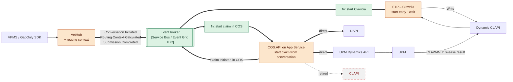
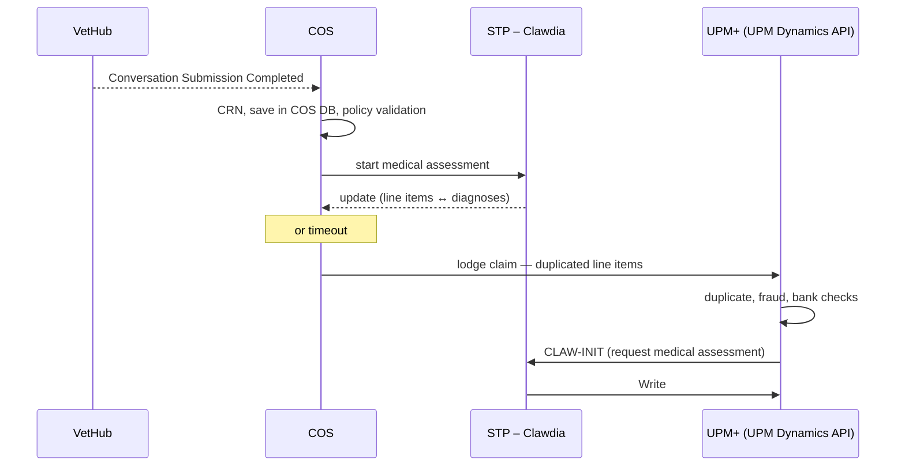
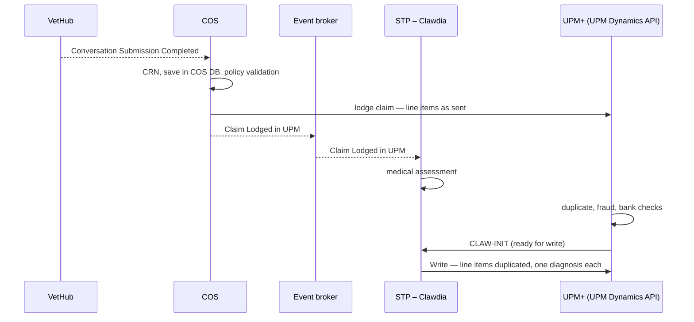
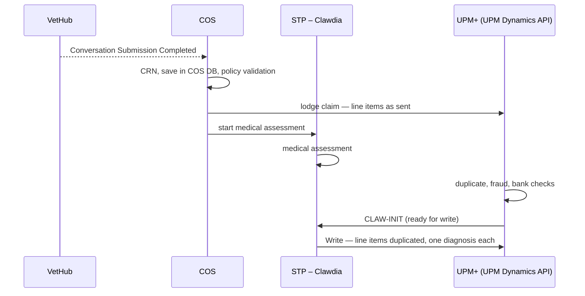
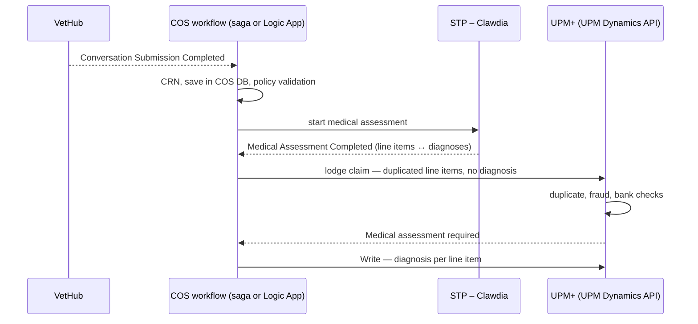
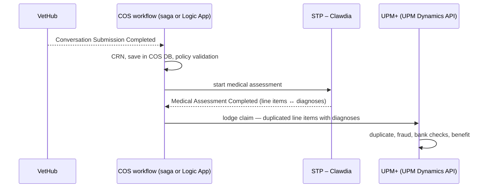
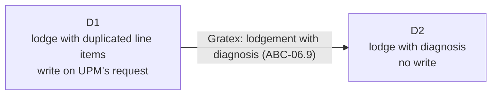

# SOL-1 — Early Starter

| | |
|---|---|
| **Tier** | 1 · Quick wins |
| **Composed of** | [ABC-03](../changes/abc-03-decouple-upm-clawdia.md), [ABC-04](../changes/abc-04-remove-polling-vethub-cos.md), [ABC-05](../changes/abc-05-rehost-cos-api-app-service.md), [ABC-06](../changes/abc-06-remove-clapi-dapi-dependencies.md), ABC-17 **[option pending experiments — see 9]** |
| **Problems solved** | [LP-2, LP-3, LP-5 (COS.API)](../cash-high-level-solution.md#22-problems-to-solve-and-associated-drivers); touches LP-6 |
| **Detailed analysis** | [Earlier Birds — high-level solution](<../../../solutions/earlier birds/Earlier birds - high-level solution.md>) (component changes, impact analysis, open questions) |
| **Status** | Draft |
| **Back to** | [AI CAsH high-level solution](../cash-high-level-solution.md) |

## 1. Summary

Early Starter **starts Clawdia's medical assessment as soon as a VetHub conversation is initiated**, instead of waiting for the claim to be lodged in UPM and checked. VetHub becomes an event publisher, small Azure Functions react to its events, and COS starts the claim from an event instead of polling. COS lodges directly in DAPI and the UPM Dynamics API using a routing context VetHub calculates once. COS.API moves to App Service so the new entry point runs on PaaS.

Early Starter is the Tier 1 evolution of **Earlier Birds**: same core moves, plus the COS.API re-host and the full inventory of CLAPI operations used by COS.

## 2. Architectural and behavioural changes

| ABC | Change | Problems | Depends on |
|---|---|---|---|
| [ABC-05](../changes/abc-05-rehost-cos-api-app-service.md) | Re-host COS.API to App Service | LP-5 | — |
| [ABC-04](../changes/abc-04-remove-polling-vethub-cos.md) | Remove polling from VetHub to COS (introduces the event platform and VetHub events) | LP-2, LP-5 | ABC-05 (started) |
| [ABC-06](../changes/abc-06-remove-clapi-dapi-dependencies.md) | Remove dependencies on CLAPI and DAPI (routing context, direct lodgement) | LP-2, LP-5, LP-3 | ABC-04 (deployed) |
| [ABC-03](../changes/abc-03-decouple-upm-clawdia.md) | Decouple UPM / Clawdia (early start, wait, release on CLAW-INIT) | LP-3, LP-2 | ABC-04 (deployed) |
| [ABC-17](#9-multiple-diagnoses-per-invoice-line-item-when-to-assess-when-to-lodge-in-upm-abc-17) | Multiple diagnoses per invoice line item — when to assess and when to lodge in UPM: options A, B1, B2, D1, D2 **[pending experiments]** | LP-1, LP-3 | ABC-03 (started); A, D1, D2 also change ABC-06 |

Service Provider Master Data ([ABC-02](../changes/abc-02-service-provider-master-data.md)) is not part of Early Starter; it depends on ABC-06 having started, because the routing context is the single place where routing is decided.

## 3. Component changes by component

| Component | Add | Evolve | Decommission |
|---|---|---|---|
| VetHub | ABC-04.2, ABC-06.1 | ABC-04.3 | ABC-04.8 |
| Event platform | ABC-04.1, ABC-04.4, ABC-03.1, ABC-03.9 | | |
| COS.API | ABC-04.5 | ABC-05.1 – ABC-05.5 | ABC-05.8 (IIS sites) |
| COS services | ABC-03.8, ABC-06.2 | ABC-04.6, ABC-06.3, ABC-06.4 | ABC-04.7 (VetHub poller) |
| STP – Clawdia | ABC-03.2, ABC-03.5 | ABC-03.3, ABC-03.4, ABC-03.6 | |
| Dynamic CLAPI | | ABC-03.7 | ABC-06.7 (*Lodge Claim*) |
| CLAPI | | | ABC-06.8 |
| DAPI | | ABC-06.5 | ABC-06.10 **[TBC]** |
| UPM Dynamics API / UPM+ | ABC-06.9 **[TBC]** | ABC-06.6 | |
| App Service, CI/CD | ABC-05.6 | ABC-05.7 | |

ABC-17 adds ABC-17.1–17.3 to STP – Clawdia in every option, plus the component changes of the chosen option (COS services or workflow, STP – Clawdia, event platform, Dynamic CLAPI, DAPI / UPM Dynamics API) — see [9](#9-multiple-diagnoses-per-invoice-line-item-when-to-assess-when-to-lodge-in-upm-abc-17).

## 4. Target flow



## 5. Patterns

Event-driven architecture with business events · publish–subscribe · event handler as a thin adapter · correlation identifier · long-running process with a wait state · decide routing once at the edge · idempotent receiver with at-least-once delivery · transactional outbox · schema-validated contracts · strangler-style decommissioning · speculative (eager) processing.

## 6. Out of scope

- UPM Dynamics API polling of the DS tables (~10 min), unless ABC-06.9 is agreed.
- Re-hosting COS services and VetHub services ([ABC-15](../changes/abc-15-rehost-vethub-remaining-vms.md), [ABC-16](../changes/abc-16-rehost-cos-services.md)).
- The gap-only return path through Dynamic CLAPI.

## 7. Risks

| Risk | Mitigation |
|---|---|
| Speculative assessments for abandoned conversations add ML and Logic App cost | Expiry policy; start on *Submission Completed* if cost is too high |
| Lost or duplicated events create or lose claims | Outbox, idempotency on `conversationId`, dead-letter with an owner and replay runbook |
| Hidden consumers of CLAPI or the VetHub polling endpoint | Inventory before retirement; switch callers first |
| Routing rules diverge between VetHub and COS | One routing source; contract tests |
| UPM can't take duplicated line items on *Write* (B1, B2) or at lodgement (A, D1) | Run E1 and check C before detailing ABC-03 and ABC-06 |
| A, D1, D2: lodgement waits for the assessment or a quick fix task | Timeout in the COS saga / workflow; agree what is lodged on timeout |
| D2 depends on a new UPM API (Gratex) | Run D1 in the meantime (9.9) |

## 8. Measures

| Measure | Baseline | Target |
|---|---|---|
| Time from *Request medical assessment* to *Write* | **[TBC]** | Lookup + write only |
| Delay from submission complete to COS claim created | Polling interval **[TBC]** | Seconds (A, D1, D2: lodgement in UPM also waits for the assessment) |
| API layers between COS and UPM for lodgement | 2 | None (direct) |
| COS.API on PaaS | No | Yes (AU, NZ, VP) |

## 9. Multiple diagnoses per invoice line item: when to assess, when to lodge in UPM (ABC-17)

**Status:** decision pending — five options and two experiments for the Go Tech team. ABC-17 gets its own page in [`changes/`](../changes/) once the option is chosen.

### 9.1 What Early Starter does not consider yet

A vet invoice line item can relate to more than one diagnosis (for example one consultation fee covering an ear infection and a skin condition). UPM stores one diagnosis per treatment row: `[Claim Treatments].[Diagnoses Line No_]` points to a single `[Claim Diagnosis]` line. An item that serves two diagnoses is therefore stored as two treatment rows under the same invoice line, each pointing to a different diagnosis line; `[Claim Entries]` holds the amount per diagnosis × treatment.

This is common. In UPM AU ([`upm_duplicated_invoice_treatment_lines.sql`](../../../upm_duplicated_invoice_treatment_lines.sql), export in [`multiple diagnosis/`](<multiple diagnosis/>)) there are about **888k** duplicated item groups across about **549k** claims — roughly **4.8 %** of the ~11.6 M claims. About **80 %** carry the full item amount on each diagnosis, **20 %** split it. *(Indicative: all history since 2011, `Document Type` 2, no other filter.)*

Three consequences for the assessment:

1. **Evaluate** each line item: does it relate to one diagnosis or to several?
2. **Associate** each diagnosis with one or more line items (many-to-many).
3. **Duplicate** each line item that has more than one diagnosis: one copy per diagnosis, linked to the original invoice line, with the amount allocated to the copy (full or split **[rule TBC with Claims]**).

Point 3 changes the shape of the claim after the vet submitted it. It raises a question that was already worth asking for other reasons (LP-3 and T1.1 *COS and Clawdia run without UPM*, the lifecycle-stage lodgement API ABC-06.9, claims waiting in a quick fix bay): **should the claim be lodged in UPM before we have a diagnosis?**

### 9.2 Common to all options

Before COS calls STP – Clawdia or UPM, it does what it does today, in this order: **enrich the claim with the claim reference number (CRN)**, **save the claim in the COS database**, **validate the policy**. The claim still starts on *Conversation Submission Completed* (ABC-04).

The options differ in three things: **what starts the medical assessment**, **when COS lodges the claim in UPM**, and **who calls the write API**. Whether Clawdia still prepares early on *Conversation Initiated* (load and map the conversation data, ABC-03.1 and ABC-03.4) is independent of the option **[TBC]**; below, "start the medical assessment" means the actual assessment.

Component changes common to all options:

| ID | Component | Type | Change |
|---|---|---|---|
| ABC-17.1 | STP – Clawdia | Evolve | Evaluate each line item for multiple diagnoses **[TBC — what the current ML output gives in Tier 1; specialist models come with ABC-14]** |
| ABC-17.2 | STP – Clawdia | Evolve | Assessment result holds the line item ↔ diagnosis association (many-to-many) |
| ABC-17.3 | STP – Clawdia | Evolve | Duplicate each line item with more than one diagnosis: one copy per diagnosis, link to the original invoice line, allocated amount |

### 9.3 Options at a glance

| | A | B1 | B2 | D1 | D2 |
|---|---|---|---|---|---|
| **Starts the medical assessment** | COS calls Clawdia | Clawdia, on the event *Claim Lodged in UPM* | COS calls Clawdia, after lodging | COS calls Clawdia | COS calls Clawdia |
| **COS lodges in UPM** | After Clawdia's update, or on timeout | Without waiting for Clawdia | Without waiting for Clawdia | After *Medical Assessment Completed* | After *Medical Assessment Completed* |
| **Line items at lodgement** | Duplicated if Clawdia's update arrived; as sent on timeout **[TBC]** | As sent | As sent | Duplicated | Duplicated |
| **Diagnosis at lodgement** | No **[TBC]** | No | No | No | **Yes** |
| **Calls the write API** | Clawdia, when UPM requests the assessment (as today) **[TBC]** | Clawdia | Clawdia | COS, when UPM signals *Medical assessment required* | Nobody — no write |
| **Write duplicates line items** | Only after a timeout | Yes | Yes | No | — |
| **Assessment before lodgement** | Yes, bounded by the timeout | No | No | Yes | Yes |
| **Depends on** | Check C (E1 on the timeout path) | E1 | E1 | Check C | E2 |
| **UPM change** | No, if check C passes | No, if E1 passes | No, if E1 passes | No, if check C passes | Yes, if E2 fails (Gratex) |
| **COS implementation** | Lodgement saga | Lodgement saga + event | Lodgement saga | Lodgement saga, or an Azure Logic Apps workflow | As D1 |

### 9.4 Option A — COS starts Clawdia, waits, then lodges

COS calls STP – Clawdia to start the medical assessment and waits for an update from Clawdia. When the update arrives, or when the wait times out, COS lodges the claim in UPM. UPM then requests the medical assessment and Clawdia writes as today.



| ID | Component | Type | Change |
|---|---|---|---|
| ABC-17.A1 | STP – Clawdia | Add | *Start medical assessment* entry point for COS; update back to COS (call or event **[TBC]**) |
| ABC-17.A2 | COS services | Evolve | Lodgement saga calls Clawdia after policy validation; waits for the update or a timeout **[timeout TBC]** |
| ABC-17.A3 | COS services | Evolve | Lodgement payload with duplicated line items when the update arrived |
| ABC-17.A4 | DAPI / UPM Dynamics API *lodge* | Evolve **[TBC]** | Accept duplicated line items (check C) |

### 9.5 Option B1 — Clawdia reacts to *Claim Lodged in UPM*

COS lodges the claim in UPM without waiting for Clawdia. Clawdia reacts to the event *Claim Lodged in UPM*, starts the actual medical assessment, then calls the write API, duplicating the line items that have more than one diagnosis.



| ID | Component | Type | Change |
|---|---|---|---|
| ABC-17.B1.1 | COS services | Add | Publish *Claim Lodged in UPM* (`conversationId`, CRN, UPM claim number) **[TBC — published by COS on lodgement confirmation, or by UPM]** |
| ABC-17.B1.2 | Event platform | Add | Function *On Claim Lodged in UPM → start medical assessment* (idempotent on CRN) |
| ABC-17.B1.3 | STP – Clawdia | Evolve | Start the actual assessment on the event; write only once UPM is ready (CLAW-INIT) |
| ABC-17.B1.4 | Dynamic CLAPI *Write* → UPM Dynamics API *write* | Evolve | Carry the duplicated line items (E1) |

### 9.6 Option B2 — COS adds Clawdia to the saga

COS lodges the claim in UPM and then calls STP – Clawdia. Clawdia starts the actual medical assessment, then calls the write API, duplicating the line items that have more than one diagnosis.



| ID | Component | Type | Change |
|---|---|---|---|
| ABC-17.B2.1 | COS services | Evolve | Lodgement saga calls Clawdia after lodging |
| ABC-17.B2.2 | STP – Clawdia | Add | *Start medical assessment* entry point for COS; write only once UPM is ready (CLAW-INIT) |
| ABC-17.B2.3 | Dynamic CLAPI *Write* → UPM Dynamics API *write* | Evolve | Carry the duplicated line items (E1) |

### 9.7 Option D1 — COS orchestrates; lodge with duplicated line items, write on UPM's request

COS orchestrates the whole claim:

1. start the medical assessment in STP – Clawdia;
2. wait for the event *Medical Assessment Completed*;
3. lodge the claim in UPM **without the diagnosis**, but with the line items duplicated where there are multiple diagnoses;
4. wait for UPM's *Medical assessment required*, then call the write API.

This option can be implemented with **Azure Logic Apps** (the same platform as Clawdia), optionally replacing the lodgement saga (`ClaimSubmissionSaga`) and the attachment saga (`ClaimAttachmentSubmissionSaga`) with a Logic Apps workflow.



| ID | Component | Type | Change |
|---|---|---|---|
| ABC-17.D1.1 | COS workflow | Evolve | Start the medical assessment in Clawdia after policy validation |
| ABC-17.D1.2 | STP – Clawdia | Add | Publish *Medical Assessment Completed* (`conversationId`, CRN, line items ↔ diagnoses, outcome) |
| ABC-17.D1.3 | Event platform | Add | Route *Medical Assessment Completed* to the COS workflow (idempotent on CRN) |
| ABC-17.D1.4 | COS workflow | Evolve | Lodge without the diagnosis, with duplicated line items |
| ABC-17.D1.5 | COS workflow | Add | Wait for *Medical assessment required*, then call the write API with Clawdia's result |
| ABC-17.D1.6 | Dynamic CLAPI | Evolve | CLAW-INIT routed to the COS workflow instead of Clawdia; COS becomes the *Write* caller **[TBC]** |
| ABC-17.D1.7 | DAPI / UPM Dynamics API *lodge* | Evolve **[TBC]** | Accept duplicated line items without diagnosis (check C) |
| ABC-17.D1.8 | COS workflow on Azure Logic Apps | Add **[optional]** | Replace `ClaimSubmissionSaga` and `ClaimAttachmentSubmissionSaga` (brings forward part of ABC-16, OQ-07) |

### 9.8 Option D2 — COS orchestrates; lodge with the diagnosis, no write

As D1, but COS lodges the claim **with the diagnosis** and the duplicated line items, and **doesn't wait** for UPM's *Medical assessment required*: there is no write call.



Requires experiment **E2** (9.10): can a claim be lodged in UPM directly with the diagnosis? Most likely not; if not, D2 needs a new UPM API (Gratex, see ABC-06.9).

| ID | Component | Type | Change |
|---|---|---|---|
| ABC-17.D2.1 | COS workflow, STP – Clawdia, event platform | — | As ABC-17.D1.1 – D1.3 |
| ABC-17.D2.2 | COS workflow | Evolve | Lodge with diagnoses and duplicated line items; no wait for UPM, no write |
| ABC-17.D2.3 | UPM+ / UPM Dynamics API | Add **[if E2 fails — Gratex]** | Lodgement with diagnosis (lifecycle-stage lodgement API, ABC-06.9) |
| ABC-17.D2.4 | Dynamic CLAPI | Evolve | CLAW-INIT and *Write* no longer used for claims lodged with a diagnosis |

### 9.9 D1 and D2 on the same roadmap

D1 and D2 can be used in sequence: **D1 runs while Gratex builds the new lodgement API, then D2 replaces it.** The switch is small: the lodgement payload gains the diagnoses, and the workflow drops the wait for *Medical assessment required* and the write call. If D1 is built on Logic Apps, the switch is a workflow change.



### 9.10 Experiments for the Go Tech team

**E1 — Write duplicates a lodged line item** (decides B1 and B2; also A's timeout path)

**Hypothesis:** the UPM write path (Dynamic CLAPI `POST api/Claims/Write` → UPM Dynamics API `…/write`) can replace one lodged line item with several copies, one diagnosis each.

```gherkin
Scenario: Write duplicates a lodged line item, one diagnosis per copy
  Given a claim lodged in UPM through the current path, with an invoice line item L
  And UPM is ready to receive the write API (checks passed, medical assessment requested)
  When we send a write that duplicates L into L1 with diagnosis D1 and L2 with diagnosis D2
  Then the claim in UPM has two treatment rows for L's invoice line and code, each linked to a different diagnosis line
  And the original L is not kept next to the copies
  And each copy carries the amount sent in the write
  And the claim continues to benefit calculation and finish
```

**Step 0 — contract review, before touching UPM.** Does the *Write* contract allow more line items than were lodged, and a reference to the original line? If not, E1 fails without a UPM run.

**Variants.** Full amount on each copy and split amount (both exist in history, ~80 / 20); one line item with three diagnoses; a claim that mixes single- and multi-diagnosis line items; the Trupanion UPM instance.

**Check C — Lodge with duplicated line items, no diagnosis** (decides A and D1; run in the same session as E1)

```gherkin
Scenario: Lodge duplicated line items, then write one diagnosis per copy
  Given a claim whose invoice line item L is lodged twice, as L1 and L2, without a diagnosis
  When UPM is ready to receive the write API
  And we send a write with diagnosis D1 for L1 and D2 for L2, without changing the line items
  Then UPM accepted the lodgement and its duplicate detection did not stop the claim
  And each copy is linked to its own diagnosis line
```

**E2 — Lodge directly with the diagnosis** (decides D2)

```gherkin
Scenario: Lodge a claim with its diagnoses
  Given a claim whose line items are duplicated where there are multiple diagnoses, each copy with its diagnosis
  When COS lodges it in UPM through the direct lodgement path (DAPI / UPM Dynamics API lodge)
  Then UPM holds the diagnosis lines and each treatment row is linked to its diagnosis
  And the claim continues without UPM requesting the medical assessment
```

Expected result: **most likely not possible** with today's APIs; check whether the condition code claim (C3) lodgement shape gets close **[TBC]**. If not, D2 needs a UPM API change (Gratex).

**Checks in UPM pre-prod (all experiments).**

- `[Claim Treatments]`: rows per invoice line and code, `[Diagnoses Line No_]` and `[Amount]` per row.
- `[Claim Diagnosis]`: one line per diagnosis on that invoice line.
- `[Claim Entries]`: one row per diagnosis × treatment line, with its `[Amount]`.
- `[Duplicate Treatment Line]` / `[Ignore Duplicate Treatmnt Line]`: does NAV's duplicate detection flag the copies, and does that stop the claim?

```sql
DECLARE @ClaimNo nvarchar(20) = N'<claim no>';
SELECT t.[Invoice Line No_], t.[Line No_], t.[Treatment_Drug Code], t.[Amount],
       t.[Diagnoses Line No_], d.[Diagnoses Code],
       t.[Duplicate Treatment Line], t.[Ignore Duplicate Treatmnt Line]
FROM [PETSURE_PRE_UPM].[dbo].[PetSure (Australia) Pty Ltd$Claim Treatments] AS t
LEFT JOIN [PETSURE_PRE_UPM].[dbo].[PetSure (Australia) Pty Ltd$Claim Diagnosis] AS d
       ON  d.[Document Type]    = t.[Document Type]
       AND d.[Claim No_]        = t.[Claim No_]
       AND d.[Animal No_]       = t.[Animal No_]
       AND d.[Invoice Line No_] = t.[Invoice Line No_]
       AND d.[Line No_]         = t.[Diagnoses Line No_]
WHERE t.[Claim No_] = @ClaimNo
ORDER BY t.[Invoice Line No_], t.[Treatment_Drug Code], t.[Line No_];
```

**Outcome.**

| Experiment | Passes | Fails |
|---|---|---|
| E1 | B1 and B2 are viable; A can lodge on timeout | B1 and B2 are out; on timeout A lodges without duplicating, and the line items need a manual fix **[TBC]** |
| Check C | A and D1 are viable | A and D1 need a UPM change |
| E2 | D2 is viable now | D2 waits for a Gratex API; D1 runs meanwhile (9.9) |

### 9.11 Which other changes depend on the option

● depends directly · ◐ depends indirectly (latency, timing or scope) · ○ no dependency

| ABC | A | B1 | B2 | D1 | D2 | How |
|---|---|---|---|---|---|---|
| [ABC-05](../changes/abc-05-rehost-cos-api-app-service.md) Re-host COS.API | ○ | ○ | ○ | ○ | ○ | — |
| [ABC-04](../changes/abc-04-remove-polling-vethub-cos.md) Remove polling VetHub → COS | ○ | ◐ | ○ | ◐ | ◐ | Start trigger unchanged. New events on the platform from ABC-04.1: *Claim Lodged in UPM* (B1), *Medical Assessment Completed* (D1, D2) |
| [ABC-06](../changes/abc-06-remove-clapi-dapi-dependencies.md) Remove CLAPI / DAPI dependencies | ● | ○ | ○ | ● | ● | A, D1: direct lodgement (ABC-06.3, 06.5, 06.6) carries duplicated line items. D2: carries diagnoses — E2 or ABC-06.9 (Gratex). B1, B2: lodgement as designed |
| [ABC-03](../changes/abc-03-decouple-upm-clawdia.md) Decouple UPM / Clawdia | ● | ● | ● | ● | ● | The trigger moves from *Conversation Initiated* (ABC-03.1, 03.3) to a COS call (A, B2, D1, D2) or to *Claim Lodged in UPM* (B1). Release: CLAW-INIT to Clawdia as today (A, B1, B2), to the COS workflow (D1 — ABC-03.6, 03.7 change), none for claims lodged with a diagnosis (D2 — ABC-03.5–03.7 not needed). ABC-03.8, 03.9 (link the CRN to the workflow) become simpler where COS passes the CRN when it starts Clawdia |
| [ABC-02](../changes/abc-02-service-provider-master-data.md) Service Provider Master Data | ○ | ○ | ○ | ○ | ○ | — |
| [ABC-01A, 01B](../changes/abc-01-ml-improvement.md) OCR and classification, clinical information extraction | ○ | ○ | ○ | ○ | ○ | — |
| [ABC-07](../changes/abc-07-enrich-claims-clinical-information-attachment-classification.md) Enrich the claim context | ◐ | ○ | ○ | ◐ | ◐ | Where the assessment runs before lodgement, enrichment time adds to the time before lodgement (A: bounded by the timeout) |
| [ABC-01C](../changes/abc-01-ml-improvement.md#abc-01c--ml-improvement--gp-model-on-the-enriched-claim-context), [ABC-01E](../changes/abc-01-ml-improvement.md#abc-01e--ml-improvement--diagnosis-from-questions-and-answers), [ABC-14](../changes/abc-14-specialist-models.md) Diagnosis models | ○ | ○ | ○ | ○ | ○ | See the note below |
| [ABC-08](../changes/abc-08-introduce-quick-fix-bays.md) Introduce quick fix bays | ● | ● | ● | ● | ● | A, D1, D2: lodgement waits for the person's task (A only until the timeout). B1, B2: the claim sits in UPM while the task is open; Clawdia holds the write until the task is done |
| [ABC-12](../changes/abc-12-quick-fix-bays-for-answers.md) Quick fix bays for answers | ● | ● | ● | ● | ● | As ABC-08 |
| [ABC-11](../changes/abc-11-questions-answers-diagnosis-family.md) Questions and answers (harness) | ◐ | ◐ | ◐ | ◐ | ◐ | A, D1, D2: the whole harness runs before lodgement. B1, B2: the write carries the line items the harness duplicated (Claim Context `DuplicateLineItem`) |
| [ABC-13](../changes/abc-13-ai-assisted-manual-medical-assessment.md) AI-assisted manual medical assessment | ● | ● | ● | ● | ● | ABC-13.3 write path: Clawdia's write (A), Clawdia's write with duplicated line items (B1, B2), COS calls the write with the human result (D1), human result lodged with the diagnosis (D2) |
| [ABC-10](../changes/abc-10-claim-visualiser.md) Claim Visualiser | ◐ | ○ | ○ | ◐ | ◐ | Claims are viewed before they exist in UPM: key on `conversationId` / CRN; the UPM deep link (ABC-10.4) applies only after lodgement |
| [ABC-09](../changes/abc-09-decommission-catch.md) Decommission CATCH | ○ | ○ | ○ | ○ | ○ | — |
| [ABC-15](../changes/abc-15-rehost-vethub-remaining-vms.md) Re-host the remaining VetHub VMs | ○ | ○ | ○ | ○ | ○ | — |
| [ABC-16](../changes/abc-16-rehost-cos-services.md) Re-host COS services | ◐ | ○ | ◐ | ● | ● | The lodgement saga gains steps (A: wait and timeout; B2: call to Clawdia). D1, D2 on Logic Apps bring forward the ABC-16 refactor of `ClaimSubmissionSaga` and `ClaimAttachmentSubmissionSaga` (OQ-07) |

**Note — multiple diagnoses matter whatever the option.** ABC-01C.3 and ABC-01E.1 return one diagnosis per invoice line; they must return the line item ↔ diagnosis association (ABC-17.2) instead. The multiple-diagnosis models of ABC-14 produce it, which makes OQ-12 (bring them into Tier 2) more pressing. The [Claim Context tool](tools/claim-context-high-level-solution.md) already has `DuplicateLineItem` and lists the resolution of duplicated line items as an open question.

**Summary.** Inside Early Starter, **ABC-03 depends on every option** and **ABC-06 on A, D1 and D2**; ABC-05 doesn't depend on any, and ABC-04 only gains new events. Beyond Tier 1, the quick fix bays (ABC-08, ABC-12) and the AI-assisted manual medical assessment (ABC-13) depend on every option, and D1 / D2 on Logic Apps pull part of ABC-16 into this decision (OQ-07). E1, check C and E2 should therefore run before ABC-03 and ABC-06 are detailed.

## 10. Open questions

See [Earlier Birds §6](<../../../solutions/earlier birds/Earlier birds - high-level solution.md>) (OQ-01 to OQ-09), plus: broker choice; .NET 10 in the same move as the COS.API re-host; replacement for the remaining CLAPI operations; ABC-17: results of E1, check C and E2, and the option chosen (A, B1, B2, D1, D2); amount allocation rule for duplicated line items (full or split); what the Tier 1 ML output gives for multiple diagnoses per line item; timeout and lodgement shape on timeout (A, D1); who publishes *Claim Lodged in UPM* (B1); routing CLAW-INIT to the COS workflow (D1); NServiceBus saga or Logic Apps for D1 / D2 (OQ-07); reuse of the C3 lodgement shape for D2; does Clawdia still prepare early on *Conversation Initiated*.
