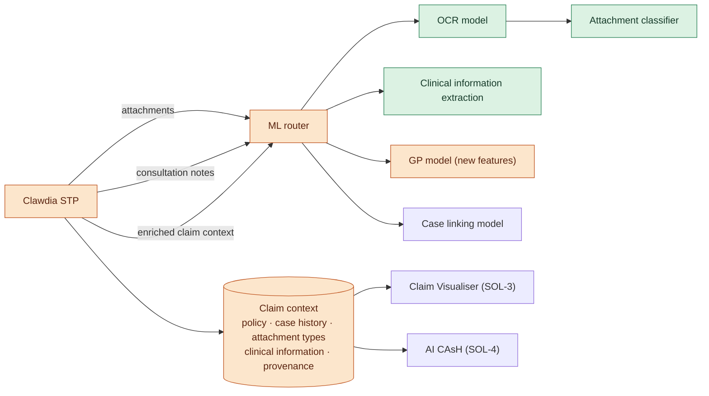

# SOL-2 — Medical Information Claim Enrichment

| | |
|---|---|
| **Tier** | 2 · Round 2 |
| **Composed of** | [ABC-01A](../changes/abc-01-ml-improvement.md#abc-01a--ml-improvement--ocr-and-attachment-classification), [ABC-01B](../changes/abc-01-ml-improvement.md#abc-01b--ml-improvement--clinical-information-extraction), [ABC-07](../changes/abc-07-enrich-claims-clinical-information-attachment-classification.md), [ABC-01C](../changes/abc-01-ml-improvement.md#abc-01c--ml-improvement--gp-model-on-the-enriched-claim-context) |
| **Problems solved** | [LP-4 Unstructured clinical evidence, LP-8 Diagnosis predictions not traceable](../cash-high-level-solution.md#22-problems-to-solve-and-associated-drivers); contributes to LP-1 (better GP model) |
| **External dependencies** | [ABC-03](../changes/abc-03-decouple-upm-clawdia.md) (started) |
| **Needed by** | SOL-3 (ABC-10), SOL-4 (ABC-01D, ABC-01E, ABC-11, ABC-14) |
| **Status** | Draft |
| **Back to** | [AI CAsH high-level solution](../cash-high-level-solution.md) |

## 1. Summary

Medical Information Claim Enrichment performs the **claim context enrichment** and delivers the first GP model improvements.

1. Clawdia STP sends the claim's attachments to the ML environment; the **ML router runs OCR, then the attachment classifier**.
2. Clawdia STP sends the consultation notes; the ML environment **extracts clinical information** with its source spans.
3. The **claim context** — claim, policy, animal case history (including pre-existing conditions), attachment classification, clinical information — is saved with provenance.
4. The enriched claim context is passed to an **improved GP model** (and, if the gain is confirmed, the case linking model) that uses the new information as features.

It addresses two problems. The models start using the inputs a human uses in a manual assessment (LP-4 — the expected gain for diagnosis prediction and case linking is an **assumption to verify**). And because every fact keeps its source, any prediction built on it can be traced back to the evidence (LP-8).

## 2. Architectural and behavioural changes

| ABC | Change | Problems | Depends on |
|---|---|---|---|
| [ABC-01A](../changes/abc-01-ml-improvement.md#abc-01a--ml-improvement--ocr-and-attachment-classification) | ML Improvement · OCR and attachment classification | LP-4 | — |
| [ABC-01B](../changes/abc-01-ml-improvement.md#abc-01b--ml-improvement--clinical-information-extraction) | ML Improvement · Clinical information extraction | LP-4, LP-8 | — |
| [ABC-07](../changes/abc-07-enrich-claims-clinical-information-attachment-classification.md) | Enrich the claim context (Clawdia STP calls the ML environment) | LP-4, LP-8 | ABC-01A, ABC-01B (deployed); ABC-03 (started) |
| [ABC-01C](../changes/abc-01-ml-improvement.md#abc-01c--ml-improvement--gp-model-on-the-enriched-claim-context) | ML Improvement · GP model on the enriched claim context | LP-4, LP-1 | ABC-07 (deployed) |

## 3. Component changes by component

| Component | Add | Evolve | Decommission |
|---|---|---|---|
| ML environment — OCR model | ABC-01A.1 | | |
| ML environment — attachment classifier | ABC-01A.2 | | |
| ML environment — clinical information extraction | ABC-01B.1 | | |
| ML router | | ABC-01A.3, ABC-01B.2, ABC-01C.1 | |
| GP model | | ABC-01C.2, ABC-01C.3, ABC-01C.4 | |
| Case linking model | | ABC-01C.5 | |
| ML environment — endpoint, monitoring | ABC-01A.4, ABC-01B.3 | ABC-01C.6 | |
| STP – Clawdia | | ABC-07.1, ABC-07.2, ABC-07.5 | |
| Claim context store | ABC-07.6 | ABC-07.3 | |
| VetHub / Storage API | | ABC-07.4 | |

## 4. Target flow

## 5. Patterns

Content enricher · pipeline in the ML router (OCR → classifier) · claim-check (attachments by reference) · provenance on every derived fact · graceful degradation (the assessment proceeds without enrichment if a call fails).

## 6. Out of scope

- Questions and answers per diagnosis family ([SOL-4](ai-claim-assessment-harness.md)).
- Multiple-diagnosis and pre-existing condition models ([ABC-14](../changes/abc-14-specialist-models.md), Tier 3 unless brought forward — OQ-12).
- Changing the merged PDF UPM receives.

## 7. Risks

| Risk | Mitigation |
|---|---|
| The LP-4 assumption doesn't hold (no uplift for the models) | Verify on an evaluation set first (ABC-01C); the enriched context still serves the Claim Visualiser and traceability |
| OCR or extraction quality too low for automation | Use the context first for people (visualiser), then for automation once measured |
| Added latency before assessment | Runs early with Early Starter; timeout and proceed |
| Clinical data in more places | Same classification and access controls as the claims DBs (AP6) |
| Cost of OCR / extraction per claim | Classify first; extract only from relevant attachment types |

## 8. Measures

Attachments classified at or above threshold · claims with clinical information before the ensemble runs · GP model and case linking accuracy with and without the new features · share of predicted codes traceable to evidence.

## 9. Open questions

- Attachment taxonomy and ownership.
- Source of the animal case history before lodgement.
- Claim context store: extend `PSPRODClaimsAutoDB` or a dedicated store?
- Should UPM receive typed attachments instead of one merged PDF (Gratex)?
