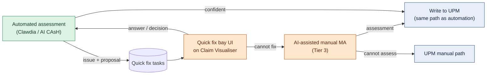

# SOL-3 — Quick Fix Bay

| | |
|---|---|
| **Tier** | 2 · Round 2 (foundation) → 3 · AI CAsH (expanded) |
| **Composed of** | Tier 2: [ABC-10](../changes/abc-10-claim-visualiser.md), [ABC-08](../changes/abc-08-introduce-quick-fix-bays.md), [ABC-09](../changes/abc-09-decommission-catch.md) · Tier 3: [ABC-12](../changes/abc-12-quick-fix-bays-for-answers.md), [ABC-13](../changes/abc-13-ai-assisted-manual-medical-assessment.md) |
| **Problems solved** | [LP-1 All-or-nothing assessment, LP-7 Fragmented exception handling](../cash-high-level-solution.md#22-problems-to-solve-and-associated-drivers); contributes to LP-5 (CATCH) and LP-8 |
| **External dependencies** | ABC-03, ABC-07 (Tier 2); ABC-11 (Tier 3) |
| **Status** | Draft |
| **Back to** | [AI CAsH high-level solution](../cash-high-level-solution.md) |

## 1. Summary

A **quick fix bay** is a place where a person resolves **one specific issue** that stopped automation, with the evidence and the automated proposal in front of them, and then hands the claim back to the automated path. The bays share one UI, built on the **Claim Visualiser**, and one task model.

| Tier | Bays | Purpose |
|---|---|---|
| **2 · Foundation** | Claim Visualiser · first bay type **[TBC]** · CATCH functions moved in | Prove the task model, the resume-automation loop and the decision trace; retire CATCH |
| **3 · Expanded** | Answers bay (confirm AI-agent answers, answer assessor-led questions) · AI-assisted manual medical assessment (ultimate bay before UPM) | Targeted intervention, then resume automation |

## 2. Architectural and behavioural changes

| ABC | Change | Tier | Problems | Depends on |
|---|---|---|---|---|
| [ABC-10](../changes/abc-10-claim-visualiser.md) | Claim Visualiser | 2 | LP-7, LP-8 | ABC-07 (started) |
| [ABC-08](../changes/abc-08-introduce-quick-fix-bays.md) | Introduce quick fix bays | 2 | LP-1, LP-7 | ABC-10, ABC-03 (deployed) |
| [ABC-09](../changes/abc-09-decommission-catch.md) | Decommission CATCH / CATCH2 | 2 | LP-7, LP-5 | ABC-08 (deployed) |
| [ABC-12](../changes/abc-12-quick-fix-bays-for-answers.md) | Quick fix bays for answers | 3 | LP-1 | ABC-08, ABC-11 (deployed) |
| [ABC-13](../changes/abc-13-ai-assisted-manual-medical-assessment.md) | AI-assisted manual medical assessment | 3 | LP-1, LP-7, LP-8 | ABC-08, ABC-10, ABC-11 (deployed) |

## 3. Task model

| Field | Content |
|---|---|
| Type | Which bay (first Tier 2 bay, answers, manual MA, …) |
| Claim | Conversation id, CRN, insurer routing context |
| Issue | The specific question(s) or failure, raised by which step |
| Evidence | Links into the Claim Visualiser (attachments, note excerpts, facts) |
| Proposal | Automated best answer with confidence and model / rule version |
| Outcome | Human answer, who, when; accept / edit / reject per proposal |
| Resume point | The automated step to continue from |

## 4. Component changes by component

| Component | Add | Evolve | Decommission |
|---|---|---|---|
| Claim Visualiser | ABC-10.1 | | |
| Quick fix task service | ABC-08.1 | ABC-12.2 | |
| Quick fix bay UI | ABC-08.2, ABC-12.1, ABC-13.1 | ABC-09.1 | |
| STP – Clawdia / `PSPRODClaimsAutoDB` | | ABC-08.3, ABC-10.2 | |
| Claim context store | | ABC-10.3 | |
| STP – Clawdia (harness) | | ABC-12.3, ABC-13.2 | |
| Event platform | | ABC-08.4 | ABC-09.5 (CATCH subscriptions) |
| COS | | ABC-09.2 | |
| Dynamic CLAPI | | ABC-09.3, ABC-13.3 **[TBC]** | |
| UPM+ | | ABC-10.4, ABC-13.4 **[TBC]** | |
| ML environment | | ABC-12.4 | |
| Monitoring | ABC-08.5 | | |
| CATCH (UI, API, functions, SignalR, tables), CATCH2 | | | ABC-09.4 – ABC-09.7 |

## 5. Target flow

## 6. Principles and patterns

AP4 (human by exception) · AP10 (human accountability — AI never declines on its own; every decision traced) · AP8 (make it understandable) · process manager with human task · resume from checkpoint · human answers feed calibration.

## 7. Risks

| Risk | Mitigation |
|---|---|
| Bays become another tool next to UPM and CATCH | Retire CATCH in the same tier; deep links from UPM |
| Assessors over-trust proposals (automation bias) | Show confidence and evidence; audit sampling; measure human edits |
| Tasks pile up | SLA, prioritisation, fallback to UPM's manual path after timeout |

## 8. Measures

Quick fix rate · full manual fall-out % · median time per task by bay · AHT on assisted manual assessments · share of proposals accepted unchanged.

## 9. Open questions

- Build as a Go Tech web app, extend the UPM Claims Advisor experience (Gratex), or use a workflow / low-code platform?
- Which roles work which bays; routing by diagnosis family?
- First bay type for Tier 2.
