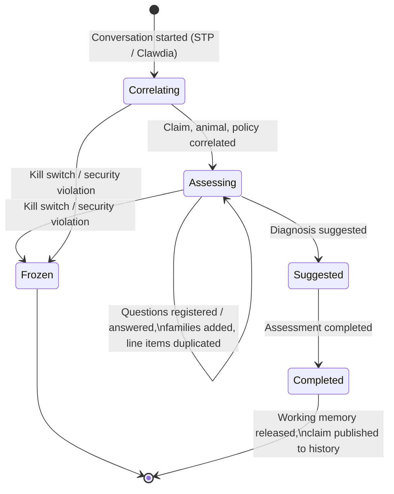
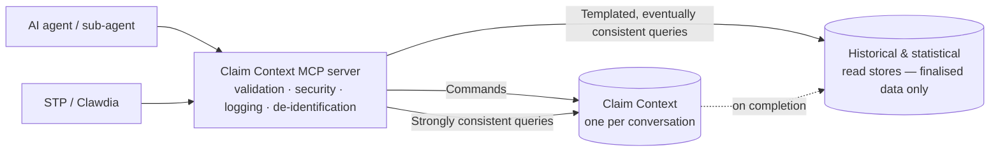
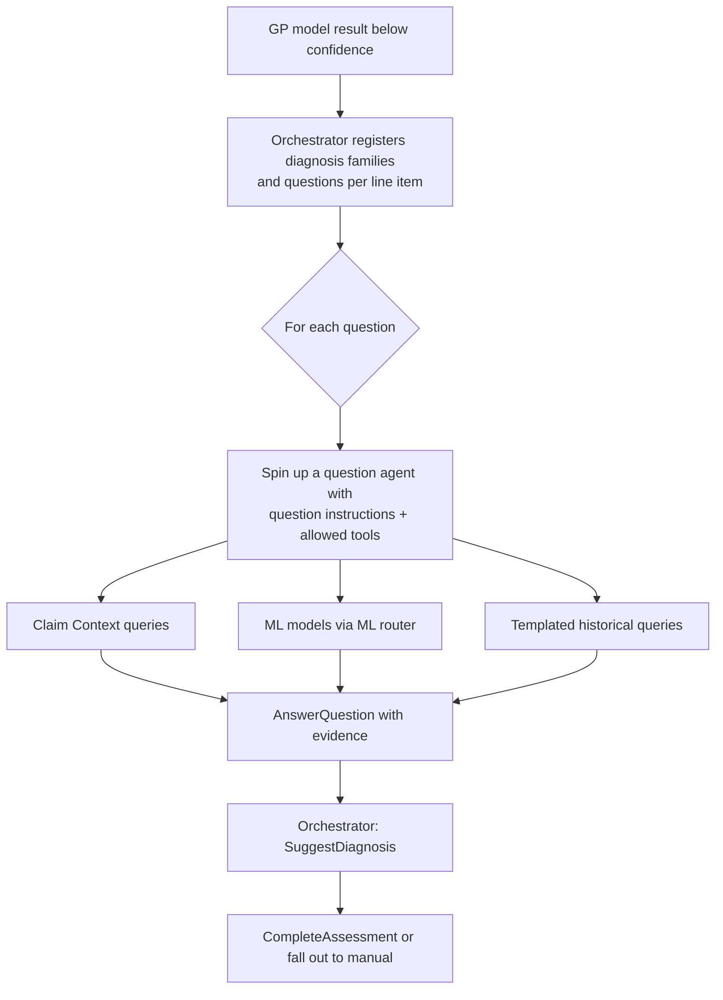

# Claim Context — High-Level Solution

**Status:** First draft · **Author:** Danilo · **Initiative:** STP 90 / AI-assisted claim assessment

<!-- TODO: Run an event storming session for the Claim Context and capture it on a Figma (FigJam) whiteboard: commands, facts/events, policies, read models, external systems. Link the board here once it exists. -->

---

## 1. Summary

The **Claim Context** is an MCP server that gives AI agents one safe, auditable place to work on a single claim assessment.

It holds everything an agent needs to know about *one* claim while it is being assessed: the claim, its line items, the animal, the policy, the candidate diagnosis families, the questions to answer and the answers given so far. Agents change it only through a small set of validated **commands**, read it through **strongly consistent queries**, and reach historical data only through a fixed set of **templated, eventually consistent queries**.

> **Terminology.** Following MCP conventions, the Claim Context as a whole is an **MCP server**, and each command or query it exposes (e.g. `AnswerQuestion`, `QueryClaimContext`) is an **MCP tool**. *Operation* is used only in its general sense (e.g. the CQRS distinction below).

This design gives us four things at once:

1. **Safety.** An agent working on a claim can only see that claim, and can only change it through rules we control.
2. **Correctness.** What an agent reads always reflects what has just happened on the claim.
3. **Traceability.** Every change and every query is recorded, so every suggested diagnosis can be explained and replayed.
4. **Continuous improvement.** The same records tell us which tools are useful, which are missing, and where agents struggle.

---

## 2. Why we need it

The GP model and the deterministic rules in STP resolve many claims, but a share of them fall out to manual medical assessment. AI agents can help close that gap, but only if we can trust them. Today we cannot safely give an agent broad access to UPM or other systems: the data is too wide, the queries too slow, and we would have little control over what the agent does or why.

The Claim Context solves this by putting a purpose-built boundary between the agent and our systems. The agent gets exactly the data and actions it needs for one assessment, and nothing else.

---

## 3. Key concepts in two minutes

### 3.1 CQRS — separating changes from questions

**CQRS** (Command Query Responsibility Segregation) means we treat *changing* something and *asking about* something as two different kinds of operation, with different paths and different rules.

- A **command** asks the Claim Context to change. It can be accepted or rejected. *Example: "Correlate this claim to policy P-123."*
- A **query** asks a question and changes nothing. *Example: "Which line items are still waiting for a diagnosis family?"*

Separating them lets us validate every change strictly while keeping questions fast and cheap.

### 3.2 Strong consistency

A query is **strongly consistent** when it always reflects every change made before it. If an agent correlates a claim to a policy and immediately asks "which policy is this claim on?", it must get the new answer, never the old one.

*Claim example:* an agent answers question Q3 for line item 2, then asks "which questions are still open for line item 2?". Q3 must not appear in the list.

### 3.3 Eventual consistency

A query is **eventually consistent** when its data may lag slightly behind reality, but catches up. This is acceptable — and normal — for data that does not change during the assessment.

*Claim example:* "How many finalised claims for this breed had a dermatology diagnosis family in the last two years?" Whether that count includes a claim finalised two seconds ago makes no difference to the assessment.

---

## 4. How the Claim Context behaves

### 4.1 One context per assessment

- A Claim Context is created when an assessment conversation starts and is identified by the **conversation ID**.
- It is correlated to the claim, the animal and the policy by STP / Clawdia before any agent starts working on it.
- It lives only for the duration of the assessment. When the assessment completes (or is abandoned and times out), its working memory is released.
- The claim under assessment is **provisional**: it is never visible in historical or statistical data until the assessment completes. This keeps statistics clean and prevents an unassessed claim from influencing other assessments.

### 4.2 Every change is a recorded business fact

Every accepted command is recorded as a fact, in order ("Policy correlated", "Question answered", "Line item duplicated"…). As a result, out of the box:

- the current state of a context can always be rebuilt, for example after a restart;
- we have a complete, ordered history of how every assessment reached its outcome;
- any assessment can be replayed and inspected after the fact;
- downstream consumers (historical stores, reporting, ML training data) can be fed from these facts once an assessment completes.

### 4.3 Lifecycle

---

## 5. Principles

| # | Principle | What it means in practice |
|---|-----------|---------------------------|
| P1 | **Scoped to one claim** | Everything the context holds belongs to a single claim and its policy, animal and history references. |
| P2 | **Changes only through commands** | No agent or tool writes to the context directly. Every change is a command that is validated against business rules. |
| P3 | **The context does not trust the model** | Business rules (invariants) are enforced by the context, not by prompts. A tricked or confused agent still cannot break them. |
| P4 | **Read-your-own-writes** | Strongly consistent queries always reflect every accepted command for that context. |
| P5 | **Historical data through templates only** | Data outside the claim is reachable only through a finite set of predefined, parameterised queries. |
| P6 | **One change at a time per context** | Commands for the same context are processed strictly one after the other; a query always reflects every command accepted before it. Different contexts run fully in parallel. |
| P7 | **Everything is logged** | Every tool call — accepted, rejected or failed — is recorded with who, what, when and the result. This AI interaction log is kept at the MCP / API layer, separate from the Claim Context's own state. |
| P8 | **Minimum necessary data, de-identified where possible** | The AI only sees what the task needs, with personal data replaced by tokens (see section 8.4). |
| P9 | **Provisional until complete** | The claim under assessment never enters shared historical data until the assessment completes. |

---

## 6. The three types of tools

### 6.1 Commands — change the Claim Context

Commands are validated, processed one at a time per context, and either accepted (recorded as a fact) or rejected with a reason. Rejections are logged and treated as a signal (see 8.2).

### 6.2 Strongly consistent queries — read the Claim Context

These read the current state of the context. Because the context only ever contains data about *this* claim, agents can be given a **full query language** (Cypher, over a graph view of the context) without risk of reaching unrelated data. This has two benefits: agents are not limited by a fixed menu of questions, and the queries they write tell us exactly what they were looking for.

Guardrails: read-only, time-limited, size-capped results, always scoped to the conversation ID.

### 6.3 Eventually consistent queries — read history, through templates

These reach data beyond the claim: prior finalised claims, statistics, cohort behaviour. Because that data spans many claims and customers, agents get **only predefined, parameterised queries**. The agent chooses which template to run and supplies its parameters; it never writes the query itself.

When an agent needs a historical query that does not exist, it says so through a dedicated feedback tool (`ReportMissingQuery`). This is how the template catalogue grows, based on real need.

---

## 7. Tool catalogue (first draft)

> The catalogue is incomplete by design. It will be refined through the event storming session and by observing agents in a controlled pilot.

### 7.1 Commands

| Command | Called by | Purpose | Example rule (invariant) |
|---------|-----------|---------|--------------------------|
| `CorrelateToConversationId` | STP / Clawdia | Creates the context for an assessment conversation. | One context per conversation ID. |
| `CorrelateToClaimReferenceNumber` | STP / Clawdia | Links the context to the claim. | Can be set once; cannot be changed afterwards. |
| `CorrelateToAnimal` | STP / Clawdia | Links the context to the animal. | Can be set once; animal must belong to the correlated policy. |
| `CorrelateToPolicy` | STP / Clawdia | Links the context to the policy. | Can be set once. A second, different policy is rejected and raised as a security signal. |
| `AddExistingCondition` | STP / Clawdia | Adds a known pre-existing or related condition from history. | Condition must belong to the correlated animal. |
| `RegisterLineItems` | STP / Clawdia | Registers the invoice line items to assess. | Only before assessment starts. |
| `AddDiagnosisFamily` | Orchestrator / agent | Adds a candidate diagnosis family to a line item (e.g. from the GP model with low confidence). | Line item must exist; family must be valid. |
| `DuplicateLineItem` | Orchestrator / agent | Creates a copy of a line item when it is a candidate for more than one diagnosis family, so each copy is assessed separately. | Only while assessing; original must exist. |
| `RegisterSubAgent` | Main agent / orchestrator | Registers a sub-agent the main agent has spun up, with the question it works on and its allowed tools. The sub-agent receives scoped access to the rest of the tools. | Only registered sub-agents can call tools; a sub-agent's tools must be a subset of the question's allow-list. |
| `RegisterQuestions` | Orchestrator | Registers the questions to answer for a line item and diagnosis family. | Questions must belong to that family's question set. |
| `AnswerQuestion` | Agent | Records an answer, with confidence and references to the evidence it used (query and tool call IDs). | Question must be registered and open; evidence references are mandatory. |
| `RecordToolResult` | Agent / orchestrator | Records the result of an external tool or model call (e.g. an ML prediction) so it becomes part of the claim's evidence. | Tool must be on the allow-list for that question. |
| `SuggestDiagnosis` | Orchestrator / agent | Proposes the diagnosis for a line item, based on the answered questions. | All mandatory questions answered. |
| `CompleteAssessment` | Orchestrator | Closes the assessment and publishes the outcome. | Every line item has a suggestion or an explicit fall-out to manual. |
| `FreezeContext` | Security / operations | Stops all activity on the context (kill switch). | Always accepted from authorised callers. |

### 7.2 Strongly consistent queries

| Query | Purpose |
|-------|---------|
| `QueryClaimContext` (Cypher) | Read-only Cypher query over the graph view of this claim context. |
| `GetClaimContextSchema` | Describes node types, relationships and properties, so the agent can write correct queries. Also packaged as a skill with examples. |
| `GetAssessmentStatus` | Convenience query: open questions, answered questions, line items without a suggestion, tools available at this stage. |

### 7.3 Eventually consistent queries

*To be defined with the ML and claims teams.* Candidate templates for discussion:

| Candidate template | Purpose |
|--------------------|---------|
| `GetPriorFinalisedClaimsForAnimal` | Prior assessed claims for the correlated animal, with diagnosis codes. |
| `GetSimilarClaimsByDiagnosisFamily` | Finalised claims with similar line items and diagnosis family, for comparison. |
| `GetDiagnosisFamilyStatistics` | Frequency of diagnosis codes within a family, by species / breed / age band. |
| `GetProviderClaimStatistics` | Statistical profile of a service provider's claims (resolved through the Entity Mapper). |
| `ReportMissingQuery` | Feedback: the agent describes a historical query it needed but could not run. |

---

## 8. Security

### 8.1 Scope is the first line of defence

Commands and strongly consistent queries can only touch one claim context. Even with a full query language, there is nothing else for the agent to reach. Historical data is only reachable through templates whose parameters are validated and whose results are bounded.

### 8.2 Business rules as a defence against prompt injection

Consultation notes, invoices and attachments are untrusted text and may contain content that tries to steer the agent. The Claim Context does not rely on the agent behaving well: its rules reject anything that does not make business sense (re-correlating to a different policy, answering an unregistered question, suggesting a diagnosis outside the line item's families).

A rejected command that should never occur in normal work is treated as a **security signal**: it is logged with its reason and can automatically freeze the context and flag it for review.

### 8.3 Kill switch

Activity can be stopped at several levels, enforced by the MCP server so it does not depend on the model cooperating:

- **Per context** — freeze one assessment.
- **Per agent or per tool** — disable a misbehaving agent or tool.
- **Global** — reject all AI activity immediately if we suspect a compromise.

Agents use short-lived credentials, so access can be revoked instantly. The AI interaction log provides the forensic trail.

### 8.4 De-identification before data reaches the AI (proposed)

The MCP server can de-identify data on the way out to the agent and re-identify it on the way back in:

- **Personal data is replaced by stable tokens** — owner name, address, phone, email, bank details, vet staff names become `OWNER_1`, `ADDRESS_1`, etc. Tokens are consistent within a context, so the agent can still reason about relationships ("the same owner as the previous claim").
- **Free text is scanned** — consultation notes and invoice text pass through a PII detection step before reaching the agent.
- **Clinically relevant data is kept** — species, breed, age, sex, clinical findings and treatments are needed for assessment and stay readable.
- **Re-identification happens only inside our boundary** — when the agent issues a command referencing a token, the MCP server maps it back. The token map never leaves the server.

The animal's name is not needed for assessment and is treated as data to remove: it must be replaced with a token everywhere it appears, including the OCR text extracted from attachments (invoices, consultation notes, referral letters).

Open points: how reliable PII detection is on clinical shorthand and OCR output; how de-identification interacts with Cypher queries over raw text properties.

### 8.5 Every MCP call is validated and logged

This is a cross-cutting requirement for every tool on every MCP server: authenticate the caller, authorise the tool call for that agent and stage, validate inputs, apply de-identification, log the call and its result.

---

## 9. Auditing and measuring tool usefulness

Every call is logged with the conversation ID, the agent or sub-agent ID, the question it was working on, the tool, its inputs, its outputs (or a reference to them) and timing. From these logs we can measure usefulness **without asking the agent's opinion** (which costs tokens and may be unreliable):

- **Usage** — how often each tool is called, per diagnosis family.
- **Contribution** — because `AnswerQuestion` must reference the calls it is based on, we know which results actually feed answers and which are fetched and ignored.
- **Friction** — errors, empty results, retries, and long chains of calls to obtain one fact.
- **Outcome** — when a human assessor overrides an answer, we trace back to the tool calls it relied on.
- **Gaps** — `ReportMissingQuery` calls and recurring Cypher patterns show which new templates or tools to build.

---

## 10. Agents, sub-agents and other tools

The Claim Context is not the only source of tools an agent uses. To answer a question an agent may combine tools from several MCP servers and other services, for example:

> *Question: "Is the presented skin condition likely a recurrence of a previous condition?"*
> 1. Strongly consistent query on the Claim Context for the line item, its diagnosis family and existing conditions.
> 2. Call the ML router (e.g. the case linking model) with that information.
> 3. Record the ML result with `RecordToolResult`.
> 4. Submit the answer with `AnswerQuestion`, referencing steps 1–3 as evidence.

The intended shape of the workflow is deterministic, with agents filling specific gaps:

Each question in the question set carries:

- the question itself;
- a suggested approach to answer it;
- the list of tools the agent is allowed to use (Claim Context tools and tools from other MCP servers or services);
- dependencies on other questions, if any (so the orchestrator can run questions in waves).

The MCP server enforces the tool allow-list per question, so an agent cannot use tools beyond what its question needs.

### 10.1 Registering sub-agents

When the main agent spins up a sub-agent, it first registers it in the Claim Context with `RegisterSubAgent`, stating which question the sub-agent works on and which tools it may use. Registration gives the sub-agent scoped access to the rest of the tools for that context only; an unregistered agent cannot call anything.

This gives us a complete picture of the agent tree for every assessment:

- **What the main agent did** — which sub-agents it created, for which questions, with which tools.
- **What each sub-agent did** — every call is attributed to a registered sub-agent.
- **Audit checks** — during the audit phase we can verify security breaches (a sub-agent trying to use tools outside its grant, or acting on a question it was not registered for) and token waste (sub-agents spun up for questions already answered, duplicated work, unusually long call chains).

---

## 11. Non-functional requirements

### 11.1 One change at a time per context (single-writer principle)

All commands for the same Claim Context are processed **strictly one at a time, in order**, and every strongly consistent query reflects all commands accepted before it. In the industry this is called the **single-writer principle** (also *per-key* or *per-aggregate serialisation*; actor frameworks call it *turn-based concurrency*). It guarantees that:

- two sub-agents working on the same claim never see or create a half-updated state;
- a query issued after a command always sees that command's effect (read-your-own-writes);
- business rules are always checked against the latest state.

> **Different Claim Contexts are processed fully in parallel.** The one-at-a-time rule applies only *within* a single context. Thousands of assessments can run at the same time without waiting on each other, and the platform scales out by adding capacity, not by queuing claims.

### 11.2 Memory usage in the MCP server

- The working state of a context is held in memory **only while the assessment is active** and is released on completion.
- An idle timeout releases contexts that are abandoned or whose assessment crashed.
- Data is tiered: small, frequently used data (line items, questions, answers, diagnosis families) stays in memory; large data (attachments, OCR text, full consultation notes) is kept outside and referenced.
- Expensive historical queries run once and their results are kept as a **working set** behind a handle, scoped to the conversation, so the agent queries slices instead of loading everything into its prompt.
- After a restart, a context's working state is rebuilt from its recorded facts on first use; no state is lost. The only cost is that the first query after a restart takes longer.
- Limits per context (memory, result size, query timeout) must be defined and enforced.

### 11.3 Performance

- Strongly consistent queries must be fast enough for interactive agent loops (target to be defined).
- No tool runs complex joins against UPM at query time; historical data is pre-shaped in read stores built for agents.

---

## 12. Open questions

1. **Agent per question, or instructions per question?** Should we create a dedicated agent for each question, or have one generic question agent that receives, at spin-up, the question's instructions and its allowed tools? The second option is simpler to maintain; either way, the MCP server must guarantee the agent cannot use tools outside its allow-list.
2. **How do question agents call ML models?** Directly through an ML MCP server, or through the Claim Context so the result is recorded automatically?
3. **Which eventually consistent templates do we need first?** To define with the ML and claims teams.
4. **How far does de-identification go?** Which fields, which PII detection approach, and how it works with free-text graph queries.
5. **Concurrent question agents** — how many in parallel per claim, and how question dependencies are declared.
6. **Who can call which command?** Fine-grained authorisation matrix (STP / Clawdia, orchestrator, question agents, operations).
7. **Resolving duplicated line items** — the exact rules for choosing a final diagnosis when a line item was assessed against more than one family.

---

## 13. To do

- [ ] **Asynchronous tool calling with long-delayed responses.** Some tools (heavy historical queries, ML calls) may take long. Investigate options: returning a handle and a separate "get result" tool; MCP's emerging long-running task support (client support still patchy); or the orchestrator pausing the agent's turn and injecting the result when ready.
- [ ] **Event-driven agents with Azure.** Verify how Azure AI Foundry agents support event-driven continuation: when an MCP tool call starts a long-running task, can the agent be notified (or resumed) when that task reports progress or produces its result, instead of polling? Check what the agent service, MCP and our orchestrator each support.
- [ ] **Event storming whiteboard on Figma** for the Claim Context (see comment at the top of this document).
- [ ] Define the first set of eventually consistent query templates.
- [ ] Define the de-identification scope and approach.
- [ ] Define the authorisation matrix per command and caller.
- [ ] Define performance and memory limits per context.
- [ ] Decide the "agent per question" open question.
