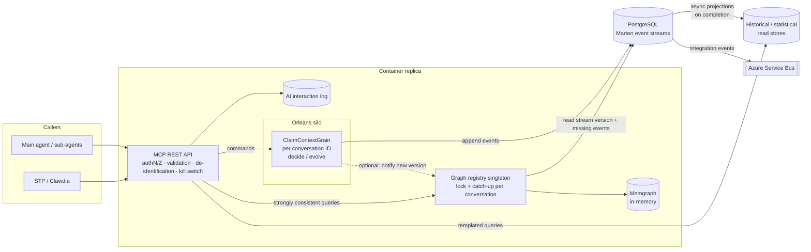
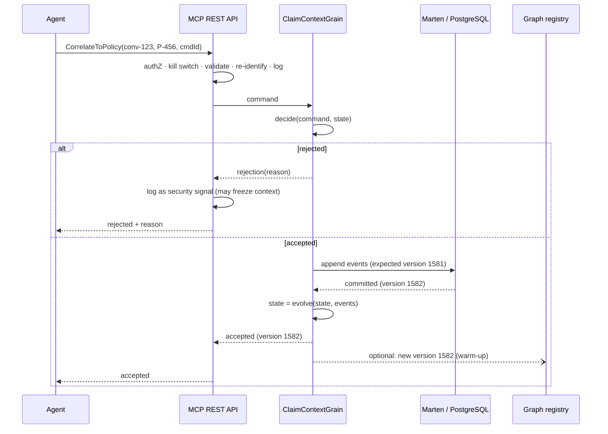
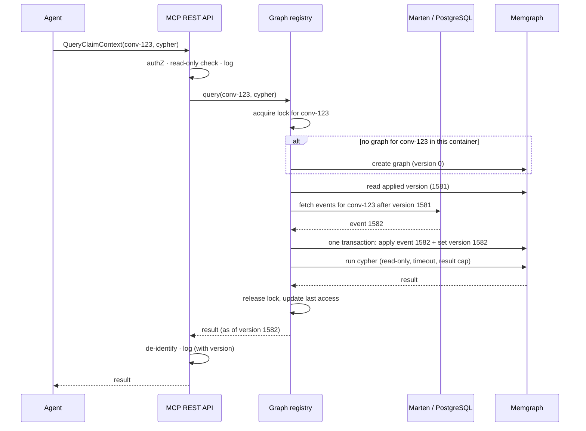

# Claim Context — Implementation Approach

**Status:** First draft (rev. 2) · **Companion to:** *Claim Context — High-Level Solution*

---

## 1. Summary

The Claim Context is split into a **command side** and a **query side**, connected only by the event stream.

- **Command side.** An event-sourced aggregate hosted in a **Microsoft Orleans grain**, one grain per conversation ID, processes commands one at a time and appends the resulting events to **Marten** on **PostgreSQL**. Marten is the single source of truth.
- **Query side.** In each container, a **graph registry singleton** keeps an in-memory **Memgraph** graph per claim context. Before answering any strongly consistent query, it reads Marten and applies any events the graph has not yet seen (**catch-up on read**). The graph is therefore always at the latest committed version when the query runs.
- **Edge.** An **MCP REST API** sits in front of everything. It handles authentication, authorisation, validation, de-identification and the kill switch, and owns the **AI interaction log**, which is kept separate from the Claim Context state.
- **History.** Historical and statistical read stores are built by **Marten asynchronous projections** when assessments complete; integration events go out through **Azure Service Bus**.

| Concern | Technology | Role |
|---------|------------|------|
| MCP REST API | ASP.NET Core (Azure Container Apps) | Entry point for agents and STP / Clawdia; security, de-identification, AI interaction log. |
| Command processing | Orleans grain (`ClaimContextGrain`) | One live, single-threaded instance per conversation ID. Validates commands, appends events. |
| Business rules | Pure domain aggregate (`decide` / `evolve`) | Invariants; no infrastructure dependencies. |
| Source of truth | Marten event store on PostgreSQL | One event stream per conversation ID. |
| Strongly consistent read model | Memgraph (in-memory), managed by a per-container graph registry | Graph view of the claim, caught up to the latest committed version before every query. |
| Eventually consistent read models | Marten async projections → historical stores | Finalised data for templated queries. |
| AI interaction log | Log store owned by the MCP REST API | Every agent call, independent of grain and event store. |
| Integration | Azure Service Bus | Completed assessments and other integration events. |

---

## 2. The consistency problem we are solving

### 2.1 No shared transaction between Marten and Memgraph

There is no ACID transaction spanning PostgreSQL / Marten and Memgraph. A design that writes the event and then updates the graph can fail half-way:

| Step | Result |
|------|--------|
| Marten commits event 1582 | Success |
| Memgraph applies event 1582 | Failure |
| Agent queries the graph | Graph still at version 1581 → **stale answer** |

Orleans serialises calls within one non-reentrant grain activation, but it cannot make two independent database transactions atomic. Pushing events into the graph after the commit is therefore not enough on its own to guarantee strong consistency.

### 2.2 Version fencing

The fix is to never answer a query from a graph that is behind the committed stream:

```text
Marten stream version:   1582
Graph applied version:   1581
Query allowed?           NO  → apply event 1582

Marten stream version:   1582
Graph applied version:   1582
Query allowed?           YES
```

The design in this document makes the query path itself enforce that fence, by catching the graph up from Marten before every query.

---

## 3. Component view



The command side and the query side share nothing but the Marten stream. Any container can serve a query for any conversation, because it can always build or catch up the graph from Marten.

---

## 4. The pieces in more detail

### 4.1 MCP REST API

For every call it:

1. Authenticates the caller and authorises the tool call for that caller, stage, question and registered sub-agent (tool allow-list).
2. Checks the kill switch (global, per agent, per tool, per conversation).
3. Validates inputs; for Cypher queries, accepts read-only queries only.
4. De-identifies outgoing data (including OCR text from attachments) and re-identifies tokens in incoming commands.
5. Routes: commands to the grain; strongly consistent queries to the graph registry; templated queries to the historical stores.
6. Writes the **AI interaction log**: conversation ID, agent / sub-agent ID, question ID, tool, inputs, result or result reference, duration, outcome.

The AI interaction log lives here, not in the grain or the event stream. Business facts go to Marten; *who asked what and what they got back* goes to the interaction log. The two are correlated by conversation ID and command ID.

### 4.2 `ClaimContextGrain` — command side

- **Grain key = conversation ID**; non-reentrant, so commands for one conversation are processed one at a time. Different conversations run fully in parallel across the cluster.
- **Hosts the aggregate.** On activation it loads the stream from Marten and folds it through `evolve`. For each command it runs `decide`, appends the events with the expected stream version, applies them with `evolve`, and returns the new version.
- **No graph, no query handling.** The grain is purely the write side.
- **Idempotent commands.** Every command carries a command ID, stored in the event metadata. If a commit outcome is ambiguous (timeout after the append), the caller retries with the same ID and the grain recognises it as already applied instead of applying it twice.
- **Optional notification.** After a successful append it can notify the local graph registry of the new version so the graph is warmed up before the next query. This is an optimisation only; correctness never depends on it.

### 4.3 Domain aggregate — functional core

```text
decide(command, state)  -> events | rejection(reason)
evolve(state, event)    -> state
```

Both are pure. Persisting events, updating graphs and logging all happen outside them. Marten `Apply` methods, if used, have no side effects, because Marten may skip them (snapshots) or run them more than once (rebuilds).

### 4.4 Marten event store

- One stream per conversation ID, appended with expected-version checks.
- The stream version is the **fence** used by the query side.
- Async projections listen for `AssessmentCompleted` and feed the historical stores and Service Bus. This is the only path by which a claim enters shared history.

### 4.5 Graph registry singleton — query side

One instance per container. It owns the in-memory graphs and guarantees they are up to date before a query runs.

**State it keeps per conversation:**

- a handle to that conversation's graph;
- an async lock (one per conversation), so only one catch-up runs at a time for a given graph;
- a last-access timestamp for eviction.

**The graph records its own version.** Each graph holds a single version node (e.g. `(:StreamVersion {conv, version})`). Every batch of events is applied **in one Memgraph transaction together with the version update**, so the recorded version always matches the data in the graph. A failed apply leaves both unchanged.

**Projection is idempotent.** Each event maps to a parameterised `MERGE` statement, so re-applying an event never creates duplicates.

**Isolation options** (a decision for the spike — see section 8):

| Option | Notes |
|--------|-------|
| One Memgraph database per conversation | Cleanest isolation and cleanup. Multi-database is, as far as we know, a Memgraph Enterprise feature. |
| One Memgraph instance per conversation | Clean isolation on Community Edition, but heavy in memory and process count. |
| Shared Memgraph per container, nodes tagged with conversation ID | Light; requires validating that every agent query is anchored on its own conversation. |
| In-process .NET graph instead of Memgraph | No isolation issue; loses Cypher unless we add a query layer. |

---

## 5. How it works

### 5.1 Command flow



### 5.2 Strongly consistent query flow (catch-up on read)



Because the registry reads the committed stream immediately before answering, the result reflects every command committed before the query started. In particular, when an agent's command has been acknowledged, its next query always sees that command (read-your-own-writes). The response includes the stream version it was answered at, which is also written to the interaction log.

### 5.3 Rebuild after restart, scale-out or a new container

There is nothing special to do. A container with no graph for a conversation simply creates an empty one and catches up from version 0 on the first query. **The only cost is that the first query takes longer.** Restarts, scale-in and scale-out never lose state and never produce stale answers.

### 5.4 Eventually consistent query flow

The MCP REST API validates the template and parameters, resolves IDs through the Entity Mapper if needed, queries the historical store, de-identifies and logs. No grain or graph involved.

### 5.5 Completion and eviction

- `AssessmentCompleted` is committed; Marten async projections publish the finalised claim to history and Service Bus.
- Graph registries drop the conversation's graph when they see the completion (via the optional notification or the next catch-up) or after an **idle timeout**.
- The grain deactivates after its own idle timeout.

---

## 6. Consistency guarantees and their boundaries

This design gives **strongly consistent, up-to-date queries for a single claim context**, provided that:

1. **All writes go through the grain.** Commands for a conversation are serialised by its grain and committed to Marten before they are acknowledged.
2. **Only the graph registry writes to Memgraph**, and only from Marten events.
3. **No query is served until the graph has caught up** to the stream version read from Marten at query time.
4. **Event application and the version update are atomic** within Memgraph (one transaction).
5. **Ambiguous commits are reconciled** through stream versions and command IDs, never by guessing.
6. **Queries run in a single Memgraph read transaction**, so they observe a consistent snapshot.
7. **Catch-up per conversation is serialised** by the registry's lock, so two concurrent queries cannot apply the same events twice or interleave.

Boundaries:

- **Direct access to Memgraph is not allowed.** Anything that queried Memgraph without going through the registry could observe a graph that has not caught up yet.
- **Queries spanning several claim contexts** are outside this guarantee. Each graph is consistent with its own stream; there is no consistency boundary across streams. Cross-claim questions belong to the eventually consistent, templated queries.
- **A command still being processed is not visible.** A query that starts while a command is in flight sees the state before it. That is correct behaviour: the command has not been acknowledged yet.

---

## 7. How the high-level requirements are met

| Requirement (high-level solution) | How it is met |
|-----------------------------------|---------------|
| Scoped to one claim (P1) | One grain, one event stream and one graph per conversation ID. |
| Changes only through commands (P2) | Only the grain appends events; only the registry writes graphs, and only from events. |
| Context does not trust the model (P3) | `decide` enforces invariants; rejections are logged and can freeze the context. |
| Read-your-own-writes (P4) | Catch-up on read against the committed Marten stream version before every query. |
| Historical data through templates only (P5) | Templated queries in the MCP REST API; no free-form access to historical stores. |
| One change at a time per context, parallel across contexts (P6) | Non-reentrant Orleans grain per conversation; per-conversation lock on the query side; different conversations never wait on each other. |
| Everything logged (P7) | AI interaction log at the MCP REST API, separate from grain and event store; business facts in Marten. |
| De-identification (P8) | MCP REST API tokenises outgoing data, including OCR text, and re-identifies incoming commands. |
| Provisional until complete (P9) | Historical stores fed only by the `AssessmentCompleted` async projection. |
| Sub-agent registration and audit | `RegisterSubAgent` command recorded in the stream; API enforces per-sub-agent allow-lists; interaction log attributes every call. |
| Kill switch | API middleware flags (global / agent / tool); `FreezeContext` makes the grain reject further commands and the API reject further queries. |
| Memory released after assessment | Graph dropped on completion or idle timeout; grain deactivated when idle. |
| Survive restarts | Grain state and graphs rebuilt from Marten on first use; first query slower. |
| Replay and forensics | Any stream can be replayed into a fresh aggregate and graph offline. |
| Tool usefulness measurement | Interaction log + mandatory evidence references in `AnswerQuestion`. |

---

## 8. Risks and points to validate

| Risk | Notes / mitigation |
|------|-------------------|
| Graph isolation between claims | Depends on the isolation option in 4.5. Free-form Cypher cannot be reliably rewritten to inject a conversation filter. **Spike needed.** |
| Read-only enforcement | Validate Cypher in the API; use read-only transactions and, where the edition supports it, a read-only role. |
| Per-query latency | Every query pays one small PostgreSQL read (stream version and any new events). Measure; acceptable for agent loops is expected. |
| First-query latency | Full rebuild on first use in a container. Streams per assessment are short-lived, so expected to be small; snapshots only if measurements require them. |
| Duplicate graphs across containers | A conversation queried through several replicas gets a graph in each. Correct but uses memory; idle eviction limits it, and sticky routing can be added later as an optimisation. |
| Memory pressure | Per-container cap on number and size of graphs; least-recently-used eviction. |
| Orleans ↔ Marten integration | Plain grain code calling Marten (recommended) vs a custom log-consistency provider. |
| Team familiarity | Orleans, Marten and Memgraph are new to the team; plan a spike and pairing. |

---

## 9. Deployment sketch

- **Azure Container Apps**: one app hosting the MCP REST API, the Orleans silo and the graph registry, with Memgraph as a sidecar (or per the chosen isolation option).
- **Orleans clustering** via Azure Table Storage or PostgreSQL membership.
- **Azure Database for PostgreSQL** for Marten.
- **Azure Service Bus** for integration events.
- **AI interaction log** in a dedicated store (e.g. Log Analytics or a database table), plus OpenTelemetry traces correlated by conversation ID.

---

## 10. Suggested spike

1. One grain with three commands (`CorrelateToConversationId`, `CorrelateToPolicy`, `AnswerQuestion`); Marten stream per conversation.
2. Graph registry with catch-up on read, version node and per-conversation lock.
3. Inject a failure between the Marten commit and the graph update; verify the next query still returns version-correct results.
4. Restart a container mid-assessment; verify rebuild and first-query latency.
5. Run concurrent sub-agents on the same conversation and on different conversations; verify ordering within one and parallelism across many.
6. Evaluate the graph isolation options in 4.5.
