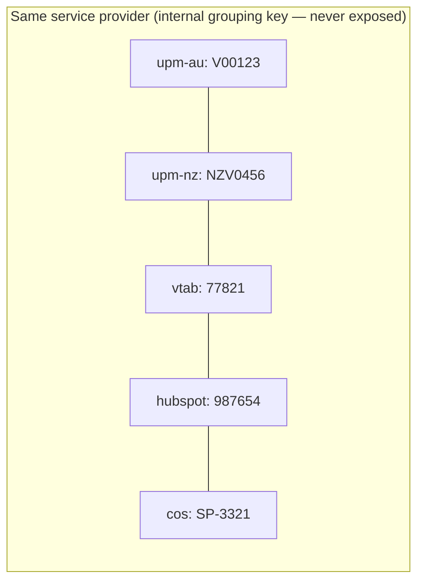

# Entity Mapper — MCP Server Proposal

**Status:** First draft · **Initiative:** STP 90 / AI enablement for claims

---

## 1. Summary

The **Entity Mapper** is a simple lookup service, exposed as an MCP server (one MCP tool per operation, see section 5), that answers one question: *"I have the ID of this entity in system A — what is its ID in system B?"*

At PetSure the same real-world entity is stored in many systems under different IDs. The Entity Mapper keeps the mapping between those IDs and lets agents (and services) resolve and register them. It is deliberately **not a source of truth** and does not hold any entity data: it only links the IDs that each system already owns.

Together with a description of the **system topology** (which systems hold which entity types), it lets an agent work out on its own how to reach an entity's data in whatever system holds it.

---

## 2. The problem

- A **service provider** has an ID in each UPM environment (UPM Australia, UPM New Zealand, UPM Trupanion), another in VTAB, another in HubSpot, and another in COS. Today divergent vet IDs across UPM instances are patched with a manual dual-insert.
- A **brand** has its own identifiers across systems.
- With the mobile app, an **animal** will exist both in UPM and in the app, and the same animal can sit on several policies across several systems.
- **Policies** may need the same treatment.

AI agents make this worse: an agent holding an ID from one system cannot fetch related data from another system without knowing how the IDs relate.

---

## 3. Principles

| # | Principle |
|---|-----------|
| E1 | **Lookup, not source of truth.** Each system remains the owner of its own IDs and data. |
| E2 | **No exposed canonical ID.** Internally the mapper groups linked IDs with a grouping key, but that key is never returned to callers or used by any system. Callers only ever see real system IDs. |
| E3 | **Generic.** Systems and entity types are data, not code: adding the mobile app or a new entity type is a registration, not a release. |
| E4 | **Topology-aware.** The mapper also describes which systems hold which entity types, so agents can plan their route. |
| E5 | **Read-mostly for agents.** Resolving is open to agents; registering and associating are restricted and audited. |

---

## 4. Concepts

| Concept | Description | Example |
|---------|-------------|---------|
| **System** | A system that owns IDs. | `upm-au`, `upm-nz`, `upm-trupanion`, `cos`, `vtab`, `hubspot`, `mobile-app` |
| **Entity type** | A kind of entity that can exist in several systems. | `service-provider`, `brand`, `animal`, `policy` |
| **Topology** | Which entity types each system holds. | `service-provider` is held by all UPM environments, VTAB, HubSpot and COS. |
| **Local entity** | An entity type + system + the ID that system uses. | `service-provider` / `upm-au` / `V00123` |
| **Association** | A link stating that two local entities are the same real-world entity. | `upm-au:V00123` ≡ `hubspot:987654` |



---

## 5. Operations

| # | Method & path | Purpose | Typical caller |
|---|---------------|---------|----------------|
| 1 | `GET /systems` | List registered systems. | Agents, services |
| 2 | `GET /systems/{systemId}/entities` | List the entity types a system holds (the topology for that system). | Agents, services |
| 3 | `GET /entities/{entityType}/systems/{fromSystemId}/{entityIdFromSystem}/to/systems/{toSystemId}` | Resolve an ID from one system to the matching ID in another system. | Agents, services |
| 4 | `GET /entities/{entityType}/systems/{fromSystemId}/{entityIdFromSystem}/to/systems` | Resolve an ID from one system to the matching IDs in **all** other systems. | Agents, services |
| 5 | `POST /entities` | Register a new entity type. | Administrators |
| 6 | `POST /systems` | Register a new system (and the entity types it holds). | Administrators |
| 7 | `POST /systems/{systemId}/entities/{entityType}/{entityId}` | Register a local entity (an ID that now exists in a system) with no association yet. | Integration services, onboarding flows |
| 8 | `POST /entities/{entityType}/systems/{fromSystemId}/{entityIdFromSystem}/to/systems/{toSystemId}/associate/{toEntityId}` | Associate an entity's ID in one system with its ID in another system. | Integration services; agents only if explicitly allowed |

As MCP tools these become, for example: `ListSystems`, `ListSystemEntityTypes`, `ResolveEntityId`, `ResolveEntityIdInAllSystems`, `RegisterEntityType`, `RegisterSystem`, `RegisterLocalEntity`, `AssociateEntities`. The topology (operations 1 and 2) can also be exposed as an MCP **resource** that agents read first.

### 5.1 Example responses

`GET /entities/service-provider/systems/upm-au/V00123/to/systems/hubspot`

```json
{
  "entityType": "service-provider",
  "from": { "system": "upm-au", "id": "V00123" },
  "to":   { "system": "hubspot", "id": "987654" }
}
```

`GET /entities/service-provider/systems/upm-au/V00123/to/systems`

```json
{
  "entityType": "service-provider",
  "from": { "system": "upm-au", "id": "V00123" },
  "matches": [
    { "system": "upm-nz",  "id": "NZV0456" },
    { "system": "vtab",    "id": "77821" },
    { "system": "hubspot", "id": "987654" },
    { "system": "cos",     "id": "SP-3321" }
  ]
}
```

Not found returns `404` with a clear reason (`unknown system`, `unknown entity type`, `entity not registered`, `no association to target system`) so agents can tell a missing mapping from a wrong request.

### 5.2 Association rules

- **Validation:** both systems must exist and must hold the entity type (topology check).
- **One ID per system per real-world entity (default):** an entity cannot be associated with two different IDs in the same system unless the system is flagged as allowing duplicates (to decide per system — e.g. legacy duplicates in UPM).
- **Merging:** associating two local entities that are each already linked to other IDs merges the two groups. Merges must be validated (no conflicting IDs for the same system) and audited.
- **Idempotency:** repeating the same association is a no-op.

---

## 6. Data model

A minimal relational shape:

| Table | Columns | Notes |
|-------|---------|-------|
| `system` | `system_id`, `name`, `description` | |
| `entity_type` | `entity_type`, `description` | |
| `system_entity_type` | `system_id`, `entity_type` | The topology. |
| `local_entity` | `entity_type`, `system_id`, `local_id`, `group_key`, `created_at`, `created_by` | Unique on (`entity_type`, `system_id`, `local_id`). `group_key` is internal only. |
| `mapping_audit` | `at`, `actor`, `operation`, `payload` | Every write. |

Resolving is a two-step lookup: find the `group_key` for the source ID, then return the rows in that group for the target system(s). Both are indexed, constant-cost reads.

---

## 7. Implementation options

| Option | How it works | Strengths | Weaknesses |
|--------|--------------|-----------|------------|
| **A. Azure Functions (or Container App) + Azure SQL / PostgreSQL** | REST + MCP endpoints over the relational model above. | Simplest; unique constraints and transactions make association and merge rules easy; fast indexed lookups; trivial listing and reporting. | Needs a database; concurrency handled by transactions. |
| **B. Azure Durable Functions (Durable Entities)** | One durable entity per local ID (`type|system|localId`, holding the group key) and one per group (holding all its IDs); a registry entity for systems and topology. Associations run as an orchestration that locks the involved entities (critical section). | Built-in single-threaded entities; serverless; no separate database to manage. | Entities are addressed by key only, so listing and searching need extra index entities; every association touches several entities through an orchestration; state stored in Azure Storage with higher read latency; harder to report on or bulk-load. |
| **C. Reuse the Orleans + Marten stack** | Grain per group, Marten for history. | Consistent with the Claim Context stack. | Over-engineered for a lookup table. |
| **D. Graph database** | Nodes per local ID, edges for associations. | Natural model for links. | Unnecessary operational weight for one-hop lookups. |

**Recommendation for the first draft:** Option A. Durable Functions (Option B) is viable and gives serialised writes for free, but the mapper is fundamentally a small, read-heavy, query-by-key-and-list workload, which a relational table with unique constraints handles more simply and more cheaply. Option B is worth keeping if the team prefers a fully serverless footprint with no database.

---

## 8. Security and governance

- Agents get **read** operations by default. Write operations (register, associate) are limited to integration services and administrators, unless a specific agent workflow is approved.
- Every MCP call is validated and logged (same cross-cutting requirement as the Claim Context).
- Wrong associations are a data quality risk: writes are audited, and a correction path is required (see open questions).
- The mapper holds only IDs, no personal data. Some IDs (e.g. customer or animal IDs) may still be considered sensitive — confirm classification.

---

## 9. How agents use it

> *An agent assessing a claim has the service provider's UPM Australia ID and needs the provider's practice information from VTAB.*
> 1. Read the topology: VTAB holds `service-provider`.
> 2. `ResolveEntityId(service-provider, upm-au, V00123, vtab)` → `77821`.
> 3. Call the VTAB data service with `77821`.

The same pattern lets eventually consistent query templates in the Claim Context (e.g. provider statistics) resolve IDs before querying historical stores.

---

## 10. Open questions

1. Do we need **unassociate / correct** operations (e.g. `DELETE` an association, split a group), and who may call them?
2. Which systems allow **multiple IDs** for the same real-world entity (legacy duplicates)?
3. How is the mapper **seeded** — bulk import from existing UPM / VTAB / HubSpot data, and who reconciles conflicts?
4. Should registrations be **event-driven** (systems publish "entity created" events that the mapper consumes) rather than API calls?
5. Is `policy` in scope for the first release?
6. Durable Functions vs relational — confirm with the Go Tech team's platform preferences.

---

## 11. To do

- [ ] Agree the initial list of systems and entity types, and the topology.
- [ ] Decide the implementation option (A or B).
- [ ] Define the correction / unassociate operations.
- [ ] Plan the initial data load for service providers (replacing the manual dual-insert).
