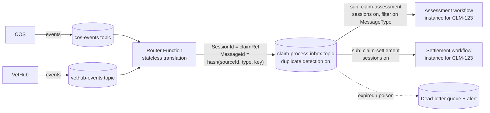
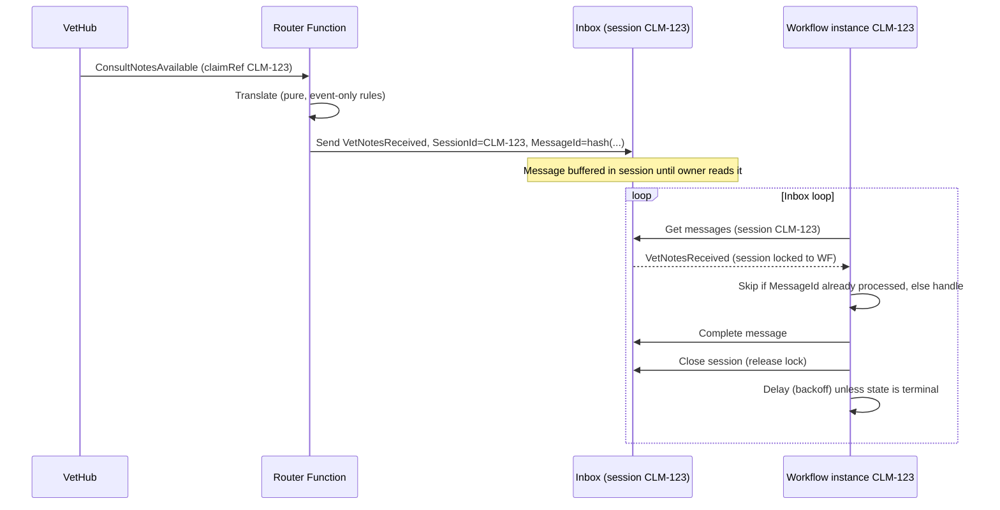

# Correlated Process Inbox

**NOTE!!!!** This document requires still review

**A pattern for long-running workflow instances that react to external events**

| | |
|---|---|
| Status | Draft for review |
| Applies to | Azure Logic Apps (Standard preferred), Azure Functions (.NET 8 isolated), Azure Service Bus (Standard/Premium) |
| Example context | Claim workflows reacting to events from COS and VetHub |

---

## 1. Problem

A long-running workflow instance (for example, one assessment per claim) reaches points where it must react to things happening elsewhere: vet notes arrive through VetHub, COS records a document, a third party responds. The systems publishing those events:

- don't know which workflow instance (if any) cares;
- speak their own models, not the workflow's;
- publish whenever they like, including before the workflow is ready and after it has finished.

We need each relevant event to reach **the one instance that owns the business key**, be processed **one at a time and in a defined order**, and have its effects applied **effectively once**. The routing component must not need to query workflow state to decide where a message goes.

## 2. Forces

- Producers must stay decoupled from consumers (no knowledge of Logic Apps run IDs or callback URLs).
- Routing must be cheap, stateless and testable.
- Workflow instances are long-lived (days to weeks), so they can't hold broker locks continuously.
- Service Bus and Functions give **at-least-once** delivery, not exactly-once.
- Events can arrive before an instance exists, while it's busy, or after it has ended.
- Payload contracts evolve independently on each side.

## 3. Solution

The pattern has three parts.

1. **Translate at the edge.** A stateless Azure Function subscribes to the source topics (COS, VetHub). For each event it runs pure translation rules. Those rules decide the outgoing message type, the payload, and the **correlation key** (the business key, such as the claim reference), using only the input event. The output is zero or more messages in the workflow's own language.
2. **Deliver to a per-key mailbox.** The Function publishes to an **inbox topic**, setting `SessionId = correlation key` and a **deterministic `MessageId`**. Each consuming process type has its own **session-enabled subscription**, filtered on `MessageType`. The session for a key is that instance's mailbox. Messages wait there until the instance reads them.
3. **One owner drains its mailbox.** Exactly one workflow instance exists per key. It runs an **inbox loop**: receive from its own session, process each message sequentially, complete it, record its ID, and repeat until the process reaches a terminal state.





### 3.1 Pattern vocabulary

This is a composition of established patterns, not a new one:

| Element | Recognised pattern | Source |
|---|---|---|
| Router Function | Message Translator; Content-Based Router; Anti-Corruption Layer | EIP (Hohpe & Woolf); DDD (Evans) |
| `SessionId` = business key | Correlation Identifier | EIP |
| Workflow instance per key | Process Manager (orchestrated saga) | EIP; Microsoft saga guidance |
| Session drained by one receiver | Sequential Convoy | Azure Architecture Center |
| Processed-ID check, deterministic `MessageId` | Idempotent Receiver, Duplicate Detection | EIP; Service Bus |
| Expired and poison messages | Dead Letter Channel | EIP |
| Mailbox per identity, one message at a time | Actor model (by analogy only) | Hewitt; Orleans virtual actors |

This isn't CQRS. No read model is separated from the write model. The relevant split is between **events** (facts published by the source systems) and **process messages** (translated, addressed facts for one process type).

## 4. Architecture principles

Each principle is given as Statement, Rationale and Implications.

### P1. Single owner per business key
**Statement:** For any process type and business key, at most one workflow instance is active, and it is the only reader of that key's mailbox.
**Rationale:** Sessions guarantee exclusive access *at a time*, not a single owner over time. Two instances would alternate on the session lock and split the messages between them.
**Implications:** Every workflow start goes through a singleton guard (an insert-only registry row keyed by process type and key). Duplicate starts terminate cleanly. Nothing else reads the inbox subscription with "next available".

### P2. Stateless, deterministic translation at the boundary
**Statement:** The router decides message type, payload and correlation key from the input event alone. It never queries workflow, ERP or third-party state.
**Rationale:** Keeps routing cheap, horizontally scalable, replayable and unit-testable. Keeps source-system models out of the workflow (anti-corruption).
**Implications:** Any rule that needs workflow state belongs in the workflow, not the router. Translation rules are pure functions covered by Given/When/Then tests. Replaying a source event always produces the same output messages.

### P3. Correlate on stable business keys
**Statement:** `SessionId` is a business key that exists before the workflow does (the claim reference), never a technical ID such as a run ID or callback URL.
**Rationale:** Producers can address a process without discovering it, and messages can arrive before the instance starts.
**Implications:** Keys must be immutable and at most 128 characters. Where one key can have several process instances over time, append a generation (for example `CLM-123:2`), and it has to be derivable from the event.

### P4. At-least-once delivery, effectively-once processing
**Statement:** Every hop assumes redelivery. Duplicates are removed by the broker where possible and ignored by the consumer always.
**Rationale:** Function retries and lost locks are normal events, not edge cases.
**Implications:** `MessageId` is derived deterministically (hash of source event ID, message type and key). Duplicate detection is enabled on the inbox. The workflow keeps processed IDs and skips repeats. Side effects downstream of the workflow are idempotent or keyed.

### P5. Explicit, versioned message contracts
**Statement:** Every process message carries `MessageType` and `SchemaVersion` as application properties and validates against a published JSON Schema at both ends.
**Rationale:** The broker doesn't validate payloads.
**Implications:** Schemas live in the repository with the code. Producer tests validate generated messages against them. The workflow parses with the same schema and dead-letters on failure. Breaking changes ship as a new version that coexists with the old one for a while.

### P6. Nothing waits forever
**Statement:** Every message has a time-to-live, and every wait in a workflow has a timeout. Expiry goes to the dead-letter queue and raises an alert.
**Rationale:** Orphaned messages (no instance, instance ended) and abandoned instances are otherwise invisible.
**Implications:** Set a default TTL on the subscription and enable dead-lettering on expiry. Workflows drain or explicitly dead-letter their remaining messages when they close. The dead-letter queue is monitored per subscription.

### P7. One mailbox per process type
**Statement:** Each consuming process type has its own session-enabled subscription. Process types never share a session space.
**Rationale:** Two consumers reading the same session ID would take each other's messages.
**Implications:** Fan-out to several process types happens through topic subscriptions and filters, not through the router knowing who the consumers are.

### P8. Ordered within a key, tolerant across sources
**Statement:** Order is guaranteed per session in the order messages were sent. The workflow tolerates business-time reordering between sources.
**Rationale:** Sessions preserve the order messages entered Service Bus, not the order events happened.
**Implications:** Messages carry `occurredAt` (and a source version where available). Where strict order matters end to end, the router's input subscription is also session-enabled, keyed by the same business key.

### P9. Observable correlation
**Statement:** The correlation key, source event ID and `MessageId` appear in every log, trace and dead-letter reason.
**Rationale:** Diagnosing a stuck claim must not require correlating clocks across systems.
**Implications:** Use structured logging in the Function and tracked properties in Logic Apps, with Application Insights queries keyed on the claim reference.

## 5. Guarantees

| Property | Provided? | How |
|---|---|---|
| Message reaches only the owning instance | Yes, given P1 and P7 | Session exclusivity plus singleton guard plus one subscription per process type |
| One message processed at a time per key | Yes | Session lock, for-each concurrency 1, complete before next |
| Order per key | Send order only | Session FIFO; see P8 |
| Exactly-once delivery | **No** | At-least-once at every hop |
| Effectively-once effect | Yes, if P4 is followed | Duplicate detection plus processed-ID check plus idempotent handlers |
| Message survives an instance that isn't running yet | Yes, up to TTL | Session buffers messages |
| Low latency | Bounded by poll interval | Instances poll; tune delay and backoff |

## 6. Implementation

### 6.1 Service Bus (Bicep)

`requiresSession` and `requiresDuplicateDetection` **can't be changed after creation**.

```bicep
param namespaceName string

resource ns 'Microsoft.ServiceBus/namespaces@2022-10-01-preview' existing = {
  name: namespaceName
}

resource inbox 'Microsoft.ServiceBus/namespaces/topics@2022-10-01-preview' = {
  parent: ns
  name: 'claim-process-inbox'
  properties: {
    requiresDuplicateDetection: true
    duplicateDetectionHistoryTimeWindow: 'P2D' // must cover the router's worst-case retry span (max 7 days)
    defaultMessageTimeToLive: 'P30D'
    supportOrdering: true
  }
}

resource assessment 'Microsoft.ServiceBus/namespaces/topics/subscriptions@2022-10-01-preview' = {
  parent: inbox
  name: 'claim-assessment'
  properties: {
    requiresSession: true
    lockDuration: 'PT5M' // maximum; the workflow renews or closes within this
    maxDeliveryCount: 10
    defaultMessageTimeToLive: 'P30D'
    deadLetteringOnMessageExpiration: true
    deadLetteringOnFilterEvaluationExceptions: true
  }
}

// Replace the $Default (match-all) rule so only this process's message types arrive
resource assessmentFilter 'Microsoft.ServiceBus/namespaces/topics/subscriptions/rules@2022-10-01-preview' = {
  parent: assessment
  name: '$Default'
  properties: {
    filterType: 'SqlFilter'
    sqlFilter: {
      sqlExpression: 'MessageType IN (\'VetNotesReceived\', \'VetNotesPartiallyReceived\', \'ClaimDocumentAttached\') AND SchemaVersion LIKE \'1.%\''
    }
  }
}
```

### 6.2 Message contract

Application properties: `MessageType`, `SchemaVersion`, `SourceSystem`, `CorrelationKey`. Broker properties: `SessionId` = correlation key, `MessageId` = deterministic hash, `CorrelationId` = source event ID, `Subject` = message type, `ContentType = application/json`.

`contracts/process-message.v1.schema.json`:

```json
{
  "$schema": "https://json-schema.org/draft/2020-12/schema",
  "$id": "https://contracts.example/process-message/v1",
  "type": "object",
  "required": ["messageType", "schemaVersion", "correlationKey", "occurredAt", "source", "data"],
  "additionalProperties": false,
  "properties": {
    "messageType":    { "type": "string", "minLength": 1 },
    "schemaVersion":  { "type": "string", "pattern": "^1\\.[0-9]+$" },
    "correlationKey": { "type": "string", "minLength": 1, "maxLength": 128 },
    "occurredAt":     { "type": "string", "format": "date-time" },
    "source": {
      "type": "object",
      "required": ["system", "eventId", "eventType"],
      "properties": {
        "system":    { "enum": ["COS", "VetHub"] },
        "eventId":   { "type": "string" },
        "eventType": { "type": "string" }
      }
    },
    "data": { "type": "object" }
  }
}
```

Each message type also has its own schema for `data` (for example `contracts/VetNotesReceived.v1.schema.json`).

### 6.3 Router Function (C#, .NET 8 isolated)

Packages: `Microsoft.Azure.Functions.Worker.Extensions.ServiceBus` (5.14 or later, for `ServiceBusMessageActions`), `Azure.Messaging.ServiceBus`, `Azure.Identity`.

The Function uses the SDK sender rather than an output binding, because it must set `SessionId`, `MessageId` and application properties.

**Contracts**

```csharp
using System.Text.Json;
using System.Text.Json.Serialization;

public sealed record SourceRef(string System, string EventId, string EventType);

public sealed record ProcessMessage(
    string MessageType,
    string SchemaVersion,
    string CorrelationKey,
    DateTimeOffset OccurredAt,
    SourceRef Source,
    JsonElement Data);

public sealed record SourceEvent(
    string System, string EventId, string EventType,
    DateTimeOffset OccurredAt, JsonElement Payload);

public sealed class ContractViolationException(string message) : Exception(message);

public static class Json
{
    public static readonly JsonSerializerOptions Options = new(JsonSerializerDefaults.Web)
    {
        DefaultIgnoreCondition = JsonIgnoreCondition.WhenWritingNull
        // 'required' members are enforced by System.Text.Json during deserialization
    };
}
```

**Translation rules (pure: input event only)**

```csharp
public interface IEventTranslator
{
    bool CanTranslate(string system, string eventType);
    IEnumerable<ProcessMessage> Translate(SourceEvent e);
}

public sealed record VetHubConsultNotes
{
    public required string ClaimReference { get; init; }
    public required string PracticeId { get; init; }
    public required bool IsComplete { get; init; }
    public required IReadOnlyList<string> NoteIds { get; init; }
}

public sealed class VetHubConsultNotesTranslator : IEventTranslator
{
    public bool CanTranslate(string system, string eventType) =>
        system == "VetHub" && eventType == "ConsultNotesAvailable";

    public IEnumerable<ProcessMessage> Translate(SourceEvent e)
    {
        var notes = e.Payload.Deserialize<VetHubConsultNotes>(Json.Options)
                    ?? throw new ContractViolationException("Empty ConsultNotesAvailable payload");

        if (string.IsNullOrWhiteSpace(notes.ClaimReference))
            yield break; // not claim-related: nothing to route

        var data = JsonSerializer.SerializeToElement(new
        {
            notes.PracticeId,
            notes.NoteIds
        }, Json.Options);

        yield return new ProcessMessage(
            MessageType: notes.IsComplete ? "VetNotesReceived" : "VetNotesPartiallyReceived",
            SchemaVersion: "1.0",
            CorrelationKey: notes.ClaimReference.Trim().ToUpperInvariant(),
            OccurredAt: e.OccurredAt,
            Source: new SourceRef(e.System, e.EventId, e.EventType),
            Data: data);
    }
}
```

**Function**

```csharp
using System.Security.Cryptography;
using System.Text;
using System.Text.Json;
using Azure.Messaging.ServiceBus;
using Microsoft.Azure.Functions.Worker;
using Microsoft.Extensions.Logging;

public sealed class InboxRouter(
    ServiceBusSender inbox,
    IEnumerable<IEventTranslator> translators,
    ILogger<InboxRouter> log)
{
    private static readonly TimeSpan MessageTtl = TimeSpan.FromDays(30);

    [Function("RouteVetHubEvents")]
    public Task RouteVetHub(
        [ServiceBusTrigger("vethub-events", "claim-process-router",
            Connection = "ServiceBus", AutoCompleteMessages = false)]
        ServiceBusReceivedMessage message,
        ServiceBusMessageActions actions,
        CancellationToken ct) => RouteAsync("VetHub", message, actions, ct);

    [Function("RouteCosEvents")]
    public Task RouteCos(
        [ServiceBusTrigger("cos-events", "claim-process-router",
            Connection = "ServiceBus", AutoCompleteMessages = false)]
        ServiceBusReceivedMessage message,
        ServiceBusMessageActions actions,
        CancellationToken ct) => RouteAsync("COS", message, actions, ct);

    private async Task RouteAsync(
        string system, ServiceBusReceivedMessage message,
        ServiceBusMessageActions actions, CancellationToken ct)
    {
        IReadOnlyList<ProcessMessage> outgoing;
        try
        {
            var source = ToSourceEvent(system, message);
            outgoing = translators
                .Where(t => t.CanTranslate(source.System, source.EventType))
                .SelectMany(t => t.Translate(source))
                .ToList();
        }
        catch (Exception ex) when (ex is JsonException or ContractViolationException)
        {
            // Poison: retrying can't fix a contract violation
            await actions.DeadLetterMessageAsync(message,
                deadLetterReason: "SourceContractViolation",
                deadLetterErrorDescription: ex.Message,
                cancellationToken: ct);
            return;
        }

        try
        {
            // Sent one by one: different sessions; a partial failure is retried
            // in full and duplicates are dropped by the inbox's duplicate detection.
            foreach (var m in outgoing)
            {
                await inbox.SendMessageAsync(ToServiceBusMessage(m), ct);
                log.LogInformation(
                    "Routed {MessageType} for {CorrelationKey} from {System}/{EventId}",
                    m.MessageType, m.CorrelationKey, m.Source.System, m.Source.EventId);
            }
            await actions.CompleteMessageAsync(message, ct);
        }
        catch (ServiceBusException ex) when (ex.IsTransient)
        {
            await actions.AbandonMessageAsync(message, cancellationToken: ct); // retried up to maxDeliveryCount
            throw;
        }
    }

    private static SourceEvent ToSourceEvent(string system, ServiceBusReceivedMessage m)
    {
        var eventType = m.ApplicationProperties.TryGetValue("EventType", out var t) ? t?.ToString() : m.Subject;
        if (string.IsNullOrWhiteSpace(eventType))
            throw new ContractViolationException("Missing EventType/Subject");

        using var doc = JsonDocument.Parse(m.Body.ToMemory());
        return new SourceEvent(system, m.MessageId, eventType, m.EnqueuedTime, doc.RootElement.Clone());
    }

    private static ServiceBusMessage ToServiceBusMessage(ProcessMessage m)
    {
        var sb = new ServiceBusMessage(JsonSerializer.SerializeToUtf8Bytes(m, Json.Options))
        {
            MessageId = DeterministicId(m.Source.System, m.Source.EventId, m.MessageType, m.CorrelationKey),
            SessionId = m.CorrelationKey,
            CorrelationId = m.Source.EventId,
            Subject = m.MessageType,
            ContentType = "application/json",
            TimeToLive = MessageTtl
        };
        sb.ApplicationProperties["MessageType"] = m.MessageType;
        sb.ApplicationProperties["SchemaVersion"] = m.SchemaVersion;
        sb.ApplicationProperties["SourceSystem"] = m.Source.System;
        sb.ApplicationProperties["CorrelationKey"] = m.CorrelationKey;
        return sb;
    }

    // 64 hex characters, well inside the 128-character MessageId limit
    private static string DeterministicId(params string[] parts) =>
        Convert.ToHexString(SHA256.HashData(Encoding.UTF8.GetBytes(string.Join('|', parts))));
}
```

`ToSourceEvent` uses the source broker's `MessageId` as the source event ID. If COS or VetHub put a business event ID in the payload, use that instead, because it survives the source system's own retries.

**Program.cs (managed identity)**

```csharp
using Azure.Identity;
using Azure.Messaging.ServiceBus;
using Microsoft.Extensions.Configuration;
using Microsoft.Extensions.DependencyInjection;
using Microsoft.Extensions.Hosting;

var host = new HostBuilder()
    .ConfigureFunctionsWorkerDefaults()
    .ConfigureServices((ctx, services) =>
    {
        // App setting: ServiceBus__fullyQualifiedNamespace = <ns>.servicebus.windows.net
        // (also used by the trigger's identity-based connection)
        var fqns = ctx.Configuration["ServiceBus:fullyQualifiedNamespace"];
        services.AddSingleton(_ => new ServiceBusClient(fqns, new DefaultAzureCredential()));
        services.AddSingleton(sp => sp.GetRequiredService<ServiceBusClient>().CreateSender("claim-process-inbox"));
        services.AddSingleton<IEventTranslator, VetHubConsultNotesTranslator>();
        // services.AddSingleton<IEventTranslator, CosDocumentAttachedTranslator>();
    })
    .Build();

host.Run();
```

**Tests (Given/When/Then, contract-checked)**

```csharp
using System.Text.Json;
using System.Text.Json.Nodes;
using Json.Schema; // JsonSchema.Net
using Xunit;

public class VetHubConsultNotesTranslatorTests
{
    private static SourceEvent Event(object payload) => new(
        "VetHub", "evt-001", "ConsultNotesAvailable", DateTimeOffset.Parse("2026-10-01T10:00:00Z"),
        JsonSerializer.SerializeToElement(payload, Json.Options));

    [Fact]
    public void Given_complete_notes_for_a_claim_When_translated_Then_VetNotesReceived_on_claim_session()
    {
        var e = Event(new { claimReference = "clm-123", practiceId = "P1", isComplete = true, noteIds = new[] { "n1" } });

        var result = new VetHubConsultNotesTranslator().Translate(e).Single();

        Assert.Equal("VetNotesReceived", result.MessageType);
        Assert.Equal("CLM-123", result.CorrelationKey);
    }

    [Fact]
    public void Given_any_translated_message_Then_it_satisfies_the_published_schema()
    {
        var e = Event(new { claimReference = "CLM-123", practiceId = "P1", isComplete = false, noteIds = new[] { "n1" } });
        var message = new VetHubConsultNotesTranslator().Translate(e).Single();
        var schema = JsonSchema.FromFile("contracts/process-message.v1.schema.json");

        var result = schema.Evaluate(JsonNode.Parse(JsonSerializer.Serialize(message, Json.Options)));

        Assert.True(result.IsValid);
    }
}
```

### 6.4 Logic App workflow (Standard)

Design the workflow as an **event loop (state machine)**, not as scattered wait points. All message types for a key share one session. A wait point that expects X can receive Y first, and then Y must either be handled where it is or deferred, which complicates the workflow. With the event loop, each message is handled according to `(processState, MessageType)`.

Shape of the workflow:

1. **Start and singleton guard.** Insert a row (PartitionKey = process type, RowKey = claim reference) into a registry table. If the insert conflicts, terminate as a duplicate start.
2. **Inbox loop** (`Until processState == 'Closed'`):
   1. Receive up to N messages from the session `claimRef` on subscription `claim-assessment`.
   2. Process each message in a for-each with **concurrency 1**:
      - If `messageId` is already in `processedIds`, complete it and skip.
      - Parse the body against the schema. On failure, dead-letter it as `ContractViolation`.
      - Switch on `MessageType` and call a handler (a child workflow or an inline scope). The handler may change `processState`.
      - Complete the message and append its `messageId` to `processedIds`.
   3. Close the session so the lock is released between polls.
   4. Delay, using backoff when nothing arrived.
3. **On close:** dead-letter any messages left in the session with reason `ProcessClosed`, then mark the registry row closed.

> **Note on the Service Bus actions below.** The session operations of the built-in Service Bus connector are in preview at the time of writing. The `operationId` and parameter names shown are illustrative. Add each action in the designer, then compare with code view before using this JSON. Control flow (`Until`, `Foreach` concurrency, `Switch`, `Scope` run-after) is standard workflow definition language.

```json
{
  "definition": {
    "$schema": "https://schema.management.azure.com/providers/Microsoft.Logic/schemas/2016-06-01/workflowdefinition.json#",
    "contentVersion": "1.0.0.0",
    "triggers": {
      "Start_claim_assessment": {
        "type": "Request",
        "kind": "Http",
        "inputs": {
          "schema": {
            "type": "object",
            "required": ["claimReference"],
            "properties": { "claimReference": { "type": "string" } }
          }
        }
      }
    },
    "actions": {
      "Init_claimRef": {
        "type": "InitializeVariable",
        "inputs": { "variables": [ { "name": "claimRef", "type": "string",
          "value": "@{toUpper(trim(triggerBody()?['claimReference']))}" } ] },
        "runAfter": {}
      },
      "Init_processState": {
        "type": "InitializeVariable",
        "inputs": { "variables": [ { "name": "processState", "type": "string", "value": "AwaitingNotes" } ] },
        "runAfter": { "Init_claimRef": ["Succeeded"] }
      },
      "Init_processedIds": {
        "type": "InitializeVariable",
        "inputs": { "variables": [ { "name": "processedIds", "type": "array", "value": [] } ] },
        "runAfter": { "Init_processState": ["Succeeded"] }
      },
      "Init_pollSeconds": {
        "type": "InitializeVariable",
        "inputs": { "variables": [ { "name": "pollSeconds", "type": "integer", "value": 30 } ] },
        "runAfter": { "Init_processedIds": ["Succeeded"] }
      },
      "Singleton_guard": {
        "type": "Scope",
        "actions": {
          "Register_instance": {
            "type": "ServiceProvider",
            "inputs": {
              "parameters": {
                "tableName": "processregistry",
                "entity": {
                  "PartitionKey": "claim-assessment",
                  "RowKey": "@{variables('claimRef')}",
                  "RunId": "@{workflow()?['run']?['name']}",
                  "Status": "Active"
                }
              },
              "serviceProviderConfiguration": {
                "connectionName": "azureTables",
                "operationId": "createEntity",
                "serviceProviderId": "/serviceProviders/azureTables"
              }
            }
          }
        },
        "runAfter": { "Init_pollSeconds": ["Succeeded"] }
      },
      "Terminate_duplicate_start": {
        "type": "Terminate",
        "inputs": { "runStatus": "Cancelled" },
        "runAfter": { "Singleton_guard": ["Failed"] }
      },
      "Inbox_loop": {
        "type": "Until",
        "expression": "@equals(variables('processState'), 'Closed')",
        "limit": { "count": 5000, "timeout": "P30D" },
        "runAfter": { "Singleton_guard": ["Succeeded"] },
        "actions": {
          "Receive_from_session": {
            "type": "ServiceProvider",
            "inputs": {
              "parameters": {
                "topicName": "claim-process-inbox",
                "subscriptionName": "claim-assessment",
                "sessionId": "@variables('claimRef')",
                "maxMessageCount": 10
              },
              "serviceProviderConfiguration": {
                "connectionName": "serviceBus",
                "operationId": "getMessagesFromTopicSubscriptionSession",
                "serviceProviderId": "/serviceProviders/serviceBus"
              }
            }
          },
          "For_each_message": {
            "type": "Foreach",
            "foreach": "@coalesce(body('Receive_from_session'), json('[]'))",
            "runtimeConfiguration": { "concurrency": { "repetitions": 1 } },
            "runAfter": { "Receive_from_session": ["Succeeded"] },
            "actions": {
              "Already_processed": {
                "type": "If",
                "expression": { "and": [ { "contains": [
                  "@variables('processedIds')", "@items('For_each_message')?['messageId']" ] } ] },
                "actions": {
                  "Complete_duplicate": {
                    "type": "ServiceProvider",
                    "inputs": {
                      "parameters": {
                        "topicName": "claim-process-inbox",
                        "subscriptionName": "claim-assessment",
                        "sessionId": "@variables('claimRef')",
                        "lockToken": "@items('For_each_message')?['lockToken']",
                        "messageId": "@items('For_each_message')?['messageId']"
                      },
                      "serviceProviderConfiguration": {
                        "connectionName": "serviceBus",
                        "operationId": "completeTopicMessage",
                        "serviceProviderId": "/serviceProviders/serviceBus"
                      }
                    }
                  }
                },
                "else": {
                  "actions": {
                    "Handle_message": {
                      "type": "Scope",
                      "actions": {
                        "Parse_envelope": {
                          "type": "ParseJson",
                          "inputs": {
                            "content": "@json(string(items('For_each_message')?['contentData']))",
                            "schema": { "$comment": "paste contracts/process-message.v1.schema.json here" }
                          }
                        },
                        "Route_by_type": {
                          "type": "Switch",
                          "expression": "@body('Parse_envelope')?['messageType']",
                          "cases": {
                            "VetNotesReceived": {
                              "case": "VetNotesReceived",
                              "actions": {
                                "Assess_with_notes": {
                                  "type": "Workflow",
                                  "inputs": {
                                    "host": { "workflow": { "id": "assess-with-notes" } },
                                    "body": "@body('Parse_envelope')"
                                  }
                                },
                                "Set_state_assessed": {
                                  "type": "SetVariable",
                                  "inputs": { "name": "processState", "value": "Closed" },
                                  "runAfter": { "Assess_with_notes": ["Succeeded"] }
                                }
                              }
                            },
                            "VetNotesPartiallyReceived": {
                              "case": "VetNotesPartiallyReceived",
                              "actions": {
                                "Record_partial_notes": { "type": "Compose", "inputs": "@body('Parse_envelope')" }
                              }
                            }
                          },
                          "default": {
                            "actions": {
                              "Ignore_unhandled_type": { "type": "Compose",
                                "inputs": "Unhandled @{body('Parse_envelope')?['messageType']} in state @{variables('processState')}" }
                            }
                          },
                          "runAfter": { "Parse_envelope": ["Succeeded"] }
                        },
                        "Complete_message": {
                          "type": "ServiceProvider",
                          "inputs": {
                            "parameters": {
                              "topicName": "claim-process-inbox",
                              "subscriptionName": "claim-assessment",
                              "sessionId": "@variables('claimRef')",
                              "lockToken": "@items('For_each_message')?['lockToken']",
                              "messageId": "@items('For_each_message')?['messageId']"
                            },
                            "serviceProviderConfiguration": {
                              "connectionName": "serviceBus",
                              "operationId": "completeTopicMessage",
                              "serviceProviderId": "/serviceProviders/serviceBus"
                            }
                          },
                          "runAfter": { "Route_by_type": ["Succeeded"] }
                        },
                        "Remember_processed": {
                          "type": "AppendToArrayVariable",
                          "inputs": { "name": "processedIds", "value": "@items('For_each_message')?['messageId']" },
                          "runAfter": { "Complete_message": ["Succeeded"] }
                        }
                      }
                    },
                    "Dead_letter_on_failure": {
                      "type": "ServiceProvider",
                      "inputs": {
                        "parameters": {
                          "topicName": "claim-process-inbox",
                          "subscriptionName": "claim-assessment",
                          "sessionId": "@variables('claimRef')",
                          "lockToken": "@items('For_each_message')?['lockToken']",
                          "messageId": "@items('For_each_message')?['messageId']",
                          "deadLetterReason": "HandlingFailed"
                        },
                        "serviceProviderConfiguration": {
                          "connectionName": "serviceBus",
                          "operationId": "deadLetterTopicMessage",
                          "serviceProviderId": "/serviceProviders/serviceBus"
                        }
                      },
                      "runAfter": { "Handle_message": ["Failed", "TimedOut"] }
                    }
                  }
                }
              }
            }
          },
          "Close_session": {
            "type": "ServiceProvider",
            "inputs": {
              "parameters": {
                "topicName": "claim-process-inbox",
                "subscriptionName": "claim-assessment",
                "sessionId": "@variables('claimRef')"
              },
              "serviceProviderConfiguration": {
                "connectionName": "serviceBus",
                "operationId": "closeTopicSession",
                "serviceProviderId": "/serviceProviders/serviceBus"
              }
            },
            "runAfter": { "For_each_message": ["Succeeded", "Failed", "Skipped"] }
          },
          "Backoff": {
            "type": "SetVariable",
            "inputs": {
              "name": "pollSeconds",
              "value": "@if(empty(coalesce(body('Receive_from_session'), json('[]'))), min(mul(variables('pollSeconds'), 2), 900), 30)"
            },
            "runAfter": { "Close_session": ["Succeeded", "Failed"] }
          },
          "Wait_before_next_poll": {
            "type": "Wait",
            "inputs": { "interval": { "count": "@variables('pollSeconds')", "unit": "Second" } },
            "runAfter": { "Backoff": ["Succeeded"] }
          }
        }
      }
    }
  },
  "kind": "Stateful"
}
```

Notes:

- **Workflow type.** Use a **stateful** workflow, so `processedIds` and `processState` survive host restarts. Stateless workflows can't run for this long.
- **Loop budget.** `Until` has a count limit. With a 15-minute backoff ceiling, 5,000 iterations cover more than 50 days. Size `count`, `timeout` and the workflow's run-duration setting together.
- **Lock duration.** One iteration of the for-each, including its handlers, must finish inside the session lock duration (5 minutes). If a handler can take longer, renew the session lock in the loop, or hand the work to a child workflow and complete the message once you've recorded that the work started.
- **Size of `processedIds`.** Keep it bounded. Once the process has moved past a message type, older IDs can be trimmed, because duplicate detection on the inbox also covers its own window.
- **Consumption logic apps.** The managed Service Bus connector has the same flow: *Get messages from a topic subscription (peek-lock)* with a session ID, *Complete the message*, *Renew lock on the session*, and *Close a session*.

## 7. Failure modes

| Failure | Effect | Handling |
|---|---|---|
| Router retries after a partial send | Duplicate messages | Deterministic `MessageId` plus inbox duplicate detection |
| Retry arrives outside the duplicate-detection window | Duplicate delivered | Workflow `processedIds` check |
| Workflow fails after its side effect, before completing the message | Redelivery after lock expiry | `processedIds` check plus idempotent handlers |
| Two instances start for the same claim | Messages split between them | Singleton guard terminates the second |
| Message arrives before the instance starts | Waits in the session | Expected; covered by TTL |
| Message arrives after the instance closed | Orphan | Drain to the DLQ on close; TTL then DLQ; alert |
| Malformed source event | Poison message | Router dead-letters with `SourceContractViolation` |
| Schema mismatch at the workflow | Parse failure | Dead-letter with `HandlingFailed`; alert |
| Out-of-order events across sources | Wrong state transition | Guard transitions on `occurredAt` and version; session-enable the router input if strict order is needed |
| Instance never closes | Mailbox grows | `Until` timeout, run-duration limit, alert on session age |

## 8. Operational concerns

- **Monitoring.** Track DLQ depth per subscription, active message count per subscription, the oldest message age, and Function failure rate. Alert on any DLQ growth.
- **Tracing.** Log `CorrelationKey`, `MessageId` and the source event ID in the Function. Use tracked properties on the Logic Apps receive and complete actions.
- **Cost and scale.** Polling instances use workflow actions and Service Bus operations even when idle. With N open processes and an average poll interval *p*, idle load is roughly N/p receive calls. Use backoff, and measure this cost in the spike.
- **Replay.** Because translation is deterministic, you can re-run the router over source events and duplicate detection drops anything already delivered inside the window.

## 9. Alternatives considered

| Alternative | Good fit when | Why not the default here |
|---|---|---|
| Durable Functions, `WaitForExternalEvent` / `RaiseEventAsync` | Orchestration lives in code | Workflows are in Logic Apps; raising an event needs the instance ID, so the router would need a lookup |
| Logic Apps HTTP Webhook action (callback URL kept in a store) | Push delivery with no polling | The router must look up the callback per key, which breaks P2 |
| Session-triggered short run per message, state loaded from a store | Very many keys, mostly idle | Changes the workflow into a stateless reactor; the right move if polling cost becomes a problem |
| Durable Entities, Orleans (true actors) | High-throughput actor semantics | New runtime and skills for the team |

## 10. Validation spike: acceptance criteria

```gherkin
Scenario: Messages for one claim are processed one at a time, in send order
  Given a running assessment instance for CLM-1
  When the router sends M1 then M2 for CLM-1
  Then the instance handles M1 completely before receiving M2

Scenario: Duplicate source events produce one inbox message
  Given the router receives the same VetHub event twice within the detection window
  Then the claim-assessment subscription holds exactly one VetNotesReceived message for that claim

Scenario: Redelivery has no second effect
  Given an instance handled M1 and then failed before completing it
  When M1 is redelivered
  Then the instance completes M1 without calling the handler again

Scenario: Duplicate start is rejected
  Given an active instance for CLM-1
  When a second start request for CLM-1 arrives
  Then the second run ends Cancelled and the first keeps receiving all CLM-1 messages

Scenario: Orphaned messages become visible
  Given no instance will ever run for CLM-9
  When a message for CLM-9 reaches its TTL
  Then it is in the dead-letter queue and an alert has fired

Scenario: Idle polling cost is within budget
  Given 2,000 open instances with backoff to 15 minutes
  Then the measured daily action and Service Bus operation cost is at or below the agreed budget
  And median pickup latency is at or below the agreed target
```

## 11. References

- Hohpe & Woolf, *Enterprise Integration Patterns*: Process Manager, Correlation Identifier, Message Translator, Content-Based Router, Idempotent Receiver, Dead Letter Channel
- Azure Architecture Center: Sequential Convoy pattern; Saga pattern
- Azure Service Bus: message sessions; duplicate detection; topic filters
- Azure Logic Apps: Service Bus built-in connector reference (Standard); correlated in-order delivery with sessions
