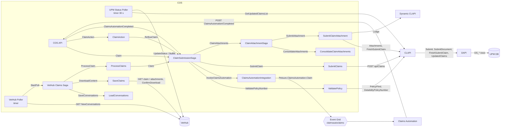

# COS: sagas and polling (services, functions, data, events)

> **Scope:** the claim-submission sagas and the two pollers of COS, and what they use in CLAPI, DAPI and the UPM DB. Derived from the source code in `repos by system` (29 Oct 2026); *inferred* marks what the code doesn't show.
> **Back to:** [COS](02-cos.md) · [Component index](README.md)

## Notation

The terms follow ArchiMate:

| Element | Meaning here | Kinds used |
|---|---|---|
| **Service** | Behaviour that a (sub-)component offers to *others* | **REST API**: an HTTP operation. **Queue worker**: an NServiceBus endpoint that accepts commands on an Azure Service Bus queue (`{env}_…`, PROD prefix `PROD_`). **Timer**: a scheduled trigger (pollers only). |
| **Function** | Internal behaviour, not called by other components | — |
| **Data object** | Data read (R), written / inserted (W) or updated (U) | COS DB tables, NServiceBus saga data (`NSBusPersistence`), blobs via the Storage API, UPM DB tables / views |
| **Event** | Something published to subscribers that the publisher doesn't know | Azure Event Grid events. **No NServiceBus `Publish(...)` exists in these repos**: every NServiceBus message is a *command* sent point-to-point, so it is listed as a queue-worker service, not as an event |

## 1. Sub-components

| Sub-component | Deployable / repo | Host (AU) | Kind | Data owned |
|---|---|---|---|---|
| **COS.API** | `COS.API` | IIS, `PS-PRD-AZS-P3-1/2` | REST API + message sender | COS DB (shared) |
| **VetHub Poller** | `COS.Poll.Services.VetHub` (Topshelf) | Windows service, `PS-PRD-AZS-P3-3` | Timer | — |
| **UPM Status Poller** | `COS.Poll.Services.UPM` (Topshelf) | Windows service, `PS-PRD-AZS-P3-3` | Timer | COS DB (polling tables) |
| **VetHub Claims Saga** | `COS.VetHub.Services` (Claims saga) | Windows service, `PS-PRD-AZS-P3-3` | Queue worker (saga) | `SagaData` |
| **LoadConversations / SaveClaims / ProcessClaims** | `COS.VetHub.Services` | Windows services, `PS-PRD-AZS-P3-3` | Queue workers | COS DB (`VetHubConversation*`) |
| **ClaimSubmissionSaga** | `COS.Service` (Sagas.Claims) | Windows service, `PS-PRD-AZS-P3-3` | Queue worker (saga) | `ClaimSubmissionSagaData` |
| **ValidatePolicy, ClaimsAutomationIntegration, SubmitClaims, ClaimAction** | `COS.Service` | Windows services, `PS-PRD-AZS-P3-3` | Queue workers | COS DB |
| **ClaimAttachmentSaga** | `COS.Service` (Sagas.Attachment) | Windows service, `PS-PRD-AZS-P3-3` | Queue worker (saga) | `ClaimAttachmentSagaData` |
| **ConsolidateClaimAttachments, SubmitClaimAttachment, ClaimAttachmentActions** | `COS.Service` | Windows services, `PS-PRD-AZS-P3-3` | Queue workers | COS DB |
| **COS DB** | `COS_PROD` (Azure SQL) | — | Data store | Claims, statuses, documents, polling |
| **NSBusPersistence** | Azure SQL | — | Data store | Saga state, timeouts |

NZ and VP have the same sub-components on their own servers (`NZ-PRD-AZ-P3WEB/APP`, `PS-PRD-AZ-P3WEB/APP`); the UPM poller isn't deployed for VP.

External components: **CLAPI** (IIS, `PS-PRD-AZS-P3-1/2`), **DAPI** (on-prem `PS-BCS-PRD-API1`), **UPM DB** (`PETSURE_PRD_UPM`, on-prem). Also used: VetHub, Dynamic CLAPI, the Storage API, the Notification API and Event Grid.

## 2. Message flow (overview)

## 3. COS sub-components

### 3.1 COS.API

| Element | Detail |
|---|---|
| **Services (REST API)** | `POST api/Claims` (submit a claim: returns the CRN, then async) · `POST api/Claims/Attachments` (additional documents) · `POST api/Claims/ClaimsAutomation/Completed` (Claims Automation callback) · Portal claim action (e.g. cancel) · `GetInvoicePayload/{CRN}`, `UpdateStatus`, gap-only operations, claim queries (synchronous; see [COS §2.2](02-cos.md#22-rest-apis-exposed-cosapi)) |
| **Functions** | Generate the CRN (daily sequence in COS DB) · enrich the claim (insurer, country, documents, invoice payload) · de-duplicate the CA callback and record its response time · send NServiceBus commands |
| **Services used** | Queue workers: ClaimSubmissionSaga (`Claim`, `ClaimsAutomationCompleted`), ClaimAction (`ClaimAction`), COS.AddAttachments.Saga (`AdditionalAttachments`) |
| **Data objects** | COS DB: R/W for the CRN sequence and the synchronous operations; U `ClaimsAutomation` (response time) |
| **Events** | None on this path |

### 3.2 VetHub Poller

| Element | Detail |
|---|---|
| **Service (Timer)** | Per insurer (AU, TPN, eClaim …), `timerInterval` and `take` per source; the timer is re-armed after each run |
| **Functions** | Group each `InsuranceClaim` with its `AttachmentOnAClaim` conversations · keep only `ClaimReadyToDownload` / `AttachmentReadyToDownLoad` · build one `StartPoll` (new `UniqueProcessingId`) per claim |
| **Services used** | VetHub REST `GET api/claim/newconversations?claimType=&NumberofClaims=` · queue worker VetHub Claims Saga (`StartPoll`, sent from `cos.vethub.poll`) |
| **Data objects** | None (no COS DB writes) |
| **Events** | None |

It looks only for **new claims and attachments ready to download**. Cancellations reach VetHub from CATCH (`POST api/Claim/{id}/Cancel/…`). Stuck claims are detected by `VetHub.Alert.StuckClaims`.

### 3.3 VetHub Claims Saga and its workers

| Element | Detail |
|---|---|
| **Service (Queue worker)** | VetHub Claims Saga: `StartPoll` (starts it), `ConversationsSaved`, `ContentDownloaded`, `ClaimProcessed` |
| **Saga data** | `SagaData`, correlated on `UniqueProcessingId` (ClaimRefNumber, VetHubConversations, RequestHeader). Completes after `ClaimProcessed` or on any failure |
| **Worker: LoadConversations** (`SaveConversations` → replies `ConversationsSaved`) | *Function:* generate the VPMS CRN `V[region][env]yyyyMMdd{n}` (`UspGetClaimReferenceNumber`). *Data:* W `VetHubConversation`, W `VetHubConversationHistory` |
| **Worker: SaveClaims** (`DownloadContent` → replies `ContentDownloaded`) | *Services used:* VetHub `GET api/Claim/{id}`, `GET api/Claim/{id}/Attachment/{attId}`, `POST …/ConfirmDownload` (claim and attachment); Storage API `POST UploadFile`. *Data:* W blobs (attachments); U `VetHubConversation` (Blob, CosStatus = ClaimReceivedByCOSButNotYetProcessed); W `VetHubConversationHistory` |
| **Worker: ProcessClaims** (`ProcessClaim` → `ClaimProcessed`) | *Function:* map the VetXML blob to the COS `Claim` (policy, pet, vet, conditions, invoice payload, clinical history per `InsuranceProviderRules`, documents). *Services used:* queue worker ClaimSubmissionSaga (`Claim`). *Data:* R `InsuranceProviderRules`; U `VetHubConversation` (CosStatus = ProcessedByCOS) |
| **Events** | None |

### 3.4 ClaimSubmissionSaga

| Element | Detail |
|---|---|
| **Service (Queue worker)** `PROD_ClaimSubmissionSaga` | `Claim` (starts it; from COS.API or ProcessClaims) · `ReflowClaim` (from ClaimAction) · `ClaimsAutomationCompleted` (from COS.API) · replies `PolicyValidated`, `ClaimSubmitted` · self-sent `ClaimSaved`, `TriggerClaimsAutomationTimeOut` · timeout `ClaimsAutomationTimeOut` |
| **Saga data** | `ClaimSubmissionSagaData`, correlated on `ClaimRefNumber`: Claim, Documents, HeaderRequest, ClaimId, IsReflow, HasClaimsAutomationResponded / TimedOut, AttachCAResponseToClaim, IsInvoiceProvided, Rules (from `InsuranceProviderRules`) |
| **Functions** | Validate the incoming claim · save the claim in COS · decide the route (policy validation → Claims Automation → submission) using the rules · Claims Automation sampling (percentage per claim type) and the 100 s wait · mark *Action Required* on errors (kept open for reflow) · attach the CA PDF |
| **Services used** | Queue workers: ValidatePolicy (`ValidatePolicyNumber`), ClaimsAutomationIntegration (`InvokeClaimsAutomation`), SubmitClaims (`SubmitClaim`), ClaimAttachmentSaga (`ClaimAttachments`) · Notification API (e-mails) |
| **Data objects** | W/U `Claim` (StatusId ClaimReceivedInCOS → ClaimReadyToBeSubmitted; SubmittedToUpmOn) · W `RequestHeader`, `ClaimBlob` (Payload, InvoicePayload; U with the CA PDF), `ClaimStatus` · gap-only: W `GapOnly`, `GapOnlyStatus` (Open), `ClaimGroup` · errors: W `ClaimStatus`, `ClaimGroup`, `ClaimError` · W/U `ClaimsAutomation` (row, ErrorId = Timeout) · R `ClaimsAutomation`, `Document` (was CA already called?) · R `NotificationLookUp` · exec `UspAuditClaim` |
| **Events** | **Event Grid** `ps-prod-egt-eventnotifications` (prod name *inferred*), event type `PetSure.Catch.Notification` (e.g. GapClaimReceivedinCOS), for gap-only claims when `SendNotificationEvent` is on → subscriber CATCH Notification Function App |

**Saga steps:**

1. **`Claim`**: save it in COS. For gap-only claims, send the e-mail and the CATCH event. Then send `ClaimSaved` to itself; a BCP claim is marked *Action Required* instead.
2. **`ClaimSaved`**: for a VPMS claim with `ValidatePolicyNumber` on, send `ValidatePolicyNumber`. Otherwise go to the Claims Automation branch if enabled, or to submission.
3. **`PolicyValidated`**: failed → **complete**. Success → apply any corrected policy number, then the Claims Automation branch (for `eClaim` / `GapOnly`) or submission.
4. **Claims Automation branch**: send `TriggerClaimsAutomationTimeOut` to itself and `InvokeClaimsAutomation`. If the claim is sampled, wait for the response; if not, submit now.
5. **`TriggerClaimsAutomationTimeOut`**: `RequestTimeout` 100 s. This is a Service Bus scheduled message on the saga's own queue, not a job.
6. **`ClaimsAutomationCompleted`**: ignored if the timeout has already fired. Otherwise attach the CA result and PDF, and submit.
7. **Timeout**: if Claims Automation hasn't answered, record the timeout and submit without its result.
8. **Submission**: set the status to *Ready to be submitted* and send `SubmitClaim`.
9. **`ClaimSubmitted`**: failed → stay open for reflow. Success → send `ClaimAttachments` to the attachment saga (or mark *No attachment*), then **complete**.

### 3.5 Workers driven by ClaimSubmissionSaga

| Worker (queue) | Service: accepts → replies | Functions | Services used | Data objects | Events |
|---|---|---|---|---|---|
| **ValidatePolicy** (`PROD_ValidatePolicy`) | `ValidatePolicyNumber` → `PolicyValidated` | Lookup-table correction; fuzzy matching (FM1/FM2, per insurer); auto-correction by customer details; gap-only eligibility | CLAPI `GET api/Policy/DetailsByPolicyNumber`, `POST api/Policy/Find`; VetHub `GET api/GapOnly/Eligibility`; Notification API (relays VetHub `UpdatePolicyNumber`; e-mails) | R `Lookup_MissingVetPolicyNumberFixed`, `Lookup_IncorrectVetPolicyNumberFixed`, `Lookup_OverriddenFWFalseNegatives`, `ClaimErrorCodeLookUp`; U `Claim` (PolicyNo, correction method), `ClaimBlob`; W `AuditActionLog`, `ClaimErrorNotification`, `ClaimStatus`, `ClaimGroup`, `ClaimError` | — |
| **ClaimsAutomationIntegration** (`PROD_InvokeClaimsAutomation`) | `InvokeClaimsAutomation` → none | For CSP claims, rebuild the TStar model and invoice total from the blob; set claim type and insurer | Event Grid | R `ClaimBlob`, `Claim` | **Event Grid** `ps-prod-egt-claimsautoclaims`, subject `Claim`, type `Petsure.ClaimsAutomation.Claim` (carries `CACallbackURL`) → subscriber Claims Automation Logic App `ps-prod-logic-claimsauto` |
| **SubmitClaims** (`PROD_SubmitClaims`) | `SubmitClaim` → `ClaimSubmitted` | Set the CA sub-category, AiType, TaskSubCategoryCode, AutoRFA, PayToServiceProvider; partial-lodge check; autolodge blacklist; strip the CA PDF; treat 409 as success; one retry without lodge fields | CLAPI `POST api/Claims`; VetHub `UpdateStatus/ClaimProcessing` (endpoint is a deploy token, *inferred*); Notification API | R `Claim`, `ClaimNotes`, `AutolodgeBlacklist`, `GapOnly`, `VetFee`; U `Claim` (IsSubmittedToUpm, StatusId, GroupId, ErrorId), `ClaimBlob`, `ClaimsAutomation`; W `ClaimStatus`, `ClaimGroup`, `ClaimError` | — |
| **ClaimAction** (`PROD_ClaimAction`) | `ClaimAction` (from COS.API / CATCH) → `ReflowClaim` to the saga | Reflow a claim | — | R `Claim` | — |

### 3.6 ClaimAttachmentSaga and its workers

| Element | Detail |
|---|---|
| **Service (Queue worker)** | ClaimAttachmentSaga: `ClaimAttachments` (starts it, from ClaimSubmissionSaga) · `ClaimAttachmentsSaved` (self) · `ClaimAttachmentsConsolidated` · `ClaimAttachmentSubmitted` · `ReflowClaimAttachment` (from ClaimAttachmentActions) |
| **Saga data** | `ClaimAttachmentSagaData`, correlated on `UniqueMessageId`. Completes after a successful submission |
| **Worker: ConsolidateClaimAttachments** (`ConsolidateAttachments` → `ClaimAttachmentsConsolidated`) | *Function:* merge all documents into `Merged-{CRN}.pdf` (iText 7). *Services used:* Storage API `GET api/documents/{path}/pdf`, `POST api/documents/UploadFile`. *Data:* R/W blobs |
| **Worker: SubmitClaimAttachment** (`SubmitAttachment` → `ClaimAttachmentSubmitted`) | *Services used:* CLAPI `POST api/Claims/Attachments` (or `CosAdditionalAttachments`), then `PUT api/Claims/FinishSubmitClaim`. If `Lodge` is on: Dynamic CLAPI `PUT api/Claims/Lodge/{UpmClaimId}`; on lodge failure, VetHub `ConfirmDownload`. *Data:* U `Claim` (SubmittedToUpmOn, UpmClaimId, LodgedOn, or Action Required / ClaimFailedToLodge) |
| **Saga data objects** | W `Document`, `DocumentStatus` (SavedInCos), `DocumentError`, `DocumentNotes`, `RequestHeader`, `ClaimStatus`, `ClaimGroup`, `ClaimError`, `ClaimNotes`; R `vwClaimDocumentCurrentStatus`; exec `UspAuditClaimAttachments` |
| **Events** | None |

### 3.7 UPM Status Poller

| Element | Detail |
|---|---|
| **Service (Timer)** | Every 30 s per UPM instance (`UPMPROD`, `UPMPRODTPN`; `UPMPRODNZ` in NZ). A sweep every 120 runs looks back 120 min |
| **Functions** | Find the last successful poll time (watermark) · map UPM status → COS status (`ClaimStatusUPMLookUp` → `ClaimStatusMappingLookUp`) · skip claims cancelled in COS, *Action Required* claims and ineligible gap-only claims · finalise admitted gap-only claims when settled or declined (`106_PAID`, `301_NOTAD`, `310_CANCEL`, `401_DNR` …) · in-memory de-duplication cache · retry failed VetHub updates |
| **Services used** | CLAPI `GET api/Claims/GetUpdatedClaimsList?lastStatusUpdateFrom=&lastStatusUpdateTo=` (and `GetClaimDetails`) · VetHub `POST api/Claim/{id}/UpdateStatus/ClaimProcessing` (19000), `…/ClaimSettled` (19001, with remittances and benefit pay-to), `…/ClaimDeclined` (19002), `POST api/Claim/{id}/Nullify` (−999, cancelled) — VPMS claims only |
| **Data objects** | R `ClaimStatusUPMLookUp`, `ClaimStatusMappingLookUp`, `ClaimStatusLookUp`, `ClaimStatusVPMSLookUp`, `VetFee` · U `Claim` (StatusId, **ClaimNumber** from UPM, IsSubmittedToUpm, SubmittedToUpmOn) · W `ClaimStatus` (history) · W/U `GapOnly`, `GapOnlyStatus` (finalise) · W `PollingClaimStatusHistory`, `PollingClaimStatusError` · W/U `StatusPollFailedClaim` |
| **Events** | None |

It doesn't check the benefit calculation as such. It syncs every status change, which shows lodgement indirectly: the claim first appears with a UPM claim number. Remittances are passed on with *Settled*. A claim that never reaches UPM never appears, so lost lodgements are not detected.

## 4. CLAPI

| Element | Detail |
|---|---|
| **Services (REST API)** | `POST api/Policy/Find` · `GET api/Policy/DetailsByPolicyNumber` · `POST api/Claims` · `POST api/Claims/Attachments` · `PUT api/Claims/FinishSubmitClaim` · `POST api/Claims/AdditionalAttachments` · `PUT api/Claims/FinaliseAdditionalAttachment` · `POST api/Claims/CosAdditionalAttachments` · `GET api/Claims/GetUpdatedClaimsList` · `POST SubmitServiceProviderFee`, `POST UpdateCSPReferenceNumber`, `GET GetGapClaimBenefitDetails` (feature-flagged) |
| **Functions** | **Insurer routing** on the `InsuranceProviderId` header (allow-list): AU / TPN / NZ DAPI, or Boomi for VP · **outbound token**: `POST api/Customer/Authentication` to DAPI, cached 5 min per insurer (Basic auth for Boomi) · **document fetch** from the Storage API as a byte[], posted as base64 · request / response mapping (e.g. `IsGapOnly` → `fastTrackClaim`, treating-vet name cut to 30 characters) · Polly retry (3×), 30 s timeout, circuit breaker |
| **Services used** | DAPI (see §5) · Boomi (VP) · Storage API |
| **Data objects** | None of its own (token cache only) |
| **Events** | None |

## 5. DAPI

Every call checks the token (R/U `$DS_Tokens`, sliding expiry) and logs an activity row (W `$DS_Activity`). `$` = company prefix `PetSure (Australia) Pty Ltd$`.

| Service (REST API) | Functions | UPM DB read | UPM DB written / updated |
|---|---|---|---|
| `POST api/Customer/Authentication` | Password hash check, lock-out, token issue | `$DS_Users`, `DS_BrandPartners`, `DS_Policy` | W `$DS_Tokens`; U `$DS_Users`; W `$DS_LockedPortalAccounts` |
| `POST api/customer/FindPolicy` | Dynamic search filters (not scoped to the caller's partner) | view `DS_PolicyAll` | — |
| `POST api/Claims/Submit` | Policy lookup; duplicate check on CSP reference (409); validate claim type, task subcategory, service provider, treatment codes; one transaction | `DS_Policy` / `DS_PolicyAll`, `$Type Lookup`, `DS_TaskSubcategory`, `DS_ServiceProviders_All`, `DS_TreatmentsDrugs` | W `$DS_Claims` (**status 0**), `$DS_ClaimInvoice`, `$DS_ClaimInvoiceLine`, `$DS_ClaimConditions`, `$DS_ClaimClinicalNotes`, `$DS_ClaimTreatingVets`, `$DS_SubmitClaimComments` |
| `POST api/Claims/SubmitDocument` | Write the file to the SMB share | `$DS_Claims` | W `$DS_ClaimDocuments` (path, type, endFiles) + **file on the share** |
| `PUT api/Claims/FinishSubmitClaim` | Allowed only from status 0 | `$DS_Claims` | U `$DS_Claims` **status 0 → 1 (Ready)**, `submittedToUPM` |
| `POST SubmitAdditionalDocument2` / `PUT FinishClaimAdditionalDocument` | Claim must exist in UPM; file to share | view `DS_Claims` | W `$DS_ClaimAdditionalDocumentsHdr` (0 → 1 on finish), `$DS_ClaimAdditionalDocumentsEnt` |
| `POST SubmitAdditionalDocument` (COS) | File to share | view `DS_Claims` | W `$DS_ClaimAdditionalDocuments` (status 0) |
| `GET api/Claims/UpdatedClaims` | Changes in [from, to] on `maxTransactionDate`; remittances when paid to the service provider | view `DS_PortalClaimHistory`; procs `sp_DS_PortalClaimInvoices`, `sp_DS_ClaimRemittanceNo` | — |
| `SubmitServiceProviderFee` / `UpdateCSPReferenceNumber` / `GetGapClaimBenefitDetails` | Gap-only (status `700_GOPAUT`) | `DS_ClaimBenefitDetails`, `$Claim`, `sp_DS_ClaimBenefitDetails` | W `$DS_ClaimServiceProviderFee`, `$DS_ClaimCSPRefNumber` (status 1) |

**Events:** none. DAPI integrates through HTTP and staging rows only.

## 6. UPM DB / UPM+ (inferred: no Business Central code in the repos)

| Element | Detail |
|---|---|
| **Data objects (inbound staging)** | `$DS_Claims` and its child tables, `$DS_ClaimDocuments`, `$DS_ClaimAdditionalDocuments*`, `$DS_ClaimServiceProviderFee`, `$DS_ClaimCSPRefNumber`. Status column: 0 = not ready, 1 = **Ready**, 2 = Processed, 3 = Confirmed, 4 = Error, 6 = ReSend (`PetsureAPI/Enum.cs`), plus `NAV_Processed_Date_Time`, `Error_Description`, `Claim_No_` |
| **Function (UPM job, polling)** | A BC job picks up `status = 1` rows, creates `$Claim` and its related records, attaches the files from the share, and sets `Claim_No_` and status 2 / 3 / 4. The ~10-minute cadence comes from the architecture documents; it isn't in the code. **`FinishSubmitClaim` is the commit**: a claim left at status 0 is never ingested |
| **Data objects (read side)** | Views `DS_PortalClaimHistory`, `DS_Claims`, `DS_Policy*`, `DS_ClaimBenefitDetails` over `$Claim`, `$Policy` and the workflow / log tables. `maxTransactionDate` is the COS poller's watermark |
| **Events** | None to COS. Push-backs from UPM+ go through Dynamic CLAPI (`CLAW-INIT`, gap-only benefit), outside this flow |

## 7. Events summary

| Event | Channel | Publisher | Subscriber |
|---|---|---|---|
| `Petsure.ClaimsAutomation.Claim` (subject `Claim`) | Event Grid `ps-prod-egt-claimsautoclaims` | ClaimsAutomationIntegration | Claims Automation (`ps-prod-logic-claimsauto`); reply by REST callback to COS.API |
| `PetSure.Catch.Notification` (e.g. GapClaimReceivedinCOS) | Event Grid `ps-prod-egt-eventnotifications` (*inferred* prod name) | ClaimSubmissionSaga (gap-only, when enabled); COS.API | CATCH Notification Function App |
| *Claims Automation timeout* | Service Bus scheduled message (NServiceBus `RequestTimeout`) | ClaimSubmissionSaga | itself, after 100 s; a timer, not a published event |

No NServiceBus events, and nothing from CLAPI or DAPI.

## 8. Open points

- **Destination queues of the VetHub Claims Saga** are deploy tokens (`#{SaveConversations}#`, `#{DownloadContent}#`, `#{ProcessClaim}#`, `#{Claim}#`); the routing of ProcessClaims → ClaimSubmissionSaga is *inferred*.
- **SubmitClaims' VetHub "processing" endpoint** is a deploy token (*inferred* `UpdateStatus/ClaimProcessing`).
- **COS additional documents**: `$DS_ClaimAdditionalDocuments` rows are inserted with status 0 and never set to Ready. Confirm that the UPM job processes them.
- **`ClaimAction` routing**: see [COS open points](02-cos.md#6-open-points).
- **Saga table names** in `NSBusPersistence` (e.g. `PROD_ClaimSubmissionSaga_ClaimSubmissionSaga`) are *inferred*.
- **Lost lodgements**: neither poller detects a claim that never reaches UPM. Today only `VetHub.Alert.StuckClaims` and CATCH show such claims.
