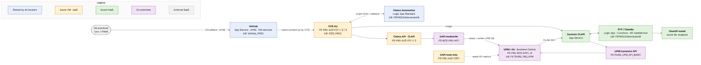

# Go Tech Platform — Australia

> **Scope:** PROD, PetSure Australia (AUS), including Luna, which runs on the same stack. Trupanion also uses parts of this stack and is described in [Trupanion](02-trupanion.md).
> **Source:** [`infrastructure-summary-as-is.md`](../infrastructure-summary-as-is.md) (2026-10-26) and the ArchiMate model `archi/h1.archimate`. Items marked *inferred* are not confirmed by any source.

## Contents

1. [High-level picture](#1-high-level-picture)
2. [VetHub (shared)](#2-vethub-shared)
3. [COS — Claim Orchestration Service](#3-cos--claim-orchestration-service)
4. [Claims Automation (shared)](#4-claims-automation-shared)
5. [Claims API (CLAPI)](#5-claims-api-clapi)
6. [CSP Digital API (DAPI)](#6-csp-digital-api-dapi)
7. [Dynamic CLAPI](#7-dynamic-clapi)
8. [STP / Clawdia and the ML environment](#8-stp--clawdia-and-the-ml-environment)
9. [UPM+ and UPM Dynamics API](#9-upm-and-upm-dynamics-api)
10. [Open points](#10-open-points)

---

## 1. High-level picture

Australia uses every part of the Go Tech platform, and it is the only insurer where all three hosting models meet. A vet practice submits a claim through **VetHub**, the vet-facing gateway shared by all insurers. The Australian **COS** picks the claim up from VetHub, stores it in its own database and asks **Claims Automation** (also shared) to assess it; Claims Automation answers COS through a callback. COS then submits the claim through the **Claims API (CLAPI)**, which hands it to the read/write **DAPI**. DAPI writes directly into the **UPM+** database, the insurance ERP where the claim is processed.

A second path runs from UPM+ back into the cloud. When a claim is ready for straight-through processing, UPM+ starts **STP / Clawdia** through **Dynamic CLAPI**. Clawdia enriches the claim, calls the **ClawGP** machine-learning model and applies the business rules, then sends its decision back through Dynamic CLAPI, which writes it into UPM+ through the **UPM Dynamics API**. COS also uses Dynamic CLAPI to lodge claims.

The hosting is split three ways. VetHub's APIs, Dynamic CLAPI and STP / Clawdia are Azure PaaS services in the landing zone. COS, CLAPI and the read-only DAPI run on Windows virtual machines in the older ("legacy") Azure estate. UPM+, its database, the UPM Dynamics API and the read/write DAPI run on-premises in two data centres (Equinix and AirTrunk). Azure reaches the on-premises systems over an ExpressRoute link through the hub firewall.

| Component | Hosting | Location | Shared / dedicated |
|---|---|---|---|
| VetHub | App Service, API Management, Windows VM, Azure SQL | Azure (landing zone + legacy estate) | Shared by all insurers |
| COS | Windows VMs (IIS + Windows services), Azure SQL | Azure legacy estate | Australia stack, also used by Trupanion and Luna |
| Claims Automation | Logic Apps Standard, Azure SQL | Azure | Shared by all insurers |
| CLAPI | Windows VMs (IIS) | Azure legacy estate | Australian deployment, also used by Trupanion |
| DAPI | IIS on an on-premises server (R/W) and an Azure VM (RO) | On-premises + Azure | Australia only |
| Dynamic CLAPI | App Service | Azure landing zone | Australia (also lodges into Trupanion UPM+) |
| STP / Clawdia | Logic Apps, Functions, App Service, Azure ML, Azure SQL | Azure landing zone | Australia only (serves AU, TPN and Luna claims) |
| UPM Dynamics API | Business Central API service on the UPM+ servers | On-premises | Part of UPM+ AU |
| UPM+ | Business Central servers, SQL Server Always On | On-premises | Australia only |

---

## 2. VetHub (shared)

VetHub is the single entry point for vet practices and their practice-management systems (for example Tyro / VPMS). There is **one VetHub deployment for all insurers** — Australia, New Zealand, Vet Partners, Trupanion and Luna — and the application itself works out which insurer a claim belongs to. Nothing in VetHub is specific to Australia, but most of its background processing physically runs on the Australian Go Tech servers.

Since release 2026_R4 (September 2026) the public parts of VetHub — the main API, the registration API, the vet portal API and the web UI — run as Azure App Services in the landing zone. All internet traffic first passes through Cloudflare, which provides a web application firewall, DDoS protection and rate limiting. Azure API Management sits in front of VetHub as a facade for Tyro's Gap-Only integration and validates the caller's identity.

The background work — reading incoming conversations, preparing claims, handling attachments, pushing status updates and alerting on stuck claims — is done by Windows services that still run on a virtual machine in the legacy estate (`PS-PRD-AZS-P3-3`, *inferred*). A small Twilio helper API, MessageFormat.API, runs on IIS on the two Australian web servers. VetHub's data lives in the Azure SQL database `VetHub_PROD`, which has a read-only failover copy and is synchronised to the data warehouse.

#### Technical reference

**Deployed artefacts (as shown in the picture)**

- API Management `ps-prod-apim-vethub` (Basic_1): `apim-vethub-api` — API definition with policies
- App Service `ps-syd-prd-vethub-vhapi-app`: VetHub.API compiled package (.NET 10, P1v3, zone-redundant, staging slot)
- App Service `ps-syd-prd-vethub-vhregapi-app`: VetHub.Reg.API compiled package
- App Service `ps-syd-prd-vethub-vhportalapi-app`: Vet.Portal.API compiled package (public access off)
- App Service `ps-syd-prd-vethub-vhui-app`: VetHub.UI source package (React + Express); static assets in `petcdnstore/vethubui-prod`
- VMs `PS-PRD-AZS-P3-1` and `PS-PRD-AZS-P3-2`: MessageFormat.API (IIS)
- VM `PS-PRD-AZS-P3-3` (*inferred*): VetHub.Service, VetHub.Service.ProcessConversations, VetHub.Service.StatusUpdate, VetHub.Alert.StuckClaims. The source also lists `.Saga.Claim`, `.Claims` and `.Attachments` services, monitored in PRTG under `GoTech-PROD-AUS`.
- Azure SQL server `petsure-production`: database `VetHub_PROD` (DTU 400, failover group to `p3-ro-db`, Data Sync to the DWH)

**Endpoints**

- `api-vh-prod.vethub.net` (via Cloudflare), `internal-api-vh-prod.petsure.com.au` (APIM backend and internal callers)
- `api-vethubreg-prod.vethub.net`, `api-vethubportal-prod.vethub.net`, `vetportal.vethub.net`
- `api-messageformat-prod.petsure.com.au`

**Azure services used**

- Key Vault: `pssydprdvethubapikv`, `pssydprdvhregkv`, `pssydprdvetportalkv`, `pssydprdvhuikv`
- Azure Cache for Redis `ps-syd-prd-vethubapi-redis` (HybridCache)
- Application Insights `ps-syd-prd-vethubapi-ai`; legacy services report to `ps-prd-insight-p3`
- Service Bus (NServiceBus queues such as `<ENV>_VetHub.Service.Saga.Claim`)
- Storage `p3storageprod` via the Storage API (attachments, generated PDFs)
- VNet `ps-syd-prd-vethubapi-vnet` (10.52.16.0/22), subscription `sub-prd-vethub-ps`, RG `ps-syd-prd-vethubapi-rg`
- Entra ID app registration (APIM JWT validation, Tyro)

---

## 3. COS — Claim Orchestration Service

COS orchestrates each claim from the moment it leaves VetHub until it has been submitted to the insurer. Unlike VetHub, COS is deployed **separately for each insurer**. The Australian stack also serves Trupanion and Luna, which were merged into it during 2025–26.

The Australian COS runs on three Windows virtual machines in the legacy Azure estate. Two of them (`PS-PRD-AZS-P3-1` and `-2`) host the COS web API in IIS, side by side, so the API keeps running if one server is down. The third (`PS-PRD-AZS-P3-3`) has no web sites; it runs the COS Windows services that do the actual work: polling VetHub for new claims, validating the policy, submitting claims, handling attachments (including converting and merging them into PDFs), triggering Claims Automation and polling UPM+ for status changes.

These services talk to each other through Azure Service Bus (using the NServiceBus framework), keep their data in the Azure SQL database `COS_PROD`, and publish events to Azure Event Grid — one topic to trigger Claims Automation and one for the CATCH real-time notifications. `COS_PROD` also holds the CATCH tables (users, roles, events, Gap-Only). The same web servers also host a set of shared Go Tech helper APIs (Storage, Security, Notification). All of the Go Tech VMs are in Sydney with cold backup only; moving COS.API to App Service on .NET 10 is the agreed long-term option.

#### Technical reference

**Deployed artefacts (as shown in the picture)**

- `PS-PRD-AZS-P3-1` (10.6.0.35), IIS: COS.API
- `PS-PRD-AZS-P3-2` (10.6.0.39), IIS: COS.API
- `PS-PRD-AZS-P3-3` (10.6.0.40), Windows services: COS.Service, COS.VetHub.Services, COS.Poll.Services, COS.AddAttachments.Saga, COS.AddAttachments.Service.ConvertPDF, COS.AddAttachments.Service.Consolidate, COS.AddAttachments.Service.Submit
- Azure SQL server `petsure-production`: database `COS_PROD`

**Windows services in detail (from the source)**

`COS.Service.Sagas.Claims`, `.Sagas.Attachment`, `.ValidatePolicy`, `.SubmitClaims`, `.ClaimsAutomationIntegration`, `.ClaimActions`, `.ConsolidateClaimAttachments`, `.SubmitClaimAttachment`, `.ClaimAttachmentActions`, `COS.VetHub.Saga.Claims`, `COS.VetHub.Services.LoadConversations / SaveClaims / ProcessClaims`, `COS.Poll.Services.VetHub` (+ `.eClaim`), `COS.Poll.Services.UPM` (AUS, NZ and a dedicated TPN deployment `UPMPRODTPN`), `COS.AddAttachments.Saga / ConvertPDF / Consolidate / Submit`, `LogManager.Handler`, `Notification.Service`. The IIS servers also host Storage.API, Security.API, Security.AAD.API, Notification.API and P3ITTools.

**Endpoints**

- `api-cos-prod.petsure.com.au`

**Azure services used**

- Service Bus via `AzureServiceBusConnection_SYD`; queues `PROD_<Endpoint>` (e.g. `PROD_ClaimSubmissionSaga`, `PROD_ValidatePolicy`, `PROD_SubmitClaims`), audit/error `PROD_COSAudit` / `PROD_COSError`. Namespace held in GitHub secrets; `p3-prod-syd` is the known PROD namespace (*inferred* for NServiceBus).
- Event Grid: `ps-prod-egt-claimsautoclaims` (publishes `Petsure.ClaimsAutomation.Claim`), `ps-prod-egt-eventnotifications` (publishes `PetSure.Catch.Notification`)
- Storage `p3storageprod` via Storage API (claim blobs, attachments, merged PDFs)
- Key Vault (names in GitHub secrets `KEYVAULT` / `CRED_KEYVAULT`), used for deploy-time token replacement
- Application Insights `ps-prd-insight-p3`, with `[AUS]…` alert rules
- NServiceBus persistence database (`NSBusPersistence`; PROD name not in repo)

**Outbound dependencies**

VetHub.API (`internal-api-vh-prod.petsure.com.au`), CLAPI → DAPI, Dynamic CLAPI Lodge (`ps-syd-prod-dynamicclapi-api.petsure.com.au`), Notification / Security / Storage APIs.

---

## 4. Claims Automation (shared)

Claims Automation (also known as Sophia Jr) is a single, shared service that assesses incoming claims for all insurers. COS triggers it by publishing an event to an Azure Event Grid topic; an Azure Logic App (Standard) picks the event up, runs its master flow and calls COS.API back with the result. Australia, New Zealand and Vet Partners all publish to the same topic.

Its database, `PSPRODClaimsAutoDB`, sits on the shared Azure SQL server `petsure-production`. One database serves all insurers, with every row tagged with the insurer it belongs to. In Australia the same database is also used by STP / Clawdia, which stores its diagnosis and STP-claim data there.

#### Technical reference

**Deployed artefacts (as shown in the picture)**

- Logic Apps Standard: *Claims Automation Logic App (name TBC)* — Claim Automation compiled package
- Azure SQL server `petsure-production`: database `PSPRODClaimsAutoDB` (rows keyed by `InsuranceProviderId`)

**Azure services used**

- Event Grid topic `ps-prod-egt-claimsautoclaims` (australiaeast); publisher COS `ClaimsAutomationIntegration`, subscriber the Claims Automation Logic App (master flow), callback to COS.API
- Dead-letter storage `p3storageprod` / container `prod-dead-letter-queue`
- DB connection secrets `CA-DB-CONNECTION` / `LZ-AU-CA-DB-CONNECTION`

---

## 5. Claims API (CLAPI)

CLAPI is the layer COS uses to submit claims to the insurer's system. The code is the same for every insurer; each deployment only differs in its configuration, which decides where claims are sent. In Australia, CLAPI forwards claims to the on-premises read/write DAPI, and Trupanion claims to the Trupanion endpoint `tp-api.petsure.com.au`.

The Australian CLAPI runs in IIS on the same two web servers as COS.API, `PS-PRD-AZS-P3-1` and `-2`. It does not use Azure services directly beyond its hosting: it gets its security token from the Security API and handles files through the Storage API. OpsLevel labels CLAPI as an App Service, but the deployment workflows and Confluence show IIS on VMs; moving it to App Service on .NET 10 is the agreed long-term option.

#### Technical reference

**Deployed artefacts (as shown in the picture)**

- `PS-PRD-AZS-P3-1`: Claims API (CLAPI) — IIS deployment
- `PS-PRD-AZS-P3-2`: Claims API (CLAPI) — IIS deployment

**Configuration and endpoints**

- URL: `api-claims-prod.petsure.com.au`
- Config file: `appsettings.prod.json`
- Back-ends: AU DAPI `https://api.petsure.com.au/` (on-premises) and Trupanion `https://tp-api.petsure.com.au`
- Token from the Security API; files via the Storage API (`p3storageprod`)

---

## 6. CSP Digital API (DAPI)

DAPI is an older (.NET Framework 4.8) web API that reads and writes the UPM+ database directly and keeps claim documents on a Windows file share. It is deployed once per UPM+ instance, in two flavours: one that can read and write, and one that can only read.

In Australia the **read/write DAPI** runs in IIS on the on-premises server `PS-BCS-PRD-API1`, next to UPM+, and Azure reaches it over ExpressRoute. That server also holds the `auapidocuments` file share used for claim documents. The **read-only DAPI** runs on the Azure VM `PS-PRD-AZS-CSP1` in the legacy estate and reads from the UPM+ read replica. DAPI is marked end-of-life in OpsLevel.

#### Technical reference

**Deployed artefacts (as shown in the picture)**

- On-premises `PS-BCS-PRD-API1` (172.16.25.50): CSP.Au.DigitalApi (DAPI) — IIS deployment; `auapidocuments` — Windows file share
- Azure VM `PS-PRD-AZS-CSP1` (10.3.0.92): CSP.Au.DigitalApi (DAPI) — IIS deployment (read-only)

**Endpoints and data**

- R/W: `api.petsure.com.au`, database `PETSURE_PRD_UPM` (listener `PS-BCS-PROD`), share `\\PS-BCS-PRD-API1\auapidocuments`
- RO: `digitalapi-prod-ro.petsure.com.au`, UPM AU read replica

**Azure services used**

- VM hosting (RO only); Key Vault (`CSP_KEYVAULT` variable)
- Deployed by GitHub Actions through the self-hosted runner `petsure-azure-windows-runner`

---

## 7. Dynamic CLAPI

Dynamic CLAPI is the newer, cloud-native bridge between the Azure services and UPM+. It is the entry point for STP / Clawdia: UPM+ calls it to start a straight-through-processing run (`CLAW-INIT`), Clawdia calls it to read claim data and to write its decisions back, and COS calls it to lodge claims. To reach UPM+ it calls the UPM Dynamics API on the on-premises servers, for both the Australian and the Trupanion UPM+ instances. It also asks COS.API for gap-benefit information.

It runs as a single .NET 8 App Service in the STP / Clawdia resource group of the landing zone. Clawdia authenticates to it with a managed identity; UPM+, COS and CATCH use basic authentication. Its outbound calls to the on-premises UPM Dynamics API travel through the hub firewall and ExpressRoute.

#### Technical reference

**Deployed artefacts (as shown in the picture)**

- App Service `ps-syd-prd-claw-dynamicclapi-app`: Dynamic Clapi — compiled application package

**Configuration and endpoints**

- URL: `ps-syd-prod-dynamicclapi-api.petsure.com.au`; `/api/claims/` used by CLAW
- RG `ps-syd-prd-claw-rg`, subscription `sub-prd-vethub-ps`
- Auth: Entra ID app `api://8e082fac-…` (managed identity from CLAW) + basic auth (UPM, COS, CATCH)
- Calls: UPM Dynamics API (AU + TPN lodge; AU write / inspect / finish / return), ReadOnly DataService, KeyVault Function `CLAW-INIT`, COS.API (gap benefit)

**Azure services used**

- Key Vault `pssydprdclawkv`; Event Grid (CLAW topic via `CLAW-INIT` proxy and notifications); Application Insights; VNet integration through the hub to ExpressRoute

---

## 8. STP / Clawdia and the ML environment

STP / Clawdia is the straight-through-processing engine of the 90STP initiative. It decides whether a claim can be settled automatically, and it exists **only in Australia**, where it serves Australian, Trupanion and Luna claims. New Zealand and Vet Partners do not use it.

Clawdia is fully serverless and lives in its own part of the Azure landing zone. Its process is a set of stateful Azure Logic App workflows (four entry flows, a master flow and sub-flows). Three Azure Function apps do the detailed work: one takes in new claims and calls the ML model (the "KeyVault" function, which also handles `CLAW-INIT`), one applies cohorts and business rules and records the audit trail (DBCommand), and one prepares the data for submission back to the insurer (DBQuery). A small App Service, the UPM ReadOnly DataService, reads claim history from the on-premises UPM+ read replica and data warehouse. The steps are chained through Azure Event Grid, and its working data is stored in the shared `PSPRODClaimsAutoDB` database.

The **ClawGP** model that predicts diagnoses is deployed as an Azure Machine Learning managed online endpoint, `ps-prd-claimsauto-gp`. The function apps call this endpoint during enrichment.

#### Technical reference

**Deployed artefacts (as shown in the pictures)**

- Logic Apps Standard `ps-syd-prd-claw-stp-lapp` (plan `ps-syd-prd-claw-stp-la-asp`): STP - Clawdia compiled package
- Function app `ps-syd-prd-claw-dbcommand-func-app`: STP DBCommand Function App
- Function app `ps-syd-prd-claw-dbquery-func-app`: STP DBQuery Function App
- Function app `ps-syd-prd-claw-keyvault-func-app`: STP KeyVault Function App
- App Service `ps-syd-prd-claw-readonlydataservice-app`: DataService.UPM compiled package
- Azure SQL server `petsure-production`: `PSPRODClaimsAutoDB`
- Azure ML managed endpoint `ps-prd-claimsauto-gp` (workspace `ps-prd-ml-ws-claimsauto`, RG `ps-prod-ml-claimsauto`): ML model artefact

**Function endpoints**

- `ps-syd-prod-dbcommand-func-app.petsure.com.au` — Easy Cohorts, business rules, GP enrichment, audit consumers
- `ps-syd-prod-dbquery-func-app.petsure.com.au` — token conversion, PrepareSubmissionToInsurer
- `ps-syd-prod-keyvault-func-app.petsure.com.au` — intake, COS payload, GP model call, dead-letter handling

**Landing zone**

- Subscription `sub-prd-vethub-ps` (`ea27562d-…`), RG `ps-syd-prd-claw-rg`, network RG `ps-syd-prd-claw-network-rg`
- VNet `ps-syd-prd-claw-vnet` (10.50.4.0/22); subnets `funcapp-snet`, `logicapp-snet`, `webapp-snet`, `pep-snet`
- Deployed with Terraform and GitHub Actions (`lz-au-*`, `au-alz-*`)

**Azure services used**

- Event Grid: CLAW topic + CLAW audit topic (pattern `ps-<env>-evgt-clawaudit`), blob dead-letter
- Key Vault `pssydprdclawkv`; Azure Cache for Redis `ps-syd-prd-claw-redis`
- Storage `pssydprdclawdlqueuesa`, `pssydprdclawevgtclawsa`
- Managed identity (CLAW ↔ Dynamic CLAPI); private endpoints and VNet integration
- Application Insights + Log Analytics (still pointed at the legacy structure); Office 365 connector `office365-1` for alerts

---

## 9. UPM+ and UPM Dynamics API

UPM+ is PetSure's insurance ERP, built on Microsoft Dynamics 365 Business Central. In Australia it runs entirely **on-premises**, spread across two data centres, Equinix and AirTrunk; the last disaster-recovery test was on 2026-10-11. Four application servers run the Business Central application (two in each data centre), and two job servers, one per data centre, run the scheduled work. The database runs on SQL Server Always On with the primary in Equinix and the secondary in AirTrunk. A read-only replica is used by the read-only DAPI and by the Clawdia ReadOnly DataService, which can also read the data warehouse.

The **UPM Dynamics API is not a separate system.** It is the Business Central web-services / API layer of UPM+ — a dedicated service instance (`PETSURE_UPM_API_BASIC`) running on the same application servers. In the picture it is shown as its own component so that it can be identified as an integration point, but it is deployed on the four application servers only (`APP1`, `APP2`, `APP5`, `APP6`), not on the job servers. Because it lives on-premises, the Azure callers (Dynamic CLAPI) reach it through the hub firewall and ExpressRoute and must use basic authentication rather than a managed identity.

#### Technical reference

**Deployed artefacts (as shown in the picture)**

- `PS-PRD-BCS-APP1` (Equinix), `PS-PRD-BCS-APP2` (AirTrunk), `PS-PRD-BCS-APP5` (Equinix), `PS-PRD-BCS-APP6` (AirTrunk): UPM+ AU Business Central application + UPM Dynamics API (`PETSURE_UPM_API_BASIC` BC API service instance)
- `PS-PRD-BCS-APP3` (Equinix), `PS-PRD-BCS-APP4` (AirTrunk) — job servers: UPM+ AU Business Central application
- SQL Server Always On, listener `PS-BCS-PROD`: database `PETSURE_PRD_UPM` (`PS-PRD-BCS-DB01` primary in Equinix, `PS-PRD-BCS-DB02` secondary in AirTrunk)

**UPM Dynamics API endpoints**

- Lodge: `upmprod.internal.petsure.com.au:9248/PETSURE_UPM_API_BASIC` (load-balanced)
- Claims API (write / inspect / finish / return): `upmprod-capi.internal.petsure.com.au:9248`
- Path pattern: `api/upm/claims/v1.0/{lodge|write|inspect|finish|return}`

**Connectivity**

- No Azure hosting; connectivity only. Azure → hub Azure Firewall `ps-syd-prd-hub-afw` → ExpressRoute `ps-syd-prd-hub-erc-at` → AirTrunk
- DNS: `internal.petsure.com.au` resolved through the DNS Private Resolver `ps-syd-prd-hub-dnspr`

---

## 10. Open points

- **VetHub Windows services host.** Placement on `PS-PRD-AZS-P3-3` is *inferred* (it is the Australian server with no IIS sites).
- **PRTG map is out of date for VetHub.** It still shows IIS VetHub.API / VetPortal.API sensors that no longer exist after the 2026_R4 move to App Service.
- **Naming conflict.** The July 2026 landing-zone design page uses `ps-syd-prd-vethub-rg` / `ps-syd-prd-vethub-redis`; the runsheet and code use `ps-syd-prd-vethubapi-rg` / `ps-syd-prd-vethubapi-redis`.
- **Service Bus namespace** for NServiceBus is held in GitHub secrets; `p3-prod-syd` is confirmed only for the claim-progress topic.
- **DAPI read-only host.** The 2025 UPM page names `AZ-SY-P-CSPRO01` (10.3.0.55); the newer Oct 2026 SSL page names `PS-PRD-AZS-CSP1` (10.3.0.92), which is used here.
- **Claims Automation Logic App** name is TBC in the model.
- **ClawGP subscription** is not confirmed; Clawdia's Application Insights still points at the legacy structure.
- **Single-region risk.** All Go Tech IIS / Windows VMs are in Sydney with cold backup only. The agreed long-term plan is .NET 10 + App Service.
- **Security.** Committed credentials exist in some repos and in one Confluence page (CLAW auth FAQ); they should be rotated.
