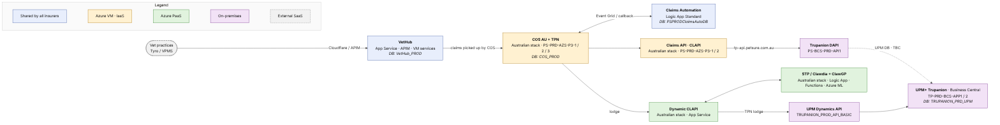

# Go Tech Platform — Trupanion

> **Scope:** PROD, Trupanion (TPN). Trupanion has no Go Tech stack of its own: it shares VetHub and Claims Automation with every insurer, and COS, CLAPI, Dynamic CLAPI and STP / Clawdia with Australia. Only its DAPI and its UPM+ instance are dedicated.
> **Source:** [`infrastructure-summary-as-is.md`](../infrastructure-summary-as-is.md) (2026-10-26) and the ArchiMate model `archi/h1.archimate`. The source summary covers Trupanion only where it differs from Australia, so the DAPI and UPM+ hosting details below come mainly from the model pictures. Items marked *inferred* are not confirmed by any source.

## Contents

1. [High-level picture](#1-high-level-picture)
2. [VetHub (shared)](#2-vethub-shared)
3. [COS (Australian stack)](#3-cos-australian-stack)
4. [Claims Automation (shared)](#4-claims-automation-shared)
5. [Claims API (CLAPI, Australian deployment)](#5-claims-api-clapi-australian-deployment)
6. [DAPI Trupanion](#6-dapi-trupanion)
7. [Dynamic CLAPI (Australian deployment)](#7-dynamic-clapi-australian-deployment)
8. [STP / Clawdia and the ML environment (Australian deployment)](#8-stp--clawdia-and-the-ml-environment-australian-deployment)
9. [UPM+ and UPM Dynamics API Trupanion](#9-upm-and-upm-dynamics-api-trupanion)
10. [Open points](#10-open-points)

---

## 1. High-level picture

A Trupanion claim follows the Australian path for most of its journey. It arrives through the shared **VetHub**, is picked up by the **Australian COS** (Trupanion was merged into the Australian COS stack in 2025–26), stored in `COS_PROD` and assessed by the shared **Claims Automation**. The Australian **CLAPI** deployment then sends it to the Trupanion endpoint `tp-api.petsure.com.au`, which is served by the Trupanion DAPI.

Trupanion has its own instance of **UPM+**, running on-premises in the same two data centres (Equinix and AirTrunk) as the Australian instance but on separate servers and a separate database. **Dynamic CLAPI** lodges Trupanion claims into this instance through its own **UPM Dynamics API** service instance, and **STP / Clawdia** serves Trupanion claims as well as Australian and Luna ones.

| Component | Hosting | Location | Shared / dedicated |
|---|---|---|---|
| VetHub | App Service, API Management, Windows VM, Azure SQL | Azure | Shared by all insurers |
| COS | Windows VMs, Azure SQL (`COS_PROD`) | Azure legacy estate | Australian stack; a dedicated UPM status poller (`UPMPRODTPN`) |
| Claims Automation | Logic Apps Standard, Azure SQL | Azure | Shared by all insurers |
| CLAPI | Windows VMs (IIS) | Azure legacy estate | Australian deployment |
| DAPI | IIS on an on-premises server | On-premises | Dedicated Trupanion deployment on the Australian DAPI server |
| Dynamic CLAPI | App Service | Azure landing zone | Australian deployment (TPN lodge endpoint) |
| STP / Clawdia | Logic Apps, Functions, App Service, Azure ML | Azure landing zone | Australian deployment |
| UPM Dynamics API | Business Central API service on the UPM+ servers | On-premises | Dedicated (part of UPM+ Trupanion) |
| UPM+ | Business Central servers, SQL Server Always On | On-premises | Dedicated |

---

## 2. VetHub (shared)

VetHub is the single entry point for vet practices, and one deployment serves every insurer, Trupanion included; the application works out which insurer a claim belongs to. Its APIs and web UI run on Azure App Service behind Cloudflare and Azure API Management, its background Windows services run on an Australian Go Tech VM, and its data sits in the Azure SQL database `VetHub_PROD`. Nothing in VetHub is deployed specifically for Trupanion.

#### Technical reference

The full list of VetHub resources, artefacts, endpoints and Azure services is in [Australia → VetHub](01-australia.md#2-vethub-shared). In short:

- App Services `ps-syd-prd-vethub-vhapi-app`, `-vhregapi-app`, `-vhportalapi-app`, `-vhui-app`; APIM `ps-prod-apim-vethub`
- Windows services on `PS-PRD-AZS-P3-3` (*inferred*); MessageFormat.API on `PS-PRD-AZS-P3-1/2`
- Database `VetHub_PROD` on `petsure-production`

---

## 3. COS (Australian stack)

Trupanion claims are orchestrated by the Australian COS. Trupanion and Luna were merged into this stack during 2025–26, so they share its servers, its web API and its database `COS_PROD`. Two Windows web servers host COS.API in IIS, and a third server runs the Windows services that poll VetHub, validate policies, submit claims, handle attachments and trigger Claims Automation.

One part remains Trupanion-specific: the service that polls UPM+ for claim status changes still has a dedicated Trupanion deployment, `UPMPRODTPN`, because Trupanion has its own UPM+ instance.

#### Technical reference

**Deployed artefacts (as shown in the picture)**

- `PS-PRD-AZS-P3-1`, `PS-PRD-AZS-P3-2` (IIS): COS.API
- `PS-PRD-AZS-P3-3` (Windows services): COS.Service, COS.VetHub.Services, COS.Poll.Services, COS.AddAttachments.Saga, COS.AddAttachments.Service.ConvertPDF / Consolidate / Submit
- Azure SQL `petsure-production`: `COS_PROD`

**Trupanion-specific**

- `COS.Poll.Services.UPM` — dedicated TPN deployment `UPMPRODTPN`

The full service list, queues, Event Grid topics and outbound dependencies are in [Australia → COS](01-australia.md#3-cos--claim-orchestration-service).

---

## 4. Claims Automation (shared)

Claims Automation (Sophia Jr) is one shared service for all insurers. COS triggers it through an Azure Event Grid topic, an Azure Logic App runs the assessment and calls COS back with the result. Its database `PSPRODClaimsAutoDB` holds the data of all insurers, each row tagged with its insurer, and is also used by STP / Clawdia.

#### Technical reference

- Logic Apps Standard: *Claims Automation Logic App (name TBC)* — Claim Automation compiled package
- Event Grid topic `ps-prod-egt-claimsautoclaims` (one topic for all insurers)
- Azure SQL `petsure-production`: `PSPRODClaimsAutoDB` (rows keyed by `InsuranceProviderId`)

---

## 5. Claims API (CLAPI, Australian deployment)

CLAPI is the layer COS uses to submit a claim to the insurer's system. Trupanion has no CLAPI of its own: the Australian deployment, on the two web servers `PS-PRD-AZS-P3-1` and `-2`, is configured with a second back-end that sends Trupanion claims to `tp-api.petsure.com.au`.

#### Technical reference

- `PS-PRD-AZS-P3-1`, `PS-PRD-AZS-P3-2`: Claims API (CLAPI) — IIS deployment
- URL `api-claims-prod.petsure.com.au`; config `appsettings.prod.json`
- Trupanion back-end: `https://tp-api.petsure.com.au`

---

## 6. DAPI Trupanion

DAPI is the older web API that reads and writes the UPM+ database directly and stores claim documents on a Windows file share. It is deployed once per UPM+ instance, so Trupanion has its own DAPI application, `CSP.Au.Trupanion.DigitalApi`.

According to the model, it runs in IIS on the same on-premises server as the Australian read/write DAPI, `PS-BCS-PRD-API1`, and has its own document share, `PRD_TP_UPMClaimDoc`. The source summary does not describe this deployment; it only lists `tp-api.petsure.com.au` as the Trupanion back-end used by CLAPI.

#### Technical reference

**Deployed artefacts (as shown in the picture)**

- On-premises `PS-BCS-PRD-API1`: CSP.Au.Trupanion.DigitalApi — IIS deployment
- `PRD_TP_UPMClaimDoc` — Windows file share

**Endpoints**

- `https://tp-api.petsure.com.au` (CLAPI back-end; mapping to this server taken from the model)

---

## 7. Dynamic CLAPI (Australian deployment)

Dynamic CLAPI is the cloud-native bridge between Azure and UPM+. The single Australian App Service is configured with two lodge endpoints: one for the Australian UPM+ and one for the Trupanion UPM+. Trupanion claims are therefore lodged through the same Dynamic CLAPI that serves Australia, calling the Trupanion UPM Dynamics API over the hub firewall and ExpressRoute. The source lists only the *lodge* operation for Trupanion; the write, inspect, finish and return operations are listed for Australia only.

#### Technical reference

- App Service `ps-syd-prd-claw-dynamicclapi-app` (RG `ps-syd-prd-claw-rg`): Dynamic Clapi — compiled application package
- URL `ps-syd-prod-dynamicclapi-api.petsure.com.au`
- TPN lodge target: `tpupm.internal.petsure.com.au:9148/TRUPANION_PROD_API_BASIC`

---

## 8. STP / Clawdia and the ML environment (Australian deployment)

STP / Clawdia, the straight-through-processing engine, exists only in Australia, but it serves Trupanion claims as well as Australian and Luna ones. It is built from Azure Logic App workflows, three Azure Function apps and a small read-only data service, and it uses the ClawGP machine-learning model hosted on an Azure Machine Learning endpoint. Its data sits in the shared `PSPRODClaimsAutoDB` database.

#### Technical reference

- Logic Apps Standard `ps-syd-prd-claw-stp-lapp`
- Function apps `ps-syd-prd-claw-dbcommand-func-app`, `ps-syd-prd-claw-dbquery-func-app`, `ps-syd-prd-claw-keyvault-func-app`
- App Service `ps-syd-prd-claw-readonlydataservice-app` (reads UPM **AU**)
- Azure ML endpoint `ps-prd-claimsauto-gp`
- Azure SQL `PSPRODClaimsAutoDB`

The full resource and service list is in [Australia → STP / Clawdia](01-australia.md#8-stp--clawdia-and-the-ml-environment).

---

## 9. UPM+ and UPM Dynamics API Trupanion

Trupanion has its own UPM+ (Business Central) instance. Like the Australian one, it runs **on-premises** in the Equinix and AirTrunk data centres, on two application servers, `TP-PRD-BCS-APP1` and `TP-PRD-BCS-APP2`, with its own SQL Server Always On database, `TRUPANION_PRD_UPM`.

As in Australia, the **UPM Dynamics API is part of UPM+, not a separate system**: it is the Business Central API service instance `TRUPANION_PROD_API_BASIC`, running on the same two application servers. Dynamic CLAPI calls it to lodge Trupanion claims.

#### Technical reference

**Deployed artefacts (as shown in the picture)**

- `TP-PRD-BCS-APP1`, `TP-PRD-BCS-APP2`: UPM+ Trupanion Business Central application + UPM Dynamics API (`TRUPANION_PROD_API_BASIC` BC API service instance)
- SQL Server Always On `TP-PRD-BCS-LS01`: database `TRUPANION_PRD_UPM`

**UPM Dynamics API endpoint**

- `tpupm.internal.petsure.com.au:9148/TRUPANION_PROD_API_BASIC`

**Connectivity**

- Reached from Azure through the hub Azure Firewall and ExpressRoute to AirTrunk, as for UPM+ AU

---

## 10. Open points

- **DAPI Trupanion and UPM+ Trupanion** are not described in the source summary (Trupanion is "mentioned only where that matters"). The servers, file share, listener `TP-PRD-BCS-LS01` and database `TRUPANION_PRD_UPM` come from the model and should be confirmed against Confluence.
- **CLAPI → DAPI mapping.** That `tp-api.petsure.com.au` resolves to `CSP.Au.Trupanion.DigitalApi` on `PS-BCS-PRD-API1` is taken from the model, not from the source summary.
- **Dynamic CLAPI scope.** Only the lodge operation is documented for Trupanion.
- **Shared Australian points** (VetHub Windows-service host, Service Bus namespace, single-region risk) apply here too — see [Australia → Open points](01-australia.md#10-open-points).
