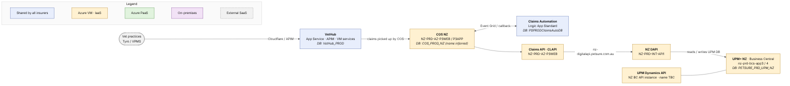

# Go Tech Platform — New Zealand

> **Scope:** PROD, PetSure New Zealand (NZ).
> **Source:** [`infrastructure-summary-as-is.md`](../infrastructure-summary-as-is.md) (2026-10-26) and the ArchiMate model `archi/h1.archimate`. Items marked *inferred* are not confirmed by any source.

## Contents

1. [High-level picture](#1-high-level-picture)
2. [VetHub (shared)](#2-vethub-shared)
3. [COS — Claim Orchestration Service](#3-cos--claim-orchestration-service)
4. [Claims Automation (shared)](#4-claims-automation-shared)
5. [Claims API (CLAPI)](#5-claims-api-clapi)
6. [CSP Digital API (DAPI)](#6-csp-digital-api-dapi)
7. [Dynamic CLAPI and STP / Clawdia — not used](#7-dynamic-clapi-and-stp--clawdia--not-used)
8. [UPM+ and UPM Dynamics API](#8-upm-and-upm-dynamics-api)
9. [Open points](#9-open-points)

---

## 1. High-level picture

New Zealand follows the classic Go Tech claim path, entirely within Azure. A vet practice submits a claim through the shared **VetHub**. The New Zealand **COS** picks it up, stores it in its own database and asks the shared **Claims Automation** to assess it. COS then submits the claim through the New Zealand **CLAPI**, which sends it to the New Zealand **DAPI**; DAPI writes it directly into the **UPM+ NZ** database.

The main difference from Australia is where UPM+ lives. In New Zealand UPM+, its database, its **UPM Dynamics API** and DAPI all run on Azure virtual machines in dedicated New Zealand subscriptions of the Azure landing zone, rather than on-premises. COS and CLAPI run on Windows virtual machines in the older ("legacy") Azure estate, as they do for every insurer. New Zealand does not use STP / Clawdia or (according to the code) Dynamic CLAPI.

| Component | Hosting | Location | Shared / dedicated |
|---|---|---|---|
| VetHub | App Service, API Management, Windows VM, Azure SQL | Azure | Shared by all insurers |
| COS | Windows VMs (IIS + Windows services), Azure SQL | Azure legacy estate | Dedicated NZ stack |
| Claims Automation | Logic Apps Standard, Azure SQL | Azure | Shared by all insurers |
| CLAPI | Windows VM (IIS) | Azure legacy estate | Dedicated NZ deployment |
| DAPI | Windows VM (IIS) | Azure landing zone, `sub-prd-digital-nz` | Dedicated |
| Dynamic CLAPI | — | — | Not used (listed in PRTG, not in code) |
| STP / Clawdia | — | — | Not used |
| UPM Dynamics API | Business Central API service on the UPM+ VMs | Azure landing zone, `sub-prd-core-nz` | Part of UPM+ NZ |
| UPM+ | Business Central VMs, SQL Server on VMs, Azure Load Balancer | Azure landing zone, `sub-prd-core-nz` | Dedicated |

---

## 2. VetHub (shared)

VetHub is the single entry point for vet practices. One deployment serves every insurer, New Zealand included, and the application works out which insurer each claim belongs to. Its APIs and web UI run on Azure App Service behind Cloudflare and Azure API Management; its background Windows services run on an Australian Go Tech VM; its data sits in the Azure SQL database `VetHub_PROD`. The VetHub alert for stuck claims also reads the New Zealand COS database.

#### Technical reference

The full list of VetHub resources, artefacts, endpoints and Azure services is in [Australia → VetHub](01-australia.md#2-vethub-shared). In short:

- App Services `ps-syd-prd-vethub-vhapi-app`, `-vhregapi-app`, `-vhportalapi-app`, `-vhui-app`; APIM `ps-prod-apim-vethub`
- Windows services on `PS-PRD-AZS-P3-3` (*inferred*); MessageFormat.API on `PS-PRD-AZS-P3-1/2`
- Database `VetHub_PROD` on `petsure-production`; `VetHub.Alert.StuckClaims` also reads the NZ COS DB

---

## 3. COS — Claim Orchestration Service

New Zealand has its own COS stack — the same software as Australia, deployed separately with New Zealand settings. It is smaller than the Australian one: a single web server, `NZ-PRD-AZ-P3WEB`, hosts COS.API in IIS, and a single application server, `NZ-PRD-AZ-P3APP`, runs the Windows services that poll VetHub, validate policies, submit claims, handle attachments, trigger Claims Automation and poll UPM+ NZ for status updates. Both are Windows virtual machines in the legacy Azure estate.

The New Zealand COS keeps its data in its own database on the shared Azure SQL server `petsure-production`. The picture names it `COS_PROD_NZ`, but this name follows the naming pattern and has not been confirmed. Like the Australian stack, the New Zealand services communicate through Azure Service Bus, publish to the shared Claims Automation Event Grid topic and to the CATCH notifications topic, and the database also holds the CATCH NZ tables.

#### Technical reference

**Deployed artefacts (as shown in the picture)**

- `NZ-PRD-AZ-P3WEB` (IIS): COS.API
- `NZ-PRD-AZ-P3APP` (Windows services): COS.Service, COS.VetHub.Services, COS.Poll.Services, COS.AddAttachments.Saga, COS.AddAttachments.Service.ConvertPDF, COS.AddAttachments.Service.Consolidate, COS.AddAttachments.Service.Submit
- Azure SQL server `petsure-production`: `COS_PROD_NZ` (*name inferred*; connection `COS-NZ-DB-CONNECTION`)

**Endpoints and configuration**

- `api-cos-prod-nz.petsure.com.au`
- Service configs `App.ProductionNZ`; NZ endpoint prefixes for NServiceBus queues
- `COS.Poll.Services.UPM` deployed for NZ

**Azure services used**

- Service Bus (NServiceBus, `AzureServiceBusConnection_SYD`)
- Event Grid: `ps-prod-egt-claimsautoclaims`, `ps-prod-egt-eventnotifications`
- Storage `p3storageprod` via the Storage API
- Key Vault (deploy-time token replacement); Application Insights `ps-prd-insight-p3` with NZ alert rules

---

## 4. Claims Automation (shared)

Claims Automation (Sophia Jr) is one shared service for all insurers. The New Zealand COS triggers it through the same Azure Event Grid topic as Australia (configured in `App.ProductionNZ`); an Azure Logic App runs the assessment and calls the New Zealand COS.API back with the result. Its database `PSPRODClaimsAutoDB` holds the data of all insurers, each row tagged with its insurer.

#### Technical reference

- Logic Apps Standard: *Claims Automation Logic App (name TBC)* — Claim Automation compiled package
- Event Grid topic `ps-prod-egt-claimsautoclaims`
- Azure SQL `petsure-production`: `PSPRODClaimsAutoDB` (rows keyed by `InsuranceProviderId`)

---

## 5. Claims API (CLAPI)

CLAPI is the layer COS uses to submit claims to the insurer's system. New Zealand runs its own copy, with the same code as Australia and a New Zealand configuration file that points it at the New Zealand DAPI. It runs in IIS on the New Zealand web server `NZ-PRD-AZ-P3WEB`, next to COS.API. It uses no Azure services directly beyond its hosting: it gets its token from the Security API and handles files through the Storage API.

#### Technical reference

- `NZ-PRD-AZ-P3WEB`: Claims API (CLAPI) — IIS deployment
- URL `api-claims-prod-nz.petsure.com.au`; config `appsettings.prod.nz.json`
- Back-end: NZ DAPI `https://nz-digitalapi.petsure.com.au/`

---

## 6. CSP Digital API (DAPI)

DAPI is the older web API that reads and writes the UPM+ database directly. New Zealand has a single DAPI server that provides both the read/write API and the read-only Digital API. Unlike in Australia, it is not on-premises: it is a Windows virtual machine, `NZ-PRD-INT-API1`, in the New Zealand digital subscription of the Azure landing zone, and it works against the `PETSURE_PRD_UPM_NZ` database. DAPI is marked end-of-life in OpsLevel.

#### Technical reference

- Azure VM `NZ-PRD-INT-API1` (Standard_D4as_v4, 10.55.8.68): NZ Digital API — IIS deployment (DAPI + Digital API RO)
- Subscription `sub-prd-digital-nz`, RG `nz-syd-prd-sharedapis-rg`, VNet `nz-syd-prd-sharedapis-vnet` (10.55.8.0/22)
- URL `nz-digitalapi.petsure.com.au`; database `PETSURE_PRD_UPM_NZ`
- Key Vault (`CSP_KEYVAULT` variable); deployed by GitHub Actions through the self-hosted runner

---

## 7. Dynamic CLAPI and STP / Clawdia — not used

STP / Clawdia is Australian only and is not used for New Zealand claims, so there is no New Zealand picture for it.

Dynamic CLAPI is listed for New Zealand in the PRTG monitoring map, but the code only configures lodge endpoints for the Australian and Trupanion UPM+ instances. This document therefore treats it as not used for New Zealand (see [Open points](#9-open-points)).

---

## 8. UPM+ and UPM Dynamics API

UPM+ NZ is the New Zealand instance of PetSure's insurance ERP, built on Microsoft Dynamics 365 Business Central. It runs as infrastructure-as-a-service in Azure: two application virtual machines, `nz-prd-bcs-app3` and `nz-prd-bcs-app4`, sit behind an Azure Load Balancer, and the database `PETSURE_PRD_UPM_NZ` runs on SQL Server Always On across two SQL virtual machines. Everything is in the New Zealand core subscription of the Azure landing zone. Claim documents are kept on a file share on `nz-prd-bcs-app3`.

As in Australia, the **UPM Dynamics API is part of UPM+, not a separate system**: it is the Business Central API service instance on the same application servers. The model shows it as a separate component on both servers, but its PROD endpoint and instance name are not documented. No caller in scope is documented for it in New Zealand.

#### Technical reference

**Deployed artefacts (as shown in the picture)**

- `nz-prd-bcs-app3`, `nz-prd-bcs-app4` (Standard D4as v4): UPM+ NZ Business Central application + UPM Dynamics API (UPM NZ BC API service instance, *name TBC*)
- SQL Server Always On, listener `NZ-PRD-BCS-LS01`: database `PETSURE_PRD_UPM_NZ`

**Infrastructure details**

- SQL VMs `nz-prd-bcs-db01/02` (Standard E4bds v5), virtual cluster `NZ-BCS-PRDDNZ`
- Load balancer `NZUPMPRD` (10.54.0.6)
- Document share `\\nz-prd-bcs-app3\NZ_UPM-Store_1`
- Subscription `sub-prd-core-nz` (`8f6610cb-…`, 10.54.0.0/16), RG `nz-syd-prd-bcs-rg`, VNet `nz-syd-prd-bcs-vnet`

**Azure services used**

- Virtual Machines, Azure Load Balancer, landing-zone VNet networking (hub firewall and DNS)

---

## 9. Open points

- **NZ COS database name** is not confirmed. `COS_PROD_NZ` (used in the picture) is *inferred* from the naming pattern; only `COS_PROD` and `COS_PROD_VP` are confirmed on `petsure-production`.
- **Dynamic CLAPI for NZ.** PRTG lists it, but the code only configures AU and TPN lodge endpoints.
- **UPM Dynamics API NZ.** Endpoint and BC service-instance name are not documented.
- **Shared points** (VetHub Windows-service host, Service Bus namespace, single-region risk for the Go Tech VMs) apply here too — see [Australia → Open points](01-australia.md#10-open-points).
