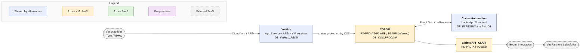

# Go Tech Platform — Vet Partners

> **Scope:** PROD, Vet Partners (VP).
> **Source:** [`infrastructure-summary-as-is.md`](../infrastructure-summary-as-is.md) (2026-10-26) and the ArchiMate model `archi/h1.archimate`. Items marked *inferred* are not confirmed by any source.

## Contents

1. [High-level picture](#1-high-level-picture)
2. [VetHub (shared)](#2-vethub-shared)
3. [COS — Claim Orchestration Service](#3-cos--claim-orchestration-service)
4. [Claims Automation (shared)](#4-claims-automation-shared)
5. [Claims API (CLAPI)](#5-claims-api-clapi)
6. [DAPI, Dynamic CLAPI, STP / Clawdia, UPM Dynamics API and UPM+ — not used](#6-dapi-dynamic-clapi-stp--clawdia-upm-dynamics-api-and-upm--not-used)
7. [Open points](#7-open-points)

---

## 1. High-level picture

Vet Partners uses the shortest version of the Go Tech claim path. A vet practice submits a claim through the shared **VetHub**. The Vet Partners **COS** picks it up, stores it in its own database and asks the shared **Claims Automation** to assess it. COS then submits the claim through the Vet Partners **CLAPI**, which hands it to the **Boomi** integration platform; Boomi lodges it in **Vet Partners' own Salesforce**.

Vet Partners claims never reach UPM+. As a result, Vet Partners does not use DAPI, Dynamic CLAPI, STP / Clawdia or the UPM Dynamics API. Its dedicated part of the platform — COS and CLAPI — runs on Windows virtual machines in the older ("legacy") Azure estate, and its COS database sits on the shared Azure SQL server.

| Component | Hosting | Location | Shared / dedicated |
|---|---|---|---|
| VetHub | App Service, API Management, Windows VM, Azure SQL | Azure | Shared by all insurers |
| COS | Windows VMs (IIS + Windows services), Azure SQL | Azure legacy estate | Dedicated VP stack |
| Claims Automation | Logic Apps Standard, Azure SQL | Azure | Shared by all insurers |
| CLAPI | Windows VM (IIS) | Azure legacy estate | Dedicated VP deployment |
| Boomi → Salesforce | SaaS | External | Vet Partners' systems |
| DAPI, Dynamic CLAPI, STP / Clawdia, UPM Dynamics API, UPM+ | — | — | Not used |

---

## 2. VetHub (shared)

VetHub is the single entry point for vet practices. One deployment serves every insurer, Vet Partners included, and the application works out which insurer each claim belongs to. Its APIs and web UI run on Azure App Service behind Cloudflare and Azure API Management; its background Windows services run on an Australian Go Tech VM; its data sits in the Azure SQL database `VetHub_PROD`. VetHub's configuration is also the source of the Vet Partners COS and CLAPI URLs listed below.

#### Technical reference

The full list of VetHub resources, artefacts, endpoints and Azure services is in [Australia → VetHub](01-australia.md#2-vethub-shared). In short:

- App Services `ps-syd-prd-vethub-vhapi-app`, `-vhregapi-app`, `-vhportalapi-app`, `-vhui-app`; APIM `ps-prod-apim-vethub`
- Windows services on `PS-PRD-AZS-P3-3` (*inferred*); MessageFormat.API on `PS-PRD-AZS-P3-1/2`
- Database `VetHub_PROD` on `petsure-production`

---

## 3. COS — Claim Orchestration Service

Vet Partners has its own COS stack — the same software as Australia, deployed separately with Vet Partners settings. Like New Zealand, it uses one web server for COS.API in IIS and one application server for the Windows services that poll VetHub, validate policies, submit claims, handle attachments and trigger Claims Automation. Both are Windows virtual machines in the legacy Azure estate. The server names `PS-PRD-AZ-P3WEB` and `PS-PRD-AZ-P3APP` are mapped to Vet Partners by analogy with the pre-production servers and the PRTG device count; this still needs confirmation from DevOps.

The Vet Partners COS keeps its data in the database `COS_PROD_VP` on the shared Azure SQL server `petsure-production`. Its services communicate through Azure Service Bus and publish to the shared Claims Automation Event Grid topic. The source lists the UPM status poller only for Australia, New Zealand and Trupanion, which fits the fact that Vet Partners claims do not go to UPM+.

#### Technical reference

**Deployed artefacts (as shown in the picture)**

- `PS-PRD-AZ-P3WEB` (10.3.0.151, *inferred VP*), IIS: COS.API
- `PS-PRD-AZ-P3APP` (*inferred VP*), Windows services: COS.Service, COS.VetHub.Services, COS.Poll.Services, COS.AddAttachments.Saga, COS.AddAttachments.Service.ConvertPDF, COS.AddAttachments.Service.Consolidate, COS.AddAttachments.Service.Submit
- Azure SQL server `petsure-production`: `COS_PROD_VP`

**Endpoints**

- `api-cos-prod-vp.petsure.com.au` (from VetHub config)

**Azure services used**

- Service Bus (NServiceBus, VP endpoint prefixes)
- Event Grid `ps-prod-egt-claimsautoclaims`
- Storage `p3storageprod` via the Storage API
- Key Vault (deploy-time token replacement); Application Insights `ps-prd-insight-p3` with VP alert rules

---

## 4. Claims Automation (shared)

Claims Automation (Sophia Jr) is one shared service for all insurers. The Vet Partners COS triggers it through the same Azure Event Grid topic as Australia and New Zealand; an Azure Logic App runs the assessment and calls COS.API back with the result. Its database `PSPRODClaimsAutoDB` holds the data of all insurers, each row tagged with its insurer.

#### Technical reference

- Logic Apps Standard: *Claims Automation Logic App (name TBC)* — Claim Automation compiled package
- Event Grid topic `ps-prod-egt-claimsautoclaims`
- Azure SQL `petsure-production`: `PSPRODClaimsAutoDB` (rows keyed by `InsuranceProviderId`)

---

## 5. Claims API (CLAPI)

CLAPI is the layer COS uses to submit a claim to the insurer's system. Vet Partners runs its own copy, with the same code as Australia and a Vet Partners configuration file. Instead of pointing at a DAPI, it sends claims to Vet Partners' **Boomi** integration platform, which lodges them in Vet Partners' Salesforce. It runs in IIS on the Vet Partners web server, next to COS.API, and uses no Azure services directly beyond its hosting.

#### Technical reference

- `PS-PRD-AZ-P3WEB` (*inferred VP*): Claims API (CLAPI) — IIS deployment
- URL `api-claims-prod-vp.petsure.com.au`; config `appsettings.prod.vp.json`
- Back-end: Boomi `https://c01-aus.integrate.boomi.com/` → Vet Partners Salesforce
- Token from the Security API; files via the Storage API (`p3storageprod`)

---

## 6. DAPI, Dynamic CLAPI, STP / Clawdia, UPM Dynamics API and UPM+ — not used

Vet Partners is not on UPM+. Its claims are lodged into Vet Partners' Salesforce through Boomi, so none of the UPM-side components are deployed or used for Vet Partners, and there are no Vet Partners pictures for them. STP / Clawdia is Australian only.

---

## 7. Open points

- **VP COS / CLAPI servers.** `PS-PRD-AZ-P3WEB` / `PS-PRD-AZ-P3APP` are mapped to Vet Partners by analogy with `PS-PRE-VP-P3WEB/APP` and the PRTG device count (*inferred*). Confirm with DevOps.
- **Boomi and Salesforce** are outside the scope of the source summary; no hosting details are recorded.
- **Shared points** (VetHub Windows-service host, Service Bus namespace, single-region risk for the Go Tech VMs) apply here too — see [Australia → Open points](01-australia.md#10-open-points).
