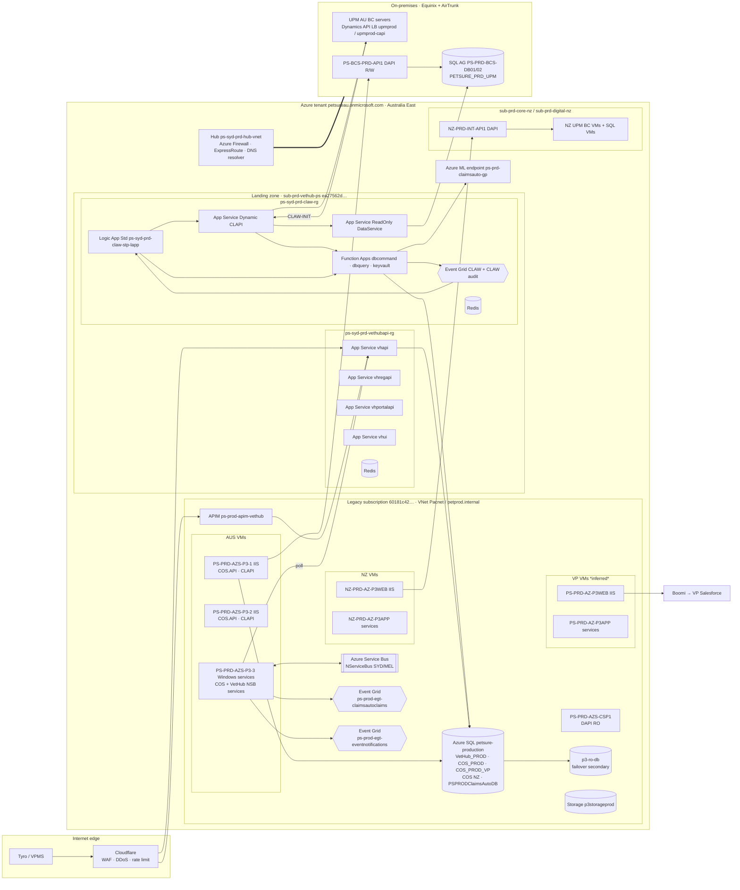

# Azure Cloud

> How the claims-path components are deployed in **PROD**: VetHub (with its DB), COS (with its DB), STP / Clawdia, CSP Digital API (DAPI), Claims API (CLAPI), Dynamic CLAPI, the UPM Dynamics API and UPM (with its DB). The page starts with the Azure Cloud foundation (tenant, subscriptions, networks, shared platform services). It then covers VetHub and COS, followed by the other components. For each component it lists the Azure services that **host** it and the Azure services it **uses** (Service Bus, Event Grid, SQL, Storage, Key Vault, Redis, etc.).
>
> Scope is PROD only, for the insurance providers on the Confluence page *Insurance Provider Details per Region*: **AUS**, **NZ** and **VP** (Vet Partners). Trupanion (TPN) and Luna run on the AUS stack and are mentioned only where that matters.
>
> Compiled on 2026-10-26 from three sources: system source code and configuration files (repos under `repos by system`, see the system `readMe.md` files), Confluence (P3, PET, UPM, SD and CS spaces) and the PRTG AUS production map. Items marked *inferred* are not stated explicitly in any source. Where code and Confluence disagree, the newer source wins and the conflict is listed in [Notes & gaps](#notes--gaps).

## Contents
1. [Deployment at a glance](#1-deployment-at-a-glance)
2. [Azure Cloud foundation](#2-azure-cloud-foundation)
3. [Shared platform services (data, messaging, events)](#3-shared-platform-services-data-messaging-events)
4. [VetHub (shared by all insurers)](#4-vethub-shared-by-all-insurers)
5. [COS — Claim Orchestration Service (per insurer)](#5-cos--claim-orchestration-service-per-insurer)
6. [Claims API (CLAPI)](#6-claims-api-clapi)
7. [STP / Clawdia (CLAW)](#7-stp--clawdia-claw)
8. [Dynamic CLAPI](#8-dynamic-clapi)
9. [CSP Digital API (DAPI)](#9-csp-digital-api-dapi)
10. [UPM Dynamics API](#10-upm-dynamics-api)
11. [UPM (incl. database)](#11-upm-incl-database)
12. [Azure services matrix](#12-azure-services-matrix)
13. [Notes & gaps](#notes--gaps)
14. [Sources](#sources)

---

## 1. Deployment at a glance

### Shared vs per-insurer

| Component | AUS (incl. TPN, Luna) | NZ | VP | Shared / dedicated |
|---|---|---|---|---|
| VetHub (APIs, UI, Windows services, VetHub_PROD DB, APIM) | ✔ | ✔ | ✔ | **Shared**: one instance serves all insurers |
| COS (COS.API + NServiceBus Windows services) | AUS VMs | NZ VMs | VP VMs | **Per insurer**: separate VMs and deployments. TPN/Luna merged into the AUS stack in 2025–26 |
| COS DB | `COS_PROD` | NZ COS DB (*name inferred*) | `COS_PROD_VP` | **Per insurer**: separate databases on the same Azure SQL logical server |
| CLAPI | AUS VMs | NZ VMs | VP VMs | **Per insurer**: same code, insurer-specific appsettings (`appsettings.prod[.nz/.vp].json`) |
| STP / Clawdia | ✔ | — | — | **AUS only** (also serves TPN/Luna). Not used for NZ or VP |
| Dynamic CLAPI | ✔ | (listed for NZ in PRTG, see notes) | — | **AUS** (lodges into AU and TPN UPM) |
| DAPI | on-prem `PS-BCS-PRD-API1` (R/W) + Azure VM `PS-PRD-AZS-CSP1` (RO) | Azure VM `NZ-PRD-INT-API1` | — (VP uses Boomi) | **Per insurer** |
| UPM Dynamics API (Business Central API) | on-prem BCS app servers | Azure BCS app servers | — | **Per insurer**: part of each UPM instance |
| UPM + DB | **On-premises** (Equinix + AirTrunk DCs) | **Azure IaaS** (`sub-prd-core-nz`) | — (VP claims go to Vet Partners Salesforce via Boomi) | **Per insurer** |
| Claims Automation (Sophia Jr) DB `PSPRODClaimsAutoDB` | ✔ | ✔ | ✔ | **Shared**: one DB, rows keyed by `InsuranceProviderId` (used by both Claims Automation and STP) |

### Deployment diagram (PROD)

---

## 2. Azure Cloud foundation

### Tenant and regions
| Item | Value | Evidence |
|---|---|---|
| Entra ID tenant | `petsureau.onmicrosoft.com` (tenant id `ce9f1d01-…`) | CATCH tfvars, VetHub APIM policy |
| Primary region | **Australia East** (Sydney): all PROD PaaS resources, CLAW, VetHub ALZ | tfvars `location = australiaeast`, Event Grid endpoints `australiaeast-1` |
| Secondary region | **Australia Southeast** (Melbourne): legacy `*_MEL` Service Bus connection strings and `ProductionMEL` configs, legacy MEL web servers | COS / VetHub App.config (`AzureServiceBusConnection_MEL`); prod COS services only reference `_SYD` |

### Two Azure estates
PetSure runs these components across two Azure estates (plus on-premises UPM AU).

**A. Legacy ("pre-landing-zone") estate.** This is where most GoTech IaaS and the shared PaaS still live.

| Item | Value |
|---|---|
| Subscription | `60181c42-6ab1-4a45-86e2-27d2a74ff8b0` (subscription display name not found) |
| Key resource groups | `petsure-production` (Azure SQL `petsure-production`, App Insights `ps-prd-insight-p3`, storage `p3storageprod`, alert rules), `Pacnet-Azure` (VNet `Pacnet`), `ps-prd-rg-vetchannel` (CATCH, vet-channel App Service plans, Event Grid topics, Key Vault `ps-prd-kv-vetchannel`), `P3-Project-Group` (Service Bus namespace `p3-prod-syd`), `Production-VP-RG` (VP CATCH), `ps-prod-rg-vethub` (VetHub APIM) |
| Networks | VNet `Pacnet` with subnets `p3-prod-appservices-au`, `p3-prod-appservices-nz` (App Service VNet integration). GoTech VMs sit in the legacy `10.3.0.0/x` and `10.6.0.0/x` ranges, AD domain `petprod.internal` (DNS 10.5.0.6 / 10.6.0.5) |
| Compute | Windows Server VMs running IIS sites and Windows services, deployed by GitHub Actions through the self-hosted runner `petsure-azure-windows-runner` (PowerShell remoting, `Petprod\` service account) |

**B. Azure Landing Zone (hub-and-spoke, Terraform).** Source of truth is the `manage-azurerm-landing-zones` repo.

| Landing zone | Subscription | Relevant content |
|---|---|---|
| Platform | `sub-shr-connectivity`, `sub-shr-management`, `sub-shr-identity` (10.30.0.0/16) | Hub VNet `ps-syd-prd-hub-vnet` (10.30.0.0/21, RG `ps-syd-prd-hub-network-rg`), **Azure Firewall** `ps-syd-prd-hub-afw` (all spoke and internet egress), **ExpressRoute** circuit `ps-syd-prd-hub-erc-at` + gateway `ps-syd-prd-hub-ergw` to the **AirTrunk** data centre, **DNS Private Resolver** `ps-syd-prd-hub-dnspr` (forwards `internal.petsure.com.au`, `petsure.com.au`, `petprod.internal`), **Private DNS zones** (RG `ps-syd-prd-hub-privatednszones-rg`, subscription `fd9c984f-…`, *inferred* = connectivity), GitHub-hosted runner subnet `github-snet` |
| Prd · VetHub (AU) | `sub-prd-vethub-ps` (`ea27562d-5f85-4227-a600-587d274cb37e`, 10.50.0.0/16) | Spoke `ps-syd-prd-claw-vnet` (10.50.4.0/22) → **CLAW / STP**, RG `ps-syd-prd-claw-rg`; spoke `ps-syd-prd-vethubapi-vnet` (10.52.16.0/22) → **VetHub APIs**, RG `ps-syd-prd-vethubapi-rg` |
| Prd · Core NZ | `sub-prd-core-nz` (`8f6610cb-…`, 10.54.0.0/16) | Spoke `nz-syd-prd-bcs-vnet` → **UPM NZ** (BC + SQL VMs), RG `nz-syd-prd-bcs-rg` |
| Prd · Digital NZ | `sub-prd-digital-nz` (10.55.0.0/16) | Spoke `nz-syd-prd-sharedapis-vnet` (10.55.8.0/22) → **NZ DAPI** VM; `nz-syd-prd-csp-vnet`, `nz-syd-prd-qtools-vnet` |
| Prd · VetHub NZ | `sub-prd-vethub-nz` (10.53.0.0/16) | Spoke `nz-syd-prd-catch-vnet` (NZ CATCH; out of scope) |
| Prd · Trupanion | `sub-prd-trupanion-ps` (`f53920f6-…`) | Trupanion CSP/QT App Services (out of scope) |
| Non-prod | `sub-non-vethub-ps` (`4a220883-…`) etc. | Not described here |

Spoke subnets follow the CLAW pattern: `pep-snet` (private endpoints), `funcapp-snet`, `webapp-snet`, `logicapp-snet`, `iaas-snet` and `dmz-snet`. UDRs force `0.0.0.0/0` through the hub firewall.

### Cross-cutting services
| Concern | Azure / other service | Notes |
|---|---|---|
| Ingress / WAF | **Cloudflare** (WAF, DDoS, bot management, 100 req/min rate limiting) in front of `*.vethub.net` | Since 2026_R4. VetHub App Services and APIM only accept Cloudflare (and APIM) IPs |
| API gateway | **Azure API Management** `ps-prod-apim-vethub` (Basic_1) | Tyro GapOnly facade, AAD JWT validation |
| Identity | **Entra ID** app registrations and **Managed Identity** (CLAW ↔ Dynamic CLAPI); Basic / API-key auth for legacy | |
| Secrets | **Azure Key Vault**, one per component (see each section) plus legacy `ps-prod-kv-claw`, `ps-prd-kv-vetchannel` | `@Microsoft.KeyVault(...)` references in app settings |
| Monitoring | **Application Insights** `ps-prd-insight-p3` (legacy shared), `ps-syd-prd-vethubapi-ai` (VetHub ALZ), CLAW App Insights + Log Analytics; **Azure Monitor scheduled query alerts** to Slack; **PRTG** (on-prem) for VM/IIS/Windows-service health | |
| CI/CD | **GitHub Actions**: ALZ workflows (`alz-*`, `lz-au-*`, `au-alz-*`) deploy to App Service / Functions / Logic Apps; legacy workflows deploy to VMs through the self-hosted runner. Terraform workflows use subscription `b15ae5d0-…` (RG `Digital-Database`) as `ARM_SUBSCRIPTION_ID` (*inferred*: Terraform state backend) | |

---

## 3. Shared platform services (data, messaging, events)

### Azure SQL Database: logical server `petsure-production.database.windows.net` (legacy subscription)
| Database | Owner / users | Insurer | Notes |
|---|---|---|---|
| `VetHub_PROD` | VetHub APIs and services, Vet.Portal.API, VetHub.Alert.StuckClaims | Shared | Azure SQL, **DTU 400**, in a **failover group** with secondary server `p3-ro-db.database.windows.net`, **Azure SQL Data Sync** to the DWH |
| `COS_PROD` | COS AUS (incl. TPN, Luna), CATCH AUS, Catch Function Apps | AUS | Shares the CATCH tables (users, roles, events, Gap-Only) |
| `COS_PROD_VP` | COS VP | VP | |
| COS NZ database | COS NZ, CATCH NZ (`COS-NZ-DB-CONNECTION`) | NZ | Name not found; `COS_PROD_NZ` *inferred* from the naming pattern |
| `PSPRODClaimsAutoDB` | Claims Automation (Sophia Jr) **and** STP/CLAW (`Diagnosis`, `STPClaim`… tables; secret `CA-DB-CONNECTION` / `LZ-AU-CA-DB-CONNECTION`) | Shared | Rows keyed by `InsuranceProviderId` |
| NServiceBus persistence (`NSBusPersistence`) | COS and VetHub sagas | per stack | Prod database name/server not in repo (connection string from Key Vault) |

### Azure Service Bus (NServiceBus transport)
| Item | Value |
|---|---|
| Used by | All COS Windows services (sagas, workers, pollers) and VetHub Windows services (`VetHub.Service.*`), plus COS.API (send-only) |
| Connection | `AzureServiceBusConnection_SYD` (all PROD COS App.Production configs), `_MEL` legacy. Namespace is resolved from the VM region (VetHub ProcessConversations) |
| Namespace | Not in repo (GitHub secret). The known PROD namespace is **`p3-prod-syd`** (RG `P3-Project-Group`), which also hosts topic `p3-prod-sbt-claimprogress-trackers` (subscription `…-subscription`) consumed by the Catch Notification Function App. COS/VetHub NServiceBus on the same namespace is *inferred* |
| Queues | `PROD_<Endpoint>` (e.g. `PROD_ClaimSubmissionSaga`, `PROD_ValidatePolicy`, `PROD_SubmitClaims`, `PROD_COS.AddAttachments.Saga`), audit/error `PROD_COSAudit` / `PROD_COSError`. NZ/VP stacks use their own endpoint prefixes; VetHub uses `<ENV>_VetHub.Service.Saga.Claim` |

### Azure Event Grid
| Topic | Publisher → subscriber | Insurer |
|---|---|---|
| `ps-prod-egt-claimsautoclaims` (australiaeast) | COS `ClaimsAutomationIntegration` → Claims Automation Logic App Standard (masterflow) → callback COS.API | AUS, NZ, VP (one topic; `App.Production`, `App.ProductionNZ` configs) |
| `ps-prod-egt-eventnotifications` (RG `ps-prd-rg-vetchannel`) | COS.API / COS services (`PetSure.Catch.Notification`) → Catch Notification Function App | AUS, NZ |
| `ps-prod-egt-signalr-eventnotifications` | Catch Notification Function → Catch SignalR Function → SignalR API | AUS |
| CLAW topic + CLAW audit topic (RG `ps-syd-prd-claw-rg`; names not in repo, pattern `ps-<env>-evgt-clawaudit`) | KeyVault Function `CLAW-INIT` → CLAW entry Logic Apps; all CLAW stages → DBCommand audit functions | AUS |
| Dead-lettering | Storage `p3storageprod` / container `prod-dead-letter-queue` (legacy topics); `pssydprdclawdlqueuesa`, `pssydprdclawevgtclawsa` (CLAW) | |

### Storage
| Account | Use |
|---|---|
| `p3storageprod` (RG `petsure-production`) | VetHub claim attachments / blobs (Defender for Storage enabled) accessed through the Storage API; Event Grid dead-letter |
| `petcdnstore` (container `vethubui-prod`) | VetHub.UI static assets / CDN |
| `pssydprdclawdlqueuesa`, `pssydprdclawevgtclawsa` | CLAW dead-letter / Event Grid storage |

---

## 4. VetHub (shared by all insurers)

VetHub is **one deployment for all insurers** (AU, NZ, VP, TPN, Luna). Insurer routing happens inside the code (`InsuranceProvider`, `Account` tables). Since **2026_R4 (Sept 2026)** the VetHub APIs and UI run on **Azure App Service in the landing zone**. The NServiceBus Windows services and the database are still on the legacy estate.

### Hosting
| Component | Azure hosting service | PROD resource | Host / DNS |
|---|---|---|---|
| VetHub APIM | **API Management** (Basic_1) | `ps-prod-apim-vethub`, RG `ps-prod-rg-vethub`; App Insights `ps-prod-insights-vethubapim`, Log Analytics `ps-prod-log-analytics-vethubapim` | `ps-prod-apim-vethub.azure-api.net` (*inferred*) |
| VetHub.API (.NET 10) | **App Service** (Windows, P1v3, zone-redundant, staging slot + swap) | `ps-syd-prd-vethub-vhapi-app` on plan `ps-syd-prd-vethub-asp`, RG `ps-syd-prd-vethubapi-rg`, sub `sub-prd-vethub-ps` | `api-vh-prod.vethub.net` (Cloudflare), `internal-api-vh-prod.petsure.com.au` (APIM backend and internal callers) |
| VetHub.Reg.API | **App Service** | `ps-syd-prd-vethub-vhregapi-app` | `api-vethubreg-prod.vethub.net`, `internal-api-vethubreg-prod.petsure.com.au` |
| Vet.Portal.API | **App Service** (public access OFF) | `ps-syd-prd-vethub-vhportalapi-app` | `api-vethubportal-prod.vethub.net`, `internal-api-vethubportal-prod.petsure.com.au` |
| VetHub.UI (React + Express) | **App Service** (Node) + blob CDN | `ps-syd-prd-vethub-vhui-app`; `petcdnstore/vethubui-prod` | `vetportal.vethub.net` |
| VetHub.Service.ProcessConversations, .Saga.Claim, .Claims, .Attachments, .StatusUpdate, VetHub.Alert.StuckClaims | **Virtual Machine** (Windows services, .NET Framework) | AUS GoTech Windows server (`PS-PRD-AZS-P3-3`, *inferred*; PRTG lists them under the `GoTech-PROD-AUS` group, see PRTG map) | — |
| MessageFormat.API (Twilio TwiML) | **Virtual Machine** (IIS) | AUS IIS servers `PS-PRD-AZS-P3-1/2` | `api-messageformat-prod.petsure.com.au` |
| VetHub DB | **Azure SQL Database** | `VetHub_PROD` on `petsure-production` (DTU 400, failover group → `p3-ro-db`) | — |

### Azure services used by VetHub
| Service | Resource | Used for |
|---|---|---|
| Key Vault | `pssydprdvethubapikv` (VetHub.API), `pssydprdvhregkv` (Reg.API), `pssydprdvetportalkv` (Portal.API), `pssydprdvhuikv` (UI) | Connection strings, Tyro keys, credentials (apps have *Key Vault Secrets Officer*) |
| Azure Cache for Redis | `ps-syd-prd-vethubapi-redis` (C1 Standard; Confluence also names it `ps-syd-prd-vethub-redis`) | HybridCache for VetHub.API |
| Application Insights / Log Analytics | `ps-syd-prd-vethubapi-ai` (+ log workspace); legacy services → `ps-prd-insight-p3` | Telemetry and Azure Monitor alerts |
| Azure SQL | `VetHub_PROD`; StuckClaims also reads `COS_PROD` and the COS NZ DB | System of record |
| Service Bus | NServiceBus queues (`<ENV>_VetHub.Service.Saga.Claim`, …) | Claim-preparation pipeline |
| Storage | via Storage API → `p3storageprod` | Attachments, generated PDFs |
| VNet integration / Private Endpoints | `ps-syd-prd-vethubapi-vnet` (10.52.16.0/22) | Outbound to legacy SQL / internal APIs through the hub |
| Entra ID | VetHub API app registration (APIM JWT, Tyro) | AuthN |

---

## 5. COS — Claim Orchestration Service (per insurer)

COS is deployed as **separate stacks per insurer** on **Azure Windows VMs** in the legacy estate: IIS for the APIs and Windows services for the NServiceBus endpoints and pollers. AUS has two IIS servers (`PRODWEB1/2`) and one Windows-service server. NZ and VP have one IIS server and one Windows-service server each. TPN and Luna run on the AUS stack (merged 2025–26). The UPM status poller still has a dedicated TPN deployment (`UPMPRODTPN`).

### Hosting per insurer
| Insurer | IIS VM(s): COS.API + CLAPI | Windows-service VM: NSB endpoints and pollers | Public / internal URLs | COS DB |
|---|---|---|---|---|
| **AUS** (+TPN, Luna) | `PS-PRD-AZS-P3-1` (10.6.0.35), `PS-PRD-AZS-P3-2` (10.6.0.39) | `PS-PRD-AZS-P3-3` (10.6.0.40) | `api-cos-prod.petsure.com.au`, `api-claims-prod.petsure.com.au` | `COS_PROD` |
| **NZ** | `NZ-PRD-AZ-P3WEB` | `NZ-PRD-AZ-P3APP` | `api-cos-prod-nz.petsure.com.au`, `api-claims-prod-nz.petsure.com.au` | NZ COS DB (*name inferred* `COS_PROD_NZ`) |
| **VP** | `PS-PRD-AZ-P3WEB` (10.3.0.151) *inferred VP* | `PS-PRD-AZ-P3APP` *inferred VP* | `api-cos-prod-vp.petsure.com.au`, `api-claims-prod-vp.petsure.com.au` (from VetHub config) | `COS_PROD_VP` |

Windows services deployed on each stack: `COS.Service.Sagas.Claims`, `.Sagas.Attachment`, `.ValidatePolicy`, `.SubmitClaims`, `.ClaimsAutomationIntegration`, `.ClaimActions`, `.ConsolidateClaimAttachments`, `.SubmitClaimAttachment`, `.ClaimAttachmentActions`, `COS.VetHub.Saga.Claims`, `COS.VetHub.Services.LoadConversations/SaveClaims/ProcessClaims`, `COS.Poll.Services.VetHub` (+ `.eClaim`), `COS.Poll.Services.UPM` (AUS, NZ, TPN), `COS.AddAttachments.Saga/ConvertPDF/Consolidate/Submit`, plus the shared helpers `LogManager.Handler` and `Notification.Service`. The same IIS VMs also host the GoTech shared APIs: Storage.API, Security.API, Security.AAD.API, Notification.API and P3ITTools.

**PRTG AUS PROD map (2026-10-26).** The map confirms the AUS layout. The "WEB API" layer on the IIS servers `PS-PRD-AZS-P3-1/2` holds COS.API, CLAPI, Storage.API, Notification.API, MessageFormat.API, CATCH.API / CATCH UI links and the "AUS Prod Web HealthCheck". The Windows-service groups are *VetHub Services* (`VetHub.Service.Attachments`, `.Saga.Claim`, `.Claims`, `COS.VetHub.Services.ProcessClaims`), *COS VetHub Services* (`COS.Poll.Services.VetHub`, `COS.VetHub.Saga.Claims`, `LoadConversations`, `SaveClaims`, `ProcessClaims`), *COS Services* (`Sagas.Claims`, `ValidatePolicy`, `SubmitClaims`, `ClaimActions`, `ClaimsAutomationIntegration`, `Sagas.Attachment`, `ConsolidateClaimAttachments`, `SubmitClaimAttachment`, `ClaimAttachmentActions`), *CSP Additional Attachments* (`COS.AddAttachments.Saga/ConvertPDF/Consolidate/Submit`), *Poll.Service.UPM Status Update* (`COS.Poll.Services.UPM`) and the `Notification Service`. All of these are `GoTech-PROD-AUS-*` sensors. Many links on the map point to sensors that no longer exist ("Object … does not exist"), mostly the old IIS VetHub.API / VetPortal.API sensors.

### Azure services used by COS
| Service | Resource | Used for |
|---|---|---|
| Virtual Machines (Windows Server, IIS) | see table above | Hosting |
| Azure SQL | `COS_PROD` / `COS_PROD_VP` / NZ COS DB on `petsure-production`; NSB persistence DB | Claims, statuses, Gap-Only, CATCH tables, saga state |
| Service Bus | NServiceBus over `AzureServiceBusConnection_SYD` | All internal commands/events (`PROD_*` queues) |
| Event Grid | `ps-prod-egt-claimsautoclaims` (publish `Petsure.ClaimsAutomation.Claim`), `ps-prod-egt-eventnotifications` (publish `PetSure.Catch.Notification`) | Claims Automation trigger; CATCH real-time alerts |
| Storage (via Storage API) | `p3storageprod` | Claim blobs and attachments downloaded from VetHub; merged PDFs |
| Key Vault | names in GitHub secrets `KEYVAULT` / `CRED_KEYVAULT` (not in repo) | Deploy-time token replacement in `Web/App.config` |
| Application Insights | `ps-prd-insight-p3` | Logs and Azure Monitor alert rules per insurer (`[AUS]…`, NZ, VP) |

Outbound (non-Azure) dependencies: VetHub.API (`internal-api-vh-prod.petsure.com.au`), CLAPI → DAPI/Boomi, Dynamic CLAPI Lodge (`ps-syd-prod-dynamicclapi-api.petsure.com.au`), Notification/Security/Storage APIs.

---

## 6. Claims API (CLAPI)

| Item | AUS (+TPN) | NZ | VP |
|---|---|---|---|
| Hosting | **VM / IIS** on `PS-PRD-AZS-P3-1/2` | **VM / IIS** on `NZ-PRD-AZ-P3WEB` | **VM / IIS** on VP web VM |
| URL | `api-claims-prod.petsure.com.au` | `api-claims-prod-nz.petsure.com.au` | `api-claims-prod-vp.petsure.com.au` |
| Config file | `appsettings.prod.json` | `appsettings.prod.nz.json` | `appsettings.prod.vp.json` |
| Insurer back-end | AU DAPI `https://api.petsure.com.au/` (on-prem) and Trupanion `https://tp-api.petsure.com.au` | NZ DAPI `https://nz-digitalapi.petsure.com.au/` (Azure VM) | **Boomi** `https://c01-aus.integrate.boomi.com/` → Vet Partners Salesforce |
| Azure services used | none directly besides hosting; token from Security API; files via Storage API (`p3storageprod`) | same | same |

OpsLevel labels CLAPI as `azure-app-service`. The workflows and Confluence show IIS on VMs. Moving CLAPI and COS.API to App Service is the agreed long-term DR option (".NET 4.8 → .NET 10 and App Services").

---

## 7. STP / Clawdia (CLAW)

**AUS only** (serves AU, TPN and Luna claims). It is fully PaaS in the landing zone: subscription `sub-prd-vethub-ps` (`ea27562d-…`), resource group `ps-syd-prd-claw-rg`, network RG `ps-syd-prd-claw-network-rg`, VNet `ps-syd-prd-claw-vnet` (10.50.4.0/22), deployed with Terraform and GitHub Actions (`lz-au-*`, `au-alz-*`).

| Component | Azure hosting service | PROD resource | Notes |
|---|---|---|---|
| CLAW workflows (entry ×4, master, subflows) | **Logic Apps Standard** (plan `ps-syd-prd-claw-stp-la-asp`) | `ps-syd-prd-claw-stp-lapp` | Stateful workflows; Office 365 managed connector `office365-1` for alerts |
| DBCommand | **Azure Functions** (.NET 8 isolated) | `ps-syd-prd-claw-dbcommand-func-app` → `ps-syd-prod-dbcommand-func-app.petsure.com.au` | Easy Cohorts, business rules, GP enrichment, audit consumers |
| DBQuery | **Azure Functions** | `ps-syd-prd-claw-dbquery-func-app` → `ps-syd-prod-dbquery-func-app.petsure.com.au` | Token conversion, PrepareSubmissionToInsurer |
| KeyVault (CLAW-INIT) | **Azure Functions** | `ps-syd-prd-claw-keyvault-func-app` → `ps-syd-prod-keyvault-func-app.petsure.com.au` | Intake, COS payload, GP model call, DLQ |
| UPM ReadOnly DataService | **App Service** | `ps-syd-prd-claw-readonlydataservice-app` | Reads the UPM AU RO replica / primary / DWH (on-prem SQL over ExpressRoute) |
| ClawGP (Clawdia GP model) | **Azure Machine Learning** managed online endpoint | `ps-prd-claimsauto-gp`, workspace `ps-prd-ml-ws-claimsauto`, RG `ps-prod-ml-claimsauto` | Subscription not confirmed |
| CA DB | **Azure SQL Database** | `PSPRODClaimsAutoDB` on `petsure-production` | Shared with Claims Automation |

Azure services used: **Event Grid** (CLAW topic + CLAW audit topic, Blob dead-letter), **Key Vault** `pssydprdclawkv` (switches, function keys, DB connection), **Azure Cache for Redis** `ps-syd-prd-claw-redis`, **Storage** `pssydprdclawdlqueuesa` / `pssydprdclawevgtclawsa`, **Managed Identity** (CLAW ↔ Dynamic CLAPI), **Private Endpoints / VNet integration** (subnets `funcapp-snet`, `logicapp-snet`, `webapp-snet`, `pep-snet`), **App Insights + Log Analytics** (CLAW App Insights currently still pointed at the legacy structure), **Office 365 connector**.

---

## 8. Dynamic CLAPI

| Item | Value |
|---|---|
| Hosting | **App Service** (.NET 8) `ps-syd-prd-claw-dynamicclapi-app`, RG `ps-syd-prd-claw-rg`, sub `sub-prd-vethub-ps` |
| URL | `ps-syd-prod-dynamicclapi-api.petsure.com.au` (custom domain); `/api/claims/` used by CLAW |
| Auth | Entra ID app `api://8e082fac-…` (Managed Identity from CLAW) + Basic auth (UPM, COS, CATCH callers) |
| Azure services used | **Key Vault** `pssydprdclawkv`, **Event Grid** (CLAW topic, via `CLAW-INIT` proxy and notifications), **App Insights**, VNet integration through hub → ExpressRoute |
| Calls | UPM Dynamics API (AU + TPN Lodge, AU write/inspect/finish/return), ReadOnly DataService, KeyVault Function `CLAW-INIT`, COS.API (gap benefit) |
| Insurer | AUS (+TPN lodge). PRTG lists it for NZ too, which is not evident in code |

---

## 9. CSP Digital API (DAPI)

DAPI is a legacy .NET Framework 4.8 Web API. It reads and writes the UPM SQL database directly (`DS_*` views / staging tables) and stores documents on an SMB share. It is deployed **per UPM instance**, in two flavours: read/write and read-only (RO).

| Insurer | Instance | Hosting | Location | DNS | Backing DB |
|---|---|---|---|---|---|
| AUS | DAPI R/W | IIS on `PS-BCS-PRD-API1` (172.16.25.50) | **On-premises DC** (not Azure); reached from Azure over ExpressRoute | `api.petsure.com.au` | UPM AU `PETSURE_PRD_UPM` (listener `PS-BCS-PROD`); docs share `\\PS-BCS-PRD-API1\auapidocuments` |
| AUS | DAPI RO | IIS on `PS-PRD-AZS-CSP1` (10.3.0.92) | **Azure VM** (legacy estate) | `digitalapi-prod-ro.petsure.com.au` | UPM AU read replica |
| NZ | DAPI + Digital API RO | IIS on `NZ-PRD-INT-API1` (Standard_D4as_v4, 10.55.8.68) | **Azure VM**, `sub-prd-digital-nz`, RG `nz-syd-prd-sharedapis-rg` | `nz-digitalapi.petsure.com.au` | `PETSURE_PRD_UPM_NZ` |
| VP | — | — | — | — | VP uses Boomi, not DAPI |

Azure services used: VM hosting (RO / NZ), Key Vault (`CSP_KEYVAULT` variable). Deployed by GitHub Actions through the self-hosted runner. OpsLevel lifecycle: end-of-life.

---

## 10. UPM Dynamics API

This is the Business Central web-services/API layer of UPM (`…_API_BASIC` service instance, `api/upm/claims/v1.0/{lodge|write|inspect|finish|return}`). It **runs on the UPM BC application servers**, so it follows UPM's location. It is not an Azure service.

| Insurer | Endpoint (PROD) | Hosting |
|---|---|---|
| AUS | Load-balanced `upmprod.internal.petsure.com.au:9248/PETSURE_UPM_API_BASIC` (lodge) and `upmprod-capi.internal.petsure.com.au:9248` (claims API: write/inspect/finish/return); nodes `PS-PRD-BCS-APP1/2/5/6` | **On-premises** (Equinix + AirTrunk), BCS app servers |
| TPN (info) | `tpupm.internal.petsure.com.au:9148/TRUPANION_PROD_API_BASIC` on `TP-PRD-BCS-APP1/2` | On-premises |
| NZ | NZ BC servers behind LB `NZUPMPRD` (*API endpoint not documented*) | **Azure VMs** (`sub-prd-core-nz`) |

Callers in Azure (Dynamic CLAPI) reach it through **hub Azure Firewall → ExpressRoute → AirTrunk**, resolving `internal.petsure.com.au` with the **DNS Private Resolver** forwarding rule. Confluence notes that this is why CLAW uses Basic auth for this hop: Managed Identity is not possible because "Dynamic API doesn't reside in Azure".

---

## 11. UPM (incl. database)

| Insurer | Application tier | Database tier | Location |
|---|---|---|---|
| **AUS** (incl. Luna) | BC app servers `PS-PRD-BCS-APP1`, `APP5` (Equinix) and `APP2`, `APP6` (AirTrunk); job servers `APP3` (Equinix), `APP4` (AirTrunk) | SQL Server Always On: `PS-PRD-BCS-DB01` (primary, Equinix), `PS-PRD-BCS-DB02` (secondary, AirTrunk); listener `PS-BCS-PROD`; DB `PETSURE_PRD_UPM`; RO replica used by DAPI RO and the CLAW ReadOnly DataService; DWH | **On-premises** (two DCs; DR test 2026-10-11) |
| **NZ** | `nz-prd-bcs-app3`, `nz-prd-bcs-app4` (Standard D4as v4), LB `NZUPMPRD` (10.54.0.6), docs `\\nz-prd-bcs-app3\NZ_UPM-Store_1` | SQL VMs `nz-prd-bcs-db01/02` (Standard E4bds v5), virtual cluster `NZ-BCS-PRDDNZ` (listener `NZ-PRD-BCS-LS01`), DB `PETSURE_PRD_UPM_NZ` | **Azure IaaS**: `sub-prd-core-nz`, RG `nz-syd-prd-bcs-rg`, VNet `nz-syd-prd-bcs-vnet` |
| **VP** | Not on UPM. Claims are lodged into Vet Partners' **Salesforce** through **Boomi** | — | SaaS (external) |

Azure services used: for AUS, none for hosting (connectivity only, through ExpressRoute). For NZ: Virtual Machines, Azure Load Balancer (`NZUPMPRD`), VNet/landing zone networking.

---

## 12. Azure services matrix

Legend: **H** = hosts the component, **U** = used by the component.

| Azure service | VetHub | COS | CLAPI | STP / Clawdia | Dynamic CLAPI | DAPI | UPM Dynamics API | UPM |
|---|---|---|---|---|---|---|---|---|
| App Service | H (4 apps) | — | — | H (RO DataService) | H | — | — | — |
| Virtual Machines (IIS / Windows services) | H (NSB services, MessageFormat) | H | H | — | — | H (AU RO, NZ) | H (NZ) | H (NZ) |
| Azure Functions | — | — | — | H (3 apps) | — | — | — | — |
| Logic Apps Standard | — | — | — | H | — | — | — | — |
| Azure Machine Learning | — | — | — | H (ClawGP endpoint) | — | — | — | — |
| API Management | H (facade) | — | — | — | — | — | — | — |
| Azure SQL Database | U (`VetHub_PROD`) | U (`COS_PROD*`, NSB persistence) | — | U (`PSPRODClaimsAutoDB`) | — | — | — | — |
| SQL Server on VMs | — | — | — | U (UPM RO/DWH, on-prem) | — | U | — | U (NZ) |
| Service Bus | U (NServiceBus) | U (NServiceBus) | — | — | — | — | — | — |
| Event Grid | — | U (claimsautoclaims, eventnotifications) | — | U (CLAW, CLAW audit) | U (CLAW topic) | — | — | — |
| Storage (Blob) | U (`p3storageprod`, `petcdnstore`) | U (via Storage API) | U (via Storage API) | U (DLQ) | — | — | — | — |
| Azure Cache for Redis | U | — | — | U | — | — | — | — |
| Key Vault | U (4 vaults) | U | U | U (`pssydprdclawkv`) | U | U | — | — |
| Application Insights / Log Analytics | U | U | U | U | U | — | — | — |
| Entra ID / Managed Identity | U | U (API key via Security API) | U | U | U | — | — | — |
| VNet integration / Private Endpoints | U | — | — | U | U | — | — | U (NZ) |
| Hub: Azure Firewall, ExpressRoute, DNS Private Resolver | U | U | U | U | U | U | (target of) | (target of, AU) |
| Load Balancer | — | — | — | — | — | — | H (NZ LB) | H (NZ) |
| Cloudflare (non-Azure edge) | U | — | — | — | — | — | — | — |

---

## Notes & gaps
- **VetHub hosting changed in Sept 2026.** VetHub.API, Reg.API, Portal.API and UI moved from IIS on `PS-PRD-AZS-P3-1/2` to App Service in `ps-syd-prd-vethubapi-rg` (2026_R4 runsheet, DNS switch-over). The PRTG summary page still labels them "IIS", and the PRTG AUS map still shows VetHub.API / VetPortal.API nodes whose sensors no longer exist. Repoint or clean up the map. The July 2026 ALZ design page names the RG `ps-syd-prd-vethub-rg` and the Redis `ps-syd-prd-vethub-redis`; the runsheet and code use `ps-syd-prd-vethubapi-rg` and `ps-syd-prd-vethubapi-redis`.
- **VetHub Windows services host.** They are monitored under the `GoTech-PROD-AUS` PRTG group. Placement on `PS-PRD-AZS-P3-3` is *inferred* (it is the AUS server with "no IIS sites").
- **VP COS VMs.** `PS-PRD-AZ-P3WEB` / `PS-PRD-AZ-P3APP` are mapped to VP by analogy with `PS-PRE-VP-P3WEB/APP` and the PRTG device count (*inferred*). Confirm with DevOps.
- **NZ COS DB name** was not found (`COS_PROD_NZ` *inferred*); only `COS_PROD` and `COS_PROD_VP` are confirmed on `petsure-production`.
- **Service Bus namespace** for NServiceBus is held in GitHub secrets. `p3-prod-syd` is confirmed only for the claim-progress topic.
- **Subscription of the legacy estate** (`60181c42-…`): the display name was not found. ClawGP's Azure ML subscription is not confirmed.
- **Dynamic CLAPI for NZ**: PRTG lists it, but the code only configures AU and TPN lodge endpoints.
- **AU DAPI RO host**: the 2025 UPM page names `AZ-SY-P-CSPRO01` (10.3.0.55); the Oct 2026 SSL page names `PS-PRD-AZS-CSP1` (10.3.0.92). The newer source is used here.
- **Single-region risk**: all GoTech IIS/Windows VMs are in Sydney with cold backup only (DR review). The agreed long-term plan is .NET 10 + App Service.
- **Security**: committed credentials exist in some repos and in one Confluence page (CLAW auth FAQ). Values are not reproduced here; they should be rotated.

## Sources
**Code / config (repos by system):** `VetHub/readMe.md`, `COS/readMe.md`, `STP/readMe.md`, `CSP Gen 3/readMe.md`; `COS/ClaimsAPI/ClaimsAPI/AppSettings/appsettings.prod*.json`; `COS/COS.Service/**/App.Production*.config`; `STP/StraightThroughProcessLogicApps/environment/parameters-au-lz.prod.json`; `STP/DynamicCLAPI/DynamicClaimsAPI/appsettings.json`; `CATCH/Catch.API/Infra/envs/{aus,nz,vp}/prod.tfvars`; `CATCH/Catch.Notification.FunctionApp/Infra/envs/prod.tfvars`; `VetHub/VetHub.Service/.github/workflows/deployVetHub.Service.Saga.Claim.yml`.

**Confluence:**
- [Insurance Provider Details per Region](https://petsure.atlassian.net/wiki/spaces/P3/pages/337838236)
- [VetHub in Azure Landing Zone (Prod)](https://petsure.atlassian.net/wiki/spaces/P3/pages/2021130259)
- [2026_R4 PROD Runsheet (Part 2)](https://petsure.atlassian.net/wiki/spaces/P3/pages/2225307672)
- [GoTech PRTG Current State](https://petsure.atlassian.net/wiki/spaces/P3/pages/2299887687)
- [GoTech current monitoring and alerts](https://petsure.atlassian.net/wiki/spaces/P3/pages/1424654345)
- [VETHUB and NZ - SSL Wildcard Cert update](https://petsure.atlassian.net/wiki/spaces/SD/pages/59279318)
- [SSL Petsure Wildcard Certificate Renewal - PROD 2026](https://petsure.atlassian.net/wiki/spaces/SD/pages/2244608020)
- [Azure Web VMs Disaster Recovery Review](https://petsure.atlassian.net/wiki/spaces/P3/pages/1072594945)
- [COS & VetHub Service Bus Message Maps](https://petsure.atlassian.net/wiki/spaces/P3/pages/2180481051)
- [VetHub / COS / CA Database Restoration Procedure](https://petsure.atlassian.net/wiki/spaces/P3/pages/221348108)
- [SPIKE-119478 runsheet (COS_PROD_VP)](https://petsure.atlassian.net/wiki/spaces/P3/pages/1820033025), [SPIKE-127791 runsheet](https://petsure.atlassian.net/wiki/spaces/P3/pages/2232223453)
- [VetHub_PROD ClaimBlob Archive & Purge Runbook](https://petsure.atlassian.net/wiki/spaces/BIDM/pages/2402680866)
- [CLAW Project Infrastructure Deployment Process](https://petsure.atlassian.net/wiki/spaces/PET/pages/1069940906)
- [Terraform + Landing zone - CLAW (AUS) - Test Result](https://petsure.atlassian.net/wiki/spaces/P3/pages/1028816935)
- [CLAW / DynamicCLAPI / DynamicAPI / UPM+RO API Flow](https://petsure.atlassian.net/wiki/spaces/P3/pages/519012357)
- [Hub and Spoke Architecture](https://petsure.atlassian.net/wiki/spaces/PET/pages/713327087)
- [Network Address Allocation](https://petsure.atlassian.net/wiki/spaces/PET/pages/519995868)
- [BCS API for Claims Lodgement](https://petsure.atlassian.net/wiki/spaces/UPM/pages/383188993)
- [UPM+ Prod Environment](https://petsure.atlassian.net/wiki/spaces/UPM/pages/27427402)
- [2026 AU UPM+ Disaster Recovery Execution](https://petsure.atlassian.net/wiki/spaces/CS/pages/2327838762)
- [Cloud NZ UPM+ Prod Environment](https://petsure.atlassian.net/wiki/spaces/UPM/pages/665223169)

**Monitoring:** PRTG AUS production map (`GoTech-PROD-AUS-*` sensors, `PS-PRD-AZS-P3-1/2`), captured 2026-10-26.
