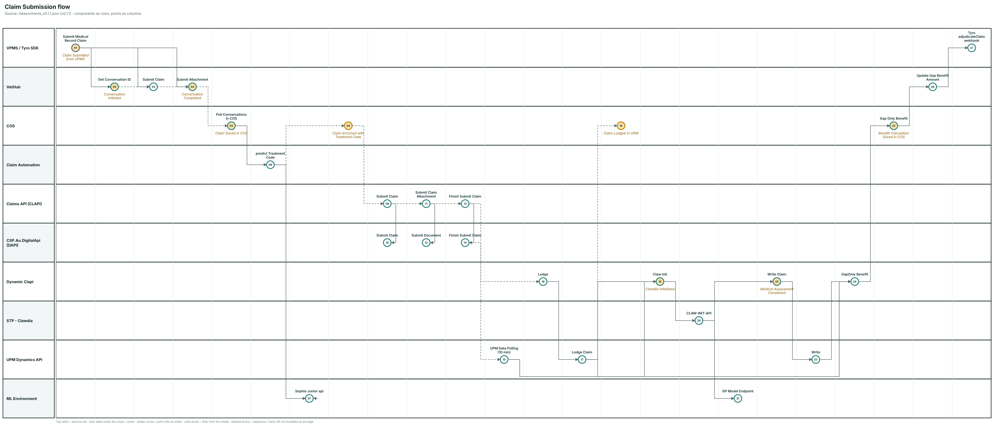
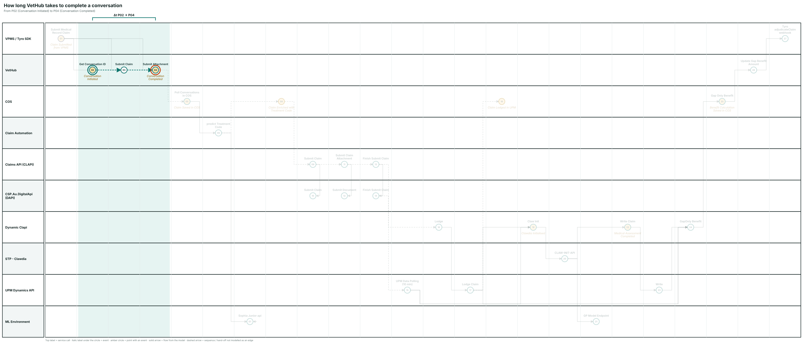
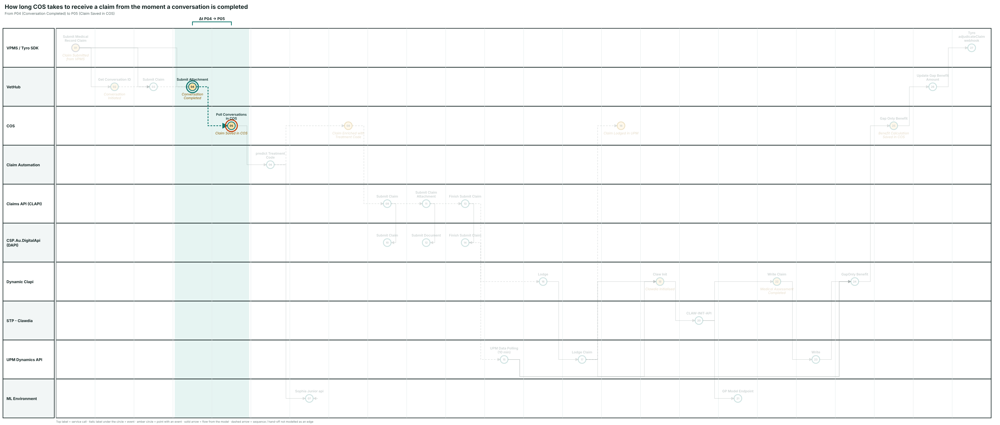
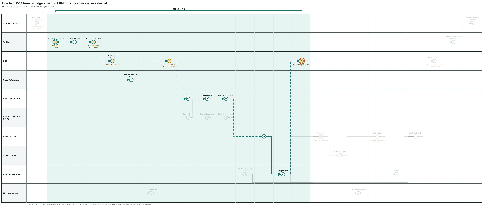
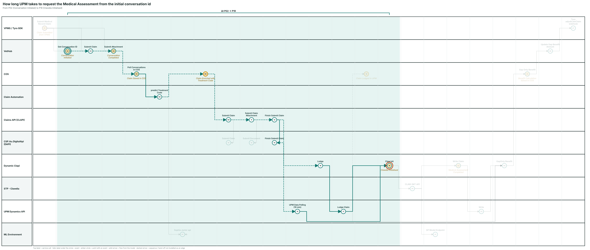
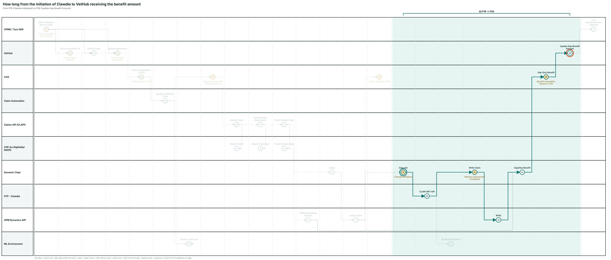
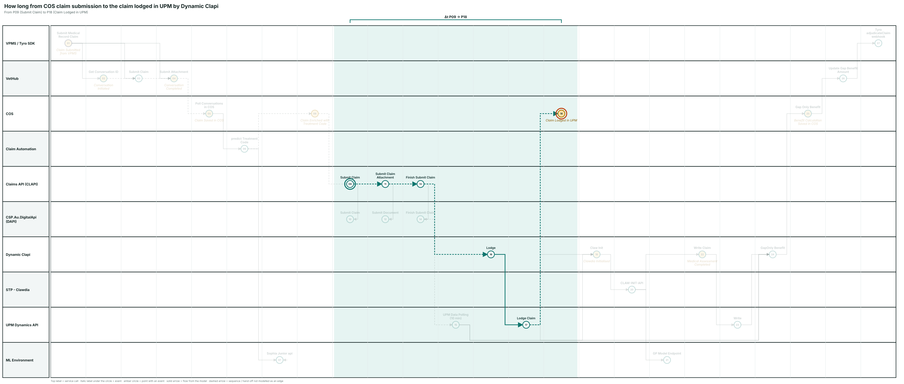

# Claim Submission flow

Source model: `measurments_v0.1.1.json`. Components are the rows. Each column is a point: the service called (label above the circle) and the event it raises (italic label under the circle). Amber circles carry an event; white circles are service calls only. Solid arrows are service-to-service flow taken from the model through its functions; dashed arrows are sequences or hand-offs the model does not have as an edge (listed at the end of this section).

Points that are not services:

- **P01** is the VPMS function *Submit Medical Record Claim*, the origin of the flow.
- **P08** *Claim Enriched with Treatment Code* and **P18** *Claim Lodged in UPM* are COS events with no COS service call behind them. P08 is placed after the Claim Automation callback, P18 after the UPM lodge returns.

Dashed (inferred) connections:

| From | To | Why |
|---|---|---|
| P02 Conversation Initiated : Get Conversation ID | P03 Submit Claim | same conversationId |
| P03 Submit Claim | P04 Conversation Completed : Submit Attachment | same conversationId |
| P04 Conversation Completed : Submit Attachment | P05 Claim Saved in COS : Poll Conversations in COS | COS polls new conversations |
| P06 predict Treatment Code | P08 Claim Enriched with Treatment Code | callback ClaimsAutomation/Completed |
| P08 Claim Enriched with Treatment Code | P09 Submit Claim | COS SubmitClaims |
| P09 Submit Claim | P11 Submit Claim Attachment | COS next call |
| P11 Submit Claim Attachment | P13 Finish Submit Claim | COS next call |
| P13 Finish Submit Claim | P16 Lodge | COS next call |
| P14 Finish Submit Claim | P15 UPM Data Polling (10 min) | via DS* tables |
| P17 Lodge Claim | P18 Claim Lodged in UPM | lodge response to COS |

`UPM+` and `UPM Db` have no service or event points, so they have no row. UPM+ work (ingest, duplicate/fraud/bank checks, Request Medical Assessment, benefit calculation) happens between P17 *Lodge Claim* / P15 *UPM Data Polling* and P19 *Claw Init*, and between P23 *Write* and P24 *GapOnly Benefit*. The model also routes Request Medical Assessment straight to Benefit Calculation (the non-STP path), which is why P15 and P17 also connect to P24.

## VPMS / Tyro SDK

### Claim Submitted from VPMS : Submit Medical Record Claim

Point **P01** · function (flow origin) · to P02, P03, P04

#### SQL

Db: todo  
Relevant field: todo  
Hint: external system, no PetSure DB. Measure it from the VetHub side (VetHub Azure SQL, `VetHubContext`).

### Tyro adjudicateClaim webhook

Point **P27** · call `POST https://gaponly-api.tyrohealth.com/trpc/webhook.vethub.adjudicateClaim?batch=1` · from P26

#### SQL

Db: todo  
Relevant field: todo  
Hint: external system, no PetSure DB. Measure it from the VetHub side (VetHub Azure SQL, `VetHubContext`).

## VetHub

### Conversation Initiated : Get Conversation ID

Point **P02** · call `GET /api/Claim/NewConversationId` · from P01 · to P03

#### SQL

Db: todo  
Relevant field: todo  
Hint: VetHub Azure SQL (`VetHubContext` / Key Vault `ConnectionStrings-VetHubDb`). Conversation and claim tables keyed by `conversationId`.

### Submit Claim

Point **P03** · call `POST /api/Claim/{conversationId}` · from P01, P02 · to P04

#### SQL

Db: todo  
Relevant field: todo  
Hint: VetHub Azure SQL (`VetHubContext` / Key Vault `ConnectionStrings-VetHubDb`). Conversation and claim tables keyed by `conversationId`.

### Conversation Completed : Submit Attachment

Point **P04** · call `POST /api/Claim/{conversationId}/Attachment/{attachmentId}` · from P01, P03 · to P05

#### SQL

Db: todo  
Relevant field: todo  
Hint: VetHub Azure SQL (`VetHubContext` / Key Vault `ConnectionStrings-VetHubDb`). Conversation and claim tables keyed by `conversationId`.

### Update Gap Benefit Amount

Point **P26** · call `POST /api/Claim/{conversationId}/GapOnly/BenefitAmount` · from P25 · to P27

#### SQL

Db: todo  
Relevant field: todo  
Hint: VetHub Azure SQL (`VetHubContext` / Key Vault `ConnectionStrings-VetHubDb`). Conversation and claim tables keyed by `conversationId`.

## COS

### Claim Saved in COS : Poll Conversations in COS

Point **P05** · from P04 · to P06

#### SQL

Db: todo  
Relevant field: todo  
Hint: COS Azure SQL (`COS_<ENV>`). Candidate tables: `Claim`, `ClaimStatus`, `VetHubConversation*`; `Claim.ConversationId` links back to VetHub.

### Claim Enriched with Treatment Code

Point **P08** · event only · from P06 · to P09

#### SQL

Db: todo  
Relevant field: todo  
Hint: COS Azure SQL (`COS_<ENV>`). Candidate tables: `Claim`, `ClaimStatus`, `VetHubConversation*`; `Claim.ConversationId` links back to VetHub.

### Claim Lodged in UPM

Point **P18** · event only · from P17

#### SQL

Db: todo  
Relevant field: todo  
Hint: COS Azure SQL (`COS_<ENV>`). Candidate tables: `Claim`, `ClaimStatus`, `VetHubConversation*`; `Claim.ConversationId` links back to VetHub.

### Benefit Calculation Saved in COS : Gap Only Benefit

Point **P25** · call `POST api/GapOnly/Benefit` · from P24 · to P26

#### SQL

Db: todo  
Relevant field: todo  
Hint: COS Azure SQL (`COS_<ENV>`). Candidate tables: `Claim`, `ClaimStatus`, `VetHubConversation*`; `Claim.ConversationId` links back to VetHub.

## Claim Automation

### predict Treatment Code

Point **P06** · from P05 · to P07, P08

#### SQL

Db: todo  
Relevant field: todo  
Hint: no database. Logic App run history or Application Insights for the run start and end.

## Claims API (CLAPI)

### Submit Claim

Point **P09** · call `POST api/Claims` · from P08 · to P10, P11

#### SQL

Db: todo  
Relevant field: todo  
Hint: no own database. Request logs (Application Insights / IIS) for the call time.

### Submit Claim Attachment

Point **P11** · call `POST api/Claims/Attachments` · from P09 · to P12, P13

#### SQL

Db: todo  
Relevant field: todo  
Hint: no own database. Request logs (Application Insights / IIS) for the call time.

### Finish Submit Claim

Point **P13** · call `PUT api/Claims/FinishSubmitClaim` · from P11 · to P14, P16

#### SQL

Db: todo  
Relevant field: todo  
Hint: no own database. Request logs (Application Insights / IIS) for the call time.

## CSP.Au.DigitalApi (DAPI)

### Submit Claim

Point **P10** · call `POST api/Claims/Submit` · from P09

#### SQL

Db: todo  
Relevant field: todo  
Hint: writes the UPM `DS_*` staging tables (e.g. `DS_Claims`). The insert time there is the closest timestamp.

### Submit Document

Point **P12** · call `POST api/Claims/SubmitDocument` · from P11

#### SQL

Db: todo  
Relevant field: todo  
Hint: writes the UPM `DS_*` staging tables (e.g. `DS_Claims`). The insert time there is the closest timestamp.

### Finish Submit Claim

Point **P14** · call `PUT api/Claims/FinishSubmitClaim` · from P13 · to P15

#### SQL

Db: todo  
Relevant field: todo  
Hint: writes the UPM `DS_*` staging tables (e.g. `DS_Claims`). The insert time there is the closest timestamp.

## Dynamic Clapi

### Lodge

Point **P16** · call `PUT api/Claims/Lodge/{claimId}` · from P13 · to P17

#### SQL

Db: todo  
Relevant field: todo  
Hint: no own database. Application Insights request logs for the call time.

### Clawdia Initialised : Claw Init

Point **P19** · call `POST api/Claims/CLAW-INIT-API` · from P15, P17 · to P20

#### SQL

Db: todo  
Relevant field: todo  
Hint: no own database. Application Insights request logs for the call time.

### Medical Assessment Completed : Write Claim

Point **P22** · call `POST api/Claims/Write` · from P20 · to P23

#### SQL

Db: todo  
Relevant field: todo  
Hint: no own database. Application Insights request logs for the call time.

### GapOnly Benefit

Point **P24** · call `POST api/Claims/GapOnly/Benefit` · from P15, P17, P23 · to P25

#### SQL

Db: todo  
Relevant field: todo  
Hint: no own database. Application Insights request logs for the call time.

## STP - Clawdia

### CLAW-INIT-API

Point **P20** · call `POST https://ps-syd-prod-keyvault-func-app.petsure.com.au/api/CLAW-INIT-API` · from P19 · to P21, P22

#### SQL

Db: todo  
Relevant field: todo  
Hint: Logic App / Function run history or Application Insights.

## UPM Dynamics API

### UPM Data Polling (10 min)

Point **P15** · from P14 · to P19, P24

#### SQL

Db: todo  
Relevant field: todo  
Hint: UPM database (`PETSURE_UPM`, Business Central/NAV). Claim header and `DS_*` tables; use the upm-sql skill for exact table names.

### Lodge Claim

Point **P17** · call `PUT {base}/api/upm/claims/v1.0/lodge({claimId})` · from P16 · to P19, P24, P18

#### SQL

Db: todo  
Relevant field: todo  
Hint: UPM database (`PETSURE_UPM`, Business Central/NAV). Claim header and `DS_*` tables; use the upm-sql skill for exact table names.

### Write

Point **P23** · call `POST {base}/api/upm/claims/v1.0/write` · from P22 · to P24

#### SQL

Db: todo  
Relevant field: todo  
Hint: UPM database (`PETSURE_UPM`, Business Central/NAV). Claim header and `DS_*` tables; use the upm-sql skill for exact table names.

## ML Environment

### Sophia Junior api

Point **P07** · from P06, P07 · to P07

#### SQL

Db: todo  
Relevant field: todo  
Hint: Azure ML online endpoint logs / Application Insights.

### GP Model Endpoint

Point **P21** · call `POST /score` · from P20

#### SQL

Db: todo  
Relevant field: todo  
Hint: Azure ML online endpoint logs / Application Insights.

# Measurements

Correlation keys for cross-system queries: VetHub `conversationId` → COS `Claim.ConversationId` → COS claim reference number / claim number → UPM claim number. Every query below needs this chain resolved first.

## Question: How long VetHub takes to complete a conversation

From: **P02** Conversation Initiated : Get Conversation ID to: **P04** Conversation Completed : Submit Attachment

Points on the path: P02, P03, P04

### Query for a single event

TODO

### Average Query by a selection of claim id

TODO

## Question: How long COS takes to receive a claim from the moment the conversation is completed

From: **P04** Conversation Completed : Submit Attachment to: **P05** Claim Saved in COS : Poll Conversations in COS

COS receives the claim by polling VetHub, so this includes the polling interval.

Points on the path: P04, P05

### Query for a single event

TODO

### Average Query by a selection of claim id

TODO

## Question: How long COS takes to lodge a claim in UPM from the initial conversation id

From: **P02** Conversation Initiated : Get Conversation ID to: **P18** Claim Lodged in UPM

Points on the path: P02, P03, P04, P05, P06, P08, P09, P11, P13, P16, P17, P18

### Query for a single event

TODO

### Average Query by a selection of claim id

TODO

## Question: How long UPM takes to request the Medical Assessment from the initial conversation id

From: **P02** Conversation Initiated : Get Conversation ID to: **P19** Clawdia Initialised : Claw Init

UPM+ has no observable point for *Request Medical Assessment*; the first timestamp outside UPM is UPM calling Dynamic Clapi *Claw Init* (P19), which raises *Clawdia Initialised*.

Points on the path: P02, P03, P04, P05, P06, P08, P09, P11, P13, P14, P15, P16, P17, P19

### Query for a single event

TODO

### Average Query by a selection of claim id

TODO

## Question: How long it takes

From: todo to: todo

> The question is incomplete in the brief. Fill in the end points and add the diagram.

### Query for a single event

TODO

### Average Query by a selection of claim id

TODO

## Question: How long it takes from the initiation of Clawdia to VetHub receiving the benefit amount

From: **P19** Clawdia Initialised : Claw Init to: **P26** Update Gap Benefit Amount

VetHub has no event for receiving the benefit; the end point is the service call P26 *Update Gap Benefit Amount*.

Points on the path: P19, P20, P22, P23, P24, P25, P26

### Query for a single event

TODO

### Average Query by a selection of claim id

TODO

## Question: How long it takes from COS claim submission to the claim lodged in UPM by Dynamic Clapi

From: **P09** Submit Claim to: **P18** Claim Lodged in UPM

"COS claim submission" is taken as COS calling CLAPI *Submit Claim* (P09). "Lodged in UPM by Dynamic Clapi" is P18, raised after P16 *Lodge* → P17 *Lodge Claim* returns.

Points on the path: P09, P11, P13, P16, P17, P18

### Query for a single event

TODO

### Average Query by a selection of claim id

TODO
