# Earlier Birds — High-level solution

| | |
|---|---|
| **Initiative** | Horizon 1 – Claims Automation – Continuous STP Uplift |
| **Solution** | Earlier Birds |
| **Author** | Danilo (Domain Architect, STP 90) |
| **Status** | Draft for team review |
| **Version** | 0.1 · 16 Oct 2026 |
| **Companion models** | `Earlier birds - as is_v2.0.0.json`, `Earlier birds - to be (gap analysis)_v2.0.0.json` (swimlane builder) and their PNG renders |

**Conventions used in this document:** **bold (new)** = introduced, *italic (changed)* = evolved, ~~strikethrough~~ = decommissioned, **[TBC]** = to be confirmed. In Mermaid diagrams, green = new, amber = changed, grey dashed = decommissioned; thick arrows (`==>`) are new interactions and dotted arrows are removed ones.

---

## 1. High-level solution

Earlier Birds starts Clawdia's medical assessment **as soon as a VetHub conversation is initiated**, instead of waiting for the claim to be lodged in UPM and checked. To do that, VetHub becomes an **event publisher**: it publishes business events to **Azure Service Bus**, and small **Azure Functions** react to them. VetHub also works out the claim's **insurer routing context** at the start, so every later step knows which COS, DAPI and UPM instance to use without routing the claim again.

The solution in six moves:

1. **VetHub publishes business events** to Azure Service Bus: *Conversation Initiated*, *Insurer Routing Context Calculated* and *Conversation Submission Completed*.
2. **VetHub calculates the insurer routing context** at the very beginning of the conversation, so it knows which COS handles the claim.
3. **An Azure Function reacts to *Conversation Initiated*** and starts a new Clawdia workflow instance. Clawdia stores the correlation `conversationId → workflowInstanceId`.
4. **An Azure Function reacts to *Conversation Submission Completed*** and calls a **new COS API that starts the claim from the conversation**. The request carries the routing context, so COS calls the right **DAPI** and **UPM Dynamics API** directly. COS no longer polls VetHub.
5. **COS creates the Claim Reference Number (CRN) and publishes *Claim Initiated in COS***. An Azure Function can add the `CRN → workflowInstanceId` correlation (this step may not be required). During the claim submission saga, COS may also call the Clawdia workflow Logic App **[TBC]**.
6. **Clawdia finishes the assessment early and waits.** When UPM requests the medical assessment (CLAW-INIT via Dynamic CLAPI, as today), Clawdia finds the running workflow and calls the Write API as it does now.

**Decommissioned:** COS polling of VetHub; CLAPI (*Claim Submission*, *Finish Claim Submission*); Dynamic CLAPI *Lodge Claim*.

### Problems addressed

| # | Problem | How Earlier Birds addresses it | Status |
|---|---|---|---|
| P1 | Clawdia is coupled to UPM: it only starts when UPM requests it | Clawdia starts from a VetHub event; UPM's request only releases a finished assessment | Addressed (start); write-back still goes through UPM by design |
| P2 | CLAPI / DAPI complexity: several API layers and repeated routing | Routing context is calculated once in VetHub; COS calls DAPI and the UPM Dynamics API directly; CLAPI and Dynamic CLAPI *Lodge Claim* are removed | Addressed |
| P3 | Polling between COS and VetHub | Replaced by *Conversation Submission Completed* → Azure Function → COS API | Addressed |
| P4 | Duplicated service provider id | Touched (routing context gives a single place to decide routing), not resolved | Open, see [OQ-08](#6-open-questions-and-next-steps) |

**Outcome:** assessment time drops, polling is removed, extra API calls are removed, event-driven architecture is introduced, and the platform is ready for the next, larger group of changes.

### 1.1 Systems and components involved

| System | Component(s) | Responsibility in the claim lifecycle | Earlier Birds impact |
|---|---|---|---|
| VPMS / GapOnly SDK | Vet practice software, Tyro gateway | Submits the C3 claim; receives the gap-only outcome | No change |
| VetHub | VetHub | Claim intake: conversation, claim type, eligibility, invoice; returns the gap-only benefit to the vet | **Changed** |
| Event platform | Azure Service Bus (topics) | Carries VetHub and COS business events | **New** |
| Event platform | Event handlers (Azure Functions) | React to events and call COS / Clawdia | **New** |
| COS | Claim Orchestration Service | Creates the claim (CRN), validates the policy, enriches treatment codes, lodges in UPM, relays the gap-only benefit | **Changed** |
| Claim Automation | Treatment-code prediction | Predicts treatment codes for COS | No change |
| Claims integration APIs | CLAPI | Routes claim submission to the right DAPI | **Decommissioned** |
| Claims integration APIs | DAPI (CSP.Au.DigitalApi) | Stages the claim in UPM's DS tables | No change (new caller: COS) |
| Claims integration APIs | Dynamic CLAPI | Routes calls to the right UPM instance (lodge, CLAW-INIT, Write) and back to COS (gap-only) | **Changed** (*Lodge Claim* removed; CLAW-INIT meaning changes) |
| STP – Clawdia | Clawdia workflow (Logic App) | Medical assessment workflow: cohort rules, GP model, business rules, write-back | **Changed** |
| UPM+ | UPM+ (AU and Trupanion instances), UPM Dynamics API, UPM DB (DS tables) | Ingests the claim, runs checks, requests the medical assessment, calculates the benefit, settles the payment | No change (UPM Dynamics API gets a new caller: COS) |
| ML environment | GP model, diagnosis prediction, case linking, Sophia Junior | Prediction models used by Clawdia and Claim Automation | No change (called earlier) |

### 1.2 High-level flow — as is

Rows are components, columns are stages of the claim's life, and each cell lists the functions that component performs in that stage.

What the matrix shows:

- **The flow is strictly linear.** Clawdia (stage 5) can only start after COS has polled VetHub, lodged the claim through two API layers, and UPM has ingested the claim and run its checks.
- **Two polling hops sit on the critical path:** COS polls VetHub for submitted conversations, and the UPM Dynamics API polls the DS tables every 10 minutes.
- **Routing is decided repeatedly:** by CLAPI (which DAPI), by Dynamic CLAPI (which UPM, for lodgement and again for write-back) and by Dynamic CLAPI again (which COS, for the gap-only benefit).

Text version of the As-Is matrix

| Component | 1 · Vet submits claim | 2 · COS prepares claim | 3 · Lodge in UPM | 4 · UPM checks | 5 · Medical assessment | 6 · Benefit & payment | 7 · Outcome to vet |
|---|---|---|---|---|---|---|---|
| VPMS / GapOnly SDK | Submit C3 claim |   |   |   |   |   | Receive gap-only outcome Poll for claim outcome |
| VetHub | Start & save conversation Recognise claim type Eligibility check Generate invoice |   |   |   |   |   | Update benefit on claim |
| COS |   | Poll VetHub for submitted claims Create claim + CRN Validate policy Enrich treatment codes | Lodge claim via CLAPI + Dynamic CLAPI |   |   |   | Receive gap-only benefit Forward benefit to VetHub |
| Claim Automation |   | Predict treatment codes |   |   |   |   |   |
| CLAPI |   |   | Submit / finish submission Route to correct DAPI |   |   |   |   |
| DAPI |   |   | Stage claim in DS tables |   |   |   |   |
| Dynamic CLAPI |   |   | Lodge claim → route to UPM |   | CLAW-INIT: start Clawdia | Write assessment → route to UPM | Gap-only benefit → route to COS |
| UPM Dynamics API |   |   | Poll DS tables (10 min) Lodge claim |   |   | Write assessment |   |
| UPM+ |   |   | Ingest claim | Duplicate, fraud, bank checks Request medical assessment |   | Calculate benefit Settle payment |   |
| STP – Clawdia |   |   |   |   | Initialise assessment Load claim & policy Easy cohort → GP model Business rules → map Prepare UPM write |   |   |
| ML environment |   | Treatment-code model (Sophia Junior) |   |   | Diagnosis prediction Case linking |   |   |

### 1.3 High-level flow — to be

What changes:

- **Clawdia's assessment moves from stage 5 to stage 1** and runs in parallel with VetHub intake. By the time UPM requests the assessment (stage 4), it is already finished, so stage 5 only finds the workflow and writes back.
- **Stage 2 is event-driven:** *Conversation Submission Completed* starts the claim in COS through a new API. The polling hop is gone.
- **Stage 3 has one fewer layer:** COS lodges directly in DAPI and the UPM Dynamics API using the routing context. CLAPI and Dynamic CLAPI *Lodge Claim* disappear.
- **Stages 4, 6 and 7 are unchanged.**

Text version of the To-Be matrix

| Component | 1 · Vet submits claim · Clawdia starts | 2 · Event starts claim in COS | 3 · COS lodges in UPM | 4 · UPM checks | 5 · Release assessment | 6 · Benefit & payment | 7 · Outcome to vet |
|---|---|---|---|---|---|---|---|
| VPMS / GapOnly SDK | Submit C3 claim |   |   |   |   |   | Receive gap-only outcome Poll for claim outcome |
| VetHub | Start & save conversation Recognise claim type **Calculate insurer routing context (new)** Eligibility check Generate invoice **Publish 3 business events (new)** |   |   |   |   |   | Update benefit on claim |
| Azure Service Bus + Functions | **On Conversation Initiated → start Clawdia (new)** | **On Submission Completed → start claim in COS (new)** **On Claim Initiated → link CRN (optional) (new)** |   |   |   |   |   |
| COS |   | ~~Poll VetHub for submitted claims~~ **Start claim from conversation (API) (new)** Create claim + CRN **Publish Claim Initiated (new)** Validate policy Enrich treatment codes | *Lodge directly in DAPI + UPM Dynamics API (changed)* **Notify Clawdia workflow (TBC) (new)** |   |   |   | Receive gap-only benefit Forward benefit to VetHub |
| Claim Automation |   | Predict treatment codes |   |   |   |   |   |
| CLAPI |   |   | ~~Submit / finish submission~~ ~~Route to correct DAPI~~ |   |   |   |   |
| DAPI |   |   | Stage claim in DS tables |   |   |   |   |
| Dynamic CLAPI |   |   | ~~Lodge claim → route to UPM~~ |   | *CLAW-INIT: release waiting workflow (changed)* | Write assessment → route to UPM | Gap-only benefit → route to COS |
| UPM Dynamics API |   |   | Poll DS tables (10 min) Lodge claim |   |   | Write assessment |   |
| UPM+ |   |   | Ingest claim | Duplicate, fraud, bank checks Request medical assessment |   | Calculate benefit Settle payment |   |
| STP – Clawdia | **Start workflow + record correlation (new)** *Load claim & policy (changed)* Easy cohort → GP model Business rules → map **Await UPM request (new)** |   |   |   | **Find workflow via correlation (new)** Prepare UPM write |   |   |
| ML environment | Diagnosis prediction Case linking | Treatment-code model (Sophia Junior) |   |   |   |   |   |

### 1.4 High-level deployment — as is

The deployment type (technology service) and deployment artefact come from the swimlane model (`techServices` on each component). Today only **VetHub** has them in the model. Anything else is marked **[TBC — not modelled]**, except where the solution description itself states the hosting.

| Component | Technology service | Deployment artefact | Source |
|---|---|---|---|
| VetHub | Azure App Service (code) | Compiled application package | Model |
| STP – Clawdia | Azure Logic Apps (Consumption or Standard **[TBC]**) | **[TBC]** | Solution description ("Workflow Logic App") |
| COS | **[TBC — not modelled]** | **[TBC]** | — |
| Claim Automation | **[TBC — not modelled]** | **[TBC]** | — |
| CLAPI | **[TBC — not modelled]** | **[TBC]** | — |
| DAPI (CSP.Au.DigitalApi) | **[TBC — not modelled]** | **[TBC]** | — |
| Dynamic CLAPI | **[TBC — not modelled]** | **[TBC]** | — |
| UPM+ (AU, Trupanion), UPM Dynamics API, UPM DB | **[TBC — not modelled]** | **[TBC]** | — |
| ML environment | **[TBC — not modelled]** | **[TBC]** | — |
| VPMS / GapOnly SDK | External | — | — |

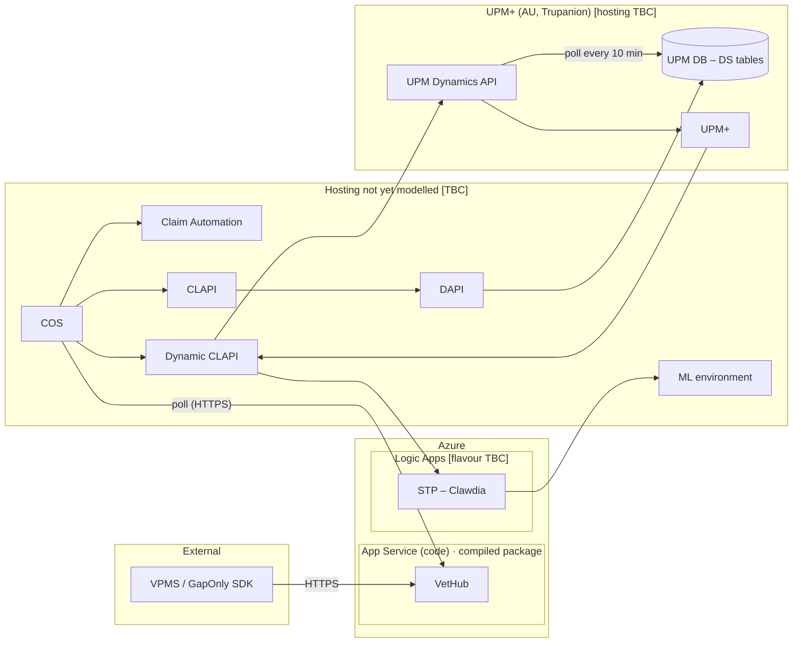

### 1.5 High-level deployment — to be

| Component | Technology service | Deployment artefact | Change |
|---|---|---|---|
| VetHub | Azure App Service (code) | Compiled application package | *New release* (routing context, event publishing) |
| **Azure Service Bus** | Azure Service Bus (namespace, topics, subscriptions; tier **[TBC]**) | Infrastructure-as-code definition **[TBC]** | **New** |
| **Event handlers** | Azure Functions | **[TBC]** (Function App: 3 functions) | **New** |
| COS | **[TBC — not modelled]** | **[TBC]** | *New release* (start-claim API, event publishing, direct lodgement) |
| STP – Clawdia | Azure Logic Apps **[flavour TBC]** | **[TBC]** | *New release* (event start, wait state, correlation) |
| **Clawdia workflow correlations** | Data store **[TBC]** | — | **New** |
| Dynamic CLAPI | **[TBC — not modelled]** | **[TBC]** | *New release* (*Lodge Claim* removed) |
| ~~CLAPI~~ | ~~[TBC]~~ | ~~[TBC]~~ | **Retired**, once no other consumers are confirmed |
| DAPI, UPM+, UPM Dynamics API, UPM DB, Claim Automation, ML environment | as is | as is | No change |

> The model's technology catalogue has no messaging service, so Azure Service Bus can't be attached to a component yet. Proposal: add *Azure Service Bus* (and an artefact type such as *Messaging entity definition*) to the metamodel, then record the deployment type and artefact for every component so the To-Be model is complete.

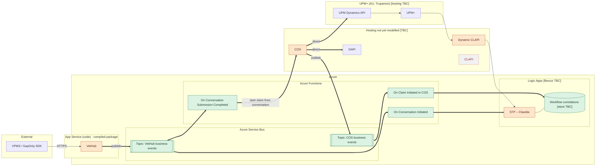

---

## 2. Motivation

Earlier Birds supports the H1 outcomes **Current & target architecture** and **Platform resilience & transition** of the *Claims Automation – Continuous STP Uplift* initiative. It also lays the groundwork for **Scalable model orchestration** (Clawdia as the orchestration service) and for **multi-insurer routing** (PetSure → UPM, Trupanion → TrUPM). It does this without a material re-architecture, which matches H1's guidance to focus investment on components expected to stay in the future landscape.

| Driver | Today | With Earlier Birds | Indicative measure |
|---|---|---|---|
| Time to assessment outcome | Clawdia starts only after lodgement, UPM ingestion and checks | Assessment runs in parallel with intake and is ready when UPM asks | Time from *Request medical assessment* to *Write* (baseline **[TBC]**) |
| Coupling of Clawdia to UPM | UPM's CLAW-INIT both starts and drives Clawdia | Clawdia starts from a VetHub event; UPM only releases the result | Clawdia steps that depend on UPM: from all of them to the write-back only |
| Integration hops for lodgement | COS → CLAPI → DAPI, and COS → Dynamic CLAPI → UPM Dynamics API | COS → DAPI and COS → UPM Dynamics API | 2 API layers removed |
| Polling | COS polls VetHub; UPM Dynamics API polls the DS tables | COS polling replaced by an event | Delay between submission and COS claim creation |
| Repeated routing | Routing decided in CLAPI and twice in Dynamic CLAPI | Routing context calculated once in VetHub and passed along | Places where routing rules live |
| Readiness for H1/H2 | No business events | Reusable business events (GapOnly platform, common claims pathway) | Event catalogue in place |

**Not addressed by Earlier Birds** (candidates for the next group of changes): UPM Dynamics API polling of the DS tables (10 min); the duplicated service provider id; UPM's call into Clawdia (still needed for the write-back); the gap-only return path through Dynamic CLAPI.

---

## 3. General architecture patterns

| # | Pattern | Where it is applied | Why | Watch-outs |
|---|---|---|---|---|
| AP-01 | **Event-driven architecture with business events** | VetHub and COS publish past-tense facts (*Conversation Initiated*, *Claim Initiated in COS*, …) | Producers no longer need to know who reacts | Event contracts need ownership and versioning |
| AP-02 | **Publish–subscribe** (topics and subscriptions) | Azure Service Bus: one topic per publisher, one subscription per handler | New consumers can be added without changing the publisher | Subscription filters on event-type properties; no consumer yet for *Insurer Routing Context Calculated* |
| AP-03 | **Event handler as a thin adapter** (serverless) | Azure Functions turn events into commands on COS and Clawdia | Keeps publishers unaware of consumers; small, independently deployable units | Keep business logic out of the functions |
| AP-04 | **Correlation identifier** | `conversationId ↔ workflowInstanceId ↔ CRN` in the Clawdia correlation store | Lets a later request (CLAW-INIT) find the running workflow | One owner for the store; lifecycle and clean-up |
| AP-05 | **Long-running process with a wait state** (process manager / saga) | Clawdia waits for UPM's request; COS runs the claim submission saga | Do the work early, release it when the system of record asks | Timeouts, and orphan workflows for conversations that are never submitted |
| AP-06 | **Decide routing once at the edge** (routing-context propagation) | VetHub calculates it; COS uses it to choose the DAPI and UPM instance | Removes repeated routing in CLAPI and Dynamic CLAPI | Single source of routing rules; duplicated service provider id |
| AP-07 | **Event-driven consumer instead of polling consumer** | COS no longer polls VetHub | Lower latency, less wasted load | Delivery guarantees are needed instead (AP-08) |
| AP-08 | **Idempotent receiver with at-least-once delivery** | COS start-claim API keyed on `conversationId`; Clawdia start keyed on `conversationId` | Retries and redeliveries must not create duplicate claims or workflows | Dead-letter queue, retry policy, alerting |
| AP-09 | **Transactional outbox** (recommended **[TBC]**) | VetHub and COS publishing after a state change | No lost or phantom events when the database write and the publish disagree | Needs a relay process or a framework feature |
| AP-10 | **Schema-validated event contracts** | Every published event | The broker does not enforce payload schemas, so publishers and consumers must | Schema registry (Azure Schema Registry) or in-code JSON Schema; event type and schema version as message properties; invalid messages go to the dead-letter queue |
| AP-11 | **Strangler-style decommissioning** | CLAPI and Dynamic CLAPI *Lodge Claim* | Switch callers first, retire afterwards, with a rollback path | Confirm there are no other consumers before retiring |
| AP-12 | **Speculative (eager) processing** | Clawdia assesses before the claim is lodged | Takes the assessment off the critical path | Wasted ML calls for abandoned conversations; result goes stale if the claim changes before submission |

---

## 4. Component architecture changes by system

**Change IDs:** `<SYS>-<I|E|D>-<nn>`, where **I** = introduce, **E** = evolve, **D** = decommission. System codes: `VH` VetHub, `EVT` event platform, `COS` COS, `CLW` Clawdia, `DCL` Dynamic CLAPI, `CLP` CLAPI. Integration rows use `<SYS>-A<n>` (as is) and `<SYS>-B<n>` (to be).

**Impact analysis flags:** ● impact expected · ○ no impact expected · ◐ investigate further. Each flag is a prompt for deeper analysis, not a sizing. The columns are:

- **Interface:** an API or event contract changes or is created.
- **Data:** a data model, schema or persisted state changes.
- **Perf:** latency, throughput or load changes.
- **Security:** authentication, authorisation or network access changes.
- **Resilience:** retries, idempotency, failure modes or timeouts change.
- **Observability:** logging, tracing, correlation or alerting changes.
- **Infra:** new or changed deployment or infrastructure.
- **Dependents:** other consumers or teams may be affected.

### 4.1 VetHub

#### Integrations — as is

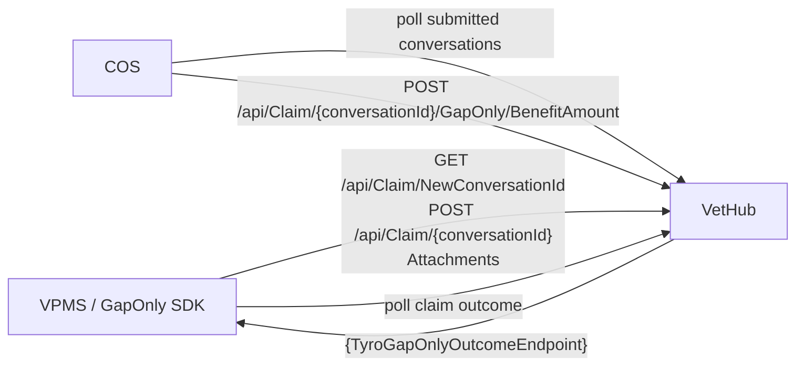

| ID | Counterpart | Direction | Interaction | Style | Interface |
|---|---|---|---|---|---|
| VH-A1 | VPMS / GapOnly SDK | Inbound | Start conversation | Sync REST | `GET /api/Claim/NewConversationId` |
| VH-A2 | VPMS / GapOnly SDK | Inbound | Claim details (VetXML) | Sync REST | `POST /api/Claim/{conversationId}` |
| VH-A3 | VPMS / GapOnly SDK | Inbound | Attachments | Sync | **[TBC — not modelled]** |
| VH-A4 | COS | Inbound | COS polls for submitted conversations | Polling | **[TBC]** |
| VH-A5 | COS | Inbound | Gap-only benefit amount | Sync REST | `POST /api/Claim/{conversationId}/GapOnly/BenefitAmount` |
| VH-A6 | VPMS / Tyro | Outbound | Gap-only outcome | Sync | `{TyroGapOnlyOutcomeEndpoint}` |
| VH-A7 | VPMS / GapOnly SDK | Inbound | Vet polls for the claim outcome | Polling | **[TBC]** |

#### Integrations — to be

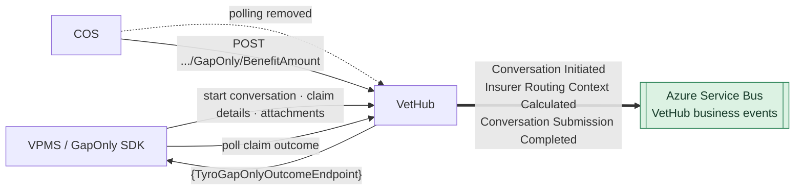

| ID | Counterpart | Direction | Interaction | Style | Interface |
|---|---|---|---|---|---|
| VH-B1 | VPMS / GapOnly SDK | Inbound | Unchanged (VH-A1, A2, A3) | Sync REST | as is |
| **VH-B2** | Azure Service Bus | Outbound | **Publish *Conversation Initiated*** | Async event | VetHub business-events topic **[name TBC]** |
| **VH-B3** | Azure Service Bus | Outbound | **Publish *Insurer Routing Context Calculated*** | Async event | same topic |
| **VH-B4** | Azure Service Bus | Outbound | **Publish *Conversation Submission Completed*** | Async event | same topic |
| ~~VH-A4~~ | ~~COS~~ | ~~Inbound~~ | ~~COS polls for submitted conversations~~ | ~~Polling~~ | Removed |
| VH-B5 | COS, VPMS | — | Unchanged (VH-A5, A6, A7) | as is | as is |

#### Behaviours

| ID | Type | Behaviour | Description |
|---|---|---|---|
| VH-I-01 | Introduce | Calculate insurer routing context | At the start of the conversation, work out which insurer and COS instance (and hence which DAPI and UPM instance) handle the claim. Store it on the conversation. Exact point and inputs **[TBC]**, see OQ-01. |
| VH-I-02 | Introduce | Publish *Conversation Initiated* | Published when the conversation is saved. Minimum payload: `conversationId` **[payload TBC]**. |
| VH-I-03 | Introduce | Publish *Insurer Routing Context Calculated* | Published once routing is known. No consumer yet (OQ-05). |
| VH-I-04 | Introduce | Publish *Conversation Submission Completed* | Published when submission is complete (details and attachments received, invoice generated). Carries `conversationId` and the routing context. |
| VH-I-05 | Introduce | Reliable event publication | Outbox or equivalent so state changes and events never diverge (AP-09). Validate against the event schema before publishing (AP-10). |
| VH-E-01 | Evolve | Conversation data model | Holds the routing context and an explicit *submission completed* state, which triggers VH-I-04. |
| VH-D-01 | Decommission | Serve COS polling | Remove the query COS uses to poll, once no other consumer is confirmed (OQ-07). |

#### Impact analysis

| ID | Interface | Data | Perf | Security | Resilience | Observability | Infra | Dependents | Description |
|---|---|---|---|---|---|---|---|---|---|
| VH-I-01 | ○ | ● | ◐ | ○ | ◐ | ○ | ○ | ◐ | New logic on the intake path; adds latency to intake if it calls out to other services. Must stay consistent with COS's endpoint resolution (COS-I-03). |
| VH-I-02 | ● | ○ | ○ | ● | ● | ● | ● | ● | New event contract; Service Bus access for VetHub (managed identity); publishing must not block intake. |
| VH-I-03 | ● | ○ | ○ | ● | ● | ● | ● | ◐ | Same as VH-I-02; consumers to be identified. |
| VH-I-04 | ● | ○ | ○ | ● | ● | ● | ● | ● | Becomes the trigger that starts the claim in COS (it replaces polling), so losing or duplicating it creates or loses claims. |
| VH-I-05 | ○ | ● | ◐ | ○ | ● | ● | ◐ | ○ | Outbox table plus relay process, or a framework feature. |
| VH-E-01 | ◐ | ● | ○ | ○ | ○ | ○ | ○ | ◐ | Schema migration on the conversation store; check reporting and other readers of the conversation data. |
| VH-D-01 | ● | ○ | ● | ○ | ○ | ○ | ○ | ◐ | Removes load from VetHub. Retire only after COS stops polling and other consumers are ruled out. |

### 4.2 Event platform — Azure Service Bus and event handlers (new)

#### Integrations — as is

None: this is a new component.

#### Integrations — to be

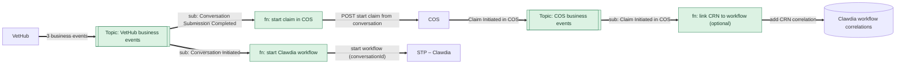

| ID | Counterpart | Direction | Interaction | Style | Interface |
|---|---|---|---|---|---|
| **EVT-B1** | VetHub | Inbound | Receive VetHub business events | Async (topic) | VetHub business-events topic |
| **EVT-B2** | COS | Inbound | Receive *Claim Initiated in COS* | Async (topic) | COS business-events topic |
| **EVT-B3** | STP – Clawdia | Outbound | Start a workflow instance | Sync (HTTP trigger of the Logic App) | **[TBC]** |
| **EVT-B4** | COS | Outbound | Start the claim from the conversation | Sync REST | New COS API (COS-I-01) |
| **EVT-B5** | Clawdia correlations | Outbound | Add the `CRN → workflowInstanceId` correlation | Data write or Clawdia API **[TBC]** | **[TBC]** |

#### Behaviours

| ID | Type | Behaviour | Description |
|---|---|---|---|
| EVT-I-01 | Introduce | Service Bus namespace, VetHub topic and subscriptions | One topic per publisher, one subscription per handler, filtered on an event-type property. Tier and sessions **[TBC]**; sessions keyed on `conversationId` only if per-conversation ordering is needed. |
| EVT-I-02 | Introduce | COS topic and subscription | For *Claim Initiated in COS*. |
| EVT-I-03 | Introduce | Function: On *Conversation Initiated* → start Clawdia workflow | Idempotent on `conversationId`. |
| EVT-I-04 | Introduce | Function: On *Conversation Submission Completed* → start claim in COS | Passes the routing context through; idempotent on `conversationId`. |
| EVT-I-05 | Introduce | Function: On *Claim Initiated in COS* → link CRN to workflow | Optional. Needed only if UPM's CLAW-INIT identifies the claim by CRN alone (OQ-03). |
| EVT-I-06 | Introduce | Retry, dead-letter and alerting policy | Per subscription. Dead-lettered messages need an owner and a replay procedure. |
| EVT-I-07 | Introduce | Event contract catalogue and validation | Schemas for the four events, an event-type and schema-version property on every message, validation at publish and consume time (AP-10). Service Bus does not enforce payload schemas. |

#### Impact analysis

| ID | Interface | Data | Perf | Security | Resilience | Observability | Infra | Dependents | Description |
|---|---|---|---|---|---|---|---|---|---|
| EVT-I-01 | ● | ○ | ◐ | ● | ● | ● | ● | ● | New platform component: IaC, network, RBAC, cost, ownership and support model. |
| EVT-I-02 | ● | ○ | ○ | ● | ● | ● | ● | ● | Same as EVT-I-01 for the COS topic. |
| EVT-I-03 | ● | ○ | ◐ | ● | ● | ● | ● | ● | A new entry point into Clawdia; a duplicate start would create duplicate assessments. |
| EVT-I-04 | ● | ○ | ◐ | ● | ● | ● | ● | ● | On the critical path of claim creation; failures must alert. |
| EVT-I-05 | ● | ● | ○ | ● | ◐ | ● | ● | ◐ | May be dropped (OQ-03). |
| EVT-I-06 | ○ | ○ | ○ | ○ | ● | ● | ● | ● | Operational runbook needed. |
| EVT-I-07 | ● | ● | ○ | ○ | ● | ● | ◐ | ● | Schema registry (Azure Schema Registry lives in an Event Hubs namespace) or in-code JSON Schema **[TBC]**. |

### 4.3 COS

#### Integrations — as is

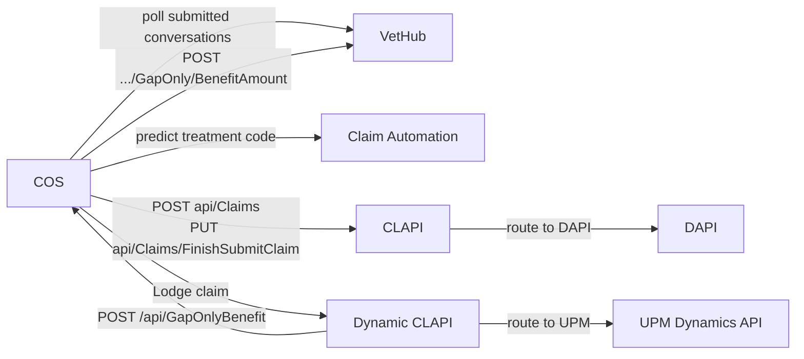

| ID | Counterpart | Direction | Interaction | Style | Interface |
|---|---|---|---|---|---|
| COS-A1 | VetHub | Outbound | Poll submitted conversations | Polling | **[TBC]** |
| COS-A2 | Claim Automation | Outbound | Predict treatment code | Sync **[TBC]** | **[TBC]** |
| COS-A3 | CLAPI | Outbound | Claim submission | Sync REST | `POST api/Claims` |
| COS-A4 | CLAPI | Outbound | Finish claim submission | Sync REST | `PUT api/Claims/FinishSubmitClaim` |
| COS-A5 | Dynamic CLAPI | Outbound | Lodge claim | Sync **[TBC]** | **[TBC]** |
| COS-A6 | Dynamic CLAPI | Inbound | Gap-only benefit | Sync REST | `POST /api/GapOnlyBenefit` |
| COS-A7 | VetHub | Outbound | Gap-only benefit amount | Sync REST | `POST /api/Claim/{conversationId}/GapOnly/BenefitAmount` |

#### Integrations — to be

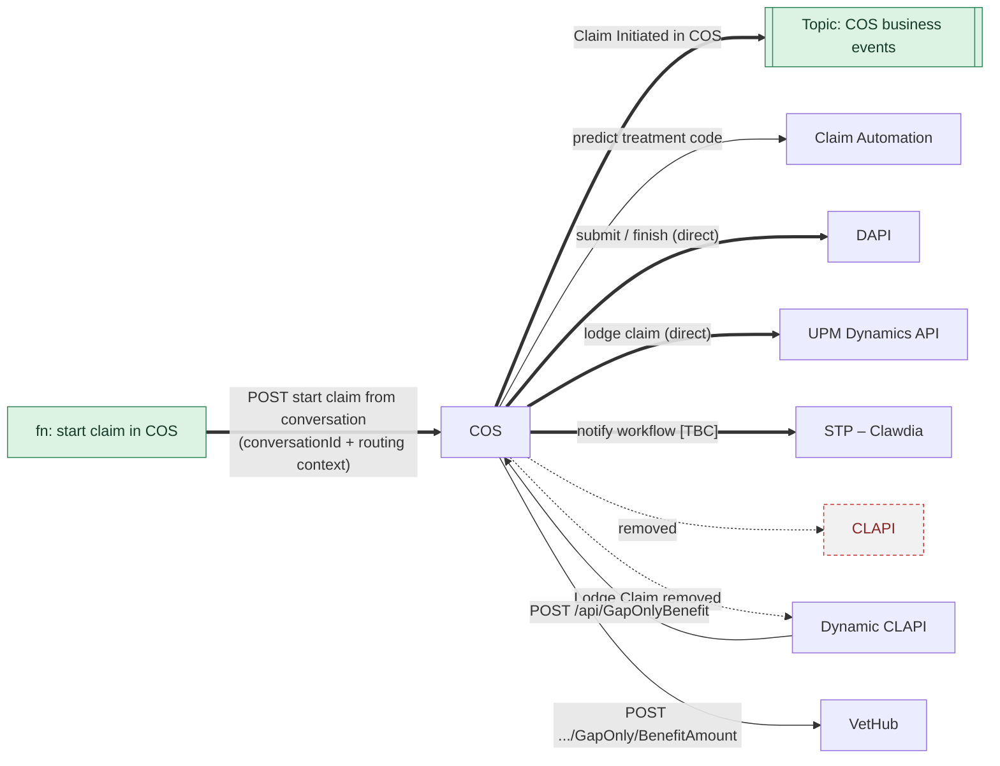

| ID | Counterpart | Direction | Interaction | Style | Interface |
|---|---|---|---|---|---|
| **COS-B1** | Event handler (Azure Function) | Inbound | **Start claim from conversation** | Sync REST | New API **[contract TBC]** |
| **COS-B2** | Azure Service Bus | Outbound | **Publish *Claim Initiated in COS*** (`conversationId`, CRN) | Async event | COS business-events topic |
| *COS-B3* | DAPI | Outbound | *Claim submission (direct)* | Sync | DAPI interface **[TBC]** |
| *COS-B4* | DAPI | Outbound | *Finish claim submission (direct)* | Sync | DAPI interface **[TBC]** |
| *COS-B5* | UPM Dynamics API | Outbound | *Lodge claim (direct)* | Sync | UPM Dynamics API *Lodge Claim* **[TBC]** |
| **COS-B6** | STP – Clawdia | Outbound | **Notify the workflow during the claim submission saga [TBC]** | Sync | Possibly today's CLAW-INIT contract |
| ~~COS-A1, A3, A4, A5~~ | ~~VetHub, CLAPI, Dynamic CLAPI~~ | | ~~Polling, CLAPI submission, Dynamic CLAPI lodgement~~ | | Removed |
| COS-A2, A6, A7 | Claim Automation, Dynamic CLAPI, VetHub | | Unchanged | | as is |

#### Behaviours

| ID | Type | Behaviour | Description |
|---|---|---|---|
| COS-I-01 | Introduce | Start claim from conversation API | Input: `conversationId` plus the insurer routing context. Idempotent on `conversationId`; replaces polling as the start of the saga. |
| COS-I-02 | Introduce | Publish *Claim Initiated in COS* | After the CRN is generated. Payload: `conversationId`, CRN **[TBC]**. |
| COS-I-03 | Introduce | Routing-context resolver | Maps the routing context to the right DAPI and UPM Dynamics API instance. Replaces CLAPI's DAPI routing and Dynamic CLAPI's lodgement routing. |
| COS-I-04 | Introduce | Notify Clawdia workflow **[TBC]** | A call from the claim submission saga into the Clawdia workflow Logic App. Purpose and payload to be agreed (OQ-04). |
| COS-E-01 | Evolve | Lodge claim in UPM | Calls DAPI *Submit* / *Finish* and the UPM Dynamics API *Lodge Claim* directly, using COS-I-03. |
| COS-E-02 | Evolve | Claim creation | Triggered by a command (COS-I-01) instead of a poll; duplicate requests are absorbed. |
| COS-D-01 | Decommission | Poll VetHub for submitted conversations | Replaced by COS-I-01. |
| COS-D-02 | Decommission | CLAPI client (*Submit*, *Finish*) | Replaced by COS-E-01. |
| COS-D-03 | Decommission | Dynamic CLAPI *Lodge Claim* client | Replaced by COS-E-01. |

#### Impact analysis

| ID | Interface | Data | Perf | Security | Resilience | Observability | Infra | Dependents | Description |
|---|---|---|---|---|---|---|---|---|---|
| COS-I-01 | ● | ◐ | ● | ● | ● | ● | ○ | ● | New public entry point; claims start as soon as submission completes (no polling delay). Needs authentication for the Function caller. |
| COS-I-02 | ● | ○ | ○ | ● | ● | ● | ● | ● | Service Bus access for COS; outbox recommended (AP-09). |
| COS-I-03 | ○ | ● | ○ | ○ | ◐ | ○ | ○ | ● | Routing rules move into COS: they must agree with VetHub's routing context. Duplicated service provider id (OQ-08). |
| COS-I-04 | ● | ○ | ○ | ● | ◐ | ● | ○ | ● | Depends on Clawdia's contract (CLW-I-05). |
| COS-E-01 | ● | ○ | ● | ● | ● | ● | ○ | ● | Fewer hops. COS becomes a direct client of DAPI and the UPM Dynamics API: credentials, network paths, timeouts and error mapping move into COS. |
| COS-E-02 | ○ | ◐ | ● | ○ | ● | ● | ○ | ○ | Idempotency key and duplicate handling. |
| COS-D-01 | ● | ○ | ● | ○ | ○ | ◐ | ◐ | ○ | Removes the polling job and its load. |
| COS-D-02 | ● | ○ | ● | ● | ○ | ○ | ○ | ◐ | Removes the CLAPI dependency; prerequisite for CLP-D-*. |
| COS-D-03 | ● | ○ | ● | ● | ○ | ○ | ○ | ◐ | Prerequisite for DCL-D-01. |

### 4.4 STP – Clawdia

#### Integrations — as is

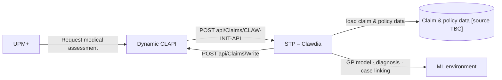

| ID | Counterpart | Direction | Interaction | Style | Interface |
|---|---|---|---|---|---|
| CLW-A1 | Dynamic CLAPI | Inbound | Start the assessment (CLAW-INIT) | Sync REST | `POST api/Claims/CLAW-INIT-API` |
| CLW-A2 | Claim and policy data | Outbound | Load claim data, load policy data | Sync **[TBC]** | **[TBC — source not modelled]** |
| CLW-A3 | ML environment | Outbound | Claim medical assessment (GP model) | Sync **[TBC]** | **[TBC]** |
| CLW-A4 | Dynamic CLAPI | Outbound | Write the assessment | Sync REST | `POST api/Claims/Write` |

#### Integrations — to be

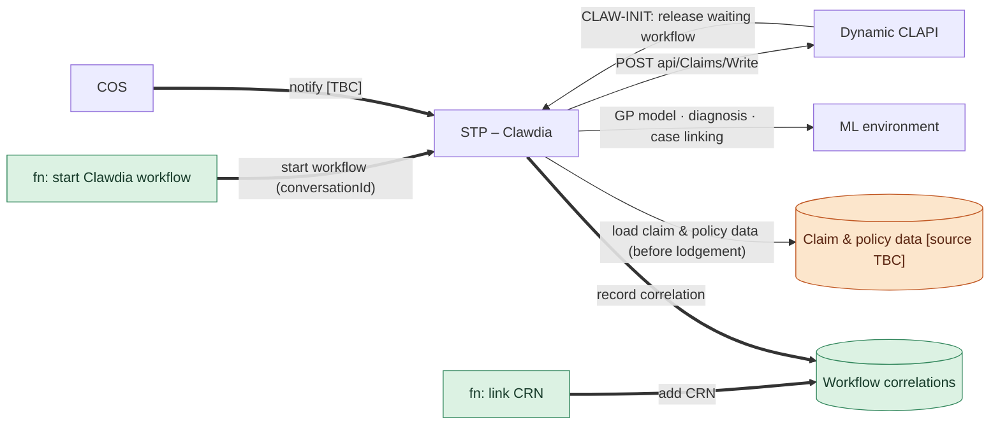

| ID | Counterpart | Direction | Interaction | Style | Interface |
|---|---|---|---|---|---|
| **CLW-B1** | Event handler (Azure Function) | Inbound | **Start the workflow on *Conversation Initiated*** | Sync (Logic App trigger) | **[TBC]** |
| **CLW-B2** | Workflow correlations | Outbound | **Write and read `conversationId / CRN ↔ workflowInstanceId`** | Data | **[store TBC]** |
| **CLW-B3** | COS | Inbound | **Claim-lodged notification [TBC]** | Sync | **[TBC]** |
| *CLW-B4* | Dynamic CLAPI | Inbound | *CLAW-INIT now releases a waiting workflow* | Sync REST | `POST api/Claims/CLAW-INIT-API` (contract unchanged **[TBC]**) |
| *CLW-B5* | Claim and policy data | Outbound | *Load claim data before the claim exists in UPM* | Sync **[TBC]** | **[TBC]** |
| CLW-A3, A4 | ML environment, Dynamic CLAPI | | Unchanged | | as is |

#### Behaviours

| ID | Type | Behaviour | Description |
|---|---|---|---|
| CLW-I-01 | Introduce | Start the assessment workflow on *Conversation Initiated* | A new trigger; idempotent on `conversationId`. |
| CLW-I-02 | Introduce | Workflow correlation repository | Stores `conversationId → workflowInstanceId` and, optionally, `CRN → workflowInstanceId`. Owner, store and retention **[TBC]**. |
| CLW-I-03 | Introduce | Await UPM request (wait state) | After *Map into claim logic* the workflow waits for UPM. Needs a timeout or expiry for conversations that are never submitted or lodged (OQ-06). |
| CLW-I-04 | Introduce | Find workflow via correlation | When CLAW-INIT arrives, find the waiting instance by CRN or conversation id, then continue to *Prepare UPM write request*. |
| CLW-I-05 | Introduce | Accept claim-lodged notification from COS **[TBC]** | Purpose to be agreed (OQ-04); for example, refresh claim data or record the CRN. |
| CLW-E-01 | Evolve | Initialise assessment | The trigger moves from CLAW-INIT to the event; the assessment steps themselves (easy cohort, GP model, business rules, mapping) are unchanged. |
| CLW-E-02 | Evolve | Load claim data | Runs before the claim exists in UPM, so the data source moves to the VetHub conversation or COS claim **[TBC]** (OQ-02). |
| CLW-E-03 | Evolve | CLAW-INIT handling | Releases a waiting workflow. Recommended fallback: start a new workflow if none is found, so claims never get stuck. |

There are no Clawdia behaviours to decommission.

#### Impact analysis

| ID | Interface | Data | Perf | Security | Resilience | Observability | Infra | Dependents | Description |
|---|---|---|---|---|---|---|---|---|---|
| CLW-I-01 | ● | ○ | ● | ● | ● | ● | ◐ | ● | Assessments start for every initiated conversation, including abandoned ones: more ML calls and more Logic App runs. |
| CLW-I-02 | ● | ● | ○ | ● | ● | ● | ● | ◐ | New store: choice of technology, backup and retention. |
| CLW-I-03 | ○ | ● | ◐ | ○ | ● | ● | ◐ | ○ | Long-running instances: Logic App run-duration limits and cost **[TBC]**; expiry policy. |
| CLW-I-04 | ◐ | ● | ● | ○ | ● | ● | ○ | ◐ | The UPM-to-write path becomes a lookup plus write, which is the main performance gain. |
| CLW-I-05 | ● | ◐ | ○ | ● | ◐ | ● | ○ | ● | Depends on OQ-04. |
| CLW-E-01 | ● | ○ | ● | ○ | ◐ | ● | ○ | ● | Assessment moves off the critical path. |
| CLW-E-02 | ● | ● | ◐ | ● | ● | ○ | ○ | ● | New data dependency on VetHub or COS; data quality before lodgement; result may differ from the lodged claim (AP-12). |
| CLW-E-03 | ◐ | ○ | ○ | ○ | ● | ● | ○ | ● | Backward compatible with UPM; fallback keeps today's behaviour. |

### 4.5 Dynamic CLAPI

#### Integrations — as is

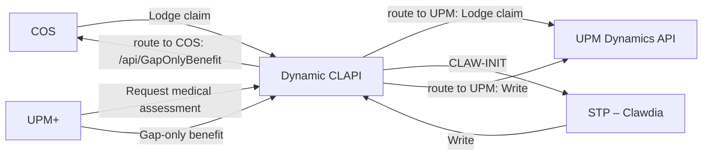

| ID | Counterpart | Direction | Interaction | Style | Interface |
|---|---|---|---|---|---|
| DCL-A1 | COS | Inbound | Lodge claim | Sync | **[TBC]** |
| DCL-A2 | UPM Dynamics API | Outbound | Lodge claim (routed to AU or Trupanion) | Sync | **[TBC]** |
| DCL-A3 | UPM+ → STP – Clawdia | Inbound → Outbound | CLAW-INIT | Sync REST | `POST api/Claims/CLAW-INIT-API` |
| DCL-A4 | STP – Clawdia → UPM Dynamics API | Inbound → Outbound | Write the assessment (routed) | Sync REST | `POST api/Claims/Write` |
| DCL-A5 | UPM+ → COS | Inbound → Outbound | Gap-only benefit (routed to COS) | Sync REST | `POST /api/GapOnlyBenefit` |

#### Integrations — to be

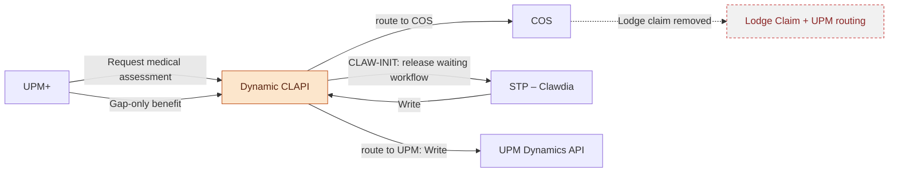

#### Behaviours

| ID | Type | Behaviour | Description |
|---|---|---|---|
| DCL-E-01 | Evolve | CLAW-INIT meaning | Same call from UPM; Clawdia now treats it as "release the result" rather than "start". The contract should not change **[TBC]**; the CRN or conversation id it carries must be enough to find the workflow (OQ-03). |
| DCL-D-01 | Decommission | *Lodge Claim* operation | COS lodges directly in the UPM Dynamics API. |
| DCL-D-02 | Decommission | UPM routing logic for lodgement | Replaced by the routing context and COS-I-03. The routing for *Write* stays. |

*Write* and *Gap-only benefit → route to COS* are unchanged; the duplicated service provider id on the gap-only route is still open (OQ-08).

#### Impact analysis

| ID | Interface | Data | Perf | Security | Resilience | Observability | Infra | Dependents | Description |
|---|---|---|---|---|---|---|---|---|---|
| DCL-E-01 | ◐ | ○ | ● | ○ | ◐ | ◐ | ○ | ● | UPM sees a much faster response from Clawdia; verify UPM's timeout and retry expectations. |
| DCL-D-01 | ● | ○ | ○ | ● | ○ | ○ | ◐ | ◐ | Remove only after COS-D-03; confirm no other callers (OQ-07). |
| DCL-D-02 | ○ | ○ | ○ | ○ | ○ | ○ | ○ | ◐ | Routing rules for lodgement now live in VetHub and COS. |

### 4.6 CLAPI (decommissioned)

#### Integrations — as is

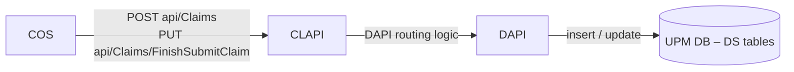

| ID | Counterpart | Direction | Interaction | Style | Interface |
|---|---|---|---|---|---|
| CLP-A1 | COS | Inbound | Claim submission | Sync REST | `POST api/Claims` |
| CLP-A2 | COS | Inbound | Finish claim submission | Sync REST | `PUT api/Claims/FinishSubmitClaim` |
| CLP-A3 | DAPI | Outbound | Submit / finish (routed to the correct DAPI) | Sync | **[TBC]** |

#### Integrations — to be

None: COS calls DAPI directly (COS-B3, COS-B4).

#### Behaviours

| ID | Type | Behaviour | Description |
|---|---|---|---|
| CLP-D-01 | Decommission | Claim Submission | `POST api/Claims` |
| CLP-D-02 | Decommission | Finish Claim Submission | `PUT api/Claims/FinishSubmitClaim` |
| CLP-D-03 | Decommission | DAPI routing logic | Replaced by the routing context and COS-I-03. |
| CLP-D-04 | Decommission | CLAPI deployment | Retire the component once no other consumers are confirmed (OQ-07). |

#### Impact analysis

| ID | Interface | Data | Perf | Security | Resilience | Observability | Infra | Dependents | Description |
|---|---|---|---|---|---|---|---|---|---|
| CLP-D-01 | ● | ○ | ● | ● | ○ | ○ | ○ | ◐ | Remove after COS-D-02 is live. |
| CLP-D-02 | ● | ○ | ● | ● | ○ | ○ | ○ | ◐ | As CLP-D-01. |
| CLP-D-03 | ○ | ○ | ○ | ○ | ○ | ○ | ○ | ◐ | Rules move to the routing context. |
| CLP-D-04 | ● | ○ | ○ | ● | ○ | ● | ● | ● | Remove hosting, secrets, monitors and pipelines; lower run cost. |

---

## 5. Components with no change

| Component | Why there is no change | Watch item |
|---|---|---|
| VPMS / GapOnly SDK | Same VetHub APIs and same outcome endpoint | — |
| Claim Automation | Called by COS exactly as today | — |
| ML environment | Same models and contracts | ◐ Calls move earlier and include abandoned conversations, so check capacity and cost |
| UPM+ (AU, Trupanion) | Same ingestion, checks, *Request medical assessment*, benefit calculation and payment | ◐ Clawdia answers faster after *Request medical assessment* |
| UPM Dynamics API | *Lodge Claim* and *Write* operations unchanged | ◐ New direct caller for *Lodge Claim*: COS instead of Dynamic CLAPI (access, network, contract) |
| DAPI (CSP.Au.DigitalApi) | *Submit* and *Finish* operations unchanged | ◐ New direct caller: COS instead of CLAPI (access, network, contract) |
| UPM DB (DS tables) and the 10-minute polling | Unchanged | Candidate for the next group of changes |

---

## 6. Open questions and next steps

| # | Open question | Affects |
|---|---|---|
| OQ-01 | Where exactly is the insurer routing context calculated, and from which inputs? (Placed after *Recognise claim type* in the model; the intent is "at the very beginning".) | VH-I-01, COS-I-03 |
| OQ-02 | Where does Clawdia load claim data from before the claim exists in UPM? | CLW-E-02 |
| OQ-03 | What identifier does CLAW-INIT carry? If it is the CRN only, EVT-I-05 (CRN correlation) is required. | EVT-I-05, CLW-I-04, DCL-E-01 |
| OQ-04 | What is COS's call into the Clawdia workflow for (refresh, CRN, readiness)? | COS-I-04, CLW-I-05 |
| OQ-05 | Who consumes *Insurer Routing Context Calculated*? | VH-I-03 |
| OQ-06 | How long does a Clawdia workflow wait, and what happens for abandoned conversations (expiry, ML cost)? | CLW-I-03, AP-12 |
| OQ-07 | Are there other consumers of CLAPI, Dynamic CLAPI *Lodge Claim*, or the VetHub endpoint COS polls? | CLP-D-04, DCL-D-01, VH-D-01 |
| OQ-08 | Duplicated service provider id: touched, not resolved. | COS-I-03, DCL gap-only route |
| OQ-09 | Deployment type and artefact are not modelled for most components. | §1.4, §1.5 |

**Next steps**

1. Team review of this document and the swimlane models, and alignment on the open questions.
2. Component architecture for the To-Be: event contracts (EVT-I-07), COS start-claim API, Clawdia correlation store.
3. Complete the deployment model (technology service and artefact per component; add Service Bus to the metamodel).
4. Discuss the next group of changes (DS-table polling, duplicated service provider id, the gap-only return path).
